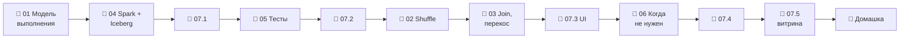

# Модуль 07 · Батч-обработка: Apache Spark

**Длительность:** ~2 нед. · **Статус и DoD:** см. [ROADMAP](../../ROADMAP.md)

## Бизнес-вопрос

> Когда данных становится слишком много для одной машины — как распределить обработку?

## Цели

- понимать модель выполнения Spark: driver, executors, jobs, stages, tasks, Spark Connect
- читать Spark UI и лечить shuffle и перекос
- писать в Iceberg атомарно, делать MERGE и обслуживать таблицы
- писать тестируемые трансформации (pytest + chispa)
- честно решать, когда Spark не нужен

## Темы

- driver/executors/workers, Spark Connect, lazy evaluation, jobs/stages/tasks, физический план
- партиции, shuffle, groupBy изнутри (частичная агрегация), AQE, repartition/coalesce, spill
- join изнутри: broadcast hash vs sort-merge vs shuffle hash; перекос и соль (Клеппман, гл. 10 и 6)
- Spark + Iceberg: каталог Lakekeeper, распределение записи, `createOrReplace`, MERGE, компактизация
- тестирование трансформаций: pytest + chispa
- когда Spark не нужен: DuckDB/Polars на одной машине, честный замер, ADR

## Инструменты

Apache Spark 4.1.3 (слой `spark.yaml`: master, 2 workers, Spark Connect), pyspark-client 4.1.3,
Iceberg 1.12, chispa 0.12, pytest

## Маршрут прохождения

Сначала урок, потом задачи лабы по нему. Статусы: ✅ сделано · 🟨 сейчас · ⬜ впереди.

| # | Шаг | Что | Статус |
|---|---|---|---|
| 1 | 📖 [01 · Как Spark выполняет запрос](theory/01_execution_model.md) · [карта](maps/execution-model.canvas) | урок | ⬜ |
| 2 | 📖 [04 · Spark и Iceberg](theory/04_spark_iceberg.md) · [карта](maps/spark-iceberg.canvas) | урок | ⬜ |
| 3 | 🧪 [Лаба 07.1 — кластер и Iceberg](labs/07.1_spark_cluster_and_iceberg/README.md) | сервисы, чтение bronze, запись silver | ⬜ |
| 4 | 📖 [05 · Тестирование трансформаций](theory/05_testing_transformations.md) · [карта](maps/testing-transformations.canvas) | урок | ⬜ |
| 5 | 🧪 [Лаба 07.2 — трансформации через тесты](labs/07.2_transformations_with_tests/README.md) | почасовой вид, метрики OOS | ⬜ |
| 6 | 📖 [02 · Партиции и shuffle](theory/02_partitions_shuffle.md) · [карта](maps/partitions-shuffle.canvas) | урок | ⬜ |
| 7 | 📖 [03 · Соединения и перекос](theory/03_joins_and_skew.md) · [карта](maps/joins-skew.canvas) | урок | ⬜ |
| 8 | 🧪 [Лаба 07.3 — Spark UI](labs/07.3_spark_ui_shuffle_skew/README.md) | предсказать план, перекос | ⬜ |
| 9 | 📖 [06 · Когда Spark не нужен](theory/06_when_not_spark.md) · [карта](maps/when-not-spark.canvas) | урок | ⬜ |
| 10 | 🧪 [Лаба 07.4 — три движка](labs/07.4_one_task_three_engines/README.md) | 116 млн и ×10, ADR | ⬜ |
| 11 | 🧪 [Лаба 07.5 — мини-проект](labs/07.5_spark_mini_project/README.md) | восстановленный спрос | ⬜ |
| 12 | 🏁 [Домашка-чекпоинт](homework.md) | 7 вопросов и одно предсказание | ⬜ |

> [!note] Учебный проект и инфраструктура модуля (2026-10-02)
> - Слой `infra/docker/spark.yaml`: `make up PROFILES="spark"` (первый раз собирается образ
>   `debd/spark:4.1.3`). UI кластера — <http://localhost:8090>, UI приложения — <http://localhost:4040>.
>   Кластер занимает ~5,5 ГБ памяти — останавливай, когда не нужен:
>   `docker compose --env-file .env -f infra/docker/compose.yaml stop spark-connect spark-worker-1 spark-worker-2 spark-master`.
> - Клиент — workspace: `pyspark-client` (группа `spark`), подключение
>   `SparkSession.builder.remote("sc://spark-connect:15002").getOrCreate()`.
> - [`demo/`](demo/) — `spark_demo/session.py` (`get_spark`, `StageReport` — стадии блока кода из
>   REST API UI), `spark_demo/weather.py` и `tests/` (pytest + chispa), `bench_hourly.py` (замер
>   трёх движков). Это не capstone и не ответы к лабам.
> - Песочница уроков — namespace `lh.sandbox_spark`; очистка — в конце урока 04.

## Чек-лист самоконтроля

Отмечай пункт, только когда можешь сделать это **без подсказки**. Подробные чек-листы — в начале
каждого урока.

**Модель** ([01](theory/01_execution_model.md), [02](theory/02_partitions_shuffle.md))
- [ ] Называю роли driver, executor, worker, менеджера кластера и Spark Connect у нас
- [ ] Предсказываю стадии и число задач запроса, нахожу их в UI
- [ ] Объясняю частичную агрегацию и что AQE делает с партициями

**Соединения и производительность** ([03](theory/03_joins_and_skew.md), [06](theory/06_when_not_spark.md))
- [ ] Предсказываю алгоритм соединения и проверяю итоговый план
- [ ] Нахожу перекос по метрикам и устраняю его
- [ ] Честно сравниваю движки и записываю решение как ADR

**Iceberg и качество кода** ([04](theory/04_spark_iceberg.md), [05](theory/05_testing_transformations.md))
- [ ] Атомарно публикую таблицу, делаю MERGE, уплотняю мелкие файлы
- [ ] Пишу трансформации чистыми функциями и тестирую их chispa

**Закрытие модуля**
- [ ] Лабы 07.1–07.5 выполнены по Definition of Done
- [ ] [Домашка](homework.md) сдана, ошибки разобраны
- [ ] Тезисы по Клеппману (гл. 10, гл. 6) — в [`notes.md`](notes.md)

## Материалы модуля

| Что | Где |
|---|---|
| 🧠 Карточки для повторения | [flashcards.md](flashcards.md) |
| 🗺️ Карты | [maps/](maps/) |
| 📚 Термины | [glossary/](../../glossary/README.md) — раздел «Батч-обработка (Spark)» |
| 🧪 Учебный проект | [demo/](demo/) |
| 🎬 Визуализации | [выполнение, shuffle и перекос: страница](visuals/shuffle_skew.html) · [видео](visuals/shuffle_skew.mp4) · [Iceberg изнутри: видео](../03_storage_and_lakehouse/visuals/iceberg_internals.mp4) · [Модель выполнения: видео](visuals/execution_model.mp4) |
| 📓 Заметки | [notes.md](notes.md) |

## Мини-проект (вклад в capstone)

Витрина «восстановленный спрос при out-of-stock» на Spark в Iceberg `gold` (лаба 07.5).

## Ресурсы

- [Spark docs](https://spark.apache.org/docs/latest/) · [Spark Connect](https://spark.apache.org/docs/latest/spark-connect-overview.html) · [AQE и тюнинг](https://spark.apache.org/docs/latest/sql-performance-tuning.html) · [Web UI](https://spark.apache.org/docs/latest/web-ui.html)
- [Iceberg + Spark](https://iceberg.apache.org/docs/latest/spark-getting-started/) · [процедуры](https://iceberg.apache.org/docs/latest/spark-procedures/) · [запись](https://iceberg.apache.org/docs/latest/spark-writes/)
- [chispa](https://github.com/MrPowers/chispa)
- [Data-Learn: модуль 7 — Apache Spark](https://github.com/Data-Learn/data-engineering/blob/master/DE-101%20Modules/Module07/readme.md)
- [Surfalytics: Spark transformations with tests](https://github.com/surfalytics/data-projects/tree/main/de-projects/10_spark_transformations_with_tests_framework)

## Книга и видео

Полная таблица с пояснениями, зачем читать и что пропустить — в [карте чтения](../../reading_map.md#07--батч-обработка-spark).

- 📖 Клеппман, гл. 10 целиком — пакетная обработка и алгоритмы соединений (уроки 02–03)
- 📖 Клеппман, гл. 6 — перекосы и горячие ключи (урок 03)
- 🎬 [Zoomcamp `06-batch`](https://github.com/DataTalksClub/data-engineering-zoomcamp/tree/main/06-batch) — анатомия кластера, GroupBy и Join изнутри

## Домашка-чекпоинт

После всех лаб — [`homework.md`](homework.md).

## Заметки

Конспект, тезисы по книге и выводы — в [`notes.md`](notes.md).
