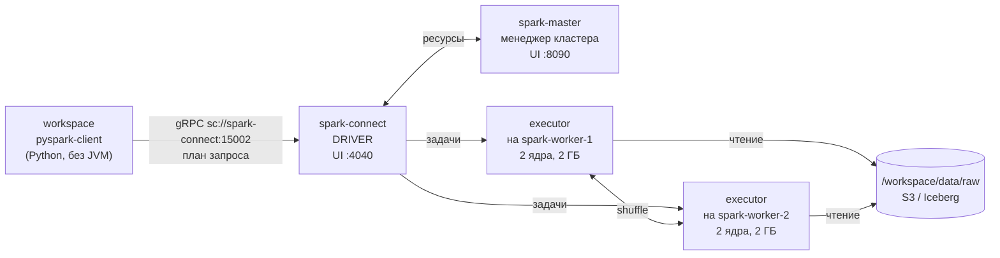
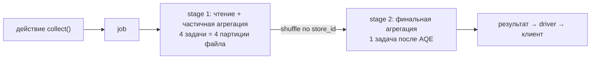
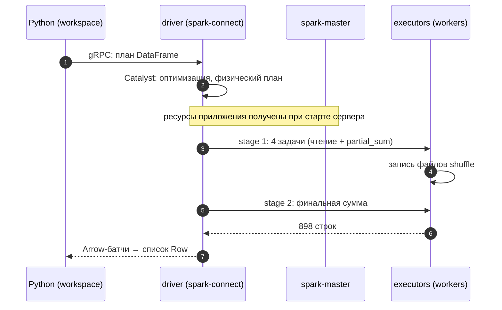

# 01 · Как Spark выполняет запрос: driver, executors, jobs, stages, tasks

> [!info] Урок одной фразой
> Spark — бригада на стройке: прораб (driver) читает чертёж (план запроса), режет работу на
> участки (партиции) и раздаёт задания рабочим (executors) на нескольких площадках (workers).
> Пока заказчик только рисует чертёж, никто не работает (ленивое выполнение); работа начинается,
> когда он просит результат (действие). Spark Connect — окно прорабской: заказчик передаёт
> чертёж в окно, а сама бригада ему не нужна у себя дома.

> [!todo] Чек-лист: после урока ты сможешь
> - [ ] назвать роли driver, executor, worker и менеджера кластера и показать их в нашем стеке;
> - [ ] объяснить, что делает Spark Connect и почему в workspace нет Java;
> - [ ] отличить трансформацию от действия и предсказать, когда начнётся вычисление;
> - [ ] разложить запрос на job → stages → tasks и найти их в Spark UI;
> - [ ] объяснить, откуда берётся число задач при чтении Parquet;
> - [ ] прочитать физический план `explain()` в первом приближении.

> [!tip] Визуализация темы
> - Интерактивная страница [shuffle_skew.html](../visuals/shuffle_skew.html), часть 0: выполняй строки
>   по одной и смотри, как трансформации строят план, а действие запускает job, стадии и задачи.
> - Видео с озвучкой (3:11): [execution_model.mp4](../visuals/execution_model.mp4) — driver и executors, Spark Connect, ленивые вычисления, job → stage → task, число задач при чтении, физический план.

**Нужно для:** лаб [07.1](../labs/07.1_spark_cluster_and_iceberg/README.md),
[07.3](../labs/07.3_spark_ui_shuffle_skew/README.md).
**Карта урока:** [execution-model.canvas](../maps/execution-model.canvas).

---

## Шаг 0. Азбука: стройка

| В Spark | В аналогии «стройка» | Подробнее |
|---|---|---|
| Driver | Прораб: план, разбивка, раздача, сбор результата | [Spark](../../../glossary/spark.md) |
| Executor | Рабочий: выполняет задания, держит промежуточные данные | [Spark](../../../glossary/spark.md) |
| Worker | Площадка, на которой живут рабочие | [Spark](../../../glossary/spark.md) |
| Cluster manager (master) | Отдел кадров: кому сколько рабочих | [Spark](../../../glossary/spark.md) |
| Партиция | Участок работы | [партиция Spark](../../../glossary/spark-partition.md) |
| Трансформация / действие | Чертёж / «сдать объект» | [ленивые вычисления](../../../glossary/lazy-evaluation.md) |
| Job → stage → task | Объект → этап → задание одному рабочему | [job, stage, task](../../../glossary/spark-job-stage-task.md) |
| Spark Connect | Окно прорабской: чертежи принимают снаружи | [Spark Connect](../../../glossary/spark-connect.md) |

Подними кластер (первый раз собирается образ, ~2 мин):

```bash
make up PROFILES="spark"
make ps | grep spark          # master, 2 workers, connect — Up; connect и master — healthy
```

UI менеджера кластера — <http://localhost:8090>, UI приложения (jobs, stages, SQL) —
<http://localhost:4040>.

---

## Шаг 1. Зачем распределять и кто что делает

**Проблема.** В модуле 04 DuckDB считал агрегат по 4,5 млн строк за доли секунды на одной
машине. Но у одной машины есть потолок: память, диск, ядра. Когда данных в сотни раз больше или
их нужно перемешать по ключу (соединить две большие таблицы), одна машина перестаёт справляться.
Spark делит работу на куски и выполняет их на многих машинах параллельно.

**Как устроено.** Приложение Spark — это **driver** и набор **executors**:

- **Driver** — процесс, который строит план запроса, делит его на задачи, раздаёт их executors,
  следит за выполнением и собирает результат. Данные он обычно не обрабатывает.
- **Executor** — процесс JVM на рабочей машине. Выполняет задачи, по одной на ядро, держит в
  памяти промежуточные данные и пишет файлы shuffle (урок 02).
- **Worker** — машина (у нас контейнер), на которой запускаются executors.
- **Cluster manager** — выдаёт приложению ресурсы: сколько executors, ядер и памяти. У нас —
  встроенный менеджер Spark standalone (`spark-master`); в продакшене чаще Kubernetes или YARN.



**У нас.** Слой `infra/docker/spark.yaml`:

| Сервис | Роль | Ресурсы |
|---|---|---|
| `spark-master` | менеджер кластера standalone | — |
| `spark-worker-1`, `spark-worker-2` | workers | по 2 ядра, 3 ГБ |
| `spark-connect` | **driver** долгоживущего приложения Spark Connect | 2 ГБ |

Настройки приложения — в `infra/docker/spark/spark-defaults.conf`: по одному executor на worker,
2 ядра и 2 ГБ на executor, всего 4 ядра. Значит, одновременно выполняются **4 задачи**.

**Что из этого следует.** Параллелизм ограничен числом ядер executors, а не числом машин: на
нашем кластере больше 4 задач одновременно не пойдёт, остальные ждут в очереди.

---

## Шаг 2. Spark Connect: почему в workspace нет Java

**Проблема.** Классический PySpark запускает driver **внутри твоего Python-процесса**. Для этого в
workspace нужны Java и все JAR-файлы Spark и Iceberg, а версии должны совпадать с кластером.
Кроме того, driver делит память с твоим ноутбуком Jupyter.

**Как устроено.** **Spark Connect** (с Spark 3.4, основной путь в Spark 4) разделяет клиента и
driver. Клиент — тонкая библиотека `pyspark-client` на чистом Python: она строит **план**
(дерево операций DataFrame), сериализует его и отправляет по gRPC серверу Spark Connect. Сервер —
и есть driver: он оптимизирует план, запускает задачи и возвращает результат клиенту в формате
Arrow.

```python
from pyspark.sql import SparkSession
spark = SparkSession.builder.remote("sc://spark-connect:15002").getOrCreate()
```

**Что из этого следует.**

- В workspace стоит только `pyspark-client` 4.1.3 (группа `spark` в `pyproject.toml`). Каталог
  Iceberg, JAR-файлы и ресурсы настраиваются на сервере.
- Driver один на всех клиентов и живёт долго — поэтому UI на <http://localhost:4040> не
  исчезает после твоего скрипта, и разбирать задания можно потом.
- Нет RDD API и `spark.sparkContext`: в Spark Connect доступны только DataFrame и SQL. Для курса
  этого достаточно.
- **Python UDF** (свои Python-функции) выполняются на executors, и минорная версия Python там
  должна совпадать с клиентом. В официальном образе Spark — Python 3.10, у нас в workspace — 3.12,
  поэтому в образ Spark добавлен Python 3.12 (`PYSPARK_PYTHON`).

> [!example]- Попробуй сам: подключиться и увидеть приложение
> ```bash
> make shell
> cd modules/07_batch_spark/demo
> python -c "from spark_demo.session import get_spark; s = get_spark(); print(s.version, s.conf.get('spark.executor.cores'), s.conf.get('spark.cores.max'))"
> exit
> ```
> Открой <http://localhost:8090>.
> **Увидишь:** `4.1.3 2 4`; в UI менеджера — 2 workers (`ALIVE`, по 2 ядра) и одно запущенное
> приложение `Spark Connect server` с 4 ядрами.
> **Почему:** приложение — это сервер Spark Connect; он занял все 4 ядра кластера, а твой
> Python-процесс — только клиент.

---

## Шаг 3. Ленивые вычисления: трансформации и действия

**Проблема.** Если бы каждая строка кода DataFrame выполнялась сразу, Spark не смог бы
оптимизировать запрос целиком: например, выбросить ненужные колонки ещё при чтении файла.

**Как устроено.** Операции делятся на два вида:

- **Трансформации** (`select`, `where`, `groupBy().agg()`, `join`, `withColumn`) возвращают
  новый DataFrame — описание вычисления. **Ничего не считается**: Spark только дописывает узел в
  логический план.
- **Действия** (`count`, `collect`, `show`, `first`, `write…`) требуют результат. Только тогда
  Spark оптимизирует весь план (оптимизатор Catalyst: проталкивание фильтров, отбрасывание
  колонок, выбор алгоритма соединения) и запускает **job**.

**Что из этого следует.** Ошибка в имени колонки в Spark Connect всплывает на действии или на
`explain`/`schema`. Это момент, когда план впервые уходит на сервер, а не строка, где ты её
написал. Каждый вызов действия по одному и тому же DataFrame **пересчитывает** его с начала,
если явно не закэшировать.

> [!example]- Попробуй сам: план без вычислений
> ```bash
> make shell
> cd modules/07_batch_spark/demo
> python - <<'EOF' 2>/dev/null
> from pyspark.sql import functions as F
> from spark_demo.session import get_spark, StageReport
> spark = get_spark()
> with StageReport("только трансформации"):
>     df = spark.read.parquet("/workspace/data/raw/freshretailnet_50k/data/train.parquet")
>     agg = df.where("dt = '2024-04-01'").groupBy("store_id").agg(F.sum("sale_amount"))
> with StageReport("действие count"):
>     print(agg.count())
> EOF
> exit
> ```
> **Увидишь:** у трансформаций — `стадий 0`. У действия — `898` и несколько стадий: одна
> читает файл в 4 задачи (`прочитано строк 4,500,000`), следующие собирают результат.
> **Почему:** пока не вызвано действие, Spark только строит план. «Прочитано 4,5 млн» при фильтре
> на один день значит: фильтр `dt` не отбросил строки при чтении. В файле датасета колонка `dt`
> — строка, и статистики не дают пропустить группы строк (модуль 03).

---

## Шаг 4. Job, stage, task

**Проблема.** Как именно действие превращается в работу executors и где смотреть, что пошло не
так?

**Как устроено.**

- **Job** — одно действие (или его часть). У запроса с адаптивным выполнением (AQE, урок 02)
  может быть несколько jobs.
- **Stage** — участок плана, который можно выполнить **без перемешивания данных** между
  executors. Граница стадии — **shuffle** (урок 02): например, `groupBy` по ключу требует
  собрать все строки ключа в одном месте.
- **Task** — выполнение одной стадии над **одной партицией** данных на одном ядре. Число задач
  стадии = число партиций на её входе.



**Сколько задач при чтении Parquet.** Spark режет файлы на куски размером
`min(spark.sql.files.maxPartitionBytes, max(openCostInBytes, размер_данных / ядра))`.
`train.parquet` — 106 МБ, `maxPartitionBytes` — 128 МБ, ядер 4: кусок ≈ 27 МБ → **4 партиции**,
по одной на ядро. Куски не могут быть мельче группы строк Parquet.

**Что из этого следует.** Если задач меньше, чем ядер, часть ядер простаивает. Если одна задача
идёт намного дольше остальных — это перекос данных (урок 03), и его видно на странице стадии:
медиана и максимум времени задачи.

> [!example]- Попробуй сам: стадии groupBy в UI
> ```bash
> make shell
> cd modules/07_batch_spark/demo
> python - <<'EOF' 2>/dev/null
> from pyspark.sql import functions as F
> from spark_demo.session import get_spark, StageReport
> spark = get_spark()
> df = spark.read.parquet("/workspace/data/raw/freshretailnet_50k/data/train.parquet")
> with StageReport("groupBy по магазинам"):
>     print(len(df.groupBy("store_id").agg(F.sum("sale_amount")).collect()))
> EOF
> exit
> ```
> Открой <http://localhost:4040> → **Jobs** → последний job → его стадии.
> **Увидишь:** `898`. Стадия на 4 задачи: `прочитано строк 4,500,000`, запись shuffle около
> 38 КБ (около 900 строк). Стадия на 1 задачу: чтение shuffle 38 КБ.
> **Почему:** первая стадия читает файл четырьмя задачами и заранее суммирует по магазину внутри
> каждой задачи. По сети уходят ≈ 4 × 898 частичных сумм, а не 4,5 млн строк (урок 02). Вторая
> стадия складывает частичные суммы.

---

## Шаг 5. Физический план: что Spark собирается делать

**Проблема.** UI показывает, что **было**. До запуска полезно увидеть, что **будет**: какие
колонки прочитаются, где будет shuffle, какой алгоритм соединения выбран.

**Как устроено.** `df.explain()` печатает **физический план** — дерево операторов, которое
читают **снизу вверх**:

```
AdaptiveSparkPlan isFinalPlan=false                                  ⑤
+- HashAggregate(keys=[store_id], functions=[sum(sale_amount)])      ④ финальная сумма
   +- Exchange hashpartitioning(store_id, 200)                       ③ shuffle → граница стадии
      +- HashAggregate(keys=[store_id], functions=[partial_sum(sale_amount)])  ② частичная
         +- FileScan parquet [store_id, sale_amount] … ReadSchema: struct<store_id:bigint,sale_amount:double>  ①
```

| Метка | Что важно |
|---|---|
| ① | читаются **только две колонки** из 19 — колоночный формат и отбрасывание колонок (модуль 03) |
| ② | `partial_sum` — сумма внутри каждой задачи до shuffle |
| ③ | `Exchange` = shuffle; 200 — `spark.sql.shuffle.partitions` по умолчанию |
| ④ | финальная сумма по частичным |
| ⑤ | `isFinalPlan=false`: AQE может поменять план во время выполнения (урок 02). Итоговый — в UI → SQL / DataFrame |

> [!warning] Ловушка: `explain()` после запуска
> Смотри итоговый план в UI: вкладка **SQL / DataFrame** → запрос → план с `isFinalPlan=true`.
> В Spark Connect `explain()` всегда показывает план **до** выполнения. Что AQE сделал на самом
> деле, видно только в UI: сколько партиций после shuffle, перешёл ли на broadcast join.

---

## Сборка целиком

Что происходит при `agg.collect()` из workspace:



| Шаг | Если сломается | Симптом |
|---|---|---|
| 1 | `spark-connect` не поднят | `Connection refused` / `UNAVAILABLE` у клиента |
| 2 | ошибка в имени колонки | `AnalysisException` / `[UNRESOLVED_COLUMN]` на действии |
| 4 | у executors нет файла по пути | `FileNotFoundException`: путь есть у тебя, но не на workers |
| 4 | executors не хватает памяти | spill на диск, затем `OutOfMemoryError`, задача перезапускается |
| 7 | `collect()` огромного результата | падает driver или клиент — результат не помещается в память |

## Шпаргалка

| Хочу | Как |
|---|---|
| Поднять кластер | `make up PROFILES="spark"`; UI 8090 (кластер), 4040 (приложение) |
| Сессия | `get_spark()` из `spark_demo.session` или `SparkSession.builder.remote("sc://spark-connect:15002").getOrCreate()` |
| План | `df.explain()`; подробно — `df.explain("formatted")` |
| Стадии и задачи запроса | `with StageReport("…"):` или UI → Jobs / Stages |
| Итоговый план после AQE | UI → SQL / DataFrame → запрос |
| Настройка сессии | `spark.conf.set("ключ", "значение")`, сброс — `spark.conf.unset("ключ")` |

## Типичные ошибки

| Симптом | Причина | Как проверить | Как чинить |
|---|---|---|---|
| `Invalid UID, could not determine effective user` | у UID нет записи в `/etc/passwd` в контейнере Spark | `id` в контейнере | пользователь с UID хоста в образе (так сделано) |
| `basedir must be absolute: ?/.ivy2…` | `user.home` неизвестен Java | лог `spark-connect` | домашняя папка у пользователя |
| Ошибка про колонку только на `collect()` | ленивое выполнение | — | проверять `df.schema` / `explain()` раньше |
| Задач меньше, чем ядер | мелкий вход, мало партиций | число задач стадии чтения | `repartition`, но только если стадия дальше тяжёлая |
| `Python worker … version` / UDF падает | разный Python на клиенте и executors | `python3.12` на workers | одинаковая минорная версия (`PYSPARK_PYTHON`) |
| Скрипт «повис» на `collect()` | огромный результат тянется в Python | размер результата | агрегировать или писать в таблицу, а не `collect` |

## Проверь себя

Карточки — в [flashcards.md](../flashcards.md).

> [!question] 1. В кластере 3 workers по 8 ядер, приложению выдано 2 executors по 4 ядра. Сколько задач выполняется одновременно?
> > [!success]- Ответ
> > 8: параллелизм определяют ядра executors приложения, а не ядра машин.

> [!question] 2. Ты написал 10 строк трансформаций и одну `count()`. Сколько раз Spark читал файл?
> > [!success]- Ответ
> > Один раз — на `count()`. Трансформации только строили план. Если вызвать `count()` второй раз,
> > файл прочитается снова (без кэша).

> [!question] 3. Почему между стадиями groupBy по магазинам ушло 38 КБ, а не 4,5 млн строк?
> > [!success]- Ответ
> > Частичная агрегация: каждая из 4 задач сначала суммирует свои строки по магазину, и по сети
> > уходят частичные суммы — около 900 строк.

> [!question] 4. Чем Spark Connect отличается от классического PySpark для нашего workspace?
> > [!success]- Ответ
> > Driver живёт на сервере `spark-connect`, а в workspace только тонкий клиент без JVM: план
> > отправляется по gRPC, результат приходит в Arrow. Нет RDD API, UI приложения живёт долго,
> > Python UDF требуют одинаковой версии Python на клиенте и executors.
