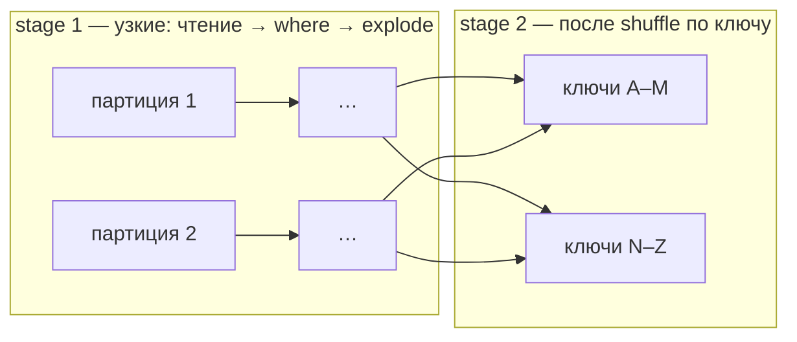
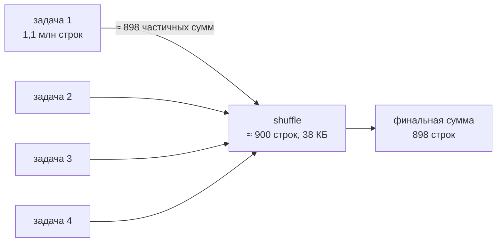
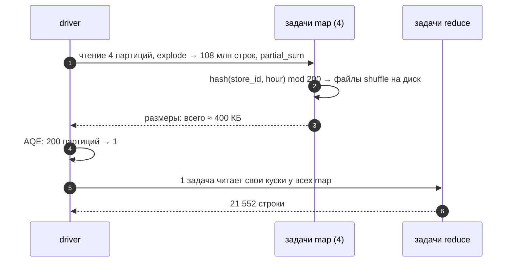

# 02 · Партиции и shuffle: почему groupBy дешёвый, а repartition — нет

> [!info] Урок одной фразой
> Пока каждый рабочий работает со своим участком, стройка идёт быстро: никто никого не ждёт. Но
> если надо собрать вместе все кирпичи одного цвета, их приходится развезти между площадками —
> это shuffle, самая дорогая часть работы. Хорошая бригада сначала считает кирпичи у себя
> (частичная агрегация) и возит только итоги, а прораб на ходу объединяет полупустые грузовики
> (AQE).

> [!todo] Чек-лист: после урока ты сможешь
> - [ ] отличить узкую трансформацию от широкой и найти в плане границу стадии;
> - [ ] объяснить механику shuffle: запись файлов на стороне map, чтение на стороне reduce;
> - [ ] объяснить двухфазную агрегацию groupBy и предсказать объём shuffle;
> - [ ] объяснить, откуда 200 партиций после shuffle и что с ними делает AQE;
> - [ ] выбрать между `repartition` и `coalesce` и объяснить spill на диск.

**Нужно для:** лаба [07.3](../labs/07.3_spark_ui_shuffle_skew/README.md).
**Карта урока:** [partitions-shuffle.canvas](../maps/partitions-shuffle.canvas).

---

## Шаг 0. Азбука

| В Spark | В аналогии | Подробнее |
|---|---|---|
| Партиция | Участок одного рабочего | [партиция Spark](../../../glossary/spark-partition.md) |
| Узкая трансформация | Работа внутри участка | [shuffle](../../../glossary/shuffle.md) |
| Широкая трансформация, shuffle | Развезти кирпичи по цветам между площадками | [shuffle](../../../glossary/shuffle.md) |
| Частичная агрегация | Посчитать кирпичи у себя, отвезти только итоги | [shuffle](../../../glossary/shuffle.md) |
| AQE | Прораб на ходу перекраивает план по фактическим объёмам | [AQE](../../../glossary/aqe.md) |
| Spill | Кирпичи не влезли на склад — часть сложили во двор (диск) | [shuffle](../../../glossary/shuffle.md) |

---

## Шаг 1. Узкие и широкие трансформации

**Проблема.** Почему один запрос выполняется одной стадией, а другой — тремя?

**Как устроено.** Всё решает вопрос: **нужны ли задаче строки из чужих партиций?**

- **Узкая** трансформация (`select`, `where`, `withColumn`, `explode`) обрабатывает каждую
  строку или каждую партицию независимо. Задача берёт свою партицию и выдаёт результат, ни с кем
  не обмениваясь. Цепочку узких трансформаций Spark склеивает в одну стадию (pipelining) и
  проходит данные один раз.
- **Широкая** трансформация (`groupBy`, `join`, `distinct`, `orderBy`, `repartition`) требует
  собрать вместе все строки одного ключа, а они разбросаны по всем партициям входа. Нужен
  **shuffle** — перераспределение данных по ключу. Shuffle — всегда граница стадии.



**Что из этого следует.** Число стадий = число shuffle + 1. Почасовой `explode` из 4,5 млн строк
делает 108 млн строк, но это узкая операция: он не добавляет стадий и не гоняет данные по сети.

---

## Шаг 2. Как устроен shuffle

**Проблема.** «Перераспределить по ключу» — что физически происходит?

**Как устроено.** Это та же схема, что у MapReduce (Клеппман, гл. 10):

1. **Сторона map** (задачи стадии до shuffle). Каждая задача для каждой своей строки вычисляет
   номер партиции назначения: `hash(ключ) mod N`, где N — число партиций после shuffle. Строки
   сортируются по номеру партиции и пишутся в **локальный файл shuffle** на диск executor.
2. Стадия до shuffle должна **полностью закончиться**: строки любого ключа могут быть в любой
   задаче.
3. **Сторона reduce** (задачи следующей стадии). Задача номер k забирает **по сети** свой кусок
   из файлов shuffle **всех** задач map и работает с ним.

Отсюда цена shuffle: запись на диск, передача по сети, чтение, сериализация — и барьер: следующая
стадия не начнётся, пока не закончится самая медленная задача предыдущей.

**Что из этого следует.** Метрики стадии в UI — **Shuffle Write** (сколько записали задачи map)
и **Shuffle Read** (сколько забрали задачи reduce). Это главные числа при разборе медленного
запроса.

---

## Шаг 3. groupBy изнутри: частичная агрегация

**Проблема.** groupBy по магазину над 4,5 млн строк. Если отправить в shuffle все строки, по сети
пойдут все 4,5 млн — а нужно-то 898 сумм.

**Как устроено.** Для агрегатов, которые можно считать по частям (`sum`, `count`, `min`, `max`,
`avg` как сумма + количество), Spark делает **двухфазную агрегацию**:

1. **Частичная** (`partial_sum` в плане): до shuffle, внутри каждой задачи — хеш-таблица
   «магазин → сумма» по своей партиции.
2. Shuffle **частичных результатов** по ключу.
3. **Финальная**: задача reduce складывает частичные суммы своих ключей.



Это **комбайнер** MapReduce. В Spark он работает автоматически, когда функции агрегации это
позволяют. Функции, которые нельзя посчитать частями «в лоб» (`collect_list`, точная медиана),
тащат через shuffle все строки.

> [!example]- Попробуй сам: сколько идёт через shuffle
> ```bash
> make shell
> cd modules/07_batch_spark/demo
> python - <<'EOF' 2>/dev/null
> from pyspark.sql import functions as F
> from spark_demo.session import get_spark, StageReport
> spark = get_spark()
> df = spark.read.parquet("/workspace/data/raw/freshretailnet_50k/data/train.parquet")
> with StageReport("groupBy — частичная агрегация"):
>     df.groupBy("store_id").agg(F.sum("sale_amount")).collect()
> with StageReport("repartition — все строки через shuffle"):
>     df.repartition(8, "store_id").count()
> hourly = df.select("store_id", F.posexplode("hours_sale").alias("hour", "qty"))
> with StageReport("108 млн почасовых строк → магазин × час"):
>     print(len(hourly.groupBy("store_id", "hour").agg(F.sum("qty")).collect()))
> EOF
> exit
> ```
> **Увидишь:** у groupBy shuffle-запись ≈ 38 КБ (≈ 900 строк). У `repartition` —
> `4,500,000 строк` через shuffle (≈ 475 КБ: уходит одна колонка, остальные отброшены — для
> `count` они не нужны). У почасового запроса — `21552` и shuffle ≈ 400 КБ (≈ 21 600 строк) при
> 108 млн строк после `explode`; около секунды.
> **Почему:** частичная агрегация сжимает данные до shuffle, а `repartition` перемещает каждую
> строку — для этого он и нужен.

---

## Шаг 4. 200 партиций после shuffle и AQE

**Проблема.** Сколько партиций (и задач) будет после shuffle? Слишком мало — задачи огромные,
не помещаются в память и не используют все ядра. Слишком много — тысячи крошечных задач, и
накладные расходы на их запуск больше самой работы.

**Как устроено.** Число партиций после shuffle задаёт `spark.sql.shuffle.partitions`, по
умолчанию **200** — независимо от объёма данных. Для 38 КБ это абсурдно: 200 задач по 190 байт.

**AQE** (Adaptive Query Execution, включено по умолчанию) пересматривает план **во время
выполнения**, когда стадия до shuffle закончилась и известны реальные размеры:

- **объединяет мелкие партиции** после shuffle до целевого размера
  (`spark.sql.adaptive.advisoryPartitionSizeInBytes`, 64 МБ): 200 партиций по 190 байт → 1;
- **меняет алгоритм соединения** на broadcast, если одна сторона оказалась маленькой (урок 03);
- **делит перекошенные партиции** в соединениях (урок 03).

**Что из этого следует.** Задавать `shuffle.partitions` руками нужно редко: AQE подгоняет его
под данные. Но AQE только **уменьшает** число партиций, поэтому для огромных данных начальное
значение 200 может оказаться мало — тогда его поднимают.

> [!example]- Попробуй сам: AQE выключен и включён
> ```bash
> make shell
> cd modules/07_batch_spark/demo
> python - <<'EOF' 2>/dev/null
> from pyspark.sql import functions as F
> from spark_demo.session import get_spark, StageReport
> spark = get_spark()
> df = spark.read.parquet("/workspace/data/raw/freshretailnet_50k/data/train.parquet")
> spark.conf.set("spark.sql.adaptive.enabled", "false")
> with StageReport("AQE выключен"):
>     df.groupBy("store_id").agg(F.sum("sale_amount")).collect()
> spark.conf.unset("spark.sql.adaptive.enabled")
> with StageReport("AQE включён"):
>     df.groupBy("store_id").agg(F.sum("sale_amount")).collect()
> EOF
> exit
> ```
> **Увидишь:** без AQE вторая стадия — `задач 200`; с AQE — `задач 1`. Время почти одинаковое
> (данных мало), но на больших объёмах 200 пустых задач — заметные секунды.
> **Почему:** AQE увидел, что после shuffle всего 38 КБ, и объединил 200 партиций в одну.

---

## Шаг 5. repartition, coalesce и spill

**Проблема.** Иногда число партиций надо поменять руками: перед записью (чтобы не плодить
мелкие файлы), перед тяжёлой стадией (чтобы загрузить все ядра). Какой инструмент выбрать?

**Как устроено.**

| Операция | Что делает | Shuffle | Когда |
|---|---|---|---|
| `repartition(n)` | равномерно перераспределяет строки по n партициям | да, все строки | нужно больше партиций или равномерность |
| `repartition(n, "ключ")` | по хешу ключа: строки ключа — в одной партиции | да | подготовить запись по ключу, соединения по ключу |
| `coalesce(n)` | склеивает соседние партиции, n меньше текущего | нет | уменьшить число выходных файлов дёшево |

**Spill.** Задаче для агрегации, сортировки или соединения нужна память executor. Если данные
партиции не помещаются, Spark **сбрасывает** часть на диск (spill) и потом сливает. Это не
ошибка, но медленно: метрика **Spill (Disk)** в UI. Spill растёт, когда партиций слишком мало
или одна партиция огромная из-за перекоса (урок 03).

**Что из этого следует.** `coalesce(1)` перед записью кажется удобным («один файл»), но сводит
всю последнюю стадию в **одну задачу** на одном ядре — для больших данных это медленно и
рискованно по памяти. Для записи в Iceberg число файлов лучше регулировать распределением записи
и компактизацией (урок 04).

> [!warning] Ловушка: «добавлю repartition, чтобы было быстрее»
> `repartition` — это лишний shuffle всех строк. Он ускоряет только если следующая стадия
> тяжёлая и страдает от малого числа или неравномерности партиций. Перед простым `count` или
> агрегатом он только добавляет стадию.

---

## Сборка целиком

Почасовая агрегация магазин × час с AQE:



| Шаг | Если сломается | Симптом |
|---|---|---|
| 1 | агрегат не делится на части | shuffle = все строки, долго, spill |
| 2 | мало места на диске executor | `No space left on device` |
| 4 | AQE выключен | 200 задач по несколько байт |
| 5 | одна партиция огромная | одна задача идёт дольше всех, spill (урок 03) |

## Шпаргалка

| Хочу | Как |
|---|---|
| Увидеть границы стадий | `explain()`: каждый `Exchange` — shuffle |
| Объём shuffle | `StageReport` или UI → Stages: Shuffle Read / Write |
| Число партиций DataFrame | `df.select(F.spark_partition_id()).distinct().count()` |
| Партиций после shuffle | `spark.sql.shuffle.partitions` (200), AQE объединяет |
| Целевой размер партиции AQE | `spark.sql.adaptive.advisoryPartitionSizeInBytes` (64 МБ) |
| Больше партиций / по ключу | `repartition(n)` / `repartition(n, "ключ")` — с shuffle |
| Меньше партиций без shuffle | `coalesce(n)` |

## Типичные ошибки

| Симптом | Причина | Как проверить | Как чинить |
|---|---|---|---|
| 200 крошечных задач | AQE выключен | `spark.sql.adaptive.enabled` | включить AQE |
| Большой spill, долгие задачи | мало партиций или огромные строки | Spill (Disk) в стадии | больше партиций, меньше колонок до shuffle |
| Shuffle = весь датасет при groupBy | агрегат без частичной фазы (`collect_list`) | план: нет `partial_` | другой агрегат или уменьшить вход до shuffle |
| Лишняя стадия, запрос медленнее | ненужный `repartition` | `Exchange RoundRobinPartitioning` в плане | убрать |
| Последняя стадия — одна задача | `coalesce(1)` | число задач | не сводить к 1 на больших данных |

## Проверь себя

Карточки — в [flashcards.md](../flashcards.md).

> [!question] 1. Сколько стадий у запроса: чтение → where → groupBy → orderBy?
> > [!success]- Ответ
> > Три: чтение и `where` — узкие (стадия 1), `groupBy` — shuffle (стадия 2), `orderBy` —
> > ещё один shuffle для глобальной сортировки (стадия 3). AQE может добавить служебные стадии.

> [!question] 2. Почему `groupBy().agg(sum)` двигает по сети меньше данных, чем `groupBy().agg(collect_list)`?
> > [!success]- Ответ
> > Сумму можно считать по частям: до shuffle уходят частичные суммы. Список нельзя сократить —
> > через shuffle идут все значения.

> [!question] 3. После shuffle 3 ГБ данных, AQE включён, `advisoryPartitionSizeInBytes` 64 МБ, `shuffle.partitions` 200. Сколько примерно будет задач?
> > [!success]- Ответ
> > Около 3 ГБ / 64 МБ ≈ 48: AQE объединит 200 партиций по ~15 МБ до целевого размера.

> [!question] 4. Перед записью результата в 20 ГБ коллега добавил `coalesce(1)`. Что скажешь на ревью?
> > [!success]- Ответ
> > Вся последняя стадия выполнится одной задачей на одном ядре: долго, большой spill, риск
> > нехватки памяти. Число файлов регулировать распределением записи и компактизацией.
