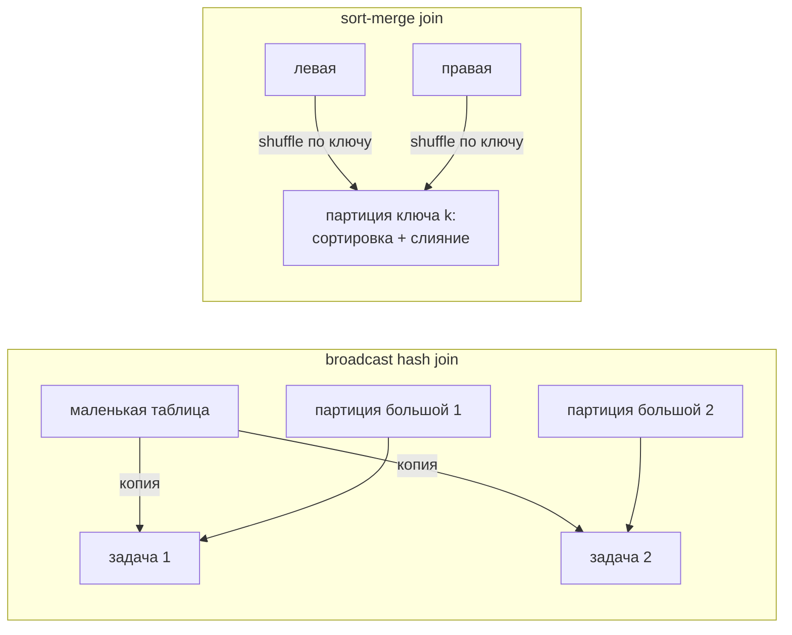

# 03 · Соединения изнутри и перекос данных

> [!info] Урок одной фразой
> Чтобы сверить два списка, бригада либо раздаёт копию короткого списка каждому рабочему
> (broadcast — никто никуда не ездит), либо развозит оба длинных списка по площадкам так, чтобы
> одинаковые фамилии оказались вместе, и сверяет их, отсортировав (sort-merge). Беда, когда
> половина фамилий — «Иванов»: одному рабочему достаётся половина стройки, и все ждут его
> (перекос). Помогает раздать «Ивановых» нескольким рабочим, добавив к фамилии номер (соль).

> [!todo] Чек-лист: после урока ты сможешь
> - [ ] объяснить broadcast hash, sort-merge и shuffle hash join и когда Spark выбирает каждый;
> - [ ] предсказать по размерам таблиц план соединения и проверить его в UI;
> - [ ] увидеть перекос по метрикам стадии: медиана и максимум времени задачи, spill;
> - [ ] устранить перекос broadcast'ом или солью и измерить эффект;
> - [ ] объяснить, что делает AQE с соединениями и почему на него нельзя полностью полагаться.

**Нужно для:** лаб [07.3](../labs/07.3_spark_ui_shuffle_skew/README.md),
[07.5](../labs/07.5_spark_mini_project/README.md).
**Карта урока:** [joins-skew.canvas](../maps/joins-skew.canvas).

---

## Шаг 0. Азбука

| В Spark | В аналогии | Подробнее |
|---|---|---|
| Broadcast hash join | Копия короткого списка — каждому рабочему | [соединения в Spark](../../../glossary/spark-joins.md) |
| Sort-merge join | Развезти оба списка по фамилиям, отсортировать, сверить | [соединения в Spark](../../../glossary/spark-joins.md) |
| Shuffle hash join | Развезти оба, по меньшему построить хеш-таблицу | [соединения в Spark](../../../glossary/spark-joins.md) |
| Перекос (skew), горячий ключ | Половина фамилий — «Иванов» | [перекос данных](../../../glossary/data-skew.md) |
| Соль (salting) | Иванов-1 … Иванов-8 у разных рабочих | [перекос данных](../../../glossary/data-skew.md) |

---

## Шаг 1. Три алгоритма соединения

**Проблема.** Соединить строки двух таблиц по ключу, когда обе разложены по партициям на разных
executors. Строки с одинаковым ключом должны встретиться в одной задаче.

**Как устроено.** Клеппман (гл. 10) описывает те же варианты для MapReduce: соединение на
стороне reduce (sort-merge) и на стороне map (broadcast hash, partitioned hash). В Spark:

| Алгоритм | Как работает | Shuffle | Когда выбирается |
|---|---|---|---|
| **Broadcast hash join** | маленькая таблица целиком собирается на driver и рассылается всем executors; каждая задача большой таблицы ищет совпадения в хеш-таблице в памяти | **нет** для большой стороны | маленькая сторона меньше `spark.sql.autoBroadcastJoinThreshold` (10 МБ) или подсказка `broadcast()` |
| **Sort-merge join** | обе стороны перераспределяются shuffle по ключу, каждая партиция сортируется, затем сливаются, как две отсортированные колоды | обе стороны | по умолчанию для двух больших таблиц |
| **Shuffle hash join** | обе стороны shuffle по ключу, по меньшей в каждой партиции — хеш-таблица | обе стороны | когда одна сторона заметно меньше, но не для broadcast; часто выбирает AQE |



**Что из этого следует.** Broadcast убирает самое дорогое — shuffle большой таблицы. Поэтому
соединение факта (миллионы строк) со справочником (сотни строк) должно быть broadcast. Цена —
маленькая сторона должна помещаться в память driver и каждого executor.

---

## Шаг 2. Как Spark выбирает: статистики, подсказки и AQE

**Проблема.** Чтобы выбрать broadcast до запуска, Spark должен знать размер маленькой стороны.
А если это не таблица, а результат запроса (`distinct`, агрегат) — размер заранее неизвестен.

**Как устроено.** Выбор идёт в два этапа:

1. **До запуска** — по оценке размеров из статистик (для файлов — по размеру на диске). Если
   сторона — подзапрос с агрегатом, оценки нет, и в `explain()` будет `SortMergeJoin`.
2. **Во время выполнения** — AQE: когда стадия маленькой стороны закончилась и её реальный
   размер известен, AQE может **заменить** sort-merge на broadcast hash join.
3. **Подсказка** `F.broadcast(df)` (или `/*+ BROADCAST(t) */` в SQL) заставляет broadcast сразу,
   независимо от оценок.

> [!example]- Попробуй сам: план до запуска и подсказка
> ```bash
> make shell
> cd modules/07_batch_spark/demo
> python - <<'EOF' 2>/dev/null
> from pyspark.sql import functions as F
> from spark_demo.session import get_spark
> spark = get_spark()
> df = spark.read.parquet("/workspace/data/raw/freshretailnet_50k/data/train.parquet")
> stores = df.select("store_id", "city_id").distinct()          # 898 строк, но размер заранее неизвестен
> df.join(stores, "store_id").explain()
> df.join(F.broadcast(stores), "store_id").explain()
> EOF
> exit
> ```
> **Увидишь:** в первом плане — `SortMergeJoin` с двумя `Exchange hashpartitioning(store_id, 200)`;
> во втором — `BroadcastHashJoin` и `BroadcastExchange`, а у большой стороны нет `Exchange`.
> **Почему:** у `distinct` нет оценки размера до запуска. Если выполнить первый вариант, в UI → SQL
> итоговый план будет уже с broadcast: AQE заменит алгоритм, когда узнает, что справочник — 898
> строк.

---

## Шаг 3. Перекос: одна задача на половину данных

**Проблема.** Shuffle распределяет строки по `hash(ключ) mod N`. Все строки одного ключа
попадают в **одну** партицию. Если ключей мало или один ключ очень частый, одна задача получает
огромную партицию, а остальные — почти ничего. Стадия длится столько, сколько самая медленная
задача (урок 02, барьер shuffle). Клеппман (гл. 6) называет это горячими ключами.

**Как устроено у нас.** В FreshRetailNet перекос по городу естественный: **город 0 — 2 322 990
строк из 4,5 млн (52 %)**, следующий — 460 530. Любой shuffle по `city_id` отдаёт половину
данных одной задаче.

Опыт: почасовые продажи (108 млн строк) соединяем со справочником городов по `city_id`,
broadcast запрещён (`autoBroadcastJoinThreshold = -1`), то есть sort-merge:

| Вариант | Время | Shuffle | Задачи стадии соединения: медиана / макс | Spill |
|---|---|---|---|---|
| Sort-merge, как есть | 12,0 с | 193 МБ (108 млн строк) | 4,2 / **9,1** с | 188 МБ |
| Sort-merge + соль 8 | 9,8 с | 240 МБ | 4,1 / **4,3** с | 183 МБ |
| Broadcast справочника | **1,1 с** | ≈ 1 КБ | — | 0 |

**Как это увидеть.** В UI → Stages → стадия соединения → **Summary Metrics**: столбцы Median и
Max у Duration и Shuffle Read Size. Перекос — когда максимум в разы больше медианы. На вкладке
**Event Timeline** видно, как все задачи закончились, а одна продолжает идти.

---

## Шаг 4. Что делать с перекосом

**Как устроено.** Варианты по порядку предпочтения:

1. **Broadcast**, если вторая сторона маленькая. Shuffle большой стороны нет — нет и перекоса.
   В нашем опыте — в 11 раз быстрее.
2. **Агрегировать до соединения**: частичная агрегация (урок 02) схлопывает горячий ключ до
   нескольких строк ещё до shuffle.
3. **Соль (salting)**: к ключу большой стороны добавить случайное число `salt` от 0 до N−1, а
   маленькую сторону **размножить** N раз со всеми значениями соли. Соединять по `(ключ, salt)`.
   Горячий ключ распадается на N партиций. Цена — маленькая сторона в N раз больше, shuffle чуть
   больше (240 МБ против 193).
4. **AQE skew join**: AQE может сам разрезать перекошенную партицию на куски, если она больше
   `spark.sql.adaptive.skewJoin.skewedPartitionThresholdInBytes` (256 МБ) **и** больше медианы в
   `skewedPartitionFactor` (5) раз. В нашем опыте партиция города 0 — около 100 МБ, ниже порога.
   Даже с порогом 16 МБ и `forceOptimizeSkewedJoin` AQE её не разделил — поэтому не рассчитывай
   на него вслепую, а проверяй по метрикам стадии.

```python
N = 8
salted = hourly.withColumn("salt", (F.rand(42) * N).cast("int"))                    # ①
cities_x = cities.crossJoin(spark.range(N).withColumnRenamed("id", "salt"))          # ②
joined = salted.join(cities_x, ["city_id", "salt"])                                   # ③
```

① Каждая строка большой стороны получает случайную соль 0…7. ② Каждая строка справочника
повторяется 8 раз — с каждой солью, иначе часть строк не найдёт пару. ③ Ключ shuffle теперь
`(city_id, salt)`: город 0 разошёлся по 8 партициям.

> [!example]- Попробуй сам: перекос и его лечение
> Запуск ~30 с. Во время выполнения открой <http://localhost:4040> → Stages.
> ```bash
> make shell
> cd modules/07_batch_spark/demo
> python - <<'EOF' 2>/dev/null
> from pyspark.sql import functions as F
> from spark_demo.session import get_spark, StageReport
> spark = get_spark()
> df = spark.read.parquet("/workspace/data/raw/freshretailnet_50k/data/train.parquet")
> hourly = df.select("city_id", "store_id", F.posexplode("hours_sale").alias("hour", "qty"))
> cities = df.select("city_id").distinct().withColumn("region", F.col("city_id") % 3)
> spark.conf.set("spark.sql.autoBroadcastJoinThreshold", "-1")
> with StageReport("sort-merge по city_id"):
>     hourly.join(cities, "city_id").groupBy("region").agg(F.sum("qty")).collect()
> N = 8
> salted = hourly.withColumn("salt", (F.rand(42) * N).cast("int"))
> cities_x = cities.crossJoin(spark.range(N).withColumnRenamed("id", "salt"))
> with StageReport("sort-merge с солью"):
>     salted.join(cities_x, ["city_id", "salt"]).groupBy("region").agg(F.sum("qty")).collect()
> spark.conf.unset("spark.sql.autoBroadcastJoinThreshold")
> with StageReport("broadcast"):
>     hourly.join(F.broadcast(cities), "city_id").groupBy("region").agg(F.sum("qty")).collect()
> EOF
> exit
> ```
> **Увидишь:** без соли у стадии соединения задача медиана/макс ≈ 4/9 с и spill ≈ 190 МБ; с
> солью ≈ 4/4 с; broadcast — около секунды и без shuffle большой стороны.
> **Почему:** без соли город 0 (52 % строк) попадает в одну партицию. Соль разрезает его на 8
> частей; broadcast вообще не перемешивает большую сторону.

> [!warning] Ловушка: соль без размножения маленькой стороны
> Если добавить соль только к большой стороне, а справочник оставить как есть, строки с солью
> 1…7 не найдут пары — inner join тихо потеряет 7/8 данных. Всегда сверяй число строк и суммы до
> и после.

---

## Шаг 5. Порядок соединений и фильтры

**Проблема.** В запросе три таблицы: факт, магазины, товары. Есть ли разница, в каком порядке
соединять и где фильтровать?

**Как устроено.** Оптимизатор Catalyst проталкивает фильтры к источникам (фильтр по `dt` будет
применён при чтении, а не после соединения) и отбрасывает лишние колонки. Порядок соединений он
меняет ограниченно — без статистик таблиц (у нас их нет для файлов) он идёт в порядке записи.
Практические правила:

- фильтруй и агрегируй **до** соединения, если это не меняет смысл;
- соединяй большой факт с маленькими справочниками broadcast'ом;
- соединяй два больших набора по одному и тому же ключу подряд — Spark переиспользует
  перераспределение и не делает shuffle второй раз.

---

## Сборка целиком

Sort-merge join с перекосом:

```mermaid
sequenceDiagram
    autonumber
    participant D as driver
    participant L as задачи большой стороны (4)
    participant S as задачи справочника
    participant J as задачи соединения
    D->>L: explode, hash(city_id) mod 200 → файлы shuffle (193 МБ)
    D->>S: distinct городов → shuffle (1 КБ)
    D->>D: AQE: размеры известны; порог skew не достигнут
    D->>J: 3 задачи после объединения партиций
    J->>J: задача с городом 0: сортировка 100 МБ, spill 188 МБ, 9 с
    J-->>D: остальные закончили за 4 с и ждут
```

| Шаг | Если исправить | Эффект |
|---|---|---|
| 1 | broadcast справочника | шагов 1–2 и 4–5 для большой стороны нет: 1,1 с |
| 1 | соль 8 | город 0 в 8 партициях: задачи по 4 с |
| 3 | AQE skew join | срабатывает только выше порогов — проверь метрики |

## Шпаргалка

| Хочу | Как |
|---|---|
| Принудительный broadcast | `df.join(F.broadcast(small), "k")`; SQL: `/*+ BROADCAST(t) */` |
| Запретить авто-broadcast | `spark.conf.set("spark.sql.autoBroadcastJoinThreshold", "-1")` |
| Порог авто-broadcast | `spark.sql.autoBroadcastJoinThreshold` (10 МБ) |
| Увидеть алгоритм | `explain()` до запуска; итог — UI → SQL / DataFrame |
| Увидеть перекос | UI → Stages → Summary Metrics: Max ≫ Median; `StageReport` |
| Распределение ключа | `df.groupBy("k").count().orderBy(F.desc("count"))` |
| Соль | `salt = (rand()*N).cast("int")` + `crossJoin(range(N))` у маленькой стороны |
| Пороги AQE skew | `spark.sql.adaptive.skewJoin.skewedPartitionThresholdInBytes`, `…skewedPartitionFactor` |

## Типичные ошибки

| Симптом | Причина | Как проверить | Как чинить |
|---|---|---|---|
| Стадия ждёт одну задачу | перекос ключа | Max ≫ Median, Event Timeline | broadcast / агрегация до join / соль |
| Join факта со справочником — shuffle обеих сторон | размер справочника неизвестен до запуска | `SortMergeJoin` в итоговом плане | `F.broadcast()` |
| `OutOfMemoryError` на driver при broadcast | «маленькая» сторона не маленькая | размер стороны | не форсировать broadcast для больших |
| Строк после соединения меньше, чем ожидалось | соль без размножения маленькой стороны | `count()` до и после | `crossJoin(range(N))` |
| Строк после соединения больше | ключ справочника неуникален (fan-out) | `groupBy(k).count() > 1` | дедуплицировать справочник (модуль 02) |

## Проверь себя

Карточки — в [flashcards.md](../flashcards.md).

> [!question] 1. Факт — 100 ГБ, справочник товаров — 5 МБ. Какой join выберет Spark и почему это хорошо?
> > [!success]- Ответ
> > Broadcast hash join: 5 МБ меньше порога 10 МБ. Справочник разошлют всем executors, а 100 ГБ
> > факта не пойдут в shuffle.

> [!question] 2. В плане `explain()` — `SortMergeJoin`, а в UI → SQL после выполнения — `BroadcastHashJoin`. Как так?
> > [!success]- Ответ
> > До запуска размер одной стороны был неизвестен. AQE после её стадии увидел реальный размер
> > меньше порога и заменил алгоритм во время выполнения.

> [!question] 3. Медиана задачи стадии соединения — 2 с, максимум — 60 с, spill только у одной задачи. Что это и что проверить первым?
> > [!success]- Ответ
> > Перекос: одна партиция огромная. Проверить распределение ключа соединения
> > (`groupBy(k).count()`), затем — можно ли broadcast или агрегацию до соединения, иначе соль.

> [!question] 4. Почему соль увеличивает объём shuffle?
> > [!success]- Ответ
> > Добавляется колонка соли, а маленькая сторона размножается в N раз. Это плата за равномерные
> > партиции.
