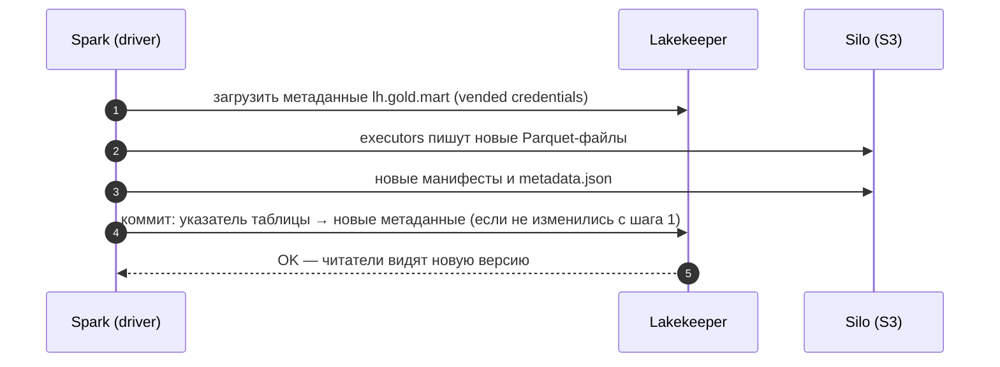

# 04 · Spark и Iceberg: атомарная запись, MERGE и обслуживание таблиц

> [!info] Урок одной фразой
> Iceberg — склад с журналом приёмки: каждая поставка (запись) оформляется одной накладной
> (снапшотом), и до подписи накладной никто не видит товар «наполовину выгруженным». Spark — бригада
> грузчиков, которая умеет и привезти новое, и заменить часть товара (MERGE), и переложить сотню
> мелких коробок в несколько больших (компактизация). DuckDB в модуле 05 мог только привезти и
> выбросить — Spark умеет подменить склад целиком одной накладной.

> [!todo] Чек-лист: после урока ты сможешь
> - [ ] настроить Spark на REST-каталог Lakekeeper и объяснить, откуда берутся ключи S3;
> - [ ] создать партиционированную таблицу Iceberg и выбрать распределение записи;
> - [ ] атомарно заменить таблицу и объяснить, чем это лучше DROP + CTAS из модуля 05;
> - [ ] написать `MERGE INTO` и предсказать, какие файлы он перепишет;
> - [ ] найти мелкие файлы по метаданным и уплотнить их; почистить старые снапшоты.

**Нужно для:** лаб [07.1](../labs/07.1_spark_cluster_and_iceberg/README.md),
[07.5](../labs/07.5_spark_mini_project/README.md).
**Карта урока:** [spark-iceberg.canvas](../maps/spark-iceberg.canvas).

---

## Шаг 0. Азбука

| В Iceberg + Spark | В аналогии «склад» | Подробнее |
|---|---|---|
| Каталог `lh` (Lakekeeper) | Регистратура: где лежит журнал каждой таблицы | [каталог Iceberg](../../../glossary/iceberg-catalog.md) |
| Снапшот | Подписанная накладная поставки | [снапшот](../../../glossary/snapshot.md) |
| Партиция `days(dt)` | Стеллаж на каждый день | [партиционирование](../../../glossary/partitioning.md) |
| Распределение записи | Как грузчики раскладывают товар по стеллажам | [Iceberg](../../../glossary/iceberg.md) |
| `MERGE INTO`, copy-on-write | Заменить часть товара, переупаковав коробку | [copy-on-write](../../../glossary/copy-on-write.md) |
| Компактизация | Переложить мелкие коробки в крупные | [компактизация](../../../glossary/compaction.md) |

---

## Шаг 1. Как Spark подключён к каталогу

**Проблема.** Таблицы Iceberg в нашем стеке пишут dlt и DuckDB (модули 04–05). Spark должен
видеть те же таблицы и писать новые так, чтобы их потом прочитали DuckDB, Trino и ClickHouse.

**Как устроено.** В `infra/docker/spark/spark-defaults.conf` описан каталог с именем `lh`:

```properties
spark.sql.extensions        org.apache.iceberg.spark.extensions.IcebergSparkSessionExtensions  # ①
spark.sql.catalog.lh        org.apache.iceberg.spark.SparkCatalog                              # ②
spark.sql.catalog.lh.type   rest
spark.sql.catalog.lh.uri    http://lakekeeper:8181/catalog
spark.sql.catalog.lh.warehouse  lakehouse
spark.sql.catalog.lh.header.X-Iceberg-Access-Delegation  vended-credentials                    # ③
spark.sql.catalog.lh.io-impl    org.apache.iceberg.aws.s3.S3FileIO                             # ④
```

| Метка | Что важно |
|---|---|
| ① | Расширения SQL: `MERGE INTO`, `CALL … system.*` (процедуры обслуживания). |
| ② | Каталог Iceberg с именем `lh`: таблицы адресуются как `lh.<namespace>.<таблица>`. |
| ③ | Просьба к Lakekeeper выдать **временные ключи S3** для каждой таблицы (модуль 03). Поэтому ключей Silo нет ни в конфиге, ни у executors. |
| ④ | Чтение и запись файлов — через S3-клиент Iceberg. Адрес Silo и path-style приходят из профиля warehouse. |

JAR-файлы `iceberg-spark-runtime-4.1_2.13` и `iceberg-aws-bundle` 1.12.0 лежат в образе
`debd/spark:4.1.3` (`infra/docker/spark/Dockerfile`).

**Что из этого следует.** Любой клиент Spark Connect сразу видит каталог `lh`: настраивать его в
коде не нужно. Таблицы, созданные Spark, — обычные таблицы Iceberg в Lakekeeper.

---

## Шаг 2. Партиционированная таблица и распределение записи

**Проблема.** Факт продаж читают по дням. Таблицу нужно разложить по дням (модуль 03) и не
наплодить мелких файлов при каждой записи.

**Как устроено.** Скрытое партиционирование задаётся в DDL: `PARTITIONED BY (days(dt))`. При
записи Spark должен распределить строки так, чтобы задача писала файлы своих партиций. Свойство
таблицы **`write.distribution-mode`** управляет этим:

| Значение | Что делает Spark перед записью | Файлов на партицию за одну запись |
|---|---|---|
| `hash` (по умолчанию для партиционированных) | shuffle по ключу партиции: все строки дня — в одну задачу | 1 (если день помещается в целевой размер файла) |
| `range` | shuffle с сортировкой по ключу партиции и порядку сортировки таблицы | 1 |
| `none` | пишет, как лежат партиции DataFrame | столько, сколько задач содержат строки этого дня |

**Что из этого следует.** `hash` — один лишний shuffle при записи, но аккуратные файлы. `none`
быстрее при записи, но если DataFrame разбит на 8 партиций, каждый день разойдётся по 8 файлам.

---

## Шаг 3. Атомарная замена таблицы

**Проблема.** В модуле 05 DuckDB публиковал витрину в Iceberg так: `DROP TABLE` + `CREATE TABLE
AS`. Между этими командами таблицы **нет** — читатель получал «table does not exist».

**Как устроено.** Spark умеет `CREATE OR REPLACE TABLE … AS SELECT` (или
`df.writeTo(t).createOrReplace()`) для Iceberg **одним коммитом**: новые файлы пишутся рядом,
затем каталог атомарно переключает указатель таблицы на новые метаданные. Читатель видит либо
старое содержимое, либо новое. История таблицы сохраняется: замена — это новый снапшот, к
старому можно вернуться (time travel).

**Что из этого следует.** Витрины, которые читают другие движки, публикуются из Spark без окна
недоступности — то, чего не хватало в модуле 05.

> [!example]- Попробуй сам: таблица по дням и атомарная замена
> ```bash
> make shell
> cd modules/07_batch_spark/demo
> python - <<'EOF' 2>/dev/null
> from pyspark.sql import functions as F
> from spark_demo.session import get_spark
> spark = get_spark()
> t = "lh.sandbox_spark.sales_daily"
> df = spark.read.parquet("/workspace/data/raw/freshretailnet_50k/data/train.parquet")
> spark.sql("CREATE NAMESPACE IF NOT EXISTS lh.sandbox_spark")
> spark.sql(f"DROP TABLE IF EXISTS {t} PURGE")
> spark.sql(f"""CREATE TABLE {t} (store_id bigint, product_id bigint, dt date,
>               sale_amount double, discount double) USING iceberg PARTITIONED BY (days(dt))""")
> week = (df.where("dt BETWEEN '2024-04-01' AND '2024-04-07'")
>           .select("store_id", "product_id", F.to_date("dt").alias("dt"), "sale_amount", "discount"))
> week.writeTo(t).append()
> print(spark.sql(f"SELECT count(*) AS files, sum(record_count) AS rows FROM {t}.files").collect())
> spark.sql(f"CREATE OR REPLACE TABLE {t} USING iceberg PARTITIONED BY (days(dt)) "
>           f"AS SELECT * FROM {t} WHERE dt < '2024-04-04'")
> print(spark.sql(f"SELECT count(*) FROM {t}").first()[0],
>       spark.sql(f"SELECT operation FROM {t}.snapshots ORDER BY committed_at").collect())
> EOF
> exit
> ```
> **Увидишь:** `files=7, rows=350000`; после замены — `150000` и два снапшота: `append` и
> `overwrite`.
> **Почему:** `hash`-распределение дало по файлу на день. Замена — один коммит поверх истории.

---

## Шаг 4. MERGE INTO: обновить часть таблицы

**Проблема.** Учётная система прислала исправления продаж магазина за день. Перезаписывать всю
таблицу ради 900 строк дорого, append даст дубли.

**Как устроено.** `MERGE INTO цель USING источник ON условие WHEN MATCHED THEN UPDATE … WHEN NOT
MATCHED THEN INSERT …` — изменить совпавшие строки, вставить новые. Iceberg в Spark по умолчанию
выполняет его как **copy-on-write**. Он находит файлы, в которых есть совпавшие строки, и
**переписывает их целиком** с изменениями. В снапшоте старые файлы помечаются удалёнными
(модуль 03).

Альтернатива — **merge-on-read** (`write.merge.mode = merge-on-read`). Пишутся
маленькие файлы удалений, а слияние происходит при чтении. Запись быстрее, чтение медленнее до
компактизации.

```sql
MERGE INTO lh.sandbox_spark.sales_daily t
USING corrections s
ON t.store_id = s.store_id AND t.product_id = s.product_id AND t.dt = s.dt    -- ① ключ строки
WHEN MATCHED THEN UPDATE SET t.sale_amount = s.sale_amount                     -- ②
WHEN NOT MATCHED THEN INSERT *                                                 -- ③
```

| Метка | Что важно |
|---|---|
| ① | Условие должно однозначно находить строку. Если одной строке цели соответствуют две строки источника, MERGE падает с ошибкой о неоднозначности. |
| ② | Обновляем только нужные колонки. |
| ③ | `INSERT *` — колонки по именам. |

**Что из этого следует.** Цена MERGE определяется числом **затронутых файлов**, а не строк.
Исправление одного магазина за день в таблице по дням перепишет **один** файл этого дня. Без
партиционирования — потенциально все файлы.

> [!example]- Попробуй сам: что переписал MERGE
> Продолжение предыдущего примера (таблица на 3 дня):
> ```bash
> make shell
> cd modules/07_batch_spark/demo
> python - <<'EOF' 2>/dev/null
> from pyspark.sql import functions as F
> from spark_demo.session import get_spark
> spark = get_spark()
> t = "lh.sandbox_spark.sales_daily"
> df = spark.read.parquet("/workspace/data/raw/freshretailnet_50k/data/train.parquet")
> (df.where("dt = '2024-04-02' AND store_id = 0")
>    .select("store_id", "product_id", F.to_date("dt").alias("dt"),
>            (F.col("sale_amount") * 2).alias("sale_amount"), "discount")
>    .createOrReplaceTempView("corrections"))
> spark.sql(f"""MERGE INTO {t} t USING corrections s
>   ON t.store_id = s.store_id AND t.product_id = s.product_id AND t.dt = s.dt
>   WHEN MATCHED THEN UPDATE SET t.sale_amount = s.sale_amount
>   WHEN NOT MATCHED THEN INSERT *""")
> print(spark.sql(f"""SELECT operation, summary['added-data-files'] AS added,
>   summary['deleted-data-files'] AS deleted, summary['changed-partition-count'] AS partitions
>   FROM {t}.snapshots ORDER BY committed_at DESC LIMIT 1""").collect())
> EOF
> exit
> ```
> **Увидишь:** `operation='overwrite', added='1', deleted='1', partitions='1'`.
> **Почему:** copy-on-write переписал единственный файл дня 2024-04-02; остальные дни не тронуты.

---

## Шаг 5. Мелкие файлы, компактизация и старые снапшоты

**Проблема.** Частые маленькие записи (по часу, по дню, с распределением `none`) плодят тысячи
мелких файлов. Каждый файл — запрос к S3 и чтение футера: запросы замедляются, метаданные
растут. Каждый снапшот хранит ссылки на старые файлы — место в S3 не освобождается.

**Как устроено.** Обслуживание таблицы — процедуры Iceberg, вызываемые из Spark:

| Процедура | Что делает | Важные параметры |
|---|---|---|
| `CALL lh.system.rewrite_data_files(table => 'ns.t')` | склеивает мелкие файлы партиции в файлы целевого размера (512 МБ) | `options => map('min-input-files','5')` — группа переписывается, если в ней ≥ 5 файлов (по умолчанию) |
| `CALL lh.system.expire_snapshots(table => 'ns.t', older_than => TIMESTAMP '…', retain_last => N)` | удаляет старые снапшоты и файлы, на которые больше никто не ссылается | по умолчанию удаляются снапшоты старше **5 дней** |
| `CALL lh.system.rewrite_manifests(table => 'ns.t')` | уплотняет манифесты | — |

Компактизация — тоже коммит (`replace`): читатели продолжают видеть старые файлы до него и
новые — после, данные не меняются.

> [!example]- Попробуй сам: мелкие файлы и уплотнение
> ```bash
> make shell
> cd modules/07_batch_spark/demo
> python - <<'EOF' 2>/dev/null
> from pyspark.sql import functions as F
> from spark_demo.session import get_spark
> spark = get_spark()
> t = "lh.sandbox_spark.sales_daily"
> df = spark.read.parquet("/workspace/data/raw/freshretailnet_50k/data/train.parquet")
> files = lambda: spark.sql(f"SELECT count(*) AS files, round(avg(file_size_in_bytes)/1024) AS avg_kb FROM {t}.files").first()
> spark.sql(f"ALTER TABLE {t} SET TBLPROPERTIES ('write.distribution-mode'='none')")
> for d in range(10, 17):
>     (df.where(f"dt = '2024-04-{d}'")
>        .select("store_id", "product_id", F.to_date("dt").alias("dt"), "sale_amount", "discount")
>        .repartition(8).writeTo(t).append())
> print("до:", files())
> print(spark.sql(f"CALL lh.system.rewrite_data_files(table => 'sandbox_spark.sales_daily')").first())
> print("после:", files())
> print(spark.sql(f"CALL lh.system.expire_snapshots(table => 'sandbox_spark.sales_daily', retain_last => 1)").first())
> EOF
> exit
> ```
> **Увидишь:** «до» — 59 файлов, в среднем ~36 КБ (по 8 на каждый новый день); процедура:
> `rewritten_data_files_count=56, added_data_files_count=7`; «после» — 10 файлов по ~180 КБ.
> `expire_snapshots` удалил **0** файлов.
> **Почему:** с `none` каждый день разошёлся по 8 задачам. Компактизация склеила 8 файлов каждого
> дня в один. Снапшоты моложе 5 дней `expire_snapshots` не трогает, пока не задан `older_than`.

**Очистка песочницы модуля.** В `make shell`, папка `modules/07_batch_spark/demo`:

```bash
python - <<'EOF' 2>/dev/null
from spark_demo.session import get_spark
spark = get_spark()
for row in spark.sql("SHOW TABLES IN lh.sandbox_spark").collect():
    spark.sql(f"DROP TABLE lh.sandbox_spark.{row.tableName} PURGE")
spark.sql("DROP NAMESPACE lh.sandbox_spark")
print(spark.sql("SHOW NAMESPACES IN lh").collect())
EOF
```

---

## Сборка целиком

Ежедневная публикация витрины из Spark:



| Шаг | Если сломается | Симптом |
|---|---|---|
| 1 | нет заголовка vended-credentials | `Access Denied` / нет ключей у executors |
| 2 | executors упали посередине | файлы-сироты в S3, таблица не изменилась |
| 4 | параллельный коммит другого писателя | `CommitFailedException`, Iceberg повторяет коммит или падает при конфликте |

## Шпаргалка

| Хочу | Как |
|---|---|
| Таблица по дням | `CREATE TABLE lh.ns.t (...) USING iceberg PARTITIONED BY (days(dt))` |
| Дописать / заменить | `df.writeTo(t).append()` / `df.writeTo(t).createOrReplace()` |
| Перезаписать партиции из DataFrame | `df.writeTo(t).overwritePartitions()` |
| Изменить часть строк | `MERGE INTO … WHEN MATCHED … WHEN NOT MATCHED …` |
| Метаданные | `SELECT * FROM t.files`, `t.snapshots`, `t.partitions`, `t.history` |
| Распределение записи | `ALTER TABLE t SET TBLPROPERTIES ('write.distribution-mode'='hash')` |
| Компактизация | `CALL lh.system.rewrite_data_files(table => 'ns.t')` |
| Старые снапшоты | `CALL lh.system.expire_snapshots(table => 'ns.t', older_than => TIMESTAMP '…')` |
| Таблица на момент времени | `SELECT … FROM t VERSION AS OF <snapshot_id>` / `TIMESTAMP AS OF '…'` |

## Типичные ошибки

| Симптом | Причина | Как проверить | Как чинить |
|---|---|---|---|
| Тысячи файлов по десяткам КБ | `distribution-mode=none` и много задач / частые записи | `t.files` | `hash`, компактизация |
| MERGE падает: несколько строк источника на строку цели | источник неуникален по ключу | `groupBy(ключ).count() > 1` в источнике | дедуплицировать источник |
| MERGE переписывает всю таблицу | нет партиционирования / условие не по ключу партиции | `t.snapshots`: `deleted-data-files` | партиции, условие с `dt` |
| `expire_snapshots` ничего не удалил | снапшоты моложе 5 дней | `committed_at` в `t.snapshots` | `older_than` |
| `Table or view not found: lh.…` | нет namespace или опечатка в каталоге | `SHOW NAMESPACES IN lh` | `CREATE NAMESPACE` |

## Проверь себя

Карточки — в [flashcards.md](../flashcards.md).

> [!question] 1. Чем `createOrReplace()` в Spark лучше публикации DROP + CTAS из модуля 05?
> > [!success]- Ответ
> > Один атомарный коммит: читатель видит старую или новую версию, «таблицы нет» не бывает. И
> > история сохраняется — старая версия доступна как снапшот.

> [!question] 2. Таблица продаж по дням, 97 файлов. MERGE исправляет 3 магазина в 2 днях. Сколько файлов перепишет copy-on-write?
> > [!success]- Ответ
> > Два — файлы этих двух дней (если в каждом дне один файл). Цена MERGE — затронутые файлы.

> [!question] 3. После недели записей по часу в таблице 168 файлов на день по 30 КБ. Что делать и чем это грозит, если ничего не делать?
> > [!success]- Ответ
> > Компактизация (`rewrite_data_files`) и, возможно, `distribution-mode=hash`. Иначе каждый
> > запрос открывает тысячи файлов: медленно, много запросов к S3, растут метаданные.

> [!question] 4. Почему у executors Spark нет ключей Silo, а запись в Iceberg работает?
> > [!success]- Ответ
> > Каталог выдаёт временные ключи на таблицу (vended credentials) по заголовку
> > `X-Iceberg-Access-Delegation`; S3FileIO берёт их и адрес из ответа каталога.
