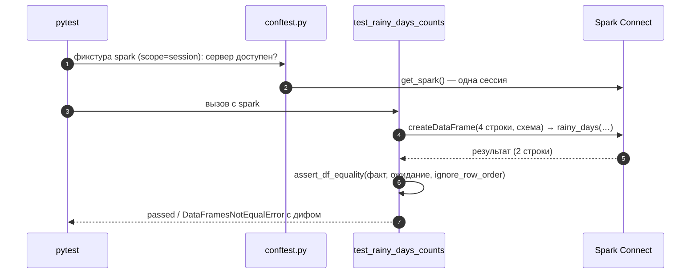

# 05 · Тестирование трансформаций: pytest и chispa

> [!info] Урок одной фразой
> Прежде чем пускать бригаду на весь объект, проверяют рецепт раствора на ведре: три замеса с
> известным результатом, включая крайние случаи («а если песок мокрый?»). Трансформация Spark —
> рецепт: функция, которая из одного DataFrame делает другой. Тест подаёт ей три строки,
> собранные руками, и сравнивает результат с ожидаемым. chispa показывает, в какой ячейке разошлось.

> [!todo] Чек-лист: после урока ты сможешь
> - [ ] отделить трансформацию (чистую функцию) от чтения и записи;
> - [ ] написать тест pytest с фикстурой сессии, параметризацией и пропуском;
> - [ ] собрать входной и ожидаемый DataFrame со схемой и сравнить их chispa;
> - [ ] выбрать флаги сравнения: порядок строк, nullable, точность для дробей;
> - [ ] придумать набор граничных случаев для трансформации и прочитать диф упавшего теста.

**Нужно для:** лаба [07.2](../labs/07.2_transformations_with_tests/README.md).
**Карта урока:** [testing-transformations.canvas](../maps/testing-transformations.canvas).

---

## Шаг 0. Азбука

| В тестировании | В аналогии | Подробнее |
|---|---|---|
| Трансформация — чистая функция | Рецепт раствора | [тесты трансформаций](../../../glossary/transformation-tests.md) |
| Тест | Пробный замес на ведре | [тесты трансформаций](../../../glossary/transformation-tests.md) |
| Фикстура pytest | Подготовленное рабочее место (ведро, мешалка) | [тесты трансформаций](../../../glossary/transformation-tests.md) |
| chispa | Весы, которые показывают, какой ингредиент не тот | [тесты трансформаций](../../../glossary/transformation-tests.md) |
| Граничный случай | Мокрый песок, мороз, пустое ведро | [тесты dbt](../../../glossary/dbt-tests.md) |

---

## Шаг 1. Что тестировать: трансформация отдельно от ввода-вывода

**Проблема.** Скрипт «прочитать Parquet → посчитать → записать в Iceberg» можно проверить только
целиком на живых данных. Это долго, и нужен весь стек. А ошибку в логике на 4,5 млн строк не
заметишь: например, порог «больше» вместо «больше или равно».

**Как устроено.** Код делят на две части:

- **Ввод-вывод** — чтение источников и запись результата. Его мало, и он проверяется запуском.
- **Трансформации** — функции `DataFrame → DataFrame` (или `Column → Column`). Не читают файлы,
  не пишут таблицы, не зависят от даты запуска. Поэтому их можно вызвать на DataFrame из трёх
  строк, собранном прямо в тесте.

В демо так устроен `spark_demo/weather.py`:

```python
def city_weather_daily(raw: DataFrame) -> DataFrame:          # ① вход — DataFrame, не путь
    return raw.groupBy("city_id", F.to_date("dt").alias("weather_date")).agg(
        F.round(F.avg("precpt"), 3).alias("precipitation"), …)

def is_rainy(precipitation: Column, threshold: float = 1.0) -> Column:   # ② выражение
    return F.coalesce(precipitation > F.lit(threshold), F.lit(False))    # ③ NULL → False

def rainy_days(daily: DataFrame, threshold: float = 1.0) -> DataFrame:   # ④ композиция
    return daily.groupBy("city_id").agg(
        F.sum(is_rainy(F.col("precipitation"), threshold).cast("int")).alias("rainy_days"), …)
```

| Метка | Что важно |
|---|---|
| ① | Функция получает DataFrame. Откуда он взялся, решает вызывающий код. |
| ② | Логика порога вынесена в отдельное выражение: его можно проверить на одной колонке. |
| ③ | Явное решение для NULL. Без `coalesce` результат сравнения с NULL — NULL, и сумма его бы пропустила. |
| ④ | Большие трансформации собираются из маленьких. |

**Что из этого следует.** Тестируемость — это свойство структуры кода, а не тестового фреймворка.
Функция, внутри которой `spark.read.parquet("/workspace/...")`, протестировать на трёх строках
нельзя.

---

## Шаг 2. pytest: минимум, который нужен

**Проблема.** Как запускать проверки автоматически и одинаково у всех?

**Как устроено.** pytest находит файлы `test_*.py`, в них функции `test_*`, и выполняет их.
Тест проходит, если не выбросил исключение; `assert выражение` бросает `AssertionError`, если
выражение ложно. Нужные приёмы:

| Приём | Синтаксис | Зачем |
|---|---|---|
| Фикстура | `@pytest.fixture` + параметр теста с тем же именем | подготовка ресурса; pytest сам передаёт его в тест |
| Область фикстуры | `@pytest.fixture(scope="session")` | создать один раз на все тесты (сессия Spark ~1 с) |
| `conftest.py` | файл рядом с тестами | фикстуры, видимые всем тестам папки, без импорта |
| Параметризация | `@pytest.mark.parametrize(("x", "y"), [(1, True), …])` | один тест — много случаев, каждый отдельной строкой отчёта |
| Пропуск | `pytest.skip("почему")` | нет нужной инфраструктуры — тест пропущен, а не упал |

Фикстура сессии в демо (`tests/conftest.py`):

```python
@pytest.fixture(scope="session")
def spark():
    if not _connect_available():                                # ① сервер не поднят
        pytest.skip('нужен кластер Spark: make up PROFILES="spark"')
    return get_spark()                                          # ② одна сессия на все тесты
```

① Если слой `spark` не поднят, тесты пропускаются — `make test` не должен требовать кластер.
② Подключение к Spark Connect — секунда; на сто тестов это сто секунд, поэтому сессия общая.

Файл `demo/conftest.py` (пустой) нужен для другого: pytest добавляет папку с ним в `sys.path`, и
импорт `spark_demo` работает и из папки демо, и из корня репозитория.

**Что из этого следует.** Тест не должен зависеть от порядка и от других тестов: общая сессия —
да, общие данные — нет. Каждый тест собирает свой маленький вход.

---

## Шаг 3. Входные данные и сравнение DataFrame: chispa

**Проблема.** `assert actual.collect() == expected.collect()` ломается от порядка строк, не
показывает, где расхождение, и игнорирует схему — тип `int` против `long` пройдёт незамеченным,
пока не упадёт запись в таблицу.

**Как устроено.** Вход и ожидание собирают через `spark.createDataFrame(строки, схема)`, где схема
— строка DDL `"city_id long, dt string, precpt double"`. Явная схема важна: без неё Spark выведет
типы сам (`int` → `long`, `None` — проблема), и тест будет проверять не то.

**chispa** сравнивает DataFrame и печатает понятный диф:

| Функция / флаг | Что делает |
|---|---|
| `assert_df_equality(a, b)` | схема и строки должны совпасть точно, в том же порядке |
| `ignore_row_order=True` | сортирует обе стороны перед сравнением — порядок после `groupBy` не гарантирован |
| `ignore_nullable=True` | не сравнивать признак nullable: у агрегатов и литералов он разный |
| `ignore_column_order=True` | колонки сравниваются по именам |
| `assert_approx_df_equality(a, b, precision=1e-6)` | дробные числа с допуском: `0.1 + 0.2 != 0.3` |

Упавший тест показывает таблицу «df1 — фактический, df2 — ожидаемый», ячейки-расхождения
подсвечены:

```
chispa.dataframe_comparer.DataFramesNotEqualError:
+--------------------------------------+--------------------------------------+
|                 df1                  |                 df2                  |
+--------------------------------------+--------------------------------------+
| city_id=0, rainy_days=1, days=2      | city_id=0, rainy_days=2, days=2      |
+--------------------------------------+--------------------------------------+
```

Если различаются схемы, chispa падает раньше, с `SchemasNotEqualError` и обеими схемами.

**Что из этого следует.** Флаги ослабления — осознанный выбор: `ignore_row_order` нужен почти
всегда после агрегатов, `ignore_nullable` — почти всегда, а `ignore_column_order` скрывает
изменение контракта выхода и нужен реже.

---

## Шаг 4. Какие случаи проверять

**Проблема.** Тест на «нормальных» данных проходит почти всегда. Ошибки живут на краях.

**Как устроено.** Для каждой трансформации перебирают типовые края:

| Край | Пример в погоде | Что ловит |
|---|---|---|
| граница порога | осадки ровно 1,0 при пороге «больше 1» | `>` против `>=` |
| NULL | осадков нет | пропущенные строки, NULL в сумме |
| дубли | два магазина одного города в один день | неверное усреднение, лишние строки |
| пустой вход | ни одной строки | падение, `None` вместо 0 |
| несколько групп | два города | перепутанные ключи группировки |
| типы | `dt` строкой | неявные приведения, даты |

В демо граница и NULL проверены параметризацией, а дубли — в тесте `city_weather_daily`
(два магазина одного города дают одно среднее).

> [!example]- Попробуй сам: прогнать тесты и сломать трансформацию
> ```bash
> make shell
> cd modules/07_batch_spark/demo
> python -m pytest -q tests
> sed -i 's/precipitation > F.lit(threshold)/precipitation >= F.lit(threshold)/' spark_demo/weather.py
> python -m pytest -q tests 2>&1 | tail -5
> sed -i 's/precipitation >= F.lit(threshold)/precipitation > F.lit(threshold)/' spark_demo/weather.py   # вернуть
> python -m pytest -q tests 2>&1 | tail -1
> exit
> ```
> **Увидишь:** сначала `6 passed` меньше чем за секунду. После правки — `1 failed, 5 passed`:
> падает `test_is_rainy_boundaries[1.0-False]` (`AssertionError`); после возврата — снова `6 passed`.
> **Почему:** граничный случай «ровно 1,0» записан явно, и смена `>` на `>=` его ломает. На полном
> датасете такую ошибку не увидеть: число дождливых дней изменилось бы на несколько процентов.

> [!warning] Ловушка: ожидание, посчитанное тем же кодом
> Пиши ожидание руками, посчитав на бумаге: 2,0 и 1,0 → среднее 1,5. Если «ожидаемый» DataFrame
> получен вызовом той же функции или копией её логики, тест проверяет, что код равен сам себе.

---

## Шаг 5. Тесты в нашем стеке и в CI

**Проблема.** Где и как запускать тесты, чтобы они не мешали и не врали?

**Как устроено.** Тесты демо идут через Spark Connect на кластер (`make up PROFILES="spark"`).
Из workspace: `python -m pytest -q tests` в папке демо или `make test` из корня (pytest найдёт
все `test_*.py` репозитория). Без кластера тесты Spark помечаются `SKIPPED`. В CI (модуль 12)
обычно поднимают локальную сессию Spark с `master("local[2]")` в контейнере с Java — принцип тот
же: маленькие данные, одна сессия, явные схемы.

**Что из этого следует.** Тест трансформации — секунды, поэтому его запускают на каждое
изменение. Полный прогон на датасете — отдельная проверка (сверка с DuckDB, модуль 09), а не
замена тестов.

---

## Сборка целиком

Что происходит при `python -m pytest -q tests`:



| Шаг | Если сломается | Симптом |
|---|---|---|
| 1 | кластер не поднят | тесты `SKIPPED` с причиной |
| 4 | схема не задана, `None` в данных | `PySparkTypeError` / неверный тип |
| 6 | порядок строк после агрегата | ложное падение без `ignore_row_order` |
| 6 | дробные значения | ложное падение без `assert_approx_df_equality` |

## Шпаргалка

| Хочу | Как |
|---|---|
| Запустить тесты демо | `cd modules/07_batch_spark/demo && python -m pytest -q tests` |
| Один тест | `python -m pytest -q tests/test_weather.py::test_rainy_days_counts` |
| Подробно, с print | `python -m pytest -q -s -vv …` |
| DataFrame в тесте | `spark.createDataFrame([(…), …], "a long, b double")` |
| Сравнить | `assert_df_equality(a, b, ignore_row_order=True, ignore_nullable=True)` |
| С допуском | `assert_approx_df_equality(a, b, precision=1e-6, …)` |
| Значение колонки | `df.select(expr.alias("r")).first().r` |
| Много случаев | `@pytest.mark.parametrize` |

## Типичные ошибки

| Симптом | Причина | Как проверить | Как чинить |
|---|---|---|---|
| `SchemasNotEqualError` | `int` против `long`, nullable | обе схемы в выводе | явная схема; `ignore_nullable` |
| Тест падает через раз | порядок строк не гарантирован | диф: строки те же, порядок другой | `ignore_row_order=True` |
| `0.30000000000000004 != 0.3` | дробная арифметика | значения в дифе | `assert_approx_df_equality` |
| `ModuleNotFoundError: spark_demo` | папка демо не в `sys.path` | откуда запущен pytest | `demo/conftest.py` |
| Все тесты `SKIPPED` | нет кластера | причина пропуска | `make up PROFILES="spark"` |
| Тест зелёный, а на данных ошибка | ожидание посчитано тем же кодом / нет краевых случаев | откуда ожидание | ожидание руками, края |

## Проверь себя

Карточки — в [flashcards.md](../flashcards.md).

> [!question] 1. Функция `build_mart(path)` читает Parquet, считает и пишет в Iceberg. Как сделать её тестируемой?
> > [!success]- Ответ
> > Вынести вычисление в `build_mart(df) -> DataFrame`, а чтение и запись оставить в тонкой
> > обёртке. Тесты вызывают чистую функцию на маленьком DataFrame.

> [!question] 2. Почему фикстура сессии Spark — `scope="session"`?
> > [!success]- Ответ
> > Подключение стоит около секунды. Одна сессия на все тесты экономит время; данные у каждого
> > теста свои, поэтому общая сессия их не связывает.

> [!question] 3. Какие случаи ты добавишь к тесту функции «доля часов без товара на полке за день»?
> > [!success]- Ответ
> > - все часы с товаром (0) и все без товара (1);
> > - ровно граница рабочих часов;
> > - NULL в массиве статусов и пустой массив;
> > - два магазина в один день;
> > - дробный результат (с допуском).

> [!question] 4. Тест упал с таблицей, где отличается только `rainy_days`. Что это говорит?
> > [!success]- Ответ
> > Схема и ключи совпали, отличается значение метрики: ошибка в логике подсчёта (порог, NULL),
> > а не в группировке или типах.
