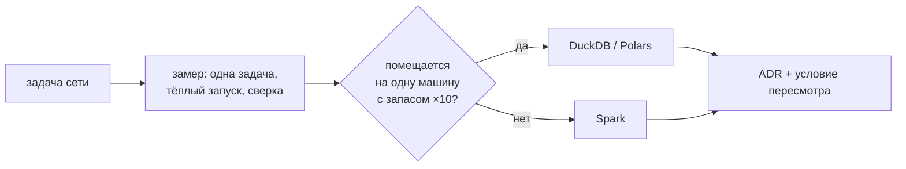

# 06 · Когда Spark не нужен: одна машина против кластера

> [!info] Урок одной фразой
> Бригада с прорабом нужна, когда дом не построить одному мастеру. Для ремонта кухни бригада
> только мешает: пока прораб раздаст задания и рабочие доедут, мастер-одиночка (DuckDB) уже
> закончит. Решение «Spark или нет» — это вопрос объёма, памяти одной машины и цены
> инфраструктуры, и он решается замером, а не модой.

> [!todo] Чек-лист: после урока ты сможешь
> - [ ] объяснить, за что Spark платит накладными расходами и когда они окупаются;
> - [ ] честно сравнить движки: одна задача, тёплый запуск, время, пиковая память, сверка результата;
> - [ ] прочитать цифры замера на нашем стеке и не ошибиться в их интерпретации;
> - [ ] сформулировать критерии выбора для задачи сети и записать решение как ADR.

**Нужно для:** лаба [07.4](../labs/07.4_one_task_three_engines/README.md).
**Карта урока:** [when-not-spark.canvas](../maps/when-not-spark.canvas).

---

## Шаг 0. Азбука

| Понятие | В аналогии | Подробнее |
|---|---|---|
| Вертикальное масштабирование | Взять мастера посильнее | [масштабируемость](../../../glossary/scalability.md) |
| Горизонтальное масштабирование | Нанять бригаду | [масштабируемость](../../../glossary/scalability.md) |
| Накладные расходы распределения | Прораб, доставка, координация | [Spark](../../../glossary/spark.md) |
| Out-of-core | Мастер раскладывает материалы во дворе, когда кухня мала | [Arrow](../../../glossary/arrow.md) |

---

## Шаг 1. Чем платит Spark

**Проблема.** В модуле 04 (урок 06) DuckDB, Polars и pandas сравнивались на одной машине. Spark
добавляет к этому кластер. Что он даёт и что стоит?

**Как устроено.** Spark платит за распределённость:

- **Запуск и координация.** Driver строит план, раздаёт задачи, собирает статусы; каждая задача
  — сериализация, планирование, отчёт. Десятки миллисекунд на задачу — незаметно на часовой
  работе и заметно на секундной.
- **Shuffle по сети и через диск** (урок 02) — даже если executors на одной машине.
- **JVM и память.** Executors резервируют память заранее: наш кластер в покое занимает ~5,6 ГБ
  (master, 2 workers с executors, driver), даже когда ничего не считает.
- **Эксплуатация.** Образ с JAR-файлами, версии Spark/Iceberg/Python, мониторинг, UI.

Взамен Spark даёт то, чего нет у одной машины: **суммарную память и диски многих машин**,
устойчивость к падению узла (задача перезапускается на другом), работу с данными, которые не
помещаются ни на один сервер.

**Что из этого следует.** Пока данные помещаются в память (или на диск) одной машины, а запрос
не требует многочасовых shuffle, однопроцессный движок обычно **быстрее и дешевле**. Порог
сместился за последние годы: на одном сервере сегодня сотни ГБ памяти и десятки ядер.

---

## Шаг 2. Как сравнивать честно

**Проблема.** «Polars в 10 раз быстрее Spark» — по какому замеру? С холодным стартом кластера?
С чтением из S3 или с локального диска? С проверкой, что результат одинаковый?

**Как устроено.** Правила замера, которые пригодятся в лабе 07.4:

1. **Одна и та же задача и один и тот же вход**: те же файлы, те же колонки, тот же результат.
2. **Сверка результата**: число строк и контрольная сумма совпадают у всех движков. Быстрый, но
   неверный ответ — не ответ.
3. **Тёплый запуск**: замер 2–3 раза, берётся типичное значение. Первый запуск греет кэш ОС и
   загружает библиотеки.
4. **Каждый движок — в отдельном процессе**, иначе пиковая память смешивается.
5. **Что входит в замер**: только вычисление или ещё подключение, запуск кластера, запись.
   Записать явно.
6. **Пиковая память** — `ru_maxrss` процесса. Для Spark это память **клиента**: вычисляют
   executors в других контейнерах, их память смотри в `docker stats`.

Скрипт `demo/bench_hourly.py` делает один такой замер: почасовые продажи (108 млн строк после
`explode`) → сумма по магазину и часу.

> [!example]- Попробуй сам: один запрос на трёх движках
> ```bash
> make up PROFILES="spark"
> make shell
> cd modules/07_batch_spark/demo
> for e in duckdb polars spark duckdb polars spark; do python bench_hourly.py $e 2>/dev/null; done
> exit
> docker stats --no-stream --format '{{.Name}} {{.MemUsage}}' | grep spark
> ```
> **Увидишь** (второй прогон, у тебя цифры будут близкими):
> ```
> duckdb: строк 21552, 0.52 с, пик памяти процесса 376 МБ
> polars: строк 21552, 1.84 с, пик памяти процесса 5451 МБ
> spark: строк 21552, 1.46 с, пик памяти процесса 160 МБ
> ```
> и около 5,5 ГБ суммарно у контейнеров `spark-*`.
> **Почему:** DuckDB разворачивает массив потоково и агрегирует, не материализуя 108 млн строк.
> Polars `explode` материализует их в памяти (5,5 ГБ). Spark считает быстро, но 160 МБ — только
> клиент; работа и память — в кластере, плюс ~0,5 с на подключение.

---

## Шаг 3. Как читать такие цифры

**Проблема.** Цифры выше легко истолковать неверно: «Spark быстрее Polars — значит, нужен
Spark».

**Как устроено.** Разберём, что на самом деле измерено:

| Наблюдение | Что оно значит | Чего оно **не** значит |
|---|---|---|
| DuckDB — 0,5 с и 0,4 ГБ | для данных этого размера одна машина справляется с запасом | что DuckDB справится с ×100 так же |
| Polars — 5,5 ГБ | этот способ записи (`explode` + `group_by`) материализует промежуточный результат | что Polars всегда прожорлив — другой запрос может быть экономнее |
| Spark — 1,5 с | кластер тёплый, данные локальные, shuffle маленький (частичная агрегация) | что Spark «быстрый»: его 4 ядра против 16 у DuckDB, и кластер стоит 5,5 ГБ постоянно |

Масштабирование проверяют, увеличивая вход (×10 в лабе 07.4): у однопроцессного движка время
растёт примерно линейно, пока данные помещаются в память, а потом — резко (диск) или падение. У
Spark время растёт медленнее, если добавить executors.

**Что из этого следует.** Для нашего датасета (4,85 млн дневных строк, 116 млн почасовых) Spark
не нужен для **скорости** — DuckDB быстрее. Spark в курсе нужен, чтобы понимать модель
распределённых вычислений, атомарную запись в Iceberg (урок 04) и потому что он — стандарт для
данных, которые не помещаются на одну машину.

---

## Шаг 4. Как решать для сети

**Проблема.** Нужен критерий, а не вкус.

**Как устроено.** Вопросы для решения:

| Вопрос | Склоняет к одной машине | Склоняет к Spark |
|---|---|---|
| Объём входа запроса | десятки ГБ | сотни ГБ — ТБ |
| Промежуточные данные (join, explode) | помещаются в память или на диск машины | нет |
| Рост за год | ×2–3 | ×10 и больше |
| Где уже данные и движки | DuckDB/dbt, Iceberg | есть кластер (Databricks, EMR), команда его знает |
| Нужны ли атомарные записи в Iceberg, MERGE на больших таблицах | редко | постоянно |
| Цена простоя кластера | важна | приемлема |

Решение записывают как **ADR** (модуль 01): контекст, варианты, выбор, последствия и условие
пересмотра («перейти на Spark, если вход ежедневного запроса превысит 200 ГБ»).

---

## Сборка целиком

Цикл решения «нужен ли Spark»:



| Ошибка в цикле | Последствие |
|---|---|
| нет сверки результата | сравнили быстрый неверный ответ с медленным верным |
| холодный кластер в замере | Spark «медленный» из-за старта JVM |
| память Spark по клиенту | «Spark экономный» при 5,5 ГБ в кластере |
| нет условия пересмотра | через год данных ×20, решение никто не пересматривает |

## Шпаргалка

| Хочу | Как |
|---|---|
| Замер трёх движков | `python bench_hourly.py duckdb|polars|spark` (папка демо) |
| Пиковая память процесса | `resource.getrusage(resource.RUSAGE_SELF).ru_maxrss // 1024` (МБ) |
| Память кластера | `docker stats --no-stream | grep spark` |
| Данные ×10 | объединить вход 10 раз со сдвигом ключей (лаба 07.4) |
| Записать решение | ADR в `capstone/architecture.md` |

## Типичные ошибки

| Симптом | Причина | Как проверить | Как чинить |
|---|---|---|---|
| Spark проигрывает на маленьких данных | накладные расходы | время задач против времени запроса в UI | одна машина для малых объёмов |
| Polars/pandas `OOM` | промежуточный результат материализован | пик памяти | lazy/streaming, DuckDB, выбор колонок |
| Разные числа у движков | разная обработка NULL, типов, дат | сверка сумм | одинаковая логика, явные типы |
| Решение «на Spark» без замера | мода | — | замер + ADR |

## Проверь себя

Карточки — в [flashcards.md](../flashcards.md).

> [!question] 1. Почему 160 МБ памяти у Spark в замере — не повод считать его самым экономным?
> > [!success]- Ответ
> > Это память клиента. Вычисляют executors в контейнерах кластера, а кластер постоянно занимает
> > около 5,5 ГБ.

> [!question] 2. DuckDB считает задачу за 0,5 с на 4,5 млн строк. Достаточно ли этого, чтобы отказаться от Spark навсегда?
> > [!success]- Ответ
> > Нет: нужен замер на росте (×10, ×100) и условие пересмотра в ADR. Пока данные помещаются на
> > машину с запасом — DuckDB; когда перестанут — пересмотреть.

> [!question] 3. Почему перед сравнением скорости нужно сверить результаты?
> > [!success]- Ответ
> > Движки по-разному обрабатывают NULL, типы и даты. Быстрый движок с неверным результатом
> > проигрывает медленному с верным.
