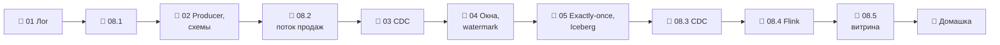

# Модуль 08 · Стриминг и CDC

**Длительность:** ~2 нед. · **Статус и DoD:** см. [ROADMAP](../../ROADMAP.md)

## Бизнес-вопрос

> Как видеть продажи и out-of-stock почти в реальном времени и не терять изменения в учётной системе?

## Цели

- понимать модель лога: топики, партиции, офсеты, группы, хранение
- писать producer и consumer с нужной гарантией доставки и схемой в Schema Registry
- построить CDC из Postgres через Debezium и объяснить, что он ловит лучше курсора
- считать оконные агрегаты во Flink по времени события с watermarks и опоздавшими
- писать поток в Iceberg с exactly-once и понимать цену мелких файлов

## Темы

- брокер сообщений vs лог (Клеппман, гл. 11); двойственность потока и таблицы
- Kafka/Redpanda: топики, партиции, ключи, offsets, consumer groups, retention, compaction
- producer: пачки, acks, идемпотентность; at-most / at-least / exactly-once
- Schema Registry: Avro, субъекты, версии, совместимость
- Kafka Connect, Debezium CDC; WAL, логическая репликация, слот, публикация (Клеппман, гл. 5)
- время события vs время обработки; окна, watermarks, опоздавшие данные; Flink SQL
- состояние, чекпоинты, exactly-once; стриминг в lakehouse: Iceberg sink, мелкие файлы

## Инструменты

Redpanda 26.2 + Console 3.12 (встроенный Schema Registry), Kafka Connect + Debezium 3.7, Flink 2.1
(слой `streaming.yaml`), confluent-kafka (группа `streaming`)

## Маршрут прохождения

Сначала урок, потом задачи лабы по нему. Статусы: ✅ сделано · 🟨 сейчас · ⬜ впереди.

| # | Шаг | Что | Статус |
|---|---|---|---|
| 1 | 📖 [01 · Лог событий](theory/01_log_and_kafka.md) · [карта](maps/log-and-kafka.canvas) | урок | ⬜ |
| 2 | 🧪 [Лаба 08.1 — Redpanda](labs/08.1_redpanda_basics/README.md) | партиции, группы, compaction | ⬜ |
| 3 | 📖 [02 · Producer, гарантии, схемы](theory/02_producers_and_schemas.md) · [карта](maps/producers-schemas.canvas) | урок | ⬜ |
| 4 | 🧪 [Лаба 08.2 — поток продаж](labs/08.2_sales_replay_producer/README.md) | producer, Avro, сверка | ⬜ |
| 5 | 📖 [03 · CDC и Debezium](theory/03_cdc_debezium.md) · [карта](maps/cdc-debezium.canvas) | урок | ⬜ |
| 6 | 📖 [04 · Время события, окна, Flink SQL](theory/04_time_windows_flink.md) · [карта](maps/time-windows-flink.canvas) | урок | ⬜ |
| 7 | 📖 [05 · Состояние, exactly-once, Iceberg](theory/05_state_exactly_once_iceberg.md) · [карта](maps/state-exactly-once.canvas) | урок | ⬜ |
| 8 | 🧪 [Лаба 08.3 — Debezium CDC](labs/08.3_debezium_cdc/README.md) | `retail_oltp` → Kafka → Iceberg | ⬜ |
| 9 | 🧪 [Лаба 08.4 — Flink SQL](labs/08.4_flink_sql_windows/README.md) | окна, опоздавшие, exactly-once | ⬜ |
| 10 | 🧪 [Лаба 08.5 — мини-проект](labs/08.5_streaming_mini_project/README.md) | OOS потоком, SCD2 из CDC, эссе | ⬜ |
| 11 | 🏁 [Домашка-чекпоинт](homework.md) | 7 вопросов и одно предсказание | ⬜ |

> [!note] Учебный проект и инфраструктура модуля (2026-10-02)
> - Слой `infra/docker/streaming.yaml`: `make up PROFILES="streaming"` (первый раз собирается образ
>   `debd/flink:2.1.3` и скачиваются образы — долго). Console — <http://localhost:8084>, Flink —
>   <http://localhost:8086>; Kafka API `redpanda:9092`, Schema Registry `http://redpanda:8081`,
>   Kafka Connect `http://connect:8083` — внутри сети. Слой занимает ~4–5 ГБ памяти.
> - Postgres работает с `wal_level=logical` (`core.yaml`) — нужно Debezium.
> - `make rpk ARGS="…"` — CLI Redpanda, `make flink-sql ARGS="-f /workspace/…sql"` — Flink SQL.
> - [`demo/`](demo/) — producer показаний погоды (`streaming_demo/weather_producer.py`: ключ
>   `city_id`, `--late`, `--avro`) и consumer групп; Flink SQL (`flink/`); песочница CDC
>   (`connect/`). Продажи и out-of-stock — твои, в лабах. Это не capstone и не ответы к лабам.

## Чек-лист самоконтроля

Отмечай пункт, только когда можешь сделать это **без подсказки**. Подробные чек-листы — в начале
каждого урока.

**Лог и доставка** ([01](theory/01_log_and_kafka.md), [02](theory/02_producers_and_schemas.md))
- [ ] Предсказываю партицию по ключу и распределение партиций в группе
- [ ] Читаю lag и переигрываю поток
- [ ] Выбираю гарантию доставки порядком «обработать / закоммитить»
- [ ] Регистрирую схему Avro и проверяю совместимость изменения

**CDC** ([03](theory/03_cdc_debezium.md))
- [ ] Запускаю коннектор Debezium и читаю события `r/c/u/d`, tombstone
- [ ] Объясняю, что ловит CDC и теряет курсор, и слежу за слотом

**Потоковая обработка** ([04](theory/04_time_windows_flink.md), [05](theory/05_state_exactly_once_iceberg.md))
- [ ] Пишу окна по времени события с watermark и предсказываю закрытие окна
- [ ] Объясняю судьбу опоздавших событий
- [ ] Объясняю чекпоинты и exactly-once до Iceberg

**Закрытие модуля**
- [ ] Лабы 08.1–08.5 выполнены по Definition of Done
- [ ] [Домашка](homework.md) сдана, ошибки разобраны
- [ ] Тезисы по Клеппману (гл. 11; гл. 5 — журналы репликации) — в [`notes.md`](notes.md)

## Материалы модуля

| Что | Где |
|---|---|
| 🧠 Карточки для повторения | [flashcards.md](flashcards.md) |
| 🗺️ Карты | [maps/](maps/) |
| 📚 Термины | [glossary/](../../glossary/README.md) — раздел «Стриминг и CDC» |
| 🧪 Учебный проект | [demo/](demo/) |
| 🎬 Визуализации | [Партиции и доставка Kafka](visuals/kafka_log_delivery.html) · [Окна и watermark](visuals/watermark_windows.html) · [Watermark и чекпоинт: видео](visuals/watermark_checkpoint.mp4) · [Курсор против журнала: видео](../04_ingestion/visuals/cursor_vs_log.mp4) |
| 📓 Заметки | [notes.md](notes.md) |

## Мини-проект (вклад в capstone)

Потоковая витрина out-of-stock + SCD2 справочников из CDC + эссе про exactly-once (лаба 08.5).

## Ресурсы

- [Redpanda docs](https://docs.redpanda.com/) · [rpk](https://docs.redpanda.com/current/reference/rpk/)
- [Debezium: PostgreSQL connector](https://debezium.io/documentation/reference/stable/connectors/postgresql.html)
- [Flink SQL: окна](https://nightlies.apache.org/flink/flink-docs-stable/docs/dev/table/sql/queries/window-tvf/) · [время и watermarks](https://nightlies.apache.org/flink/flink-docs-stable/docs/concepts/time/) · [чекпоинты](https://nightlies.apache.org/flink/flink-docs-stable/docs/dev/datastream/fault-tolerance/checkpointing/)
- [Iceberg + Flink](https://iceberg.apache.org/docs/latest/flink/)
- [Confluent: Schema Registry, совместимость](https://docs.confluent.io/platform/current/schema-registry/fundamentals/schema-evolution.html)
- [Surfalytics: Data Streaming Mastery](https://github.com/surfalytics/data-projects/tree/main/async-projects/data-streaming-mastery)

## Книга и видео

Полная таблица с пояснениями, зачем читать и что пропустить — в [карте чтения](../../reading_map.md#08--стриминг-и-cdc).

- 📖 Клеппман, гл. 11 целиком — потоковая обработка (все уроки)
- 📖 Клеппман, гл. 5 — журналы репликации, основа CDC (урок 03)
- 📖 Клеппман, гл. 9 и 12 — по желанию, к эссе про exactly-once (урок 05)
- 🎬 [Zoomcamp `07-streaming`](https://github.com/DataTalksClub/data-engineering-zoomcamp/tree/main/07-streaming) — Kafka, Avro и Schema Registry

## Домашка-чекпоинт

После всех лаб — [`homework.md`](homework.md).

## Заметки

Конспект, тезисы по книге и выводы — в [`notes.md`](notes.md).
