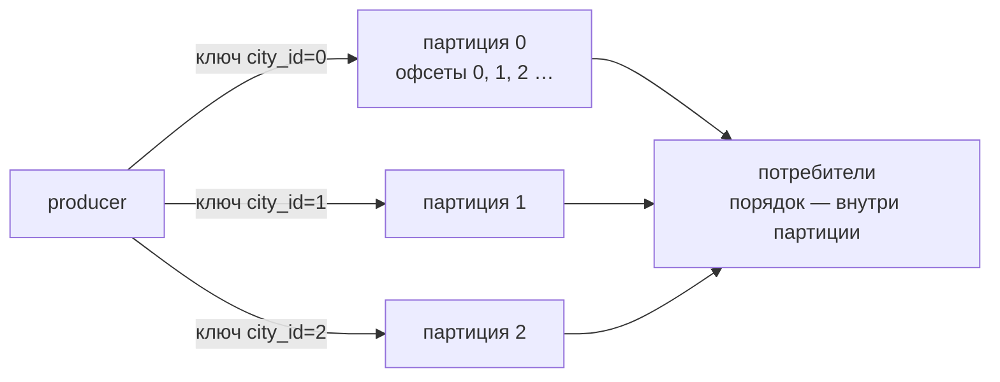
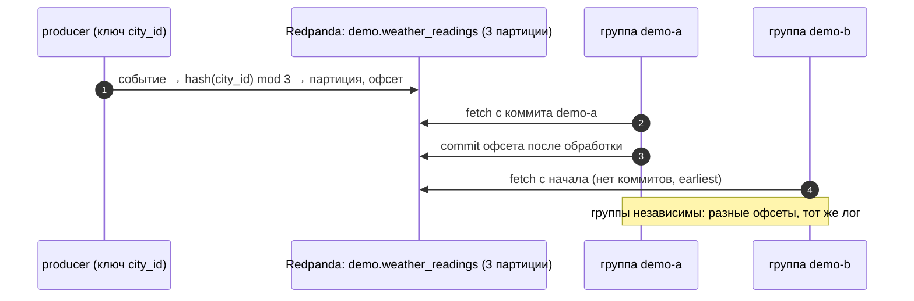

# 01 · Лог событий: топики, партиции, офсеты и группы потребителей

> [!info] Урок одной фразой
> Kafka — это не почтовый ящик, из которого письмо исчезает после прочтения, а журнал на
> проходной: события дописываются в конец и лежат там, сколько решили хранить. Каждый читатель
> держит закладку (офсет) и читает со своей скоростью; журналов несколько параллельных (партиции),
> а читатели одной команды (группа) делят журналы между собой, чтобы не читать одно и то же
> дважды.

> [!todo] Чек-лист: после урока ты сможешь
> - [ ] объяснить разницу между брокером-очередью и логом и что из неё следует;
> - [ ] создать топик с партициями и объяснить, как ключ выбирает партицию и почему порядок гарантирован только внутри партиции;
> - [ ] прочитать офсеты, lag и состояние группы потребителей;
> - [ ] предсказать, как распределятся партиции между потребителями группы;
> - [ ] выбрать retention или compaction для топика.

**Нужно для:** лаба [08.1](../labs/08.1_redpanda_basics/README.md).
**Карта урока:** [log-and-kafka.canvas](../maps/log-and-kafka.canvas).

---

## Шаг 0. Азбука: журнал на проходной

| В Kafka | В аналогии «журнал» | Подробнее |
|---|---|---|
| Событие (record) | Строка журнала: кто, когда, что | [Kafka](../../../glossary/kafka.md) |
| Топик | Журнал одной темы | [Kafka](../../../glossary/kafka.md) |
| Партиция | Один из параллельных томов журнала | [партиция Kafka](../../../glossary/kafka-partition.md) |
| Офсет | Номер строки в томе | [офсет и группа](../../../glossary/consumer-group.md) |
| Ключ | По нему выбирают том | [партиция Kafka](../../../glossary/kafka-partition.md) |
| Группа потребителей | Команда читателей, делящая тома | [офсет и группа](../../../glossary/consumer-group.md) |
| Retention / compaction | Сколько хранить / оставлять последнюю запись по ключу | [Kafka](../../../glossary/kafka.md) |

Подними слой стриминга (первый раз — сборка образа Flink и загрузка образов, это долго):

```bash
make up PROFILES="streaming"
make ps | grep -E "redpanda|connect|flink"     # redpanda, console, connect, flink — healthy / Up
make rpk ARGS="cluster info"
```

UI Redpanda Console — <http://localhost:8084>.

---

## Шаг 1. Очередь или лог

**Проблема.** Между системами нужен буфер событий: касса публикует продажу, а её ждут витрина,
система пополнения запасов и антифрод. Если каждый ходит к кассе напрямую, касса знает обо всех
потребителях и падает вместе с самым медленным.

**Как устроено.** Клеппман (гл. 11) различает два вида брокеров:

| | Брокер-очередь (RabbitMQ, классический JMS) | Лог (Kafka, Redpanda) |
|---|---|---|
| Что после прочтения | сообщение удаляется | событие остаётся до истечения хранения |
| Порядок | не гарантирован при нескольких потребителях | гарантирован внутри партиции |
| Новый потребитель | видит только новые сообщения | может прочитать историю с начала |
| Масштабирование чтения | потребители берут сообщения по одному | группа делит партиции |
| Повторное чтение | невозможно | сдвинуть офсет назад |

Лог — это файл, в который **только дописывают**. Брокер хранит его на диске, а читатель сам
помнит, до какой строки дочитал (офсет). Поэтому чтение не меняет лог, и сколько угодно
независимых читателей читают его в своём темпе.

**Что из этого следует.** Лог превращает поток событий в **воспроизводимые данные**: новая
витрина может пересчитать историю, прочитав топик с начала; упавший потребитель продолжит с
последнего сохранённого офсета. Это та же идея неизменяемого входа, что в пакетной обработке
(модуль 06, урок 01).

---

## Шаг 2. Топики и партиции: как ключ выбирает место

**Проблема.** Один журнал на всё не выдержит нагрузки: его пишет один узел, читает один процесс.

**Как устроено.** Топик делится на **партиции** — независимые логи. Каждая партиция — свой файл со
своей нумерацией офсетов с 0. Producer выбирает партицию так:

- если у события есть **ключ** — `hash(ключ) mod число_партиций`: события одного ключа всегда в
  одной партиции и читаются **по порядку**;
- если ключа нет — партиции чередуются (в современных клиентах — пачками), порядок между
  событиями не гарантирован.



**Что из этого следует.** Ключ выбирают по тому, **для чего нужен порядок**: показания одного
города должны идти по времени — ключ `city_id`. Цена — перекос: у нас город 0 — половина строк
(модуль 07, урок 03), и его партиция будет самой тяжёлой. Число партиций задают с запасом:
увеличить можно, но тогда `hash mod N` изменится, и новые события ключа пойдут в другую партицию.

> [!example]- Попробуй сам: топик и события с ключами
> ```bash
> make rpk ARGS="topic create demo.weather_readings -p 3"
> make shell
> cd modules/08_streaming_cdc/demo
> python -m streaming_demo.weather_producer --from 2024-04-01 --to 2024-04-03
> exit
> make rpk ARGS="topic describe demo.weather_readings -p"
> ```
> **Увидишь:** `2694 событий → demo.weather_readings (опоздавших 0), не доставлено 0`; в описании
> партиций — у каждой из трёх свой `HIGH-WATERMARK` (число событий), сумма — 2694, и они
> неравны.
> **Почему:** 898 магазинов × 3 дня; ключ `city_id` раскладывает 18 городов по 3 партициям по
> хешу, а города разного размера.

---

## Шаг 3. Офсеты и группы потребителей

**Проблема.** Витрина читает топик тремя процессами для скорости. Как им не прочитать одно
событие дважды и как продолжить после перезапуска?

**Как устроено.** Потребители с одинаковым `group.id` образуют **группу**. Брокер-координатор
распределяет между ними **партиции**: каждая партиция в группе читается **ровно одним**
потребителем. Прочитав, потребитель **коммитит офсет** — сохраняет в брокере «группа G дочитала
партицию 1 до офсета 412». После перезапуска чтение продолжается с коммита.

- **Lag** — сколько событий партиции группа ещё не прочитала: `конец партиции − закоммиченный
  офсет`. Главная метрика здоровья потребителя.
- **Ребалансировка** — когда потребитель входит в группу или выходит из неё, партиции
  перераспределяются.
- Разные группы независимы: у каждой свои офсеты. Витрина и антифрод читают один топик, не
  мешая друг другу.

| Потребителей в группе | Партиций 3 | Что происходит |
|---|---|---|
| 1 | читает все 3 | |
| 3 | по одной | максимальный параллелизм |
| 4 | трое читают, один простаивает | партиций меньше, чем потребителей |

**Что из этого следует.** Параллелизм чтения ограничен **числом партиций**. А `auto.offset.reset`
решает, откуда читает новая группа без офсетов: `earliest` — с начала, `latest` — только новые.

> [!example]- Попробуй сам: группы, коммиты и lag
> ```bash
> make shell
> cd modules/08_streaming_cdc/demo
> python -m streaming_demo.consumer --group demo-a --max 5
> python -m streaming_demo.consumer --group demo-a --max 5
> python -m streaming_demo.consumer --group demo-b --max 2
> exit
> make rpk ARGS="group describe demo-a"
> ```
> **Увидишь:** первый запуск `demo-a` печатает 5 строк `партиция … офсет …`; второй продолжает
> с тех же партиций **со следующих** офсетов. `demo-b` снова начинает с начала. В `group describe`
> — по партициям `CURRENT-OFFSET`, `LOG-END-OFFSET` и `LAG`; сумма LAG = 2694 − 10.
> **Почему:** офсеты коммитятся в брокере на группу; новая группа без коммитов читает с
> `earliest`.

---

## Шаг 4. Сколько хранить: retention и compaction

**Проблема.** Лог растёт бесконечно. Что и когда удалять?

**Как устроено.** У топика две политики очистки (`cleanup.policy`):

- **delete + retention** — удалять сегменты старше `retention.ms` (по умолчанию 7 дней) или когда
  топик больше `retention.bytes`. Для потоков событий: продажи, показания, клики.
- **compact** — хранить **последнее событие каждого ключа**, старые версии удаляются в фоне.
  Событие со значением `null` (**tombstone**) означает «ключ удалён» и тоже со временем
  исчезает. Для потоков изменений состояния: справочники, CDC (урок 03) — топик превращается в
  «текущую таблицу», которую можно восстановить, прочитав его с начала.

**Что из этого следует.** Retention определяет, на сколько назад можно **переиграть** поток:
если витрину нужно пересчитать за месяц, а хранится 7 дней, переигрывать неоткуда — нужен ещё и
слой хранения (Iceberg, урок 05).

---

## Сборка целиком

Producer и две группы на одном топике:



| Шаг | Если сломается | Симптом |
|---|---|---|
| 1 | нет ключа | порядок событий города не гарантирован |
| 2 | потребитель медленный | растёт LAG |
| 3 | коммит до обработки, затем падение | событие потеряно (at-most-once, урок 02) |
| 4 | `latest` у новой группы | история не прочитана |

## Шпаргалка

| Хочу | Как |
|---|---|
| Состояние кластера | `make rpk ARGS="cluster info"` |
| Создать топик | `make rpk ARGS="topic create t -p 3"`; compaction — `-c cleanup.policy=compact` |
| Описание партиций | `make rpk ARGS="topic describe t -p"` |
| Прочитать N событий | `make -s rpk ARGS="topic consume t -n 3"` (формат с `\|` — в одинарных кавычках) |
| Группы и lag | `make rpk ARGS="group list"`, `make rpk ARGS="group describe g"` |
| Сбросить офсеты группы | `make rpk ARGS="group seek g --to start"` (группа должна быть пустой) |
| UI | <http://localhost:8084> |

## Типичные ошибки

| Симптом | Причина | Как проверить | Как чинить |
|---|---|---|---|
| События города «перепутаны» | нет ключа или разные ключи | ключ в `topic consume` | ключ — сущность, порядок которой важен |
| Добавили потребителей — быстрее не стало | партиций меньше, чем потребителей | `group describe` | больше партиций (с осторожностью) |
| Новая группа ничего не читает | `auto.offset.reset=latest` | настройки потребителя | `earliest` |
| После увеличения партиций порядок нарушен | `hash mod N` изменился | номер партиции ключа | задавать партиции с запасом сразу |
| Нельзя переиграть поток за месяц | retention 7 дней | `retention.ms` | хранить в Iceberg (урок 05) |

## Проверь себя

Карточки — в [flashcards.md](../flashcards.md).

> [!question] 1. Витрина и антифрод читают один топик. Почему их надо поместить в разные группы?
> > [!success]- Ответ
> > В одной группе каждая партиция читается одним потребителем — они бы поделили события, и каждый
> > увидел бы только часть. В разных группах у каждого свои офсеты и полный поток.

> [!question] 2. Топик на 3 партиции, в группе 5 потребителей. Сколько работают?
> > [!success]- Ответ
> > Три: партиция читается одним потребителем группы; двое простаивают и ждут ребалансировки.

> [!question] 3. Почему порядок гарантирован только внутри партиции?
> > [!success]- Ответ
> > Партиции — независимые логи, их читают разные потребители в своём темпе. Глобальной нумерации
> > нет; порядок есть только у офсетов одной партиции.

> [!question] 4. Для топика «текущий статус магазина» — retention или compaction?
> > [!success]- Ответ
> > Compaction по ключу `store_id`: важна последняя запись каждого магазина, а прочитав топик с
> > начала, получаешь текущую таблицу статусов.
