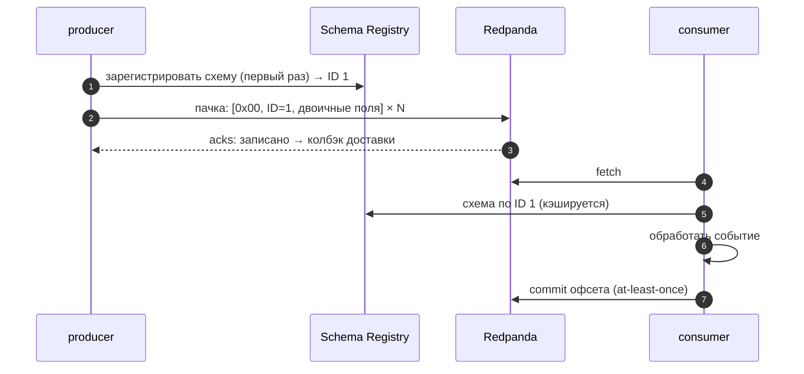

# 02 · Producer и consumer: гарантии доставки и схемы событий

> [!info] Урок одной фразой
> Отправить письмо можно «один раз и не проверять» (может потеряться), «пока не придёт
> квитанция» (может прийти дважды) или «с номером, по которому почта отбросит повтор» (ровно
> один раз). А чтобы получатель понял письмо, у обоих должен быть один бланк — схема. Schema
> Registry — нотариус бланков: хранит их версии и не даёт выпустить новую, которую старые
> получатели не прочитают.

> [!todo] Чек-лист: после урока ты сможешь
> - [ ] объяснить, что делает producer между `produce()` и подтверждением брокера: батчи, `acks`, повторы;
> - [ ] отличить at-most-once, at-least-once и exactly-once и получить каждую порядком «обработать / закоммитить»;
> - [ ] объяснить идемпотентный producer и зачем `flush()`;
> - [ ] записать события в Avro со схемой в Schema Registry и прочитать версию схемы;
> - [ ] предсказать, пройдёт ли изменение схемы проверку совместимости.

**Нужно для:** лаба [08.2](../labs/08.2_sales_replay_producer/README.md).
**Карта урока:** [producers-schemas.canvas](../maps/producers-schemas.canvas).

---

## Шаг 0. Азбука

| Понятие | В аналогии «почта» | Подробнее |
|---|---|---|
| Producer | Отправитель | [Kafka](../../../glossary/kafka.md) |
| `acks` | Сколько квитанций ждать | [гарантии доставки](../../../glossary/delivery-semantics.md) |
| Идемпотентный producer | Номер письма, по которому повтор отбрасывается | [гарантии доставки](../../../glossary/delivery-semantics.md) |
| at-most / at-least / exactly-once | Может потеряться / может задвоиться / ровно один раз | [гарантии доставки](../../../glossary/delivery-semantics.md) |
| Сериализация | Как письмо упаковано: JSON, Avro | [Schema Registry](../../../glossary/schema-registry.md) |
| Schema Registry | Нотариус бланков с версиями | [Schema Registry](../../../glossary/schema-registry.md) |
| Совместимость схем | Новый бланк читается старыми получателями | [эволюция схемы](../../../glossary/schema-evolution.md) |

---

## Шаг 1. Что происходит после `produce()`

**Проблема.** `producer.produce(topic, value)` возвращается мгновенно. Значит ли это, что событие
уже в Kafka?

**Как устроено.** Нет. Клиент (у нас `confluent-kafka` — обёртка над C-библиотекой librdkafka):

1. Сериализует ключ и значение в байты.
2. Кладёт событие в **буфер** партиции и сразу возвращает управление.
3. Фоновый поток собирает **пачки** (батчи) по партициям и отправляет брокеру — по размеру пачки
   или по времени `linger.ms`.
4. Брокер записывает пачку и отвечает, когда выполнено условие `acks`: `0` — не ждать ответа,
   `1` — записал лидер партиции, `all` — записали все синхронные реплики.
5. Клиент вызывает **колбэк доставки**; при временной ошибке повторяет отправку сам.

`poll()` даёт клиенту обработать колбэки, `flush()` ждёт, пока буфер опустеет. Без `flush()` в
конце скрипта события из буфера пропадут при выходе процесса.

**Что из этого следует.** Скорость producer — от пачек, а не от отдельных событий; надёжность —
от `acks` и повторов. Повторы порождают проблему дублей: если брокер записал пачку, но ответ
потерялся, клиент отправит её снова.

---

## Шаг 2. Гарантии доставки

**Проблема.** Потребитель упал. Что будет с событием, которое он обрабатывал?

**Как устроено.** Гарантию определяет **порядок двух действий** потребителя — обработать событие и
закоммитить офсет:

| Гарантия | Порядок | Что при падении между шагами |
|---|---|---|
| at-most-once | закоммитить → обработать | событие потеряно |
| at-least-once | обработать → закоммитить | событие обработается ещё раз (дубль) |
| exactly-once (эффект) | обработать и закоммитить **атомарно** или обработка идемпотентна | ни потерь, ни дублей |

На стороне producer дубли от повторов убирает **идемпотентный producer**
(`enable.idempotence=true`): у каждой пачки номер, и брокер отбрасывает повтор с уже записанным
номером. Это exactly-once **записи в одну партицию**, но не всей цепочки «прочитать → обработать →
записать».

У нас consumer демо коммитит **после** обработки (`enable.auto.commit=False` и
`consumer.commit(message=msg)`), то есть at-least-once. Так делают почти всегда, а дубли
убирают идемпотентной записью в приёмник (merge по ключу, модуль 04).

**Что из этого следует.** «Exactly-once» в стриминге — это почти всегда **at-least-once +
идемпотентный приёмник** или транзакции внутри одной системы (Flink + Kafka, урок 05). Клеппман
(гл. 11–12) называет это сквозной (end-to-end) корректностью.

> [!warning] Ловушка: автокоммит
> По умолчанию consumer коммитит офсеты сам раз в несколько секунд (`enable.auto.commit=true`),
> **независимо** от того, обработал ли ты событие. Падение после автокоммита, но до обработки —
> потеря. Для данных, которые нельзя терять, автокоммит выключают.

---

## Шаг 3. Схема события и Schema Registry

**Проблема.** Producer шлёт JSON. Через месяц разработчик переименовал поле `precipitation` в
`precip`. Потребители не падают — они тихо получают `null`.

**Как устроено.** **Avro** — двоичный формат со схемой: какие поля, какие типы, какие значения
по умолчанию. Схему не кладут в каждое сообщение — она хранится в **Schema Registry**, а сообщение
начинается с 5 байт: «магический» байт и **ID схемы**. Потребитель по ID берёт схему из реестра и
разбирает байты.

Схемы хранятся по **субъекту** (subject) — обычно `<топик>-value` — с версиями. При регистрации
новой версии реестр проверяет **совместимость** с предыдущей:

| Режим (по умолчанию BACKWARD) | Что разрешено | Кто может обновиться первым |
|---|---|---|
| BACKWARD | удалить поле; добавить поле **со значением по умолчанию** | потребители |
| FORWARD | добавить поле; удалить поле со значением по умолчанию | producer |
| FULL | только поля со значениями по умолчанию | любой |
| NONE | что угодно | — проверки нет |

Переименование поля — это удаление старого и добавление нового **без** значения по умолчанию:
BACKWARD его не пропустит, и producer получит ошибку **до** того, как сломает потребителей.

У нас в Redpanda реестр встроенный: `http://redpanda:8081` (внутри сети).

> [!example]- Попробуй сам: Avro и версия схемы
> ```bash
> make shell
> cd modules/08_streaming_cdc/demo
> python -m streaming_demo.weather_producer --from 2024-04-01 --avro
> curl -s http://redpanda:8081/subjects; echo
> curl -s http://redpanda:8081/subjects/demo.weather_readings.avro-value/versions/latest | python -m json.tool | head -12
> exit
> make -s rpk ARGS="topic consume demo.weather_readings.avro -n 1 -f %v" | head -c 16 | od -A n -t x1
> ```
> **Увидишь:** `898 событий → demo.weather_readings.avro`; субъект
> `demo.weather_readings.avro-value`; версия 1 со схемой `WeatherReading`; первые байты значения —
> `00 00 00 00 01 0a 0a 26 …` (магический байт 0 и ID схемы 1 в четырёх байтах), дальше двоичные
> поля.
> **Почему:** сериализатор при первой отправке зарегистрировал схему и пишет её ID в начало
> каждого сообщения.

---

## Шаг 4. Проверка совместимости до выкатки

**Проблема.** Как узнать, сломает ли новая схема потребителей, не отправляя событий?

**Как устроено.** Реестр умеет проверить схему без регистрации:
`POST /compatibility/subjects/<subject>/versions/latest` с новой схемой → `{"is_compatible": …}`.
Эту проверку ставят в CI (модуль 12) рядом с тестами: изменение схемы события — такое же
ломающее изменение, как переименование колонки (модуль 09, урок 03).

> [!example]- Попробуй сам: какие изменения совместимы
> ```bash
> make shell
> cd modules/08_streaming_cdc/demo
> python - <<'EOF'
> import json, urllib.request
> from streaming_demo.weather_producer import AVRO_SCHEMA
> url = "http://redpanda:8081/compatibility/subjects/demo.weather_readings.avro-value/versions/latest"
> def check(label, schema):
>     req = urllib.request.Request(url, method="POST", headers={"Content-Type": "application/vnd.schemaregistry.v1+json"},
>                                  data=json.dumps({"schema": json.dumps(schema)}).encode())
>     print(label, json.load(urllib.request.urlopen(req)))
> base = json.loads(AVRO_SCHEMA)
> added = {**base, "fields": base["fields"] + [{"name": "humidity", "type": ["null", "double"], "default": None}]}
> renamed = {**base, "fields": [f if f["name"] != "precipitation" else {"name": "precip", "type": "double"} for f in base["fields"]]}
> check("добавить поле с default:", added)
> check("переименовать поле:", renamed)
> EOF
> exit
> ```
> **Увидишь:** `добавить поле с default: {'is_compatible': True}` и `переименовать поле:
> {'is_compatible': False}`.
> **Почему:** режим BACKWARD: новая схема должна читать старые данные. Поле с default
> заполнится значением по умолчанию; поле `precip` без default в старых данных взять неоткуда.

---

## Сборка целиком

Событие от producer до потребителя с Avro:



| Шаг | Если сломается | Симптом |
|---|---|---|
| 1 | несовместимая схема | ошибка регистрации у producer — ничего не отправлено |
| 2 | нет `flush()` в конце | часть событий не дошла |
| 3 | ответ брокера потерян, повтор без идемпотентности | дубль события |
| 7 | коммит до обработки + падение | потеря события |

## Шпаргалка

| Хочу | Как |
|---|---|
| Producer | `Producer({"bootstrap.servers": "redpanda:9092", "enable.idempotence": True})` |
| Отправить с ключом | `produce(topic, key=…, value=…)`; `poll(0)` в цикле; `flush()` в конце |
| Consumer без автокоммита | `"enable.auto.commit": False`; `commit(message=msg)` после обработки |
| Читать новой группой с начала | `"auto.offset.reset": "earliest"` |
| Avro | `AvroSerializer(SchemaRegistryClient({"url": "http://redpanda:8081"}), схема)` |
| Субъекты и версии | `curl http://redpanda:8081/subjects`, `…/subjects/<s>/versions/latest` |
| Проверить совместимость | `POST /compatibility/subjects/<s>/versions/latest` |

## Типичные ошибки

| Симптом | Причина | Как проверить | Как чинить |
|---|---|---|---|
| Скрипт отработал, событий меньше | нет `flush()` | число событий в топике | `flush()` и проверка его результата |
| Дубли после сбоя сети | повторы без идемпотентности | ключи в топике | `enable.idempotence=true`; идемпотентный приёмник |
| Потери после падения consumer | автокоммит или коммит до обработки | настройки, порядок вызовов | коммит после обработки |
| Потребитель получает `null` в поле | JSON без схемы, поле переименовали | сравнение событий | Avro + реестр с проверкой совместимости |
| `Schema being registered is incompatible` | изменение нарушает режим совместимости | проверка `/compatibility` | default у нового поля; новая версия топика |

## Проверь себя

Карточки — в [flashcards.md](../flashcards.md).

> [!question] 1. Consumer пишет событие в Iceberg через merge по ключу и коммитит офсет после записи. Какая гарантия у результата?
> > [!success]- Ответ
> > Эффект exactly-once: доставка at-least-once (повтор после падения возможен), но merge по ключу
> > делает повтор безвредным.

> [!question] 2. Почему `produce()` не гарантирует, что событие в брокере?
> > [!success]- Ответ
> > Он только кладёт событие в буфер клиента. Отправка идёт пачками в фоне, подтверждение
> > приходит колбэком; гарантия — после `flush()` с нулём недоставленных.

> [!question] 3. В схеме Avro нужно добавить поле `store_format`. Как сделать, чтобы реестр (BACKWARD) принял изменение?
> > [!success]- Ответ
> > Добавить поле с типом `["null", "string"]` и `"default": null`: старые данные читаются новой
> > схемой, поле получает значение по умолчанию.

> [!question] 4. Чем идемпотентный producer не спасает от дублей в витрине?
> > [!success]- Ответ
> > Он убирает повторы отправки одной пачки в партицию. Но если producer-скрипт перезапустили и он
> > заново прочитал источник, события пойдут как новые; и consumer может обработать событие дважды.
