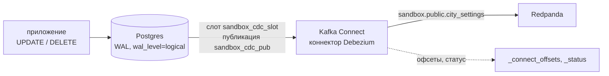
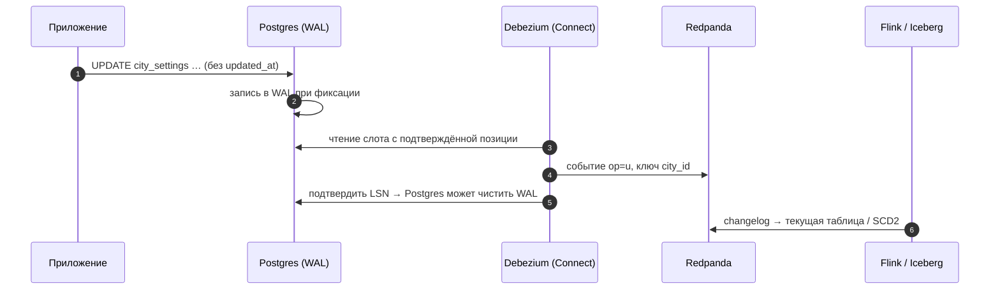

# 03 · CDC: изменения учётной системы как поток событий

> [!info] Урок одной фразой
> У каждой базы есть бортовой журнал (WAL), куда она записывает каждое изменение раньше, чем
> меняет сами таблицы, — чтобы восстановиться после сбоя. CDC читает этот журнал и превращает
> каждую запись «строку изменили так-то» в событие Kafka. В отличие от выгрузки по `updated_at`
> (модуль 04), журнал не врёт: в нём есть и удаления, и правки «старого модуля», который забыл
> обновить `updated_at`.

> [!todo] Чек-лист: после урока ты сможешь
> - [ ] объяснить, что такое WAL, логическая репликация, слот и публикация, и что из них берёт Debezium;
> - [ ] запустить коннектор Debezium через REST API Kafka Connect и прочитать его статус;
> - [ ] прочитать событие изменения: `before`, `after`, `op`, `source`, и что такое tombstone;
> - [ ] объяснить начальный снапшот и почему CDC ловит то, что теряет курсор по `updated_at`;
> - [ ] назвать главный эксплуатационный риск слота репликации и как его увидеть;
> - [ ] объяснить двойственность потока и таблицы и путь к SCD2 из CDC.

> [!tip] Визуализация темы
> Видео с озвучкой (3:08): [cursor_vs_log.mp4](../../04_ingestion/visuals/cursor_vs_log.mp4) — три дыры курсора `updated_at` (без штампа, удаление, долгая транзакция), окно перечитывания, журнал WAL и события Debezium.

**Нужно для:** лаб [08.3](../labs/08.3_debezium_cdc/README.md),
[08.5](../labs/08.5_streaming_mini_project/README.md).
**Карта урока:** [cdc-debezium.canvas](../maps/cdc-debezium.canvas).

---

## Шаг 0. Азбука

| Понятие | В аналогии «бортовой журнал» | Подробнее |
|---|---|---|
| WAL | Бортовой журнал базы | [CDC](../../../glossary/cdc.md) |
| Логическая репликация | Журнал, переведённый на язык «строка → изменение» | [CDC](../../../glossary/cdc.md) |
| Слот репликации | Закладка читателя журнала: до сюда прочитано | [CDC](../../../glossary/cdc.md) |
| Публикация | Список таблиц, изменения которых выдают | [CDC](../../../glossary/cdc.md) |
| Kafka Connect | Платформа готовых перегрузчиков «система ↔ Kafka» | [Kafka Connect, Debezium](../../../glossary/kafka-connect-debezium.md) |
| Debezium | Перегрузчик, читающий журнал базы | [Kafka Connect, Debezium](../../../glossary/kafka-connect-debezium.md) |
| Tombstone | Пустое событие «ключ удалён» | [Kafka](../../../glossary/kafka.md) |

---

## Шаг 1. Почему не хватает выгрузки по `updated_at`

**Проблема.** В модуле 04 (урок 03) инкремент по курсору `updated_at` терял изменения:

- «старый модуль» менял категорию товара, не трогая `updated_at`;
- удалённые строки исчезали без следа;
- долгая транзакция фиксировалась с меткой времени в прошлом и проскакивала мимо курсора.

**Как устроено.** Postgres, прежде чем изменить страницы таблицы, записывает изменение в **WAL**
(write-ahead log) — последовательный журнал всех изменений. Это нужно ему самому: после сбоя он
восстанавливается, проигрывая журнал (Клеппман, гл. 5, журналы репликации). Журнал содержит
**все** изменения в порядке фиксации транзакций — независимо от того, какие колонки изменило
приложение.

При `wal_level=logical` Postgres умеет **логическую репликацию**. Плагин декодирования (у нас
стандартный `pgoutput`) переводит физические записи журнала в построчные изменения: «в таблице T
вставлена / изменена / удалена строка с такими значениями».

**Что из этого следует.** CDC (change data capture) через журнал ловит то, что курсор теряет:
удаления, изменения без `updated_at`, долгие транзакции (событие приходит при фиксации, в
порядке фиксации). Цена — доступ к журналу и ещё один процесс, который нужно эксплуатировать.

> [!example]- Попробуй сам: уровень журнала
> ```bash
> make shell
> export PGHOST=postgres PGUSER=$POSTGRES_USER PGPASSWORD=$POSTGRES_PASSWORD
> psql -d postgres -tAc "SHOW wal_level"
> exit
> ```
> **Увидишь:** `logical`.
> **Почему:** в `core.yaml` Postgres запускается с `-c wal_level=logical`. По умолчанию уровень
> `replica` — его хватает для физических реплик, но не для построчных изменений.

---

## Шаг 2. Слот, публикация и Debezium

**Проблема.** Журнал Postgres периодически чистит: старые сегменты WAL удаляются после
контрольной точки. Как читателю не потерять изменения, пока он был выключен?

**Как устроено.**

- **Публикация** (`CREATE PUBLICATION … FOR TABLE …`) — какие таблицы выдавать.
- **Слот репликации** — серверная закладка читателя: позиция в журнале (LSN), до которой
  изменения подтверждены. Пока слот не подтвердил позицию, Postgres **не удаляет** WAL после неё.
- **Kafka Connect** — отдельный сервис, который запускает **коннекторы**: готовые программы
  «система ↔ Kafka». Коннекторы настраиваются JSON-конфигом через REST API
  (`http://connect:8083`), свои офсеты и статус хранят в служебных топиках Kafka (`_connect_*`).
- **Debezium** — коннектор-источник для Postgres: создаёт публикацию и слот, делает начальный
  снапшот таблиц, затем читает слот и пишет каждое изменение в топик
  `<prefix>.<схема>.<таблица>`.



**У нас.** Конфиг коннектора песочницы — `demo/connect/sandbox_cdc.json`:

```json
"connector.class": "io.debezium.connector.postgresql.PostgresConnector",
"plugin.name": "pgoutput",                                   // ① встроенный плагин Postgres
"database.password": "${env:POSTGRES_PASSWORD}",             // ② секрет из окружения Connect
"database.dbname": "sandbox_cdc",
"topic.prefix": "sandbox",                                   // ③ топики sandbox.<схема>.<таблица>
"table.include.list": "public.city_settings",
"slot.name": "sandbox_cdc_slot",
"publication.autocreate.mode": "filtered",                   // ④ публикация только на нужные таблицы
"snapshot.mode": "initial"                                   // ⑤ сначала снапшот, потом журнал
```

| Метка | Что важно |
|---|---|
| ② | Пароля нет в файле: Kafka Connect подставляет переменную окружения (`EnvVarConfigProvider` в `streaming.yaml`). |
| ⑤ | Начальный снапшот читает текущее содержимое таблиц и выдаёт его событиями `op = r` (read). Затем коннектор переходит на журнал с той позиции, на которой сделан снапшот. Между ними нет пропусков и дублей. |

> [!example]- Попробуй сам: песочница и коннектор
> ```bash
> make shell
> export PGHOST=postgres PGUSER=$POSTGRES_USER PGPASSWORD=$POSTGRES_PASSWORD
> psql -d postgres -qc "CREATE DATABASE sandbox_cdc"
> psql -d sandbox_cdc -q -f modules/08_streaming_cdc/demo/connect/sandbox_cdc.sql
> curl -s -X POST -H "Content-Type: application/json" \
>   --data @modules/08_streaming_cdc/demo/connect/sandbox_cdc.json http://connect:8083/connectors | head -c 80; echo
> sleep 10
> curl -s http://connect:8083/connectors/sandbox-cdc/status; echo
> psql -d sandbox_cdc -tAc "SELECT slot_name, plugin, active FROM pg_replication_slots"
> exit
> make -s rpk ARGS="topic consume sandbox.public.city_settings -n 1 -f '%v\n'"
> ```
> **Увидишь:** статус коннектора и задачи — `RUNNING`; слот `sandbox_cdc_slot | pgoutput | t`; в
> топике — событие снапшота с `"op":"r"`, `"before":null` и строкой города в `after`.
> **Почему:** коннектор создал слот и публикацию, прочитал 18 строк снапшотом и ждёт изменений в
> журнале.

---

## Шаг 3. Как выглядит событие изменения

**Проблема.** Что именно приходит в топик при UPDATE и DELETE и как из этого восстановить таблицу?

**Как устроено.** Значение события Debezium (с `schemas.enable=false`) — объект:

| Поле | Что внутри |
|---|---|
| `before` | строка до изменения; без `REPLICA IDENTITY FULL` у UPDATE — `null`, у DELETE — только ключ |
| `after` | строка после изменения (`null` при DELETE) |
| `op` | `r` — снапшот, `c` — вставка, `u` — изменение, `d` — удаление |
| `source` | метаданные: база, таблица, LSN, `txId`, время фиксации `ts_ms` |
| `ts_ms` | когда коннектор обработал событие |

**Ключ** события — первичный ключ строки (`{"city_id": 3}`): все изменения одной строки идут в
одну партицию по порядку. После события `d` Debezium по умолчанию шлёт **tombstone** — событие с
тем же ключом и значением `null`. По нему compaction (урок 01) со временем удалит ключ из топика.

`REPLICA IDENTITY` — что Postgres пишет в журнал о **старой** строке. `DEFAULT` — только
первичный ключ и только если он нужен: при UPDATE без смены ключа — ничего. `FULL` — все
колонки. Без `FULL` у UPDATE `before` пустой, и «что именно изменилось» по одному событию не понять.

> [!example]- Попробуй сам: UPDATE, DELETE и tombstone
> ```bash
> make shell
> export PGHOST=postgres PGUSER=$POSTGRES_USER PGPASSWORD=$POSTGRES_PASSWORD
> psql -d sandbox_cdc -qc "ALTER TABLE city_settings REPLICA IDENTITY FULL"
> psql -d sandbox_cdc -qc "UPDATE city_settings SET status = 'paused', updated_at = now() WHERE city_id = 3"
> psql -d sandbox_cdc -qc "UPDATE city_settings SET rain_threshold = 2.5 WHERE city_id = 4"
> psql -d sandbox_cdc -qc "DELETE FROM city_settings WHERE city_id = 17"
> exit
> make -s rpk ARGS="topic consume sandbox.public.city_settings -o 18 -n 4 -f '%k | %v\n'"
> ```
> **Увидишь:** четыре события после 18 событий снапшота:
>
> - `"op":"u"` у города 3 и у города 4 — с полным `before` и `after`. У города 4
>   `rain_threshold` 1.0 → 2.5: `updated_at` не менялся, а событие есть;
> - `"op":"d"` у города 17 с `"after":null`;
> - tombstone — строка `{"city_id":17} | ` с пустым значением.
>
> **Почему:** журнал фиксирует любое изменение строки, независимо от `updated_at`. Полное `before`
> пишется, потому что таблица переведена в `REPLICA IDENTITY FULL` до изменений.

> [!warning] Ловушка: `before: null` и Flink
> Выставляй `REPLICA IDENTITY FULL` для таблиц CDC **до** запуска коннектора. Без него событие
> UPDATE приходит с `"before":null`. Для Debezium это норма. Но формат `debezium-json` во Flink
> (шаг 5) превращает UPDATE в пару «удалить старую строку → вставить новую», и без старой строки не
> может. Задание падает и бесконечно перезапускается:
> `IllegalStateException: The "before" field of UPDATE message is null, if you are using Debezium
> Postgres Connector, please check the Postgres table has been set REPLICA IDENTITY to FULL level.`
> Такое событие уже лежит в топике. Его придётся пропустить (новая позиция чтения) или
> пересоздать поток снапшотом.

---

## Шаг 4. Риск слота: журнал, который не удаляется

**Проблема.** Ты остановил Kafka Connect на выходные. Что с Postgres?

**Как устроено.** Слот остался, его позиция не двигается, и Postgres **копит WAL** с этой позиции,
сколько бы его ни набралось. На загруженной базе за выходные — гигабайты; диск заканчивается, и
падает **учётная система**, а не pipeline. Объём удерживаемого журнала видно запросом к
`pg_replication_slots`:

```sql
SELECT slot_name, active,
       pg_size_pretty(pg_wal_lsn_diff(pg_current_wal_lsn(), restart_lsn)) AS retained_wal
FROM pg_replication_slots;
```

Защита: мониторинг `retained_wal` с алертом, `max_slot_wal_keep_size` в Postgres (слот
«сломается», но база выживет), удаление слота брошенного коннектора. В песочнице с работающим
коннектором `retained_wal` — несколько килобайт (на проверке — 3152 bytes): коннектор
подтверждает позицию почти сразу.

**Что из этого следует.** CDC — это связь с продакшен-базой: удаление коннектора без удаления
слота — мина замедленного действия. Порядок уборки: удалить коннектор → удалить слот → удалить
публикацию.

---

## Шаг 5. Поток и таблица — две стороны одного

**Проблема.** В топике — изменения. Витрине нужна таблица «текущие настройки городов» и история
«когда какой порог действовал» (SCD2, модуль 05).

**Как устроено.** Клеппман (гл. 11) называет это **двойственностью потока и таблицы**: таблица —
это результат применения всех изменений из потока по порядку; поток — это журнал изменений
таблицы. Отсюда:

- **текущее состояние** — применить события по ключу: `r/c/u` → записать `after`, `d` → удалить.
  Это делает merge в Iceberg (модуль 04) или changelog-таблица Flink (`format = 'debezium-json'`,
  урок 04);
- **история (SCD2)** — каждое событие `u` закрывает старую версию (`valid_to = ts`) и открывает
  новую. В отличие от snapshots dbt (модуль 05), промежуточные изменения между запусками не
  теряются — их видно в журнале.

> [!example]- Попробуй сам: поток изменений как таблица во Flink
> ```bash
> make flink-sql ARGS="-f /workspace/modules/08_streaming_cdc/demo/flink/03_cdc_changelog.sql" 2>&1 | grep -E "^\+|\|" | tail -8
> ```
> **Увидишь:** не таблицу, а **поток изменений результата**: строки с `op` = `+I` (вставка),
> `-U` / `+U` (старое и новое значение строки), всего около 44 строк. Последние значения: `paused`
> — 1, `active` — 16 (город 17 удалён, город 3 приостановлен).
> **Почему:** формат `debezium-json` превращает события в изменения строк, а агрегат над
> изменяющейся таблицей сам выдаёт изменения: каждое событие обновляет счётчик своего статуса.
> Итог — по текущему состоянию таблицы, а не по сумме событий.

**Очистка песочницы.** Порядок важен: остановить коннектор → удалить его офсеты → удалить
коннектор → удалить слот → базу и топик.

```bash
make shell
export PGHOST=postgres PGUSER=$POSTGRES_USER PGPASSWORD=$POSTGRES_PASSWORD
curl -s -X PUT http://connect:8083/connectors/sandbox-cdc/stop
curl -s -X DELETE http://connect:8083/connectors/sandbox-cdc/offsets; echo
curl -s -X DELETE http://connect:8083/connectors/sandbox-cdc
psql -d sandbox_cdc -tAc "SELECT pg_drop_replication_slot('sandbox_cdc_slot')"
psql -d postgres -qc "DROP DATABASE sandbox_cdc"
exit
make rpk ARGS="topic delete sandbox.public.city_settings"
```

> [!warning] Ловушка: офсеты коннектора переживают его удаление
> Перед повторным созданием коннектора с тем же именем удали его офсеты: `PUT …/stop`, затем
> `DELETE …/offsets`. Kafka Connect хранит позицию коннектора в топике `_connect_offsets` по
> **имени** коннектора. Иначе Debezium не сделает снапшот новой базы. Он попытается продолжить с
> запомненной позиции журнала, которой в новой базе нет. Коннектор при этом `RUNNING`, а задача —
> `FAILED`: `Last recorded offset is no longer available on the server`. Смотри статус **задач**,
> а не только коннектора.

---

## Сборка целиком



| Шаг | Если сломается | Симптом |
|---|---|---|
| 2 | `wal_level=replica` | коннектор падает: логическая репликация недоступна |
| 3 | Connect остановлен надолго | растёт `retained_wal`, диск Postgres |
| 4 | нет `REPLICA IDENTITY FULL` | у UPDATE `before` пустой |
| 6 | потребитель не обрабатывает tombstone | падает на `null`-значении |

## Шпаргалка

| Хочу | Как |
|---|---|
| Уровень журнала | `SHOW wal_level` → `logical` |
| Создать коннектор | `curl -X POST -H "Content-Type: application/json" --data @c.json http://connect:8083/connectors` |
| Статус / список / удалить | `GET /connectors/<имя>/status`, `GET /connectors`, `DELETE /connectors/<имя>` |
| Слоты и удерживаемый WAL | `pg_replication_slots` + `pg_wal_lsn_diff(pg_current_wal_lsn(), restart_lsn)` |
| Полное `before` | `ALTER TABLE t REPLICA IDENTITY FULL` |
| События топика | `make -s rpk ARGS="topic consume <t> -n 5 -f '%k \| %v\n'"` |
| CDC во Flink | `format = 'debezium-json'` + `PRIMARY KEY … NOT ENFORCED` |

## Типичные ошибки

| Симптом | Причина | Как проверить | Как чинить |
|---|---|---|---|
| Коннектор `FAILED`: logical decoding requires wal_level >= logical | Postgres без `wal_level=logical` | `SHOW wal_level` | `-c wal_level=logical`, перезапуск |
| Пароль в JSON коннектора в git | секрет записан явно | `grep password` | `${env:POSTGRES_PASSWORD}` + `EnvVarConfigProvider` |
| Диск Postgres растёт | брошенный слот | `retained_wal` | удалить слот, мониторить |
| У UPDATE `before: null` | `REPLICA IDENTITY DEFAULT` | событие `u` | `REPLICA IDENTITY FULL` |
| Потребитель падает на пустом значении | tombstone после DELETE | ключ без значения | обрабатывать `null`; или `tombstones.on.delete=false` |
| Повторный POST коннектора → 409 | коннектор уже есть | `GET /connectors` | `PUT /connectors/<имя>/config` |
| Коннектор `RUNNING`, задача `FAILED`: `Last recorded offset is no longer available` | старые офсеты коннектора с тем же именем | `GET /connectors/<имя>/status` | `PUT …/stop`, `DELETE …/offsets`, пересоздать |
| Задание Flink перезапускается: `The "before" field of UPDATE message is null` | `debezium-json` без `REPLICA IDENTITY FULL` | лог taskmanager | `REPLICA IDENTITY FULL` до запуска коннектора |

## Проверь себя

Карточки — в [flashcards.md](../flashcards.md).

> [!question] 1. Генератор модуля 04 делает `recategorize` без изменения `updated_at`. Увидит ли это Debezium и почему?
> > [!success]- Ответ
> > Да: UPDATE пишется в WAL при фиксации независимо от колонок. Debezium читает журнал, а не
> > `updated_at`, и выдаст событие `op=u`.

> [!question] 2. Почему после остановки Connect на неделю может упасть учётная система?
> > [!success]- Ответ
> > Слот удерживает WAL с последней подтверждённой позиции. Журнал копится, пока не кончится диск
> > Postgres. Нужен мониторинг `retained_wal` и/или `max_slot_wal_keep_size`.

> [!question] 3. Зачем Debezium шлёт tombstone после события `d`?
> > [!success]- Ответ
> > Чтобы в топике с compaction ключ со временем исчез полностью: compaction хранит последнее
> > значение ключа, а `null` означает «удалить ключ».

> [!question] 4. Чем SCD2 из CDC лучше snapshots dbt?
> > [!success]- Ответ
> > Snapshot видит только состояние на момент запуска — изменения между запусками теряются. CDC
> > даёт каждое изменение с временем фиксации, история полная.
