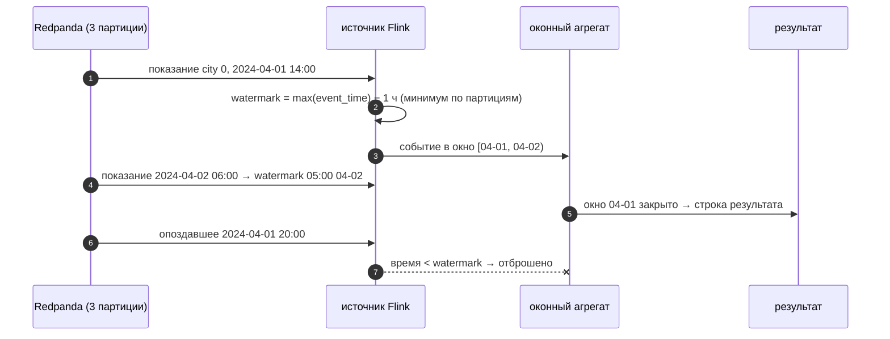

# 04 · Время события, окна и watermarks во Flink SQL

> [!info] Урок одной фразой
> Почта сортирует письма по дате на штемпеле, а не по дню, когда их принесли. Чтобы закрыть ящик
> «письма за понедельник», почтальон ждёт ещё немного — вдруг понедельничное письмо задержалось в
> пути. Как долго ждать, говорит отметка «до сюда всё пришло» — watermark. Письмо, пришедшее после
> закрытия ящика, — опоздавшее: его либо отбрасывают, либо обрабатывают отдельно.

> [!todo] Чек-лист: после урока ты сможешь
> - [ ] отличить время события от времени обработки и объяснить, почему считать нужно по первому;
> - [ ] выбрать окно: tumbling, hopping, session — и записать его в Flink SQL;
> - [ ] объяснить watermark и предсказать, когда окно выдаст результат;
> - [ ] объяснить, что происходит с опоздавшими событиями и как настроить терпимость;
> - [ ] описать источник Kafka во Flink SQL и запустить запрос из скрипта.

> [!tip] Визуализация темы
> Интерактивная страница [watermark_windows.html](../visuals/watermark_windows.html). Поток показаний с опоздавшими:
> терпимость watermark, закрытие окон и отброшенные события, как в Flink.

**Нужно для:** лаба [08.4](../labs/08.4_flink_sql_windows/README.md).
**Карта урока:** [time-windows-flink.canvas](../maps/time-windows-flink.canvas).

---

## Шаг 0. Азбука

| Понятие | В аналогии «почта» | Подробнее |
|---|---|---|
| Время события (event time) | Дата на штемпеле | [время события и окна](../../../glossary/event-time-windows.md) |
| Время обработки (processing time) | Когда письмо принесли | [время события и окна](../../../glossary/event-time-windows.md) |
| Окно | Ящик «письма за понедельник» | [время события и окна](../../../glossary/event-time-windows.md) |
| Watermark | Отметка «всё, что раньше, уже пришло» | [watermark](../../../glossary/watermark.md) |
| Опоздавшее событие | Письмо после закрытия ящика | [watermark](../../../glossary/watermark.md) |
| Flink | Сортировочный центр, работающий непрерывно | [Flink](../../../glossary/flink.md) |

---

## Шаг 1. Время события и время обработки

**Проблема.** Нужно посчитать средние осадки города за день. Считать по времени, когда событие
пришло во Flink, или по времени, когда показание снято?

**Как устроено.** У события два времени:

- **время события** — когда это произошло в мире (`event_time` в показании);
- **время обработки** — когда событие дошло до обработчика.

Они расходятся: сеть, буферы, перезапуски, а при **переигрывании истории** (прочитать топик с
начала) время обработки — сегодня, а события — за весь прошлый месяц. Клеппман (гл. 11)
показывает: агрегаты по времени обработки при переигрывании дают бессмысленные «всплески».

**Что из этого следует.** Аналитические агрегаты считают **по времени события**. Цена —
неизвестно, все ли события за прошлый час уже пришли. Это решают watermarks (шаг 3).

---

## Шаг 2. Окна

**Проблема.** Поток бесконечен. Агрегат «за всё время» никогда не будет готов. Нужны конечные
куски.

**Как устроено.** **Окно** нарезает поток по времени события. Во Flink SQL окна — табличные
функции (`TABLE(TUMBLE(…))`), они добавляют колонки `window_start` и `window_end`:

| Окно | Как режет | Flink SQL | Пример у нас |
|---|---|---|---|
| Tumbling (неперекрывающиеся) | подряд, без пересечений | `TUMBLE(TABLE t, DESCRIPTOR(ts), INTERVAL '1' DAY)` | осадки города за день |
| Hopping (скользящие) | длина L с шагом S < L, перекрываются | `HOP(TABLE t, DESCRIPTOR(ts), INTERVAL '1' HOUR, INTERVAL '3' HOUR)` | продажи за последние 3 часа каждый час |
| Cumulative | растущее окно от начала периода | `CUMULATE(… INTERVAL '1' HOUR, INTERVAL '1' DAY)` | продажи дня нарастающим итогом |
| Session | по паузам активности | `SESSION(… INTERVAL '30' MINUTE)` | серия покупок одного клиента |

```sql
SELECT window_start, city_id, count(*) AS readings, round(avg(precipitation), 3) AS precipitation
FROM TABLE(TUMBLE(TABLE weather_readings, DESCRIPTOR(event_time), INTERVAL '1' DAY))
GROUP BY window_start, window_end, city_id;      -- окно обязательно в GROUP BY
```

**Что из этого следует.** Результат окна выдаётся **один раз — когда окно закрылось**, а не
обновляется по каждому событию. Когда именно закрыть — решает watermark.

---

## Шаг 3. Watermark: когда закрывать окно

**Проблема.** Окно «1 апреля» закрыть в полночь? А если показание за 23:50 придёт в 00:10?

**Как устроено.** **Watermark** — утверждение потока «событий со временем раньше W больше не
будет». Во Flink его объявляют в DDL источника:

```sql
CREATE TEMPORARY TABLE weather_readings (
    store_id BIGINT, city_id BIGINT,
    event_time TIMESTAMP(3),                                   -- ① время события
    precipitation DOUBLE, temperature DOUBLE,
    WATERMARK FOR event_time AS event_time - INTERVAL '1' HOUR -- ② терпимость к опозданию
) WITH (
    'connector' = 'kafka', 'topic' = 'demo.weather_readings',
    'properties.bootstrap.servers' = 'redpanda:9092',
    'scan.startup.mode' = 'earliest-offset',
    'scan.bounded.mode' = 'latest-offset',                      -- ③ прочитать до текущего конца и закончить
    'format' = 'json', 'json.timestamp-format.standard' = 'SQL'
);
```

| Метка | Что важно |
|---|---|
| ① | Колонка времени события из сообщения. |
| ② | Watermark = максимальное увиденное время события минус 1 час. Flink считает, что события опаздывают не больше чем на час. Окно `[00:00, 24:00)` закроется, когда watermark перейдёт 24:00. Это случится, когда придёт событие со временем после 01:00 следующего дня. |
| ③ | Обычно источник Kafka бесконечен. Ограничение чтения нужно учебным запросам, чтобы они завершались. В конце ограниченного потока Flink выдаёт максимальный watermark и закрывает все окна. |

**Watermark в параллельном источнике** — минимум по партициям. Если одна партиция молчит, её
watermark не растёт, и окна не закрываются вообще (настройка `scan.watermark.idle-timeout`
исключает простаивающие партиции).

**Что из этого следует.** Терпимость — компромисс: больше — меньше потерянных опоздавших, но
результат позже. 1 час на показаниях погоды — разумно; для дашборда «сейчас» — секунды.

> [!example]- Попробуй сам: дневные окна по городам
> Топик пересоздаётся, чтобы в нём была ровно одна копия трёх дней (после урока 01 события уже есть):
> ```bash
> make rpk ARGS="topic delete demo.weather_readings"
> make rpk ARGS="topic create demo.weather_readings -p 3"
> make shell
> cd modules/08_streaming_cdc/demo
> python -m streaming_demo.weather_producer --from 2024-04-01 --to 2024-04-03
> exit
> make flink-sql ARGS="-f /workspace/modules/08_streaming_cdc/demo/flink/01_weather_windows.sql" 2>&1 | grep -E "^\| [+|]|window_start" | head -10
> ```
> **Увидишь:** таблицу `window_start | city_id | readings | precipitation` — по строке на день и
> город (города 0 и 1): у города 0 — `290` показаний в день, у города 1 — `14`.
> **Почему:** 3 дня показаний; `TUMBLE` на день по `event_time`; в конце ограниченного чтения
> watermark закрыл все окна. Число показаний города 0 за день — число его магазинов.

---

## Шаг 4. Опоздавшие события

**Проблема.** Событие пришло, когда его окно уже закрыто и результат выдан. Что с ним?

**Как устроено.** Во Flink SQL оконный агрегат по умолчанию **отбрасывает** события, у которых
время события меньше текущего watermark: окно уже выдано, а пересчитывать выданное он не будет.
Варианты:

- **больше терпимость** watermark — окна дольше ждут;
- **непрерывный агрегат без окна** (`GROUP BY city_id, CAST(event_time AS DATE)`). Flink выдаёт
  **обновления** результата (retract/upsert) по каждому событию, опоздавшие учитываются. Но
  приёмник должен уметь обновлять строки: upsert в Iceberg или Kafka с ключом;
- **досчитать опоздавших пакетно**. Стрим даёт быстрый приблизительный ответ, ночной пакетный
  пересчёт из Iceberg — точный (модуль 01, Lambda; Клеппман, гл. 11).

> [!example]- Попробуй сам: опоздавшие показания теряются
> Отдельный топик с **одной** партицией и скрипт `01b_late_events.sql` (почему так — ниже):
> ```bash
> make rpk ARGS="topic create demo.weather_late -p 1"
> make shell
> cd modules/08_streaming_cdc/demo
> python -m streaming_demo.weather_producer --from 2024-04-01 --to 2024-04-03 --late 0.1 --topic demo.weather_late
> exit
> make flink-sql ARGS="-f /workspace/modules/08_streaming_cdc/demo/flink/01b_late_events.sql" 2>&1 | grep -E "^\| [+]"
> ```
> **Увидишь:** producer пишет `опоздавших 277`. В окнах у города 0 за 1 апреля `257` показаний, за
> 2 апреля — `260` вместо 290, за 3 апреля — все `290`.
> **Почему:** опоздавшие отправлены в конец потока, после событий 3 апреля. Когда они пришли,
> watermark уже перешёл окна 1 и 2 апреля, и оконный агрегат их отбросил. Окно 3 апреля ещё было
> открыто — его закрыл только финальный watermark в конце ограниченного чтения.

> [!warning] Ловушка: при быстром переигрывании опоздания «не видно»
> Проверяй обработку опоздавших в условиях, похожих на живой поток, а не только переигрыванием
> истории. Тот же опыт на топике `demo.weather_readings` (3 партиции) и скрипте
> `01_weather_windows.sql` показывает **полные** окна: ни одно событие не отброшено. Причин две:
>
> 1. Watermark источника — минимум по партициям. Один читатель забирает партицию целиком, вместе с
>    её опоздавшими, пока другие партиции ещё не начаты. Минимум стоит на месте.
> 2. Watermark по умолчанию выпускается раз в 200 мс (`pipeline.auto-watermark-interval`), а весь
>    топик читается быстрее.
>
> В живом потоке события приходят постепенно, и опоздавшие теряются.

---

## Шаг 5. Как запускать Flink SQL у нас

**Проблема.** Где живёт запрос и что значит «он работает»?

**Как устроено.** Flink — кластер: **jobmanager** (координатор, UI <http://localhost:8086>) и
**taskmanager** (исполнитель, 4 слота). SQL-клиент (`make flink-sql`) компилирует запрос в
**задание** (job) — граф операторов — и отправляет его jobmanager:

- `SELECT` в клиенте с `result-mode = tableau` печатает результат; с ограниченным источником
  задание заканчивается само;
- `INSERT INTO …` с неограниченным источником — **долгоживущее** задание: оно работает в кластере
  и после выхода клиента, пока его не остановят (UI → Running Jobs → Cancel, или `STOP JOB`).

Временные таблицы (`CREATE TEMPORARY TABLE`) живут только в сессии клиента; каталог Iceberg
(урок 05) хранит таблицы постоянно.

---

## Сборка целиком



| Шаг | Если сломается | Симптом |
|---|---|---|
| 2 | одна партиция молчит | watermark не растёт, окна не закрываются, результата нет |
| 2 | терпимость мала | много опоздавших отброшено |
| 5 | агрегат по времени обработки | при переигрывании все события в одном «сегодняшнем» окне |

## Шпаргалка

| Хочу | Как |
|---|---|
| Время события и терпимость | `WATERMARK FOR ts AS ts - INTERVAL '1' HOUR` |
| Окно на день | `TABLE(TUMBLE(TABLE t, DESCRIPTOR(ts), INTERVAL '1' DAY))` + `GROUP BY window_start, window_end, …` |
| Скользящее окно | `HOP(TABLE t, DESCRIPTOR(ts), шаг, длина)` |
| Ограничить чтение Kafka | `'scan.bounded.mode' = 'latest-offset'` |
| Печать результата | `SET 'sql-client.execution.result-mode' = 'tableau'` |
| Запуск скрипта | `make flink-sql ARGS="-f /workspace/…sql"` |
| Простаивающие партиции | `'scan.watermark.idle-timeout' = '30 s'` |
| Watermark на каждом событии | `'scan.watermark.emit.strategy' = 'on-event'` |
| UI Flink | <http://localhost:8086> |

## Типичные ошибки

| Симптом | Причина | Как проверить | Как чинить |
|---|---|---|---|
| Окна не выдают результат | watermark не растёт (пустая партиция, нет новых событий) | UI → Watermarks | idle-timeout; данные во все партиции |
| В окнах меньше событий, чем ожидалось | опоздавшие отброшены | время событий против watermark | больше терпимость / непрерывный агрегат |
| `SELECT` в клиенте не заканчивается | источник неограничен | `scan.bounded.mode` | ограничить чтение или остановить |
| Задание осталось работать после выхода | `INSERT INTO` с неограниченным источником | UI → Running Jobs | Cancel / `STOP JOB` |
| Время парсится как NULL | формат времени в JSON | `json.timestamp-format.standard` | `SQL` для `YYYY-MM-DD HH:MM:SS` |

## Проверь себя

Карточки — в [flashcards.md](../flashcards.md).

> [!question] 1. Watermark — `event_time - INTERVAL '10' MINUTE`. Когда выдаст результат окно `[12:00, 13:00)`?
> > [!success]- Ответ
> > Когда watermark перейдёт 13:00, то есть когда во всех партициях придёт событие со временем
> > после 13:10.

> [!question] 2. Ты переиграл топик за неделю с начала. Чем агрегат по времени обработки отличится от агрегата по времени события?
> > [!success]- Ответ
> > По времени обработки вся неделя попадёт в окна последних минут (когда события прочитаны); по
> > времени события — разложится по своим дням, как было на самом деле.

> [!question] 3. Почему опоздавшее событие оконный агрегат отбросил, а `GROUP BY` по дате без окна — учёл?
> > [!success]- Ответ
> > Окно выдаёт результат один раз при закрытии и потом не меняет его. Непрерывный агрегат выдаёт
> > обновления результата по каждому событию — опоздавшее просто обновит строку.

> [!question] 4. В топике 3 партиции, в одну события не приходят. Что с окнами?
> > [!success]- Ответ
> > Watermark источника — минимум по партициям; пустая партиция держит его на месте, окна не
> > закрываются. Лечится `scan.watermark.idle-timeout`.
