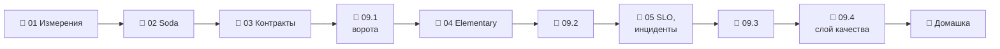

# Модуль 09 · Качество и наблюдаемость данных

**Длительность:** ~1 нед. · **Статус и DoD:** см. [ROADMAP](../../ROADMAP.md)

## Бизнес-вопрос

> Как узнать о проблеме в данных раньше, чем её заметит бизнес?

## Цели

- раскладывать «качество» на измерения и ставить проверки на нужном слое с нужной строгостью
- записывать ожидания от источников как контракты Soda и делать их воротами перед dbt
- защищать витрины контрактами моделей dbt
- наблюдать за объёмом и распределениями (Elementary) и читать отчёт
- формулировать SLO через перцентили, сверять с источником, разбирать инциденты по lineage

## Темы

- измерения качества: полнота, уникальность, свежесть, валидность, согласованность; слои и строгость
- dbt tests vs Soda vs Great Expectations; свежесть источника в dbt
- Soda Core 4: источник, контракт, проверки, пороги, коды выхода, Python API
- data contracts: границы (dlt, Soda, dbt `contract: enforced`), ломающие изменения
- observability: Elementary — аномалии объёма, колонок и разрезов, отчёт и алерты
- SLA/SLO/SLI через перцентили, бюджет ошибок, MTTD/MTTR, постмортемы
- reconciliation: сверка источника и витрины
- lineage в разборе инцидентов: вверх к источнику, вниз к потребителям

## Инструменты

dbt tests, Soda Core 4.25 (+ soda-duckdb), Elementary 0.26 (dbt-пакет и CLI `edr`), DuckDB

## Маршрут прохождения

Сначала урок, потом задачи лабы по нему. Статусы: ✅ сделано · 🟨 сейчас · ⬜ впереди.

| # | Шаг | Что | Статус |
|---|---|---|---|
| 1 | 📖 [01 · Измерения качества](theory/01_quality_dimensions.md) · [карта](maps/quality-dimensions.canvas) | урок | ⬜ |
| 2 | 📖 [02 · Soda Core](theory/02_soda_contracts.md) · [карта](maps/soda-contracts.canvas) | урок | ⬜ |
| 3 | 📖 [03 · Контракты данных](theory/03_data_contracts.md) · [карта](maps/data-contracts.canvas) | урок | ⬜ |
| 4 | 🧪 [Лаба 09.1 — Soda](labs/09.1_soda_checks/README.md) | контракты bronze, ворота в Dagster | ⬜ |
| 5 | 📖 [04 · Наблюдаемость: Elementary](theory/04_observability_elementary.md) · [карта](maps/observability-elementary.canvas) | урок | ⬜ |
| 6 | 🧪 [Лаба 09.2 — Elementary](labs/09.2_elementary/README.md) | отчёт, мониторы, аномалии | ⬜ |
| 7 | 📖 [05 · SLO, сверка, инциденты](theory/05_slo_incidents.md) · [карта](maps/slo-incidents.canvas) | урок | ⬜ |
| 8 | 🧪 [Лаба 09.3 — SLO и инцидент](labs/09.3_slo_and_incident/README.md) | `ops/slo.md`, постмортем | ⬜ |
| 9 | 🧪 [Лаба 09.4 — мини-проект](labs/09.4_quality_mini_project/README.md) | слой качества capstone | ⬜ |
| 10 | 🏁 [Домашка-чекпоинт](homework.md) | 7 вопросов и одно предсказание | ⬜ |

> [!note] Учебный проект модуля (2026-10-02)
> - Новых сервисов нет: Soda и Elementary — группа зависимостей `quality` в образе workspace.
> - [`demo/build_demo_db.py`](demo/build_demo_db.py) — база `data/demo_quality.duckdb`: дневные
>   продажи 898 магазинов за 97 дней, **даты сдвинуты к вчерашнему дню** (свежесть и детекторы
>   аномалий сравнивают с текущим временем). Флаги `--drop-day`, `--stale N`, `--null-city N`,
>   `--negative N`, `--dupes` внедряют инциденты.
> - [`demo/soda/`](demo/soda/) — источник и контракты Soda; [`demo/dbt_quality/`](demo/dbt_quality/)
>   — dbt-проект с тестами, свежестью источника, контрактом модели и мониторами Elementary
>   (`dbt deps && dbt build`; отчёт — `edr report …`, урок 04).
> - Это не capstone и не ответы к лабам.

## Чек-лист самоконтроля

Отмечай пункт, только когда можешь сделать это **без подсказки**. Подробные чек-листы — в начале
каждого урока.

**Проверки** ([01](theory/01_quality_dimensions.md), [02](theory/02_soda_contracts.md), [03](theory/03_data_contracts.md))
- [ ] Перевожу измерение качества в проверку с порогом и выбираю слой и строгость
- [ ] Пишу контракт Soda и предсказываю код выхода
- [ ] Включаю контракт модели dbt и выкатываю ломающее изменение в три шага

**Наблюдаемость и эксплуатация** ([04](theory/04_observability_elementary.md), [05](theory/05_slo_incidents.md))
- [ ] Настраиваю мониторы Elementary и объясняю, когда они ошибаются
- [ ] Формулирую SLO через перцентиль и считаю SLI по истории
- [ ] Сверяю данные с источником и иду по lineage вверх и вниз
- [ ] Пишу постмортем, где причина — свойство системы

**Закрытие модуля**
- [ ] Лабы 09.1–09.4 выполнены по Definition of Done
- [ ] [Домашка](homework.md) сдана, ошибки разобраны
- [ ] Тезисы по Клеппману (гл. 1, перцентили) — в [`notes.md`](notes.md)

## Материалы модуля

| Что | Где |
|---|---|
| 🧠 Карточки для повторения | [flashcards.md](flashcards.md) |
| 🗺️ Карты | [maps/](maps/) |
| 📚 Термины | [glossary/](../../glossary/README.md) — раздел «Качество и наблюдаемость» |
| 🧪 Учебный проект | [demo/](demo/) |
| 📓 Заметки | [notes.md](notes.md) |

## Мини-проект (вклад в capstone)

Слой качества capstone: карта проверок, ворота Soda, контракты витрин, мониторы, сверка, SLO в
[`ops/slo.md`](../../ops/slo.md) и постмортем в [`ops/incidents.md`](../../ops/incidents.md)
(лабы 09.3–09.4).

## Ресурсы

- [Soda v4: язык контрактов](https://docs.soda.io/soda-v4/reference/contract-language-reference) · [Soda docs](https://docs.soda.io/)
- [Elementary docs](https://docs.elementary-data.com/) · [тесты аномалий](https://docs.elementary-data.com/data-tests/introduction)
- [dbt: model contracts](https://docs.getdbt.com/docs/mesh/govern/model-contracts) · [source freshness](https://docs.getdbt.com/docs/deploy/source-freshness)
- [Google SRE Book: SLO](https://sre.google/sre-book/service-level-objectives/)
- [Surfalytics: Elementary + dbt](https://github.com/surfalytics/data-projects/tree/main/de-projects/09_elementary_dbt) · [Soda Core](https://github.com/surfalytics/data-projects/tree/main/de-projects/07_soda_core_snowflake)

## Книга и видео

Полная таблица с пояснениями, зачем читать и что пропустить — в [карте чтения](../../reading_map.md#09--качество-и-наблюдаемость).

- 📖 Клеппман, гл. 1 — перцентили (повтор; урок 05)
- 📖 Клеппман, гл. 12 — проверка целостности (по желанию; урок 05, сверка)
- 🎬 [Zoomcamp `05-data-platforms`](https://github.com/DataTalksClub/data-engineering-zoomcamp/tree/main/05-data-platforms) — часть про качество данных (по желанию)

## Домашка-чекпоинт

После всех лаб — [`homework.md`](homework.md).

## Заметки

Конспект, тезисы по книге и выводы — в [`notes.md`](notes.md).
