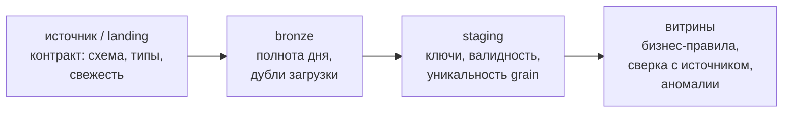
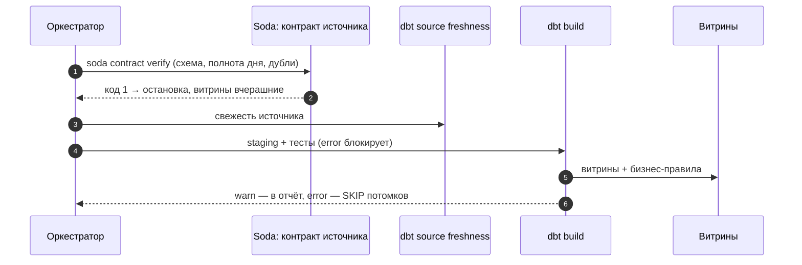

# 01 · Качество данных: что проверять, где и насколько строго

> [!info] Урок одной фразой
> Данные — продукты на складе магазина. Их проверяют по нескольким признакам. Всё ли привезли
> (полнота) и нет ли двойной поставки (уникальность)? Не просрочено ли (свежесть)? Годен ли товар
> (валидность)? Сходится ли накладная с полкой (согласованность)?
>
> Проверять лучше на приёмке, а не у кассы. Не каждая находка — повод закрыть магазин: где-то
> хватит пометки, а где-то нужно снять товар с полки.

> [!todo] Чек-лист: после урока ты сможешь
> - [ ] назвать измерения качества и для каждого — проверку на наших данных;
> - [ ] решить, на каком слое (источник, bronze, staging, витрина) ставить проверку и почему;
> - [ ] выбрать строгость: остановить pipeline (error) или предупредить (warn);
> - [ ] проверить свежесть источника в dbt и прочитать результат;
> - [ ] сравнить dbt tests, Soda и Great Expectations и выбрать инструмент под задачу.

**Нужно для:** лаба [09.1](../labs/09.1_soda_checks/README.md).
**Карта урока:** [quality-dimensions.canvas](../maps/quality-dimensions.canvas).

---

## Шаг 0. Азбука: склад магазина

| Измерение | В аналогии «склад» | Проверка у нас | Подробнее |
|---|---|---|---|
| Полнота (completeness) | всё ли привезли | нет NULL в ключах; магазинов в дне не меньше вчерашнего | [измерения качества](../../../glossary/data-quality-dimensions.md) |
| Уникальность (uniqueness) | нет двойной поставки | одна строка на (магазин, день) | [измерения качества](../../../glossary/data-quality-dimensions.md) |
| Свежесть (freshness, timeliness) | не просрочено | последняя загрузка не старше 26 ч | [свежесть](../../../glossary/data-freshness.md) |
| Валидность (validity) | годен ли товар | продажи ≥ 0, статус из списка | [измерения качества](../../../glossary/data-quality-dimensions.md) |
| Согласованность (consistency) | накладная сходится с полкой | сумма витрины = сумма источника | [сверка](../../../glossary/reconciliation.md) |
| Точность (accuracy) | товар тот, что заказан | совпадение с эталоном (учётная система) | [измерения качества](../../../glossary/data-quality-dimensions.md) |

Учебная база модуля — `data/demo_quality.duckdb`: дневные продажи 898 магазинов за 97 дней,
даты сдвинуты так, чтобы последний день был **вчерашним** (почему — шаг 4). Собери её:

```bash
make shell
cd modules/09_quality_observability/demo
python build_demo_db.py        # чистые данные: 87106 строк, 97 дней
exit
```

---

## Шаг 1. Измерения качества: от «данные плохие» к проверке

**Проблема.** «Витрина врёт» — не диагноз. Чтобы проверять данные автоматически, нужно разложить
«качество» на признаки, каждый из которых превращается в запрос с числовым ответом.

**Как устроено.** Каждое измерение — это вопрос к данным и правило «сколько нарушений допустимо».
Проверка — **запрос, возвращающий число нарушений** (модуль 00, лаба 00.3), и порог:

| Измерение | Запрос-нарушение | Порог |
|---|---|---|
| полнота ключа | `count(*) WHERE city_id IS NULL` | 0 |
| полнота дня | доля магазинов последнего дня от вчерашнего | ≥ 95 % |
| уникальность | `count(*) - count(DISTINCT (store_id, dt))` | 0 |
| валидность | `count(*) WHERE sales < 0` | 0 |
| свежесть | `now() - max(loaded_at)` | < 26 ч |
| согласованность | `abs(sum(источник) - sum(витрина))` | < 0,01 |

**Что из этого следует.** Измерение подсказывает, **что** проверять, а данные — **какой порог**.
Порог «магазинов в дне не меньше 95 % от вчерашнего» взят из данных: в датасете в каждом дне
все 898 магазинов. Порог без знания данных либо молчит, либо кричит на каждом запуске.

---

## Шаг 2. Где проверять: слои и раннее обнаружение

**Проблема.** Ошибку в данных можно поймать на входе, в середине или в витрине. Где ставить
проверку?

**Как устроено.** Чем ближе к источнику, тем дешевле ошибка: она ещё не размножилась по
моделям, а причина видна сразу. Чем ближе к витрине, тем ближе к тому, что видит бизнес, —
проверяются бизнес-правила, которых на входе нет.



| Слой | Что проверять | Почему здесь |
|---|---|---|
| источник | схема, типы, свежесть поставки | не пускать сломанный формат дальше (модуль 04, контракты) |
| bronze | полнота дня, повторная загрузка | ловит сбои загрузки, пока они не стали «данными» |
| staging | ключи, NULL, диапазоны, grain | после приведения типов проверки точны |
| витрины | бизнес-правила, сверка, аномалии | то, что видит потребитель |

**Что из этого следует.** Проверки не дублируют, а **распределяют**: уникальность grain — на
staging, сверка сумм — на витрине. Одна и та же проверка на трёх слоях даёт три красных сигнала
об одной проблеме и мешает найти место, где она возникла.

---

## Шаг 3. Строгость: остановить или предупредить

**Проблема.** Отрицательные продажи у двух магазинов из 898 — повод не обновлять витрину для
всей сети? А пропавшие 60 % магазинов?

**Как устроено.** У каждой проверки есть **строгость** (severity):

- **error** — проверка блокирует. В dbt упавший тест с `severity: error` пропускает (SKIP) все
  модели ниже по графу. В Dagster блокирующая проверка не даёт материализовать потомков (модуль
  06). Витрина остаётся вчерашней, но правильной.
- **warn** — проверка сообщает, но pipeline продолжается. Витрина обновлена, проблема видна в
  отчёте.

В dbt строгость и пороги задаются в `config`: `severity: warn`, `warn_if: ">10"`,
`error_if: ">100"` — так «пара строк — предупреждение, сотня — остановка».

**Что из этого следует.** Правило выбора — **цена ошибки для потребителя**. Неполный день в
витрине продаж исказит выводы всей сети — error. Пара отрицательных продаж (возвраты?) —
warn с разбором. Свежесть: опоздание на час — warn, на сутки — error.

> [!example]- Попробуй сам: три инцидента и dbt build
> ```bash
> make shell
> cd modules/09_quality_observability/demo
> python build_demo_db.py --drop-day --null-city 3 --negative 2
> cd dbt_quality && dbt deps && dbt build 2>&1 | grep -E "FAIL|PASS=" | cut -c1-120
> cd .. && python build_demo_db.py        # вернуть чистые данные
> exit
> ```
> **Увидишь:** `FAIL 2 dbt_utils_accepted_range_stg_store_sales_sales__0`, `FAIL 1
> elementary_volume_anomalies_stg_store_sales_…`, `FAIL 3 not_null_stg_store_sales_city_id` и
> итог `PASS=35 … ERROR=3 SKIP=3`.
> **Почему:** три инцидента пойманы тремя разными проверками на staging; тесты со строгостью
> error заблокировали витрину и её тесты (SKIP). Аномалию объёма ловит Elementary (урок 04).

---

## Шаг 4. Свежесть источника в dbt

**Проблема.** Данные могут быть безупречны, но позавчерашние: загрузка тихо остановилась.
Тесты значений этого не видят — старые данные проходят все проверки.

**Как устроено.** dbt проверяет свежесть **источника** по колонке времени загрузки:

```yaml
sources:
  - name: raw
    tables:
      - name: store_sales_daily
        loaded_at_field: loaded_at                          # ① время загрузки строки
        config:
          freshness:
            warn_after: {count: 26, period: hour}           # ② сутки + запас на ночную выгрузку
            error_after: {count: 50, period: hour}          # ③ двое суток — точно сломано
```

① Колонка, когда строка попала в хранилище (не дата продаж!). ② ③ Пороги относительно **текущего
времени**: `now() - max(loaded_at)`. Команда — `dbt source freshness`; она не входит в
`dbt build`, её запускают отдельно (или в оркестраторе перед сборкой).

Именно поэтому даты в учебной базе сдвинуты: датасет кончается в 2024 году, и проверка свежести
на настоящих датах всегда была бы красной.

> [!example]- Попробуй сам: загрузка остановилась
> ```bash
> make shell
> cd modules/09_quality_observability/demo
> python build_demo_db.py --stale 2 && (cd dbt_quality && dbt source freshness 2>&1 | grep freshness)
> python build_demo_db.py --stale 3 && (cd dbt_quality && dbt source freshness 2>&1 | grep freshness)
> python build_demo_db.py
> exit
> ```
> **Увидишь:** при `--stale 2` — `WARN freshness of raw.store_sales_daily`, при `--stale 3` —
> `ERROR STALE freshness of raw.store_sales_daily`.
> **Почему:** без двух последних дней последняя загрузка была больше 26 ч назад (warn), без трёх —
> больше 50 ч (error).

---

## Шаг 5. dbt tests, Soda, Great Expectations: кто что проверяет

**Проблема.** Инструментов проверки много. Нужен ли второй, если есть тесты dbt?

**Как устроено.**

| | dbt tests | Soda Core 4 | Great Expectations |
|---|---|---|---|
| Где живут проверки | YAML рядом с моделями | контракт YAML на набор данных | Python-набор «ожиданий» |
| Что проверяет | модели и источники dbt | любую таблицу источника, даже не из dbt | любую таблицу или DataFrame |
| Когда | в `dbt build` | отдельной командой (`soda contract verify`), в оркестраторе | в коде, в оркестраторе |
| Сильная сторона | рядом с логикой, блокирует потомков | контракт источника до dbt; простой YAML; код выхода | гибкость, профилирование |
| Слабая сторона | только то, что в dbt-проекте | ещё один инструмент | тяжёлый, много кода |

**Что из этого следует.** Разделение у нас такое: **Soda** — контракт **источника и bronze**
(до dbt, лаба 09.1), **dbt tests** — модели (модуль 05), **Elementary** — аномалии и отчёт
(урок 04). Great Expectations — для сравнения в теории: его ниша — проверки в Python-коде и
DataFrame (например, внутри Spark-задачи).

---

## Сборка целиком

Ночной запуск с проверками:



| Шаг | Если пропустить | Что увидит бизнес |
|---|---|---|
| 1 | нет контракта источника | сломанный формат дойдёт до витрин |
| 3 | нет проверки свежести | «свежая» витрина по позавчерашним данным |
| 4 | все тесты warn | витрина с 40 % магазинов, никто не остановил |
| 5 | всё error | витрина не обновляется из-за двух отрицательных продаж |

## Шпаргалка

| Хочу | Как |
|---|---|
| Учебная база с инцидентами | `python build_demo_db.py [--drop-day] [--stale N] [--null-city N] [--negative N] [--dupes]` |
| Тесты dbt | `dbt build` / `dbt test -s модель` |
| Свежесть источника | `loaded_at_field` + `freshness` в `sources`; `dbt source freshness` |
| Предупреждение вместо ошибки | `config: {severity: warn}`; пороги `warn_if`, `error_if` |
| Проверка как запрос | число нарушений + порог |

## Типичные ошибки

| Симптом | Причина | Как проверить | Как чинить |
|---|---|---|---|
| Свежесть всегда красная | исторические даты / время в другой зоне | `max(loaded_at)` и `now()` | время загрузки, единая зона (UTC) |
| Свежесть зелёная, а данных нет | проверяется дата продаж, а не загрузки | `loaded_at_field` | колонка времени загрузки |
| Одна проблема — пять красных тестов | одна проверка на всех слоях | где упали | проверку — на слой, где ошибка возникает |
| Витрина не обновляется неделями | все тесты error с жёсткими порогами | история падений | warn для мелких, пороги по данным |
| Тесты зелёные, бизнес видит ошибку | нет проверок полноты и сверки | что именно не так | полнота дня, сверка с источником |

## Проверь себя

Карточки — в [flashcards.md](../flashcards.md).

> [!question] 1. Какое измерение качества нарушено, если в витрине вчерашний день есть, но в нём 340 магазинов из 898?
> > [!success]- Ответ
> > Полнота. Ключи и значения могут быть валидны, уникальность не нарушена — не хватает строк.
> > Ловится проверкой «магазинов в дне не меньше 95 % от вчерашнего» или аномалией объёма.

> [!question] 2. Почему свежесть проверяют по `loaded_at`, а не по дате продаж `dt`?
> > [!success]- Ответ
> > `dt` говорит, за какой день данные, а не когда они пришли. Исправление за прошлую неделю
> > пришло сегодня — `dt` старый, а загрузка свежая. И наоборот: позавчерашняя загрузка
> > вчерашнего дня — проблема, которую видно только по времени загрузки.

> [!question] 3. Тест «продажи ≥ 0» упал на 2 строках из 87 тысяч. error или warn?
> > [!success]- Ответ
> > Скорее warn с порогом (`error_if: ">100"`): две строки могут быть возвратами и мало влияют на
> > витрину; сотни — уже сбой. Решение зависит от того, как витрину используют.

> [!question] 4. Зачем Soda, если есть dbt tests?
> > [!success]- Ответ
> > Проверить источник до того, как dbt его прочитает, — в том числе таблицы вне dbt-проекта, —
> > и остановить pipeline кодом выхода. dbt tests проверяют модели внутри сборки.
