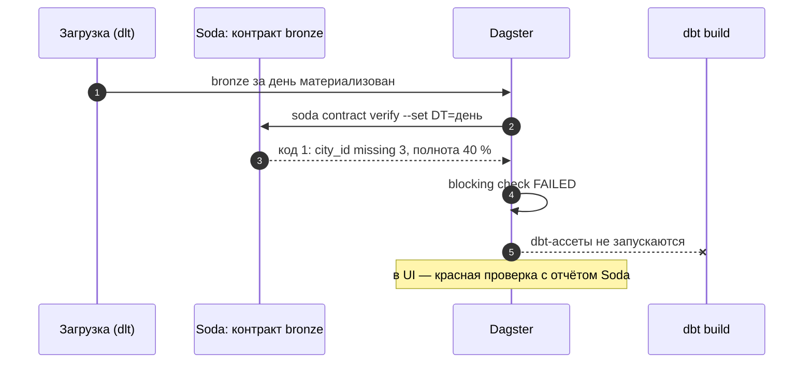

# 02 · Soda Core: проверки источника как контракт

> [!info] Урок одной фразой
> Soda — контролёр на приёмке склада с бланком: в бланке (контракте) перечислено, какие колонки
> должны быть в накладной, какие поля обязательны, какие значения допустимы и сколько коробок
> должно прийти. Контролёр сверяет поставку с бланком и ставит штамп: принято (0), принято с
> замечаниями (2), не принято (1). По штампу оркестратор решает, пускать ли поставку на склад.

> [!todo] Чек-лист: после урока ты сможешь
> - [ ] описать источник данных Soda для DuckDB и контракт на таблицу;
> - [ ] выбрать тип проверки: пропуски, недопустимые значения, схема, дубли, свежесть, объём, своя метрика, строки-нарушения;
> - [ ] задать порог и уровень (fail / warn) и предсказать код выхода;
> - [ ] параметризовать контракт переменными;
> - [ ] встроить проверку Soda в pipeline так, чтобы провал останавливал сборку.

**Нужно для:** лаба [09.1](../labs/09.1_soda_checks/README.md).
**Карта урока:** [soda-contracts.canvas](../maps/soda-contracts.canvas).

---

## Шаг 0. Азбука

| В Soda | В аналогии «приёмка» | Подробнее |
|---|---|---|
| Источник данных (data source) | Склад, куда пришла поставка | [Soda](../../../glossary/soda.md) |
| Контракт (contract) | Бланк приёмки | [контракт данных](../../../glossary/data-contract.md) |
| Проверка (check) | Строка бланка: «колонка не пустая» | [Soda](../../../glossary/soda.md) |
| Порог (threshold) | Сколько нарушений допустимо | [Soda](../../../glossary/soda.md) |
| Уровень fail / warn | Не принято / принято с замечаниями | [измерения качества](../../../glossary/data-quality-dimensions.md) |
| Код выхода | Штамп | [код выхода](../../../glossary/exit-code.md) |

---

## Шаг 1. Источник данных и контракт

**Проблема.** Тесты dbt проверяют модели, но источник dbt читает как есть. Нужна проверка, которая
смотрит на сырую таблицу **до** сборки и не зависит от dbt-проекта.

**Как устроено.** Soda Core 4 работает с двумя файлами:

```yaml
# demo/soda/data_source.yml — где данные
type: duckdb                                       # ① тип источника (пакет soda-duckdb)
name: demo_quality                                 # ② имя — первая часть адреса набора данных
connection:
  database: /workspace/data/demo_quality.duckdb
  schema: raw
  read_only: true                                  # ③ контролёр не меняет данные
```

```yaml
# demo/soda/store_sales_daily.yml — что проверять (фрагмент)
dataset: demo_quality/raw/store_sales_daily        # ④ источник / схема / таблица
columns:                                           # ⑤ ожидаемая схема (обязательный раздел)
  - name: city_id
    data_type: BIGINT
    checks:
      - missing:                                   # ⑥ проверка колонки
  - name: sales
    data_type: DOUBLE
    checks:
      - invalid:
          valid_min: 0
checks:                                            # ⑦ проверки всего набора
  - schema:
  - duplicate:
      columns: [store_id, dt]
  - freshness:
      column: loaded_at
      threshold: {unit: hour, must_be_less_than: 26}
```

① Для DuckDB нужен пакет `soda-duckdb` (группа `quality`). ③ Только чтение: проверка не должна
мешать загрузке и не держит запись в файле. ④ Адрес набора — имя источника, схема, таблица через
`/`. ⑤ Список колонок обязателен: Soda 4 строит проверки вокруг схемы, и `schema` сравнивает
фактические колонки с этим списком. ⑥ Проверка без параметров — порог по умолчанию «0
нарушений».

Запуск: `soda contract verify -c контракт.yml -ds data_source.yml`.

**Что из этого следует.** Контракт — это **документ**: в нём записано, что считается
правильной поставкой. Его читают люди (что нам обещают) и выполняет Soda (обещание выполнено?).

---

## Шаг 2. Типы проверок

**Проблема.** Какие вопросы можно задать данным в контракте?

**Как устроено.**

| Проверка | Где | Что считает | Пример у нас |
|---|---|---|---|
| `missing` | колонка | NULL (и значения из `missing_values`) | `city_id` не пустой |
| `invalid` | колонка | значения вне `valid_values` / `valid_min`/`valid_max` / `valid_format` | `sales ≥ 0` |
| `schema` | набор | колонки и типы против раздела `columns` | лишняя или пропавшая колонка |
| `row_count` | набор | число строк (можно с `filter`) | строк последнего дня ≥ 850 |
| `duplicate` | набор / колонка | повторы значений или их сочетаний | одна строка на (магазин, день) |
| `freshness` | набор | `now() - max(колонка)` | загрузка не старше 26 ч |
| `metric` | набор | число из своего SQL-запроса | доля магазинов последнего дня |
| `failed_rows` | набор | строки, которые вернул свой запрос | продажи при нуле часов наличия |

`metric` и `failed_rows` — выход для любых правил, которых нет в списке: сверка с другой
таблицей, бизнес-правило, полнота относительно вчера.

**Что из этого следует.** Проверку выбирают по измерению качества (урок 01): полнота —
`missing` и `row_count`/`metric`; уникальность — `duplicate`; валидность — `invalid`; свежесть —
`freshness`; согласованность — `metric` со сверкой (урок 05).

---

## Шаг 3. Пороги, уровни и код выхода

**Проблема.** Не любое нарушение — повод остановить pipeline (урок 01, шаг 3). Как сказать это
Soda?

**Как устроено.** Порог — блок `threshold` у проверки:

```yaml
- failed_rows:
    name: Продажи без наличия на полке
    query: |
      SELECT store_id, dt, sales, stock_hours FROM raw.store_sales_daily
      WHERE stock_hours = 0 AND sales > 0
    threshold:
      level: warn                     # ① предупреждение, а не провал
      must_be: 0                      # ② ожидание
```

| Ключ | Значение |
|---|---|
| `must_be`, `must_not_be` | равно / не равно |
| `must_be_greater_than(_or_equal)`, `must_be_less_than(_or_equal)` | сравнение |
| `must_be_between: {greater_than: …, less_than: …}` | диапазон |
| `metric: percent` | порог в процентах строк, а не в штуках |
| `level: warn` | нарушение — предупреждение (по умолчанию `fail`) |

**Код выхода** `soda contract verify`:

| Код | Значит | Что делает оркестратор |
|---|---|---|
| 0 | все проверки прошли | продолжает |
| 1 | есть проваленные (`fail`) | останавливает зависимые шаги |
| 2 | провалов нет, есть предупреждения | продолжает, сигнал в отчёт |
| 3 | ошибка выполнения (нет файла, неверный YAML, нет связи) | останавливает: проверка не состоялась |

**Что из этого следует.** Код 3 — **не** «данные хорошие». Если оркестратор проверяет только
«код ≠ 1», сломанный контракт тихо пропустит любые данные.

> [!example]- Попробуй сам: контракт на чистых и сломанных данных
> ```bash
> make shell
> cd modules/09_quality_observability/demo
> python build_demo_db.py
> cd soda && soda contract verify -c store_sales_daily.yml -ds data_source.yml 2>&1 | tail -9; echo "код $?"
> cd .. && python build_demo_db.py --drop-day --null-city 3 --negative 2
> cd soda && soda contract verify -c store_sales_daily.yml -ds data_source.yml 2>&1 | grep -E "FAILED|Failed"
> soda contract verify -c store_sales_daily.yml -ds data_source.yml > /dev/null 2>&1; echo "код $?"
> cd .. && python build_demo_db.py
> exit
> ```
> **Увидишь:** на чистых данных — `Checks 8 · Passed 8`, код 0. На сломанных — `❌ FAILED` у
> «Полнота последнего дня», `city_id` (`missing_count: 3`), `sales` (`invalid_count: 2`); код 1.
> **Почему:** контракт поймал все три инцидента генератора; провал хотя бы одной проверки уровня
> `fail` даёт код 1.

> [!warning] Ловушка: «странное» — не всегда ошибка
> Проверка «продажи при нуле часов наличия» на **чистых** данных находит 34 магазино-дня. Это не
> сбой загрузки: `stock_hours` считает наличие только в часы 6–22, а продажа могла пройти вне
> этого окна. Прежде чем делать такую проверку `fail`, разберись с данными — иначе контракт будет
> красным каждую ночь, и на него перестанут смотреть.

---

## Шаг 4. Переменные: один контракт для разных условий

**Проблема.** Порог полноты для ежедневной загрузки — 95 %, а для backfill старых дней — 100 %.
Держать два контракта?

**Как устроено.** Раздел `variables` объявляет переменные с умолчанием, а в проверках они
подставляются как `${var.ИМЯ}`. Значение меняют при запуске: `--set ИМЯ=значение`.

```yaml
variables:
  MIN_SHARE:
    default: 95
checks:
  - metric:
      name: Доля магазинов последнего дня
      query: |
        SELECT round(100.0 * count(*) / 898, 1) FROM raw.store_sales_daily
        WHERE dt = (SELECT max(dt) FROM raw.store_sales_daily)
      threshold:
        must_be_greater_than_or_equal: ${var.MIN_SHARE}
```

`soda contract verify … --set MIN_SHARE=100` — тот же контракт со строгим порогом. Оркестратор
передаёт так и дату партиции (`--set DT=2024-04-01`), чтобы проверять ровно загруженный день.

> [!example]- Попробуй сам: переменная и предупреждение
> Файл `demo/soda/store_sales_rules.yml` — доля магазинов с переменной `MIN_SHARE` и проверка
> «продажи при нуле наличия» с `level: warn`.
> ```bash
> make shell
> cd modules/09_quality_observability/demo/soda
> soda contract verify -c store_sales_rules.yml -ds data_source.yml 2>&1 | grep -E "Доля|наличия"
> soda contract verify -c store_sales_rules.yml -ds data_source.yml > /dev/null 2>&1; echo "код $?"
> soda contract verify -c store_sales_rules.yml -ds data_source.yml --set MIN_SHARE=101 > /dev/null 2>&1; echo "код $?"
> exit
> ```
> **Увидишь:** доля — `✅ PASSED`, продажи без наличия — `⚠ WARN` с `failed_rows_count: 34`;
> код 2. С `MIN_SHARE=101` доля проваливается (больше 100 % не бывает) — код 1.
> **Почему:** провалов нет, есть предупреждение → 2; строгий порог превратил метрику в провал → 1.

---

## Шаг 5. Soda в pipeline

**Проблема.** Проверка, которую запускают руками, не защищает витрины ночью.

**Как устроено.** Контракт источника запускают **после загрузки и до dbt**. В Dagster (модуль 06)
это проверка ассета bronze: она вызывает `soda contract verify` и превращает код выхода в
результат:

```python
@asset_check(asset=AssetKey("sales_bronze"), blocking=True)
def sales_bronze_contract() -> AssetCheckResult:
    proc = subprocess.run(["soda", "contract", "verify", "-c", CONTRACT, "-ds", DATA_SOURCE],
                          capture_output=True, text=True)
    return AssetCheckResult(
        passed=proc.returncode in (0, 2),                     # 2 — только предупреждения
        severity=AssetCheckSeverity.ERROR if proc.returncode != 2 else AssetCheckSeverity.WARN,
        metadata={"exit_code": proc.returncode, "report": MetadataValue.md(f"```\n{proc.stdout[-3000:]}\n```")},
    )
```

Код 1 и 3 → проверка не прошла, `blocking=True` останавливает dbt-ассеты ниже по графу. Отчёт
Soda — в метаданных проверки в UI.

**Python API вместо CLI.** YAML-источник Soda открывает файл DuckDB, а таблицы bronze у нас — в
Iceberg. Python API принимает **готовое соединение**, в котором можно сделать `ATTACH` чего угодно,
и умеет задать «текущее время» для проверки свежести — это нужно на исторических данных:

```python
import duckdb
from soda_core.contracts.api.verify_api import verify_contract_locally
from soda_duckdb.common.data_sources.duckdb_data_source import DuckDBDataSourceImpl

con = duckdb.connect()
con.execute("ATTACH '/workspace/data/demo_quality.duckdb' AS q (READ_ONLY)")      # ① любой ATTACH
ds = DuckDBDataSourceImpl.from_existing_cursor(con, name="att")                   # ② источник из соединения
result = verify_contract_locally(
    data_sources=[ds], contract_file_path="contract.yml",                         # dataset: att/q/raw/store_sales_daily
    data_timestamp="2026-12-01T00:00:00")                                          # ③ «сейчас» для freshness
print(result.is_ok)
```

① Для Iceberg — `ATTACH 'lakehouse' AS lh (TYPE iceberg, …)` (модуль 03). ② Адрес набора в
контракте — `имя_источника/база/схема/таблица`. ③ На проверке: с текущим временем свежесть
учебной базы проходит, с `2026-12-01` — проваливается.

**Что из этого следует.** Контракт становится **воротами**: плохая поставка остаётся в bronze,
а витрины — вчерашними, но верными. Это лаба 09.1.

---

## Сборка целиком



| Шаг | Если сломается | Симптом |
|---|---|---|
| 2 | контракт с ошибкой YAML | код 3 — проверки не было; без обработки пропустит всё |
| 3 | все проверки `warn` | код 2, pipeline идёт дальше с плохими данными |
| 4 | проверка не blocking | dbt собирает витрины из неполного дня |

## Шпаргалка

| Хочу | Как |
|---|---|
| Проверить контракт | `soda contract verify -c c.yml -ds data_source.yml` |
| Проверить синтаксис без запуска | `soda contract test -c c.yml` |
| Пропуски / недопустимые | `missing:` / `invalid: {valid_min: 0}` у колонки |
| Схема, дубли, свежесть | `schema:`, `duplicate: {columns: […]}`, `freshness: {column: …, threshold: {unit: hour, …}}` |
| Своё правило | `metric: {query: …, threshold: …}`, `failed_rows: {query: …}` |
| Предупреждение | `threshold: {level: warn, …}` |
| Переменная | `variables:` + `${var.X}`; `--set X=…` |
| Коды выхода | 0 ок · 1 провал · 2 предупреждения · 3 ошибка выполнения |

## Типичные ошибки

| Симптом | Причина | Как проверить | Как чинить |
|---|---|---|---|
| `The contract is missing the required 'columns' property` | нет раздела `columns` | текст ошибки | перечислить колонки |
| Код 3, `Only type postgres is supported` у `data-source create` | генератор шаблонов знает только Postgres | — | написать `data_source.yml` руками |
| `schema` FAILED: `Present, not expected columns` | в `columns` перечислены не все колонки | вывод проверки | дописать колонки или `optional: true` |
| Свежесть всегда красная | данные исторические / зона времени | `max(loaded_at)` | время загрузки, UTC |
| Контракт красный каждую ночь | правило не про сбой, а про особенность данных | разобрать нарушения | `warn` или поправить правило |

## Проверь себя

Карточки — в [flashcards.md](../flashcards.md).

> [!question] 1. Оркестратор останавливает pipeline, только если код Soda равен 1. Что может пойти не так?
> > [!success]- Ответ
> > Код 3 (ошибка выполнения: битый YAML, нет файла, нет соединения) пропустит данные без
> > проверки. Останавливать нужно на всём, кроме 0 и 2.

> [!question] 2. Каким типом проверки записать «в последнем дне не меньше 95 % магазинов от вчерашнего»?
> > [!success]- Ответ
> > `metric` со своим SQL: доля строк последнего дня от предыдущего и порог
> > `must_be_greater_than_or_equal: 95`. `row_count` с фильтром сравнивает с константой, а не со
> > вчерашним днём.

> [!question] 3. Зачем контракту раздел `columns`, если проверки в нём не нужны?
> > [!success]- Ответ
> > Это ожидаемая схема: проверка `schema` сравнивает фактические колонки и типы с ним, а люди
> > читают в нём, что обещает источник. В Soda 4 раздел обязателен.

> [!question] 4. Почему `failed_rows` «продажи при нуле наличия» лучше начать с `level: warn`?
> > [!success]- Ответ
> > На чистых данных оно находит 34 строки — это особенность расчёта наличия (только часы 6–22),
> > а не сбой. С `fail` контракт был бы красным каждую ночь.
