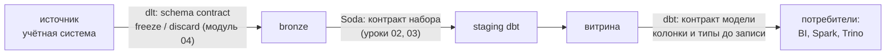
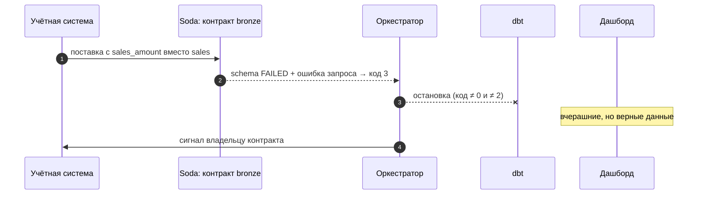

# 03 · Контракты данных: договор между тем, кто отдаёт, и тем, кто берёт

> [!info] Урок одной фразой
> Поставщик и магазин подписывают договор: какие товары, в какой упаковке, с какой маркировкой и
> к какому часу. Пока договор не нарушен, магазин может строить на поставке свои планы. Если
> поставщик хочет поменять упаковку, он предупреждает заранее и выпускает новую версию договора,
> а не привозит молча другое. Контракт данных — такой договор между системой-источником и теми,
> кто строит на её данных.

> [!todo] Чек-лист: после урока ты сможешь
> - [ ] перечислить, что входит в контракт данных: схема, смысл, качество, свежесть, владелец, версия;
> - [ ] показать, где контракт проверяется у нас: dlt, Soda, контракт модели dbt;
> - [ ] включить контракт модели dbt и прочитать ошибку нарушения;
> - [ ] отличить ломающее изменение от неломающего и предложить порядок выкатки;
> - [ ] объяснить, что делать с поставкой, нарушившей контракт.

**Нужно для:** лаб [09.1](../labs/09.1_soda_checks/README.md) (задача 3),
[09.4](../labs/09.4_quality_mini_project/README.md).
**Карта урока:** [data-contracts.canvas](../maps/data-contracts.canvas).

---

## Шаг 0. Азбука

| Понятие | В аналогии «поставщик» | Подробнее |
|---|---|---|
| Контракт данных | Договор поставки | [контракт данных](../../../glossary/data-contract.md) |
| Производитель (producer) | Поставщик | [контракт данных](../../../glossary/data-contract.md) |
| Потребитель (consumer) | Магазин | [контракт данных](../../../glossary/data-contract.md) |
| Ломающее изменение | Новая упаковка без предупреждения | [эволюция схемы](../../../glossary/schema-evolution.md) |
| Версия контракта | Новая редакция договора | [контракт схемы](../../../glossary/schema-contract.md) |
| Карантин | Склад для спорной поставки | [контракт данных](../../../glossary/data-contract.md) |

---

## Шаг 1. Что такое контракт данных

**Проблема.** Учётная система переименовала колонку `sales` в `sales_amount` — разработчики
приложения сочли это улучшением. Ночью staging dbt упал, утром витрины пустые. Никто не нарушал
правил: их просто не было записано.

**Как устроено.** **Контракт данных** — записанное и проверяемое соглашение о наборе данных между
производителем и потребителями. Обычно в нём:

| Часть | Что фиксирует | Пример для `store_sales_daily` |
|---|---|---|
| Схема | колонки, типы, обязательность | `store_id BIGINT NOT NULL`, `sales DOUBLE` |
| Смысл | что означает колонка, единицы | `sales` — продажи за день в единицах товара |
| Качество | правила и пороги | `sales ≥ 0`, одна строка на (магазин, день) |
| Свежесть | к какому сроку данные готовы | день — до 06:00 следующего дня |
| Владелец | кто отвечает и кому писать | команда учётной системы |
| Версия | номер и правила изменения | v1; ломающие изменения — через v2 |

**Что из этого следует.** Контракт превращает «у нас сломалось» в «нарушен пункт договора, вот
владелец». Проверяемая часть (схема, качество, свежесть) исполняется автоматически, остальная —
документ, который читают люди.

---

## Шаг 2. Где контракт проверяется в нашем стеке

**Проблема.** Договор бесполезен, если его никто не проверяет. Где в pipeline эти проверки?

**Как устроено.** Контракт проверяют **на границах** — там, где данные переходят от одного
владельца к другому:



| Граница | Инструмент | Что проверяет | Когда |
|---|---|---|---|
| источник → bronze | dlt `schema_contract` | новые колонки и типы при загрузке | на этапе normalize, до записи |
| bronze → dbt | Soda | схема, качество, свежесть поставки | после загрузки, до dbt |
| витрина → потребители | dbt `contract: enforced` | имена, типы, ограничения выхода модели | до создания таблицы |

**Что из этого следует.** Каждая граница защищает своих потребителей: dlt не пускает чужую схему
в bronze, Soda — плохую поставку в dbt, контракт модели — неожиданную схему витрины в BI.

---

## Шаг 3. Контракт модели dbt

**Проблема.** Витрину читают Superset и Spark. Если разработчик в dbt случайно изменит тип колонки
(дата стала строкой из-за `cast`), дашборды сломаются тихо — dbt построит таблицу без ошибок.

**Как устроено.** У модели включают **контракт**: dbt перед созданием таблицы сравнивает колонки и
типы SELECT с объявленными в YAML и при расхождении **не создаёт** таблицу. Ограничения
(`not_null`, `primary_key`) dbt добавляет в DDL, если база их поддерживает:

```yaml
models:
  - name: mart_city_sales_daily
    config:
      contract:
        enforced: true                       # ① проверять до записи
    columns:
      - name: city_id
        data_type: bigint                     # ② тип обязателен у каждой колонки
        constraints:
          - type: not_null                    # ③ ограничение в DDL
      - name: sales_date
        data_type: date
      - name: sales
        data_type: double
      - name: stores
        data_type: bigint
```

**Что из этого следует.** Контракт модели проверяет **форму** результата, а не значения: тесты
(`unique`, `accepted_range`) по-прежнему нужны. Зато он ломает сборку **до** того, как потребитель
получил другую схему.

> [!example]- Попробуй сам: нарушить контракт модели
> ```bash
> make shell
> cd modules/09_quality_observability/demo/dbt_quality
> dbt build -s mart_city_sales_daily 2>&1 | grep -E "OK created|Done"
> sed -i 's/        data_type: date/        data_type: varchar/' models/marts/_marts.yml
> dbt run -s mart_city_sales_daily 2>&1 | grep -A6 "enforced contract"
> sed -i 's/        data_type: varchar/        data_type: date/' models/marts/_marts.yml
> exit
> ```
> **Увидишь:** сначала `OK created sql table model main.mart_city_sales_daily`; после правки —
> `This model has an enforced contract that failed.` и таблица расхождений
> `sales_date | DATE | VARCHAR | data type mismatch`.
> **Почему:** SELECT модели возвращает `DATE`, а контракт обещает `VARCHAR`; dbt сравнил их до
> записи и отказался менять таблицу — потребители видят прежнюю версию.

---

## Шаг 4. Ломающие изменения и как их выкатывать

**Проблема.** Источник всё-таки хочет переименовать колонку. Как сделать это, не ломая
потребителей?

**Как устроено.** Изменения делят по влиянию на потребителей (модуль 03, эволюция схемы):

| Изменение | Ломающее? | Почему |
|---|---|---|
| добавить колонку, допускающую NULL | нет | старые запросы её не видят |
| расширить тип (`int` → `bigint`) | обычно нет | значения помещаются |
| переименовать или удалить колонку | **да** | запросы со старым именем падают |
| сузить тип, изменить смысл или единицы | **да** | падают или, хуже, тихо врут |

Ломающее изменение выкатывают **в несколько шагов** (expand → migrate → contract):

1. **Расширить**: добавить новую колонку `sales_amount` рядом со старой, заполнять обе.
2. **Перевести потребителей** на новую колонку, проверив по lineage, кто читает старую (модуль 05).
3. **Сузить**: удалить старую колонку в новой версии контракта, когда потребителей не осталось.

**Что из этого следует.** Контракт делает изменения **переговорами**, а не сюрпризом: его нарушение
— сигнал, что кто-то пропустил шаги 1–2.

> [!warning] Ловушка: переименование ломает проверку, а не только данные
> Переименование `sales` → `sales_amount` в нашем источнике Soda ловит проверкой `schema`
> (`Present, not expected columns: sales_amount`), но проверки, которые ссылаются на `sales`,
> падают с ошибкой запроса (`Referenced column "sales" not found`). Итоговый код — **3**, а не 1.
> Если оркестратор останавливает pipeline только по коду 1, такая поставка пройдёт дальше и
> уронит dbt (урок 02, шаг 3).

---

## Шаг 5. Что делать с поставкой, нарушившей контракт

**Проблема.** Контракт нарушен. Отбросить данные, остановить всё или пропустить?

**Как устроено.** Три стратегии, и они комбинируются:

| Стратегия | Что происходит | Когда |
|---|---|---|
| Остановить (fail) | pipeline стоит, витрины вчерашние | нарушение делает данные бесполезными: схема, полнота |
| Карантин | плохие строки — в отдельную таблицу, хорошие идут дальше | нарушают отдельные строки, а не вся поставка |
| Пропустить с предупреждением (warn) | данные идут, сигнал владельцу | нарушение мелкое или ожидаемое |

В dlt это режимы контракта `freeze` (остановить), `discard_row` / `discard_value` (отбросить);
в Soda — уровень `fail` или `warn`; карантин делают моделью dbt или отдельной загрузкой с
условием из `failed_rows`.

**Что из этого следует.** Выбор стратегии — часть контракта: потребитель должен знать, увидит ли
он вчерашние данные или сегодняшние без части строк.

---

## Сборка целиком

Переименование колонки в источнике — с контрактом и без:



| Без шага | Что случится |
|---|---|
| 2 (контракт) | staging dbt упадёт с `Referenced column "sales" not found` — ночью, без объяснения |
| 3 (остановка по коду 3) | dbt запустится и упадёт, или хуже — модель без колонки соберётся |
| 5 (владелец) | источник не узнает, что сломал потребителей |

## Шпаргалка

| Хочу | Как |
|---|---|
| Контракт модели dbt | `config: {contract: {enforced: true}}` + `data_type` у всех колонок |
| Ограничение в DDL | `constraints: [{type: not_null}]` |
| Контракт источника | контракт Soda (`columns` + проверки) |
| Контракт при загрузке | dlt `schema_contract` (`freeze`, `discard_row`, `discard_value`, `evolve`) |
| Ломающее изменение | расширить → перевести потребителей → сузить |
| Кто читает колонку | lineage: `dbt ls -s источник+`, граф Dagster |

## Типичные ошибки

| Симптом | Причина | Как проверить | Как чинить |
|---|---|---|---|
| `This model has an enforced contract that failed` | SELECT вернул не те имена или типы | таблица расхождений в ошибке | исправить SQL или осознанно сменить контракт |
| dbt требует `data_type` у колонки | контракт включён, тип не указан | ошибка компиляции | указать типы всех колонок |
| Дашборд сломался после «безобидной» правки | у модели нет контракта | история изменений модели | контракт на витринах для внешних потребителей |
| Источник поменял формат, узнали утром | нет контракта на границе | — | контракт Soda + остановка на кодах 1 и 3 |

## Проверь себя

Карточки — в [flashcards.md](../flashcards.md).

> [!question] 1. Чем контракт модели dbt отличается от тестов dbt?
> > [!success]- Ответ
> > Контракт проверяет форму результата (имена, типы, ограничения) **до** записи таблицы и не даёт
> > её изменить. Тесты проверяют значения **после** записи. Нужны оба.

> [!question] 2. Источник добавил новую колонку `promo_id`, допускающую NULL. Ломающее ли это изменение и что скажут dlt и Soda?
> > [!success]- Ответ
> > Не ломающее для запросов. dlt в режиме `evolve` добавит колонку, в `freeze` — остановит
> > загрузку. Soda `schema` провалится («Present, not expected columns»), пока колонку не
> > добавят в контракт.

> [!question] 3. Как переименовать колонку `sales` в источнике, не сломав витрины?
> > [!success]- Ответ
> > Расширить: добавить `sales_amount`, заполнять обе. Перевести staging и всех потребителей
> > (найти по lineage). Сузить: удалить `sales` в новой версии контракта.

> [!question] 4. В поставке 3 строки из 87 тысяч с отрицательными продажами. Остановить, карантин или пропустить?
> > [!success]- Ответ
> > Карантин или warn: нарушают отдельные строки, остальная поставка полезна. Остановка всей сети
> > из-за трёх строк — слишком дорого; но строки не должны молча попасть в витрину.
