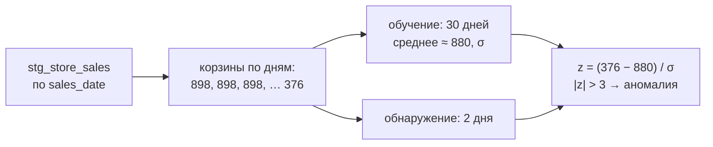
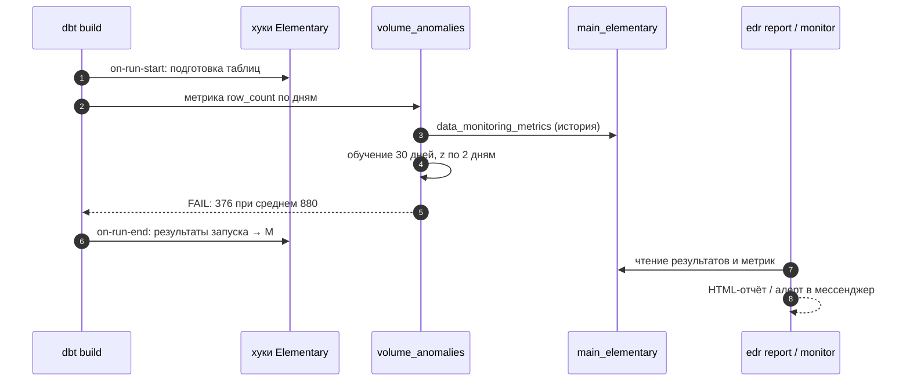

# 04 · Наблюдаемость: Elementary и аномалии объёма и свежести

> [!info] Урок одной фразой
> Тесты — это правила, которые ты знал заранее: «продажи не отрицательные». Но магазин может
> однажды привезти втрое меньше товара, чем обычно, и ни одно правило этого не запрещает.
> Наблюдаемость — опытный завсклад, который помнит, сколько обычно приходит по вторникам, и
> поднимает тревогу, когда сегодня привезли подозрительно мало. Elementary — такой завсклад для
> dbt: он помнит историю метрик и сравнивает с ней каждый новый день.

> [!todo] Чек-лист: после урока ты сможешь
> - [ ] объяснить разницу между тестом с правилом и детектором аномалий;
> - [ ] объяснить, как Elementary считает аномалию: корзины времени, обучающее окно, z-оценка, чувствительность;
> - [ ] настроить `volume_anomalies` и `column_anomalies` под наши данные;
> - [ ] найти результат и метрики в таблицах Elementary и собрать отчёт `edr report`;
> - [ ] назвать, когда детектор ошибается, и что с этим делать.

**Нужно для:** лаба [09.2](../labs/09.2_elementary/README.md).
**Карта урока:** [observability-elementary.canvas](../maps/observability-elementary.canvas).

---

## Шаг 0. Азбука

| Понятие | В аналогии «завсклад» | Подробнее |
|---|---|---|
| Наблюдаемость данных | Завсклад помнит, как обычно | [наблюдаемость данных](../../../glossary/data-observability.md) |
| Метрика монитора | Сколько коробок пришло за день | [наблюдаемость данных](../../../glossary/data-observability.md) |
| Корзина времени (bucket) | Один день поставок | [Elementary](../../../glossary/elementary.md) |
| Обучающее окно | Последние 30 дней, по которым помнит «обычно» | [Elementary](../../../glossary/elementary.md) |
| z-оценка, чувствительность | На сколько «сегодня» необычнее обычного разброса | [Elementary](../../../glossary/elementary.md) |
| Отчёт, алерт | Журнал завсклада и звонок директору | [Elementary](../../../glossary/elementary.md) |

---

## Шаг 1. Правило или аномалия

**Проблема.** Ты не можешь заранее перечислить всё, что сломается. «Магазинов в дне ≥ 850» —
правило; а если сеть откроет 100 новых магазинов, правило устареет. А если продажи упали втрое
из-за сбоя кассы — ни одно правило значений не нарушено.

**Как устроено.** Два подхода дополняют друг друга:

| | Тест с правилом | Детектор аномалий |
|---|---|---|
| Вопрос | «нарушено ли известное правило?» | «похоже ли сегодня на обычные дни?» |
| Порог | задаёт человек | вычисляется из истории |
| Ловит | известные виды ошибок | неожиданные сдвиги: объём, свежесть, распределение |
| Ошибается | когда правило устарело | когда история короткая или «обычно» само меняется (праздники, рост) |

**Что из этого следует.** Наблюдаемость не заменяет тесты: она ловит то, о чём ты не подумал,
но ценой ложных срабатываний. Её ставят на ключевые таблицы, а не на всё подряд.

---

## Шаг 2. Как Elementary находит аномалию

**Проблема.** Как превратить «необычно мало» в число и порог?

**Как устроено.** Elementary — dbt-пакет (тесты и служебные модели) и CLI `edr` (отчёты и алерты).
Тест `volume_anomalies` работает так:

1. **Метрика по корзинам.** Делит таблицу по колонке времени (`timestamp_column`) на корзины
   (`time_bucket`: день) и считает метрику каждой: для объёма — число строк за день.
2. **Сохраняет метрики** в `main_elementary.data_monitoring_metrics` — история копится между
   запусками.
3. **Обучающее окно** (`training_period`, у нас 30 дней): по корзинам из него считает среднее и
   стандартное отклонение.
4. **z-оценка** каждой корзины из окна обнаружения (`detection_period`, 2 дня):
   `(значение − среднее) / отклонение`.
5. Если `|z|` больше **чувствительности** (`anomaly_sensitivity`, по умолчанию 3) — аномалия, тест
   падает.



Конфигурация у нас (`demo/dbt_quality/models/staging/_stg_models.yml`):

```yaml
- elementary.volume_anomalies:
    arguments:
      timestamp_column: sales_date                    # ① по какой дате резать корзины
      time_bucket: {period: day, count: 1}            # ② корзина — день
      training_period: {period: day, count: 30}       # ③ сколько дней «помнить»
      detection_period: {period: day, count: 2}       # ④ какие дни проверять
    config:
      severity: error
```

**Что из этого следует.** Окна считаются **от текущей даты**: «последние 30 дней» и «последние 2
дня» — относительно сегодня. На исторических датах (2024 год) в окна не попала бы ни одна корзина
— поэтому учебная база сдвинута к вчерашнему дню (урок 01).

> [!example]- Попробуй сам: аномалия объёма
> ```bash
> make shell
> cd modules/09_quality_observability/demo
> python build_demo_db.py --drop-day
> cd dbt_quality && dbt build -s stg_store_sales 2>&1 | grep -E "FAIL|Done"
> duckdb -readonly /workspace/data/demo_quality.duckdb -c "
>   SELECT test_short_name, status, trim(regexp_replace(test_results_description, '\s+', ' ', 'g')) AS description
>   FROM main_elementary.elementary_test_results
>   WHERE test_short_name = 'volume_anomalies' ORDER BY detected_at DESC LIMIT 1"
> cd .. && python build_demo_db.py
> exit
> ```
> **Увидишь:** `FAIL 1 elementary_volume_anomalies_stg_store_sales_…`; в таблице результатов —
> `fail` и описание вида `The last row_count value is 376.000. The average for this metric is
> 880.600.`
> **Почему:** в последнем дне осталось 376 магазинов из 898; это дальше трёх стандартных отклонений
> от среднего обучающего окна.

---

## Шаг 3. Какие мониторы бывают

**Проблема.** Объём — не единственное, что меняется тихо.

**Как устроено.**

| Тест Elementary | Метрика по корзинам | Что ловит |
|---|---|---|
| `volume_anomalies` | число строк | пропавшие и задвоенные загрузки |
| `freshness_anomalies` | время между обновлениями | загрузка стала приходить реже или позже обычного |
| `event_freshness_anomalies` | задержка между временем события и загрузкой | опоздание данных относительно событий |
| `column_anomalies` | по колонке: `null_count`, `average`, `zero_count`, `missing_percent` … | сдвиг распределения: стало больше пустых, среднее упало |
| `dimension_anomalies` | число строк в разрезе значения колонки | пропал один город, остальные на месте |
| `schema_changes` | снимок колонок | колонку добавили, удалили, сменили тип |

У нас на витрине `mart_city_sales_daily` стоит `column_anomalies` со средним продаж города за
день.

**Что из этого следует.** `dimension_anomalies` по `city_id` поймал бы «пропал один город»,
который общий объём почти не меняет. Выбор монитора — по вопросу «какой сбой мы боимся
пропустить».

---

## Шаг 4. Отчёт и алерты

**Проблема.** Результаты тестов в логах dbt никто не читает. Нужно место, где видно состояние всех
таблиц, историю и графики метрик.

**Как устроено.** Elementary собирает служебные таблицы при каждом `dbt build` (через хуки
`on-run-start` / `on-run-end`): результаты тестов (`elementary_test_results`), метрики
(`data_monitoring_metrics`), запуски моделей (`dbt_run_results`), артефакты проекта. CLI `edr`
читает их и:

- `edr report` — собирает **HTML-отчёт**: тесты, графики метрик с ожидаемым коридором, lineage,
  покрытие тестами;
- `edr monitor` — шлёт **алерты** о новых провалах в Slack или Teams (нужен webhook; в учебном
  стеке его нет, поэтому работаем с отчётом).

`edr` подключается к той же базе через профиль `elementary` (у нас — в `profiles.yml` демо).

> [!example]- Попробуй сам: HTML-отчёт
> ```bash
> make shell
> cd modules/09_quality_observability/demo/dbt_quality
> edr report --profiles-dir . --project-dir . --file-path /workspace/data/elementary_report.html \
>   --open-browser false 2>&1 | tail -2
> exit
> ```
> Открой на хосте в браузере файл `data/elementary_report.html` из папки проекта.
> **Увидишь:** строки `Running dbt command … run-operation …`, затем файл ~5 МБ. В отчёте —
> вкладки Test Results (зелёные и красные тесты, у `volume_anomalies` — график row_count по дням
> с коридором), Lineage, Model Runs.
> **Почему:** `edr` запускает свой dbt-проект с макросами, которые читают таблицы
> `main_elementary`, и упаковывает всё в один статический HTML.

---

## Шаг 5. Когда детектор ошибается

**Проблема.** Детектор, который краснеет каждый понедельник, отключат через неделю.

**Как устроено.** Типовые причины ложных срабатываний и пропусков:

| Ситуация | Что происходит | Что делать |
|---|---|---|
| Недельная сезонность | воскресенье всегда ниже — «аномалия» каждую неделю | `seasonality: day_of_week` (сравнение с теми же днями недели) |
| Рост бизнеса | открыли магазины — объём «аномально» вырос | обучающее окно короче; принять новую норму |
| Короткая история | 5 дней — σ ненадёжна | не включать, пока не накопится история (`min_training_set_size`) |
| Однажды плохой день попал в обучение | среднее и σ искажены | исключить корзину / перезапустить метрики |
| Медленная деградация | каждый день чуть хуже — z небольшой | тест с правилом на абсолютный уровень |

**Что из этого следует.** Чувствительность — компромисс: 3σ даёт мало ложных тревог, но пропускает
мелкие сбои. Важные таблицы получают и правило (жёсткий минимум), и детектор (необычное).

---

## Сборка целиком



| Шаг | Если сломается | Симптом |
|---|---|---|
| 2 | даты исторические, окна пустые | тест проходит всегда — нечего сравнивать |
| 4 | сезонность не учтена | ложные тревоги по одним и тем же дням недели |
| 7 | профиль `elementary` не настроен | `edr` не находит таблицы |

## Шпаргалка

| Хочу | Как |
|---|---|
| Подключить пакет | `packages.yml`: `elementary-data/elementary 0.26.0`; `dbt deps` |
| Схема служебных таблиц | `models: elementary: +schema: elementary` |
| Аномалия объёма | `elementary.volume_anomalies` с `timestamp_column`, `time_bucket`, окнами |
| Аномалии колонки | `elementary.column_anomalies` с `column_anomalies: [null_count, average]` |
| Сезонность | `seasonality: day_of_week` |
| Чувствительность | `anomaly_sensitivity: 3` |
| Результаты | `main_elementary.elementary_test_results` |
| Отчёт | `edr report --profiles-dir . --project-dir . --file-path …` |

## Типичные ошибки

| Симптом | Причина | Как проверить | Как чинить |
|---|---|---|---|
| Аномалия никогда не находится | данные вне окон (история в прошлом) | `max(timestamp_column)` против сегодня | живые даты / сдвиг (учебно) |
| Тревога каждую неделю | недельная сезонность | график метрики в отчёте | `seasonality: day_of_week` |
| `PackageMaterializationOverrideDeprecation` в логе | пакет переопределяет встроенные материализации | — | флаг `require_explicit_package_overrides_for_builtin_materializations: false` (учебно) |
| `edr` падает на подключении | нет профиля `elementary` | `profiles.yml` | профиль на ту же базу, схема `main_elementary` |
| Отчёт пустой | `dbt build` не запускался с пакетом | таблицы `main_elementary` | `dbt deps && dbt build` |

## Проверь себя

Карточки — в [flashcards.md](../flashcards.md).

> [!question] 1. Сеть открыла 100 магазинов. Что покажут тест «магазинов ≥ 850» и `volume_anomalies`?
> > [!success]- Ответ
> > Тест пройдёт (998 ≥ 850). Детектор, скорее всего, поднимет тревогу на росте — это не сбой, а
> > новая норма; её примут, когда новые дни войдут в обучающее окно.

> [!question] 2. Почему на исторических данных 2024 года `volume_anomalies` всегда проходит?
> > [!success]- Ответ
> > Окна обучения и обнаружения считаются от текущей даты; в них нет ни одной корзины, сравнивать
> > нечего.

> [!question] 3. Из сети пропал один город (0,5 % строк). Какой монитор это заметит?
> > [!success]- Ответ
> > `dimension_anomalies` по `city_id`: объём по каждому городу. Общий `volume_anomalies` почти не
> > изменится.

> [!question] 4. Чем `freshness_anomalies` отличается от `dbt source freshness`?
> > [!success]- Ответ
> > `source freshness` сравнивает с порогом, который задал человек (26 ч). `freshness_anomalies`
> > сравнивает интервал между обновлениями с историей: «обычно раз в сутки, а сейчас 40 часов».
