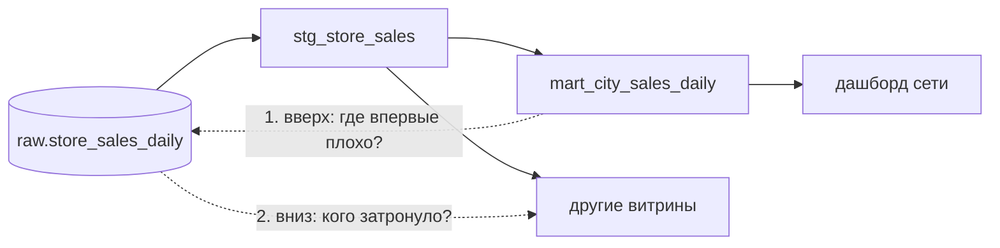

# 05 · SLO pipeline, сверка и разбор инцидентов по lineage

> [!info] Урок одной фразой
> Магазин обещает: «свежий хлеб на полке к 8 утра в 95 дней из 100». Это обещание (SLO) меряют
> по журналу (SLI), а пять опозданий из ста — допустимый запас (бюджет ошибок). Когда хлеб всё же
> опоздал, разбирают не «кто виноват», а «где в цепочке пекарня → машина → склад → полка
> застряло», идя по цепочке назад от полки и вперёд — к тем, кто пришёл за хлебом.

> [!todo] Чек-лист: после урока ты сможешь
> - [ ] отличить SLI, SLO и SLA и сформулировать SLO свежести через перцентиль;
> - [ ] посчитать SLI по истории загрузок и бюджет ошибок;
> - [ ] сверить данные с источником и объяснить, какие ошибки ловит только сверка;
> - [ ] найти по lineage источник плохих данных (вверх) и затронутых потребителей (вниз);
> - [ ] посчитать MTTD и MTTR и написать постмортем, где причина — свойство системы.

**Нужно для:** лаб [09.3](../labs/09.3_slo_and_incident/README.md),
[09.4](../labs/09.4_quality_mini_project/README.md).
**Карта урока:** [slo-incidents.canvas](../maps/slo-incidents.canvas).

---

## Шаг 0. Азбука

| Понятие | В аналогии «хлеб» | Подробнее |
|---|---|---|
| SLI (индикатор) | Во сколько хлеб реально лёг на полку | [SLA, SLO, SLI](../../../glossary/slo-sli-sla.md) |
| SLO (цель) | «К 8:00 в 95 % дней» | [SLA, SLO, SLI](../../../glossary/slo-sli-sla.md) |
| SLA (договор) | Обещание с последствиями для магазина | [SLA, SLO, SLI](../../../glossary/slo-sli-sla.md) |
| Бюджет ошибок | 5 опозданий из 100 — допустимо | [SLA, SLO, SLI](../../../glossary/slo-sli-sla.md) |
| Перцентиль | В 95 % дней — не позже такого-то часа | [перцентиль](../../../glossary/percentile.md) |
| Сверка | Пересчитать полку против накладной пекарни | [сверка](../../../glossary/reconciliation.md) |
| MTTD, MTTR | Через сколько заметили / починили | [постмортем](../../../glossary/postmortem.md) |

---

## Шаг 1. SLI, SLO, SLA

**Проблема.** «Данные должны быть свежими» — не цель: нельзя проверить, выполнена ли она, и нельзя
договориться, сколько это стоит.

**Как устроено.**

- **SLI** (service level indicator) — **измеримый** показатель: «задержка загрузки дня — время от
  конца дня до появления данных», «доля успешных ночных запусков».
- **SLO** (objective) — **цель** по индикатору на период: «задержка ≤ 6 ч в 95 % дней за 30
  дней».
- **SLA** (agreement) — договор с потребителем, где за нарушение есть последствия. SLA строже
  внешне, а внутренний SLO ставят с запасом, чтобы узнать о проблеме раньше, чем нарушится SLA.
- **Бюджет ошибок** — сколько нарушений SLO допускает: при 95 % за 30 дней — 1,5 дня. Пока
  бюджет не исчерпан, можно выкатывать изменения; исчерпан — сначала надёжность.

**Что из этого следует.** SLO формулируется **через долю или перцентиль**, а не через среднее:
среднее прячет хвост (Клеппман, гл. 1).

---

## Шаг 2. Почему перцентиль, а не среднее

**Проблема.** Средняя задержка загрузки — 3,7 ч. Значит, всё в порядке?

**Как устроено.** В учебной базе время загрузки дня (`loaded_at`) — ночная выгрузка через 1–5 ч
после конца дня, но иногда выгрузка задерживается ещё на 12 ч. Распределение задержки:

| Показатель | Часов |
|---|---|
| среднее | 3,7 |
| медиана (p50) | 2,8 |
| **p95** | **13,6** |
| максимум | 16,7 |
| дней с задержкой > 6 ч | 6 из 97 |

Среднее и медиана говорят «утром всё есть». p95 говорит: в каждый двадцатый день данные
появляются к обеду, и аналитик, открывший дашборд в 9:00, видит вчерашнее. SLO «≤ 6 ч в 95 %
дней» **нарушен**: таких дней 91 из 97 (93,8 %).

**Что из этого следует.** Хвост — это и есть опыт пользователя в плохие дни. Перцентиль считают
по истории: `quantile_cont(задержка, 0.95)`.

> [!example]- Попробуй сам: SLI свежести по истории загрузок
> ```bash
> make shell
> cd modules/09_quality_observability/demo && python build_demo_db.py
> duckdb -readonly /workspace/data/demo_quality.duckdb -c "
>   WITH loads AS (
>       SELECT DISTINCT dt, epoch(loaded_at - dt) / 3600 - 24 AS delay_h FROM raw.store_sales_daily)
>   SELECT round(avg(delay_h), 1) AS avg_h,
>          round(quantile_cont(delay_h, 0.5), 1) AS p50_h,
>          round(quantile_cont(delay_h, 0.95), 1) AS p95_h,
>          round(100.0 * count(*) FILTER (WHERE delay_h <= 6) / count(*), 1) AS within_slo_pct
>   FROM loads"
> exit
> ```
> **Увидишь:** `avg_h 3.7 · p50_h 2.8 · p95_h 13.6 · within_slo_pct 93.8`.
> **Почему:** задержка считается от конца дня (`dt + 24 ч`) до загрузки. 6 дней из 97 с
> задержкой 13–17 ч почти не двигают среднее, но определяют p95.

---

## Шаг 3. Сверка с источником: то, что не видят тесты

**Проблема.** День загрузили дважды (append без защиты). Тест уникальности staging упадёт — но
если бы ключ был не уникальным по смыслу, а дубли пришли «перемешанными», ни один тест на
значения не заметил бы, что продажи сети выросли на процент.

**Как устроено.** **Сверка** (reconciliation) сравнивает итоги копии с итогами **эталона** —
источника, которому доверяем: число строк, суммы по ключевым метрикам, при необходимости разницу
ключей (`ANTI JOIN`). Сверка между слоями одного pipeline (bronze ↔ витрина) ловит потери внутри
pipeline; сверка с источником (учётная система, исходные файлы) — ещё и ошибки загрузки.

> [!example]- Попробуй сам: задвоенный день и сверка с исходными файлами
> ```bash
> make shell
> cd modules/09_quality_observability/demo
> python build_demo_db.py --dupes
> duckdb -readonly /workspace/data/demo_quality.duckdb -c "
>   WITH src AS (SELECT count(*) AS rows, round(sum(sale_amount), 1) AS sales
>                FROM read_parquet('/workspace/data/raw/freshretailnet_50k/data/*.parquet')),
>        raw AS (SELECT sum(products) AS rows, round(sum(sales), 1) AS sales FROM raw.store_sales_daily)
>   SELECT src.rows AS src_rows, raw.rows AS raw_rows, src.sales AS src_sales, raw.sales AS raw_sales,
>          round(100 * (raw.sales - src.sales) / src.sales, 3) AS diff_pct
>   FROM src, raw"
> python build_demo_db.py
> exit
> ```
> **Увидишь:** `src_rows 4850000 · raw_rows 4900000`, продажи `4911229.3` против `4966315.4`,
> `diff_pct 1.122`. На чистых данных (после `python build_demo_db.py`) — равенство и 0.
> **Почему:** задвоенный день добавил 50 000 строк товаров и 1,1 % продаж. Сверка видит это
> сразу, независимо от того, какие ключи и тесты стоят в моделях.

**Что из этого следует.** Сверку делают **числами с допуском** (округления при агрегации дают
копейки), запускают после загрузки и после витрин, а результат — проверка Soda `metric` или тест
dbt.

---

## Шаг 4. Lineage в разборе инцидента: вверх и вниз

**Проблема.** Аналитик пишет: «продажи города 0 за вчера странные». С чего начать?

**Как устроено.** Граф зависимостей (модуль 05, урок 04; модуль 06, урок 04) отвечает на два
вопроса:

1. **Вверх (откуда)** — от плохой витрины к источникам: на каждом узле проверить, есть ли там
   ошибка. Первый узел, где данные уже плохие, а его входы хорошие, — место возникновения.
2. **Вниз (кого затронуло)** — от места возникновения ко всем потребителям: какие витрины,
   дашборды и выгрузки нужно пересчитать и о каких предупредить.



В dbt: `dbt ls -s +модель` — модель и всё выше; `dbt ls -s source:raw.таблица+` — источник и
всё ниже (модели, тесты, exposures). В Dagster — те же выборы `*x` и `x*` (модуль 06).

> [!example]- Попробуй сам: вверх и вниз по графу
> ```bash
> make shell
> cd modules/09_quality_observability/demo/dbt_quality
> dbt -q ls -s +mart_city_sales_daily --resource-type model source --output name
> dbt -q ls -s source:raw.store_sales_daily+ --resource-type model test --output name | grep -v elementary_
> exit
> ```
> **Увидишь:** вверх — `mart_city_sales_daily`, `stg_store_sales`, `raw.store_sales_daily`; вниз —
> обе модели и тесты на них (`not_null_…`, `unique_combination_of_columns_…`, `accepted_range…`).
> **Почему:** `+` слева — предки, справа — потомки; тесты привязаны к моделям, которые проверяют.

---

## Шаг 5. MTTD, MTTR и постмортем

**Проблема.** Инцидент починили. Как сделать, чтобы он не повторился и чтобы в следующий раз его
заметили раньше?

**Как устроено.** Постмортем (шаблон — [`ops/incidents.md`](../../../ops/incidents.md)) отвечает
на вопросы без поиска виноватых. Ключевые числа:

- **MTTD** — от начала проблемы до обнаружения. Если загрузка сломалась в 02:00, а аналитик
  написал в 11:00 — MTTD 9 ч, и это сигнал: нет проверки или алерта.
- **MTTR** — от обнаружения до восстановления данных. Долгий MTTR — медленная диагностика (нет
  lineage, нет отчёта) или тяжёлый перерасчёт (нет партиций, неидемпотентные шаги).

Причина в постмортеме — **свойство системы**, а не событие: не «источник прислал дубль»
(триггер), а «загрузка дописывает без защиты от повторов, и нет сверки с источником» (причина).
Действия — проверки, контракты, алерты, идемпотентность, которые закрывают **причину**.

**Что из этого следует.** Хороший постмортем уменьшает MTTD (новая проверка ловит раньше) и MTTR
(понятно, где смотреть и что пересчитать).

---

## Сборка целиком

Инцидент «задвоенный день» от начала до постмортема:

```mermaid
sequenceDiagram
    autonumber
    participant SRC as Источник
    participant P as Pipeline
    participant Q as Проверки
    participant ON as Дежурный
    SRC->>P: 02:00 повторная доставка дня (append)
    P->>Q: 02:10 dbt build: unique FAIL, сверка +1,1 %
    Q-->>ON: 02:10 алерт (MTTD 10 мин)
    ON->>ON: lineage вверх: raw уже с дублем; вниз: stg, mart, дашборд
    ON->>P: удалить дубль / перезагрузить день; пересобрать x*
    P-->>ON: 03:00 сверка = 0 (MTTR 50 мин)
    ON->>ON: постмортем: причина — append без защиты; действие — merge по ключу
```

| Без элемента | Что изменится |
|---|---|
| сверка и тест уникальности | MTTD = «когда заметит аналитик», часы |
| lineage | MTTR растёт: перебор моделей вслепую |
| идемпотентная загрузка | перерасчёт дня сам создаёт дубли |
| постмортем с причиной | через месяц тот же инцидент |

## Шпаргалка

| Хочу | Как |
|---|---|
| SLI свежести | задержка загрузки = `loaded_at − конец периода` |
| Перцентиль | `quantile_cont(x, 0.95)` в DuckDB |
| Доля в SLO | `count(*) FILTER (WHERE x <= порог) / count(*)` |
| Бюджет ошибок | `(1 − SLO) × период`: 5 % от 30 дней = 1,5 дня |
| Сверка | число строк и суммы против эталона, с допуском |
| Вверх / вниз в dbt | `dbt ls -s +m` / `dbt ls -s source:s.t+` |
| Вверх / вниз в Dagster | `*x` / `x*` |
| Постмортем | `ops/incidents.md`: MTTD, MTTR, причина ≠ триггер |

## Типичные ошибки

| Симптом | Причина | Как проверить | Как чинить |
|---|---|---|---|
| «SLO выполняется», а пользователи жалуются | SLO по среднему | хвост распределения | перцентиль / доля дней |
| Тесты зелёные, суммы не сходятся с учётной системой | нет сверки с эталоном | сверка | Soda `metric` / тест dbt со сверкой |
| Починили одну витрину, вторая осталась плохой | не пошли вниз по графу | `x*` / `+` справа | пересчитать всех потомков |
| Постмортем «виноват источник» | триггер вместо причины | «5 почему» | причина — свойство системы |
| MTTD — часы | нет алерта, проверки не блокируют | время обнаружения | проверки в pipeline, алерт |

## Проверь себя

Карточки — в [flashcards.md](../flashcards.md).

> [!question] 1. Средняя задержка 3,7 ч, p95 — 13,6 ч. SLO «≤ 6 ч в 95 % дней» выполнен?
> > [!success]- Ответ
> > Нет: p95 > 6 ч значит, что больше 5 % дней с задержкой выше 6 ч (у нас 6 из 97 → 93,8 % в
> > пределах). Среднее не говорит о выполнении такого SLO.

> [!question] 2. SLO 99 % успешных ночных запусков за 30 дней. Сколько падений допускает бюджет?
> > [!success]- Ответ
> > 0,3 запуска — то есть ни одного: одно падение уже 96,7 %. Для ежедневного процесса 99 % за
> > 30 дней — слишком строгая цель; её формулируют на больший период или ниже.

> [!question] 3. Число строк в bronze совпало с источником, а сумма продаж — нет. Что могло случиться?
> > [!success]- Ответ
> > Одна строка потеряна, другая задвоена (число совпало), или изменились значения (тип, единицы,
> > округление). Нужна разница ключей в обе стороны и сверка по метрикам.

> [!question] 4. Перепиши «причину» постмортема «оператор дважды запустил загрузку» как свойство системы.
> > [!success]- Ответ
> > «Загрузка неидемпотентна (append без ключа), и нет сверки с источником после загрузки, поэтому
> > повторный запуск незаметно задваивает день». Действия: merge по ключу, сверка, тест
> > уникальности со строгостью error.
