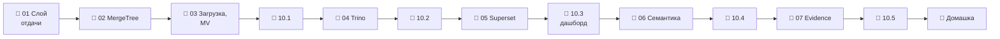

# Модуль 10 · Витрины и BI

**Длительность:** ~1–2 нед. · **Статус и DoD:** см. [ROADMAP](../../ROADMAP.md)

## Бизнес-вопрос

> Как отдать данные бизнесу быстро и так, чтобы все считали метрики одинаково?

## Цели

- выбирать схему отдачи: чтение lakehouse, копия в OLAP-СУБД, федеративный движок
- проектировать витрину ClickHouse под запросы дашборда и подтверждать выбор замером
- перезаливать витрины атомарно и считать итоги заранее (materialized views)
- соединять Iceberg, Postgres и ClickHouse одним запросом Trino и читать его план
- строить честный дашборд в Superset и отчёт-страницу в Evidence
- описывать метрики один раз (семантический слой) и сверять их между инструментами

## Темы

- слой отдачи, требования потребителей, стоимость запроса (строки и байты)
- ClickHouse: MergeTree как LSM-дерево, части и слияния, разреженный индекс, `ORDER BY`, партиции
- загрузка из Iceberg (`DataLakeCatalog`), `EXCHANGE TABLES`, materialized views, Summing /
  Aggregating / ReplacingMergeTree, refreshable MV
- Trino: координатор, worker, коннекторы, каталоги; федеративные запросы, pushdown, динамический фильтр
- Superset: подключения, датасеты и метрики, чарты, дашборды, кэш; выбор графика и обманы
- семантический слой: сущности, измерения, меры, метрики; MetricFlow
- отчёты как код: Evidence — источники, страница, компоненты, статическая сборка

## Инструменты

ClickHouse 26.8, Trino 483, Superset 6.1, Evidence 40 (открытый фреймворк), MetricFlow 0.15 —
слой `serving.yaml` (профили `serving`, `evidence`) и группа зависимостей `serving`

## Маршрут прохождения

Сначала урок, потом задачи лабы по нему. Статусы: ✅ сделано · 🟨 сейчас · ⬜ впереди.

| # | Шаг | Что | Статус |
|---|---|---|---|
| 1 | 📖 [01 · Слой отдачи](theory/01_serving_layer.md) · [карта](maps/serving-layer.canvas) | урок | ⬜ |
| 2 | 📖 [02 · ClickHouse: MergeTree и ORDER BY](theory/02_clickhouse_mergetree.md) · [карта](maps/clickhouse-mergetree.canvas) | урок | ⬜ |
| 3 | 📖 [03 · Загрузка и materialized views](theory/03_clickhouse_views.md) · [карта](maps/clickhouse-views.canvas) | урок | ⬜ |
| 4 | 🧪 [Лаба 10.1 — ClickHouse](labs/10.1_clickhouse_marts/README.md) | ключ, перезалив, предрасчёт | ⬜ |
| 5 | 📖 [04 · Trino](theory/04_trino_federation.md) · [карта](maps/trino-federation.canvas) | урок | ⬜ |
| 6 | 🧪 [Лаба 10.2 — Trino](labs/10.2_trino_federation/README.md) | федерация, pushdown | ⬜ |
| 7 | 📖 [05 · Superset](theory/05_superset_dashboards.md) · [карта](maps/superset-dashboards.canvas) | урок | ⬜ |
| 8 | 🧪 [Лаба 10.3 — дашборд сети](labs/10.3_superset_dashboard/README.md) | мини-проект | ⬜ |
| 9 | 📖 [06 · Семантический слой](theory/06_semantic_layer.md) · [карта](maps/semantic-layer.canvas) | урок | ⬜ |
| 10 | 🧪 [Лаба 10.4 — метрики](labs/10.4_semantic_layer/README.md) | MetricFlow, сверка | ⬜ |
| 11 | 📖 [07 · Отчёты как код](theory/07_reports_as_code.md) · [карта](maps/reports-as-code.canvas) | урок | ⬜ |
| 12 | 🧪 [Лаба 10.5 — Evidence](labs/10.5_evidence_report/README.md) | отчёт-страница | ⬜ |
| 13 | 🏁 [Домашка-чекпоинт](homework.md) | 7 вопросов и одно предсказание | ⬜ |

> [!note] Учебный проект модуля (2026-10-03)
> - Слой `serving.yaml`: `make up PROFILES="serving"` (ClickHouse, Trino, Superset); отчёты —
>   `make up PROFILES="serving evidence"`. Пароли — `CLICKHOUSE_PASSWORD`,
>   `SUPERSET_ADMIN_PASSWORD` в `.env`.
> - [`demo/build_serving_demo.py`](demo/build_serving_demo.py) — звезда `serving_demo` в Iceberg
>   (4,85 млн строк продаж по дням) и справочник `retail_oltp.serving_demo.stores` в Postgres.
> - [`demo/clickhouse/`](demo/clickhouse/) — почасовые продажи (116,4 млн строк, из файлов
>   датасета) и дневная витрина из Iceberg с атомарной заменой.
> - [`demo/dbt_semantic/`](demo/dbt_semantic/) — метрики сети в MetricFlow (`dbt build`, `mf query`).
> - [`demo/evidence_report/`](demo/evidence_report/) — отчёт «Где и когда полки пустеют»
>   (сборка — `make report`).
> - Это не capstone и не ответы к лабам.

## Чек-лист самоконтроля

Отмечай пункт, только когда можешь сделать это **без подсказки**. Подробные чек-листы — в начале
каждого урока.

**ClickHouse** ([01](theory/01_serving_layer.md), [02](theory/02_clickhouse_mergetree.md), [03](theory/03_clickhouse_views.md))
- [ ] Выбираю схему отдачи под потребителя и подтверждаю выбор замером строк и байт
- [ ] Предсказываю, сколько гранул прочитает запрос, по его фильтру и `ORDER BY`
- [ ] Перезаливаю витрину из Iceberg атомарно и сверяю её с источником
- [ ] Строю предрасчёт на MV и пишу к нему запросы, не зависящие от слияний

**Федерация и BI** ([04](theory/04_trino_federation.md), [05](theory/05_superset_dashboards.md))
- [ ] Пишу федеративный запрос и по плану называю, что ушло в источники
- [ ] Собираю дашборд с метриками из сумм и нахожу обманы на графиках

**Метрики и отчёты** ([06](theory/06_semantic_layer.md), [07](theory/07_reports_as_code.md))
- [ ] Описываю метрику в семантическом слое и получаю одно число в трёх инструментах
- [ ] Собираю отчёт-страницу и знаю, какие данные попали в сайт

**Закрытие модуля**
- [ ] Лабы 10.1–10.5 выполнены по Definition of Done
- [ ] [Домашка](homework.md) сдана, ошибки разобраны
- [ ] Тезисы по Клеппману (гл. 3, LSM-деревья) — в [`notes.md`](notes.md)

## Материалы модуля

| Что | Где |
|---|---|
| 🧠 Карточки для повторения | [flashcards.md](flashcards.md) |
| 🗺️ Карты | [maps/](maps/) |
| 📚 Термины | [glossary/](../../glossary/README.md) — раздел «Отдача и BI» |
| 🧪 Учебный проект | [demo/](demo/) |
| 🎬 Визуализации | [MergeTree: части, слияния и гранулы](visuals/mergetree_index.html) |
| 📓 Заметки | [notes.md](notes.md) |

## Мини-проект (вклад в capstone)

Дашборд сети в Superset: продажи, часы без товара, промо, погода — экспорт и скриншоты в
`capstone/serving/` (лаба 10.3). Плюс витрины ClickHouse с перезаливом в Dagster (10.1),
метрики в семантическом слое (10.4) и отчёт-страница (10.5).

## Ресурсы

- [ClickHouse: MergeTree](https://clickhouse.com/docs/engines/table-engines/mergetree-family/mergetree) · [разреженный индекс](https://clickhouse.com/docs/guides/best-practices/sparse-primary-indexes) · [DataLakeCatalog](https://clickhouse.com/docs/engines/database-engines/datalakecatalog)
- [Trino: коннекторы](https://trino.io/docs/current/connector.html) · [pushdown](https://trino.io/docs/current/optimizer/pushdown.html)
- [Superset docs](https://superset.apache.org/docs/intro)
- [dbt Semantic Layer и MetricFlow](https://docs.getdbt.com/docs/build/about-metricflow)
- [Evidence (открытый фреймворк)](https://docs.evidence.dev/) · [Quarto — альтернатива](https://quarto.org/)
- [Data-Learn: модуль 3 — BI](https://github.com/Data-Learn/data-engineering/blob/master/DE-101%20Modules/Module03/readme.md)
- [Surfalytics: Trino](https://github.com/surfalytics/data-projects/tree/main/de-projects/05_trinodb)

## Книга и видео

Полная таблица с пояснениями, зачем читать и что пропустить — в [карте чтения](../../reading_map.md#10--витрины-и-bi).

- 📖 Клеппман, гл. 3 — LSM-деревья (основа MergeTree; урок 02)
- 🎬 [Zoomcamp `03-data-warehouse`](https://github.com/DataTalksClub/data-engineering-zoomcamp/tree/main/03-data-warehouse) — стоимость запроса (урок 01)
- 🎬 Zoomcamp `04-analytics-engineering` — видео про визуализацию (по желанию; урок 05)

## Домашка-чекпоинт

После всех лаб — [`homework.md`](homework.md).

## Заметки

Конспект, тезисы по книге и выводы — в [`notes.md`](notes.md).
