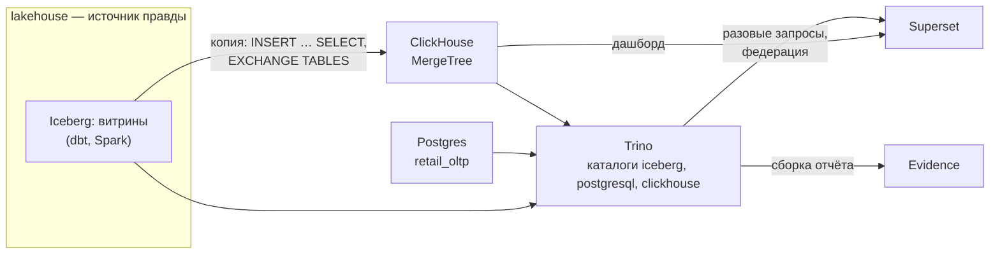
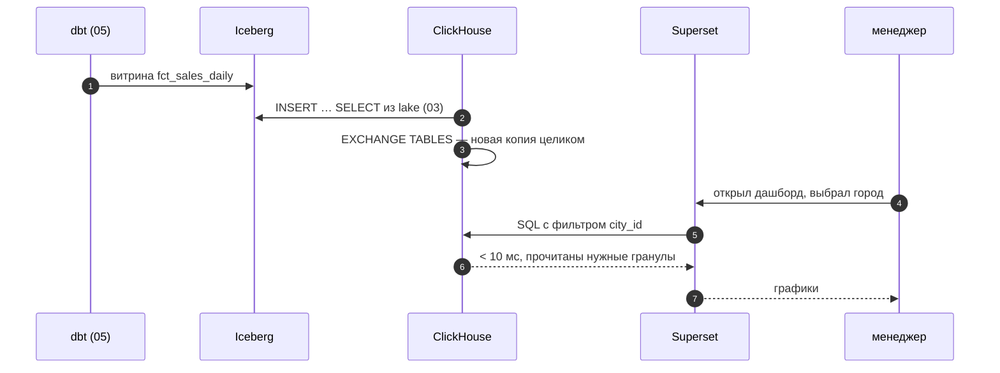

# 01 · Слой отдачи: кто читает витрины и как не заставить их ждать

> [!info] Урок одной фразой
> Витрины готовы, но бизнес их ещё не видит. Слой отдачи — раздача в столовой: блюда готовят на
> кухне (lakehouse), а выдают с раздачи, где всё под рукой и очередь движется быстро. Урок
> отвечает, когда кормить прямо с кухни, когда держать раздачу (ClickHouse), а когда — общее окно
> во все кухни сразу (Trino).

> [!todo] Чек-лист: после урока ты сможешь
> - [ ] перечислить потребителей витрин и их требования: задержка, параллельность, свежесть;
> - [ ] сравнить три схемы отдачи: чтение lakehouse, копия в OLAP-СУБД, федеративный движок;
> - [ ] объяснить, что такое стоимость запроса и как её измерить у нас;
> - [ ] нарисовать слой отдачи нашего стека и назвать, кто что читает.

**Нужно для:** лабы [10.1](../labs/10.1_clickhouse_marts/README.md),
[10.2](../labs/10.2_trino_federation/README.md), [10.3](../labs/10.3_superset_dashboard/README.md).
**Карта урока:** [serving-layer.canvas](../maps/serving-layer.canvas).

---

## Шаг 0. Азбука

| Понятие | В аналогии «столовая» | Подробнее |
|---|---|---|
| Слой отдачи (serving) | Раздача: отсюда блюда уходят к гостям | [слой отдачи](../../../glossary/serving-layer.md) |
| Витрина | Готовое блюдо | [витрина](../../../glossary/data-mart.md) |
| OLAP-СУБД (ClickHouse) | Раздача с подогревом: копия блюд под рукой | [ClickHouse](../../../glossary/clickhouse.md) |
| Федеративный движок (Trino) | Окно, через которое заказывают из любой кухни | [Trino](../../../glossary/trino.md) |
| BI (Superset) | Меню с картинками для гостя | [Superset](../../../glossary/superset.md) |
| Стоимость запроса | Сколько продуктов достали со склада ради порции | [стоимость запроса](../../../glossary/query-cost.md) |

---

## Шаг 1. Кто читает витрины и чего они хотят

**Проблема.** Модули 05–07 построили витрины. Но у разных потребителей разные требования, и
одна схема отдачи всем не подходит.

**Как устроено.**

| Потребитель | Как читает | Задержка | Сколько одновременно | Свежесть |
|---|---|---|---|---|
| Дашборд сети | десятки однотипных запросов на клик | < 1 с | десятки людей | раз в сутки |
| Аналитик | разовые сложные запросы, join разных источников | секунды–минуты | единицы | любая |
| Отчёт-страница (Evidence) | запросы при сборке сайта | не важна | один процесс | на момент сборки |
| Приложение (рекомендации, API) | точечные запросы по ключу | < 100 мс | сотни | минуты |

Требования противоречат друг другу. Дашборду нужна предсказуемая задержка под нагрузкой.
Аналитику нужна свобода: соединить витрину с учётной системой, не дожидаясь, пока инженер
построит новую таблицу.

**Что из этого следует.** Слой отдачи — это несколько путей к одним данным. Источник правды
остаётся один — lakehouse; пути различаются скоростью и гибкостью.

---

## Шаг 2. Три схемы отдачи

**Проблема.** Можно читать витрины прямо из Iceberg, копировать их в быструю СУБД или
спрашивать через движок, который видит всё сразу. У каждого варианта своя цена.

**Как устроено.**



| Схема | Как работает | ➕ | ➖ |
|---|---|---|---|
| A. Читать lakehouse напрямую | BI → движок (Trino, DuckDB, ClickHouse) → файлы Iceberg в S3 | одна копия данных, всегда свежо | каждый запрос ходит в каталог и S3; задержка плавает |
| B. Копия в OLAP-СУБД | витрина копируется в ClickHouse после расчёта | стабильно быстро, свой индекс и кэш | вторая копия; её надо обновлять и сверять |
| C. Федеративный движок | Trino одним SQL читает Iceberg, Postgres, ClickHouse | join источников без новых пайплайнов | медленнее B; нагрузка ложится на источники |

На стеке один и тот же вопрос — доля часов без товара в городе 0 за май — 10 раз подряд:

| Путь | Медиана | Максимум | Прочитано строк |
|---|---|---|---|
| ClickHouse → Iceberg напрямую (`DataLakeCatalog`) | 29 мс | 60 мс | 800 тыс. |
| ClickHouse → копия в MergeTree | 4 мс | 4 мс | 827 тыс. |
| Trino → Iceberg (join со справочником магазинов) | 113 мс | 125 мс | — |
| Trino → ClickHouse (тот же запрос через каталог `clickhouse`) | 65 мс | 106 мс | — |

Время ClickHouse — из `system.query_log` (работа сервера). Время Trino — от клиента в workspace
до ответа: оно включает разбор, планирование и сеть, поэтому сравнивай Trino с Trino.

Строк прочитано почти поровну: Iceberg отсёк файлы по статистикам дат, MergeTree — гранулы по
ключу. Разница во времени — в накладных расходах: запрос к каталогу, чтение метаданных и
Parquet по HTTP из Silo. На настоящем S3 в другом дата-центре разрыв будет больше.

**Что из этого следует.** В курсе используем все три схемы. Схема B — для дашборда (лабы 10.1,
10.3). Схема C — для разовых запросов и отчётов (лабы 10.2, 10.5). Схема A — для проверок и
сверки копии с источником.

> [!warning] Ловушка
> Не делай копию в ClickHouse источником правды. Если dbt пересчитал витрину, а копию не
> обновили, дашборд покажет старые числа. Обновляй копию шагом того же пайплайна (Dagster) и
> сверяй число строк с Iceberg.

---

## Шаг 3. Стоимость запроса

**Проблема.** «Быстро» и «медленно» зависят от кэша, нагрузки и железа. Чтобы сравнивать схемы и
ключи, нужна метрика, которая повторяется от запуска к запуску.

**Как устроено.** В облачных хранилищах счёт выставляют за **прочитанные байты** (BigQuery) или
за время вычислителя (Snowflake). Поэтому стоимость запроса измеряют так:

1. **Строки и байты прочитано** — главная метрика. Её уменьшают отсечение партиций и файлов,
   индекс, выбор только нужных колонок.
2. **Время** — смотри медиану и максимум по нескольким запускам, а не один запуск.
3. **Память** — важна для join и `GROUP BY` с большим числом групп.

Где смотреть у нас:

| Движок | Где видно строки и байты |
|---|---|
| ClickHouse | строка `Processed … rows, … MB` в клиенте; `system.query_log` (урок 02) |
| Trino | `EXPLAIN ANALYZE`; UI http://localhost:8082 → запрос → Stages (урок 04) |
| DuckDB | `EXPLAIN ANALYZE` (модуль 03) |
| Spark | UI 4040, вкладка SQL (модуль 07) |

**Что из этого следует.** Любое решение по витрине — ключ сортировки, партиции, копия или
федерация — подтверждается замером «до и после» в строках и байтах. Это требование лаб модуля.

> [!example]- Попробуй сам: копия против чтения Iceberg
> ```bash
> make up PROFILES="serving"
> make ch
> ```
> ```sql
> SET allow_database_iceberg = 1;
> CREATE DATABASE IF NOT EXISTS lake ENGINE = DataLakeCatalog('http://lakekeeper:8181/catalog')
> SETTINGS catalog_type = 'rest', warehouse = 'lakehouse';
> SELECT sum(oos_hours) / (16 * count()) FROM lake.`serving_demo.fct_sales_daily`
> WHERE dt BETWEEN '2024-05-01' AND '2024-05-31';
> SELECT sum(oos_hours) / (16 * count()) FROM serving_demo.sales_daily
> WHERE dt BETWEEN '2024-05-01' AND '2024-05-31';
> exit
> ```
> **Увидишь:** одинаковый ответ `0.1814…`. Под каждым — строка `Elapsed: … Processed …`: у
> копии время в несколько раз меньше.
> **Почему:** обе таблицы отсекли лишние месяцы, но чтение Iceberg каждый раз идёт через каталог
> и HTTP в Silo. Если `serving_demo.sales_daily` нет — построй её:
> `make ch ARGS="--queries-file modules/10_serving_bi/demo/clickhouse/02_sales_daily.sql"`.

---

## Шаг 4. Слой отдачи нашего стека

**Проблема.** Нужно знать, где запущен каждый сервис, как он находит данные и сколько памяти
занимает. Иначе непонятно, что поднимать для лабы.

**Как устроено.** Слой `serving.yaml`, профиль `serving`:

| Сервис | Порт на хосте | Что делает | Память на стеке |
|---|---|---|---|
| `clickhouse` | 8123 (HTTP, `/play`) | витрины для дашборда | ~1 ГБ с данными модуля |
| `trino` | 8082 (UI) | федеративные запросы | лимит 3 ГБ |
| `superset` | 8088 | BI | ~0,2–0,5 ГБ |
| `evidence` (профиль `evidence`) | 3071 | отчёты как код | по требованию |

Учебные данные модуля строит `demo/build_serving_demo.py`: звезда `serving_demo` в Iceberg
(4,85 млн строк продаж по дням) и справочник магазинов в Postgres. Почасовая таблица ClickHouse
(116,4 млн строк) и дневная витрина — SQL-файлы в `demo/clickhouse/`.

> [!example]- Попробуй сам: поднять слой и построить учебные данные
> ```bash
> make up PROFILES="serving"
> make shell
> python modules/10_serving_bi/demo/build_serving_demo.py
> exit
> make ch ARGS="--queries-file modules/10_serving_bi/demo/clickhouse/01_sales_hourly.sql"
> make ch ARGS="--queries-file modules/10_serving_bi/demo/clickhouse/02_sales_daily.sql"
> ```
> **Увидишь:** `iceberg serving_demo.fct_sales_daily 4,850,000 строк`,
> `postgres retail_oltp.serving_demo.stores 898 строк`; затем `116400000 898 2024-03-28 2024-07-02`
> и `4850000 0.1975`.
> **Почему:** скрипт пишет Iceberg через DuckDB, ClickHouse читает файлы датасета функцией
> `file()` и Iceberg через `DataLakeCatalog`.

---

## Сборка целиком

Путь витрины от расчёта до глаз менеджера:



| Шаг | Если сломается | Симптом |
|---|---|---|
| 2 | копию не обновили | дашборд показывает вчерашние числа |
| 5 | ключ ClickHouse не под фильтры | дашборд медленный под нагрузкой |
| 6 | кэш Superset держит старое | числа не меняются до Force refresh |

## Шпаргалка

| Хочу | Как |
|---|---|
| Поднять слой | `make up PROFILES="serving"` (+ `evidence` для отчётов) |
| Учебные данные | `python modules/10_serving_bi/demo/build_serving_demo.py` в `make shell` |
| ClickHouse | `make ch`; в браузере http://localhost:8123/play |
| Trino | `make trino`; UI http://localhost:8082 |
| Superset | http://localhost:8088 |
| Стоимость запроса | строки и байты прочитано + медиана времени по нескольким запускам |

## Типичные ошибки

| Симптом | Причина | Как проверить | Как чинить |
|---|---|---|---|
| Дашборд медленный только в часы пик | BI читает lakehouse напрямую | время запросов в разное время | копия в ClickHouse |
| Числа дашборда и отчёта расходятся | копия устарела или формулы разные | `count()` копии против Iceberg; формулы | обновление копии в пайплайне; семантический слой (урок 06) |
| Не хватает памяти на машине | подняты serving и spark/streaming сразу | `docker stats` | останови ненужные слои |
| Вывод «стало быстрее» по одному запуску | кэш и шум | 10 запусков | медиана и максимум, строки и байты |

## Проверь себя

Карточки — в [flashcards.md](../flashcards.md).

> [!question] 1. Аналитик хочет соединить витрину продаж с текущим статусом магазинов из `retail_oltp`. Какую схему отдачи выберешь?
> > [!success]- Ответ
> > Федеративный движок (Trino): один SQL читает Iceberg и Postgres, новых пайплайнов не нужно.
> > Если запрос станет частью дашборда — статус переносят в витрину.

> [!question] 2. Почему при одинаковом числе прочитанных строк копия в ClickHouse отвечает быстрее Iceberg?
> > [!success]- Ответ
> > Данные лежат локально рядом с процессом, а индекс и метаданные — в памяти. Чтение Iceberg
> > каждый раз идёт в каталог, читает manifest-файлы и Parquet по HTTP из S3.

> [!question] 3. Как доказать, что новый `ORDER BY` витрины лучше старого?
> > [!success]- Ответ
> > Замером на главных запросах дашборда: прочитано строк и байт (не зависит от кэша) и медиана
> > времени по нескольким запускам — до и после.
