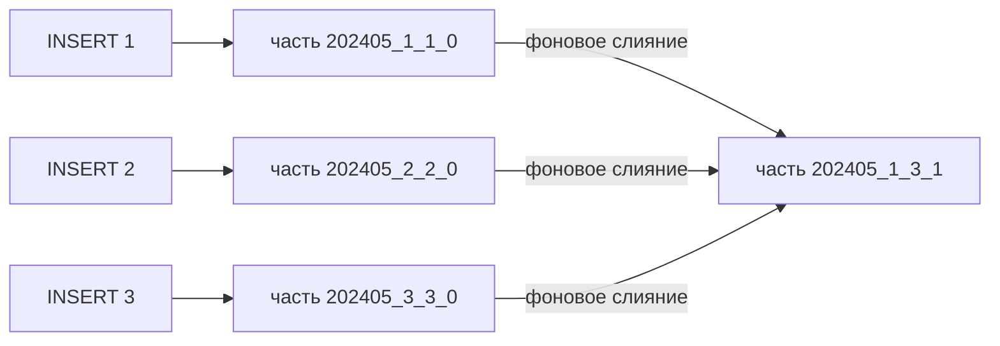
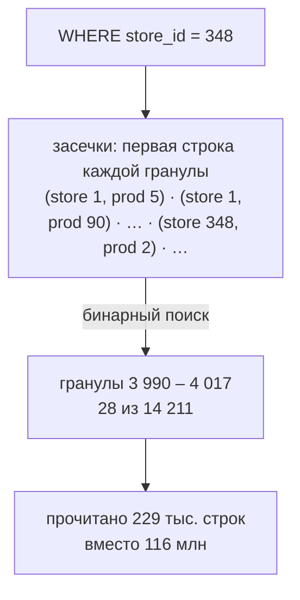
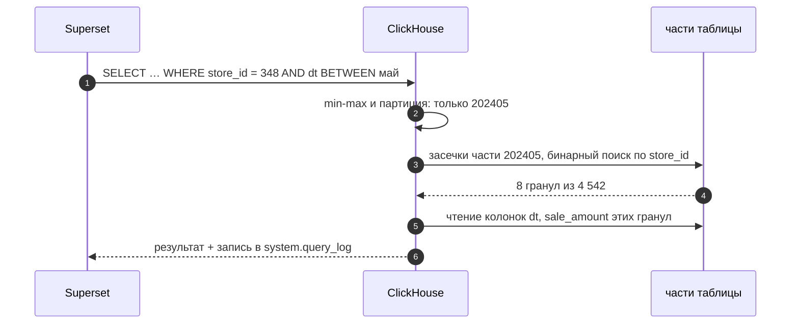

# 02 · ClickHouse: как MergeTree хранит витрину и почему важен ORDER BY

> [!info] Урок одной фразой
> ClickHouse — склад, где коробки всегда стоят по порядку, а на каждой восьмитысячной висит
> табличка с адресом. Новая поставка ложится отдельным штабелем (частью), ночью кладовщики
> сливают штабели в один и снова сортируют. Запрос смотрит только таблички и открывает лишь
> нужные коробки. Порядок коробок задаёт `ORDER BY` — и от него зависит, сколько коробок придётся
> открыть.

> [!todo] Чек-лист: после урока ты сможешь
> - [ ] объяснить, что происходит при `INSERT` в MergeTree и зачем нужны фоновые слияния;
> - [ ] объяснить разреженный первичный индекс: гранула, засечка, бинарный поиск;
> - [ ] предсказать, сколько строк прочитает запрос, по его фильтру и `ORDER BY` таблицы;
> - [ ] выбрать `ORDER BY` и `PARTITION BY` витрины под запросы дашборда;
> - [ ] измерить стоимость запроса: строки и байты в выводе клиента, `EXPLAIN indexes = 1`,
>   `system.query_log`.

> [!tip] Визуализация темы
> Интерактивная страница [mergetree_index.html](../visuals/mergetree_index.html): вставки создают
> части, слияния их объединяют, а фильтр выбирает гранулы по разреженному индексу.

**Нужно для:** лаба [10.1](../labs/10.1_clickhouse_marts/README.md), задачи 1–2.
**Карта урока:** [clickhouse-mergetree.canvas](../maps/clickhouse-mergetree.canvas).

---

## Шаг 0. Азбука

| Понятие | В аналогии «склад» | Подробнее |
|---|---|---|
| Таблица MergeTree | Склад с упорядоченными коробками | [MergeTree](../../../glossary/mergetree.md) |
| Часть (part) | Штабель одной поставки, уже отсортированный | [MergeTree](../../../glossary/mergetree.md) |
| Слияние (merge) | Ночная пересортировка: два штабеля → один | [LSM-дерево](../../../glossary/lsm-tree.md) |
| Гранула | Коробка на 8 192 строки — меньше ClickHouse не читает | [MergeTree](../../../glossary/mergetree.md) |
| Первичный индекс, засечка | Табличка с адресом первой строки коробки | [разреженный индекс](../../../glossary/sparse-index.md) |
| `ORDER BY` | Порядок коробок на складе | [порядок сортировки](../../../glossary/sort-order.md) |
| `PARTITION BY` | Отдельный зал склада на каждый месяц | [партиционирование](../../../glossary/partitioning.md) |

---

## Шаг 1. Зачем BI отдельная СУБД, если есть lakehouse

**Проблема.** Дашборд открывают 20 человек сразу, и каждый клик по фильтру — новый запрос. Ответ
нужен меньше чем за секунду. Lakehouse хранит данные в Parquet-файлах на S3: каждый запрос
обращается к каталогу, читает метаданные, скачивает файлы по сети. Это сотни миллисекунд ещё до
чтения данных. Для одного аналитика это нормально, а для дашборда с десятью графиками — медленно.

**Как устроено.** ClickHouse — колоночная СУБД со своим хранилищем на локальном диске. Она
хранит каждую колонку отдельным сжатым файлом, как Parquet. Но файлы лежат рядом с процессом, а
порядок строк и индекс ClickHouse поддерживает сам. Поэтому типичная схема такая: витрины
считаются в lakehouse (dbt, Spark), а их копия загружается в ClickHouse для быстрой отдачи.

**Что из этого следует.** ClickHouse в нашем стеке — не второе хранилище правды, а кэш витрин.
Его можно пересоздать из Iceberg в любой момент. Поэтому его данные не нужно бэкапить так же
строго, как lakehouse.

**У нас.** Учебная таблица `serving_demo.sales_hourly` — почасовые продажи: 116,4 млн строк.
Её строит файл `demo/clickhouse/01_sales_hourly.sql` прямо из файлов датасета за 6,7 с.

| Колонка | Тип | Сжато | Без сжатия | Во сколько раз |
|---|---|---|---|---|
| `store_id` (1-я в `ORDER BY`) | UInt16 | 1,01 МиБ | 222 МиБ | 219 |
| `dt` | Date | 1,49 МиБ | 222 МиБ | 149 |
| `sale_amount` | Float32 | 102,4 МиБ | 444 МиБ | 4,3 |
| вся таблица | | 142,5 МиБ | 2,28 ГиБ | 16 |

Колонки ключа сортировки сжимаются в сотни раз: после сортировки в них идут длинные серии
одинаковых значений. Продажи — почти случайные дробные числа, поэтому они сжимаются плохо.

> [!example]- Попробуй сам: таблица и её размер
> ```bash
> make up PROFILES="serving"
> make ch
> ```
> ```sql
> SELECT name, type, formatReadableSize(data_compressed_bytes) AS comp,
>        formatReadableSize(data_uncompressed_bytes) AS uncomp
> FROM system.columns WHERE database = 'serving_demo' AND table = 'sales_hourly';
> exit
> ```
> **Увидишь:** 10 колонок; у `store_id` около 1 МиБ сжатых данных, у `sale_amount` — около 102 МиБ.
> **Почему:** сжатие использует повторы. Отсортированная колонка повторяется длинными сериями.
> Если таблицы нет, построй её: `make ch ARGS="--queries-file modules/10_serving_bi/demo/clickhouse/01_sales_hourly.sql"`.

---

## Шаг 2. Что происходит при INSERT: части и слияния

**Проблема.** Держать строки отсортированными дорого. Если вставлять каждую строку в середину
большого файла, запись станет медленной. Аналитической СУБД нужна быстрая запись больших пачек.

**Как устроено.** MergeTree решает задачу так же, как LSM-дерево из главы 3 Клеппмана:

1. `INSERT` сортирует пришедшую пачку по `ORDER BY` в памяти.
2. Пачка записывается на диск новой **частью** (part) — папкой с файлами колонок и индексом.
   Старые части не меняются.
3. Если у таблицы есть `PARTITION BY`, пачка сначала делится по партициям. Каждая партиция
   получает свою часть.
4. Фоновый процесс **сливает** мелкие части одной партиции в крупную. Слияние — это сортировка
   слиянием двух отсортированных списков, поэтому оно дешёвое.
5. Старые части становятся неактивными и удаляются через несколько минут.



Имя части читается так: `<партиция>_<первый блок>_<последний блок>_<уровень>`. Уровень растёт
на единицу при каждом слиянии.

**Что из этого следует.**

- Вставляй **крупными пачками**: тысячи и миллионы строк. Каждый мелкий `INSERT` — новая часть.
  Если частей в партиции больше 1 000, ClickHouse замедляет вставки, а больше 3 000 — отклоняет
  их с ошибкой `Too many parts`.
- Мелкое партиционирование умножает части: одна вставка за 90 дней в таблицу с партицией по дню
  создаст 90 частей. Партиция по месяцу — обычный выбор для витрин.
- Пока слияние не прошло, в таблице могут лежать «недосклеенные» данные. Это важно для движков
  из урока 03.

> [!example]- Попробуй сам: 2 вставки → 10 частей → 5
> ```bash
> make ch
> ```
> ```sql
> CREATE TABLE serving_demo.zz_parts AS serving_demo.sales_hourly
> ENGINE = MergeTree PARTITION BY toYYYYMM(dt) ORDER BY (store_id, product_id, dt, hour);
> INSERT INTO serving_demo.zz_parts SELECT * FROM serving_demo.sales_hourly WHERE store_id = 1;
> INSERT INTO serving_demo.zz_parts SELECT * FROM serving_demo.sales_hourly WHERE store_id = 2;
> SELECT count() AS parts FROM system.parts
> WHERE database = 'serving_demo' AND table = 'zz_parts' AND active;
> OPTIMIZE TABLE serving_demo.zz_parts FINAL;
> SELECT name, rows, level FROM system.parts
> WHERE database = 'serving_demo' AND table = 'zz_parts' AND active ORDER BY name;
> DROP TABLE serving_demo.zz_parts;
> exit
> ```
> **Увидишь:** после двух вставок — `10` частей. После `OPTIMIZE … FINAL` — 5 частей уровня 1,
> например `202405_5_6_1`: блоки 5 и 6 слиты.
> **Почему:** данные одного магазина есть во всех 5 месяцах, поэтому каждая вставка создаёт
> 5 частей. Слияния объединяют части внутри месяца, но не между месяцами.
>
> Фоновое слияние не спешит: две маленькие части на стеке не слились и за 10 с. Когда частей
> 20 на месяц, слияние прошло за 8 с. ClickHouse сам выбирает, что и когда сливать, поэтому
> в замере мы запустили слияние командой.

> [!warning] Ловушка
> Не вставляй строки по одной из цикла в Python. Каждая вставка создаёт часть, слияния не
> успевают, и через несколько тысяч вставок таблица перестаёт принимать данные (`Too many parts`).
> Копи строки в пачку или включай `async_insert = 1`: тогда буфер копит пачку на сервере.

---

## Шаг 3. Разреженный индекс: как ClickHouse находит нужные строки

**Проблема.** В таблице 116 млн строк. Обычный индекс B-дерево хранит запись на каждую строку —
он был бы размером с саму таблицу. Аналитическому запросу и не нужна одна строка: ему нужны
тысячи строк подряд.

**Как устроено.** Внутри части строки отсортированы по `ORDER BY` и разбиты на **гранулы** по
8 192 строки. Первичный индекс хранит одну запись на гранулу: значения ключа в её первой строке.
Эта запись — **засечка** (mark). На 116 млн строк — около 14 тыс. засечек, они целиком лежат в
памяти.

Запрос с фильтром по ключу работает так:

1. ClickHouse берёт засечки части и ищет **бинарным поиском** диапазон гранул, где может быть
   нужное значение.
2. Читает с диска только эти гранулы — и только нужные колонки.
3. Внутри гранул проверяет условие построчно.

Индекс **разреженный**: он не говорит, где строка, а говорит, в каких гранулах её точно нет.



**Что из этого следует.** Индекс помогает, только когда фильтр идёт по **началу** ключа:

| Фильтр | `ORDER BY (store_id, product_id, dt, hour)` | Почему |
|---|---|---|
| `store_id = 348` | 28 гранул, 229 тыс. строк | первая колонка ключа — бинарный поиск |
| `store_id = 348 AND product_id = 140` | 7 гранул, 57 тыс. строк | префикс из двух колонок |
| `product_id = 140` | 35,7 млн строк из 116,4 | вторая колонка: исключает гранулы, где магазин сменился |
| `dt = '2024-05-01'` | 37,2 млн строк | третья колонка: помогла только партиция по месяцу |
| `city_id = 0` | 116,4 млн — вся таблица | колонки нет в ключе |

Для второй и следующих колонок ClickHouse применяет **generic exclusion search**: он отбрасывает
гранулу, только если в ней одно значение первых колонок. Чем больше разных значений у первой
колонки, тем хуже этот поиск работает для второй.

> [!example]- Попробуй сам: стоимость запроса в выводе клиента
> ```bash
> make ch
> ```
> ```sql
> SELECT sum(sale_amount) FROM serving_demo.sales_hourly WHERE store_id = 348;
> SELECT sum(sale_amount) FROM serving_demo.sales_hourly WHERE dt = '2024-05-01';
> EXPLAIN indexes = 1
> SELECT sum(sale_amount) FROM serving_demo.sales_hourly WHERE store_id = 348;
> exit
> ```
> **Увидишь:** под первым ответом — `Processed 229.38 thousand rows, 1.38 MB`, под вторым —
> `Processed 37.20 million rows, 223.20 MB`. В `EXPLAIN` в блоке `PrimaryKey` —
> `Granules: 28/14211` и `Search Algorithm: binary search`.
> **Почему:** магазин — первая колонка ключа. День — третья, поэтому сработал только отбор
> партиции: прочитан весь май.

---

## Шаг 4. Как выбрать ORDER BY и PARTITION BY

**Проблема.** Один порядок строк не ускорит все запросы сразу. Значит, порядок выбирают под
главные запросы витрины.

**Как устроено.** Мы построили ту же таблицу с ключом `(dt, store_id, product_id, hour)` и
повторили запросы:

| Запрос | ключ `(store_id, …)` | ключ `(dt, store_id, …)` |
|---|---|---|
| магазин 348 | 229 тыс. строк | 1,74 млн строк |
| магазин 348 + товар 140 | 57 тыс. строк | 1,74 млн строк |
| день 2024-05-01 | 37,2 млн строк | 1,2 млн строк |
| город 0 | 116,4 млн | 116,4 млн |
| размер на диске | 142,5 МиБ | 204,5 МиБ |

Таблица по дате быстрее отвечает на вопрос про день, но медленнее — про магазин. Она ещё и
больше на 43 %: внутри одного дня магазины и товары чередуются, серии короче, сжатие хуже.

**Правила выбора:**

1. Выпиши фильтры главных графиков дашборда. Колонка, по которой фильтруют почти всегда, —
   первая в `ORDER BY`.
2. Ставь колонки с **меньшим числом значений раньше**: город (18) → магазин (898) → товар (865)
   → дата. Тогда generic exclusion search работает и для следующих колонок.
3. Дату чаще ставят в конец ключа и в `PARTITION BY toYYYYMM(dt)`. Партиция отрежет месяцы, ключ
   — магазины.
4. `PARTITION BY` нужен для управления данными (удалить или перезалить месяц), а не для
   скорости. Партиций должно быть десятки, не тысячи.
5. Если двум группам запросов нужны разные порядки — заведи **проекцию** (`PROJECTION`): это
   вторая копия данных в другом порядке внутри той же таблицы. Её ClickHouse выбирает сам.

**Что из этого следует.** `ORDER BY` — главное решение при проектировании витрины в ClickHouse.
Поменять его можно только пересозданием таблицы.

> [!warning] Ловушка
> Не ставь первой колонкой ключа время с точностью до секунды или уникальный ID. Тогда каждая
> гранула содержит разные значения первой колонки, и фильтр по второй колонке читает всю таблицу.

---

## Шаг 5. Как измерить стоимость запроса

**Проблема.** «Запрос стал быстрее» — не измерение: время зависит от кэша и нагрузки. Нужна
метрика, которая не меняется от запуска к запуску.

**Как устроено.** Стоимость запроса в аналитической СУБД — сколько **строк и байт прочитано**.
BigQuery по байтам выставляет счёт (Zoomcamp, модуль 03), а в ClickHouse эти числа видно тремя
способами:

| Способ | Что показывает | Когда |
|---|---|---|
| строка `Processed … rows, … MB` в клиенте | прочитано строк и байт | быстрая проверка |
| `EXPLAIN indexes = 1` | сколько частей и гранул отобрал каждый индекс | до запуска запроса |
| `system.query_log` | `read_rows`, `read_bytes`, `query_duration_ms`, `memory_usage` по каждому запросу | сравнение и история |

Метка `SETTINGS log_comment = '…'` помогает найти свои запросы в журнале.

> [!example]- Попробуй сам: журнал запросов
> ```bash
> make ch
> ```
> ```sql
> SELECT sum(sale_amount) FROM serving_demo.sales_hourly WHERE city_id = 0
> SETTINGS log_comment = 'city0';
> SYSTEM FLUSH LOGS;
> SELECT read_rows, formatReadableSize(read_bytes) AS read, query_duration_ms
> FROM system.query_log WHERE type = 'QueryFinish' AND log_comment = 'city0'
> ORDER BY event_time DESC LIMIT 1;
> exit
> ```
> **Увидишь:** `116400000`, около 500 МиБ, десятки миллисекунд.
> **Почему:** `city_id` нет в ключе — прочитана вся таблица. `SYSTEM FLUSH LOGS` сбрасывает
> буфер журнала на диск: без него свежий запрос может ещё не попасть в таблицу.

---

## Сборка целиком

Путь одного запроса дашборда «продажи магазина 348 за май»:



| Шаг | Если сломается | Симптом |
|---|---|---|
| 2 | `PARTITION BY` по дню и тысячи партиций | долгий старт запроса, `Too many parts` при вставке |
| 3 | фильтр не по началу ключа | `Processed` ≈ вся таблица |
| 5 | запрос читает `SELECT *` | байт прочитано в разы больше, чем нужно |

## Шпаргалка

| Хочу | Как |
|---|---|
| Клиент | `make ch`; файл — `make ch ARGS="--queries-file modules/…sql"` |
| Таблица витрины | `ENGINE = MergeTree PARTITION BY toYYYYMM(dt) ORDER BY (city_id, store_id, dt)` |
| Загрузить из файлов | `INSERT INTO … SELECT … FROM file('raw/…/*.parquet', Parquet)` |
| Части таблицы | `SELECT name, rows, level FROM system.parts WHERE table = '…' AND active` |
| Какие гранулы читает запрос | `EXPLAIN indexes = 1 SELECT …` |
| Стоимость запроса | `system.query_log`: `read_rows`, `read_bytes`, `query_duration_ms` |
| Размер колонок | `system.columns`: `data_compressed_bytes`, `data_uncompressed_bytes` |
| Слить все части | `OPTIMIZE TABLE … FINAL` (дорого; для учебных замеров) |

## Типичные ошибки

| Симптом | Причина | Как проверить | Как чинить |
|---|---|---|---|
| `Too many parts` при вставке | мелкие вставки или мелкие партиции | `count()` в `system.parts` | пачки крупнее, `async_insert`, партиция по месяцу |
| Фильтр читает всю таблицу | колонки нет в начале `ORDER BY` | `EXPLAIN indexes = 1` | другой ключ или проекция |
| Таблица на диске больше ожидаемого | ключ начинается с колонки с большим числом значений | `system.columns` | колонки с малым числом значений — раньше |
| `Code: 291 … File … is not inside /workspace/data` | путь вне `user_files_path` | `infra/docker/clickhouse/config.d/serving.xml` | путь относительно `data/`: `file('raw/…')` |
| Свежего запроса нет в `query_log` | журнал пишется пачками | — | `SYSTEM FLUSH LOGS` |

## Проверь себя

Карточки — в [flashcards.md](../flashcards.md).

> [!question] 1. Таблица `ORDER BY (store_id, product_id, dt, hour)`. Запрос фильтрует `product_id = 140`. Прочитает он всю таблицу или меньше?
> > [!success]- Ответ
> > Меньше: на стеке 35,7 млн строк из 116,4. Generic exclusion search отбрасывает гранулы, где
> > магазин один и товар 140 в диапазон гранулы не попадает. Но выигрыш в 3 раза, а не в 500, как
> > для первой колонки.

> [!question] 2. Почему таблица с ключом `(dt, store_id, …)` заняла на 43 % больше места?
> > [!success]- Ответ
> > Сжатие использует повторы. При ключе по магазину в колонках `store_id`, `product_id`, `city_id`
> > идут длинные серии одинаковых значений. При ключе по дате внутри дня магазины и товары
> > чередуются — серии короче, сжатие хуже.

> [!question] 3. Скрипт вставляет по 100 строк каждую секунду. Что случится через час?
> > [!success]- Ответ
> > 3 600 частей. Слияния могут не успеть, и при числе частей в партиции больше порога вставки
> > начнут падать с `Too many parts`. Решение — копить пачку или `async_insert = 1`.

> [!question] 4. Дашборд фильтрует по городу и дате, иногда по магазину. Какой `ORDER BY` и `PARTITION BY` выберешь?
> > [!success]- Ответ
> > `PARTITION BY toYYYYMM(dt) ORDER BY (city_id, store_id, dt)`. Город — главный фильтр и имеет
> > мало значений; магазин уточняет город; дату режут партиции и последняя колонка ключа.
