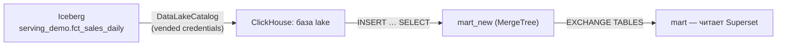
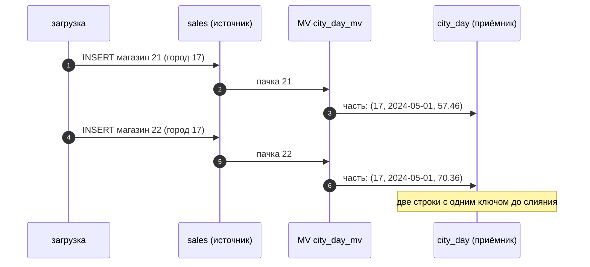

# 03 · ClickHouse: загрузка витрин, materialized views и движки предрасчёта

> [!info] Урок одной фразой
> Витрину в ClickHouse надо привезти из lakehouse, а частые итоги — посчитать заранее. Materialized
> view в ClickHouse — кассир, который при каждой поставке сразу дописывает итог в журнал. Он не
> пересчитывает старые поставки и не сводит журнал сам: строки одного дня сольются только при
> фоновом слиянии. Поэтому запрос к итогам всё равно делает `GROUP BY`.

> [!todo] Чек-лист: после урока ты сможешь
> - [ ] подключить каталог Iceberg к ClickHouse и скопировать витрину в MergeTree;
> - [ ] перезалить витрину атомарно через `EXCHANGE TABLES`;
> - [ ] объяснить, почему materialized view видит только новые вставки, и заполнить её историей;
> - [ ] выбрать движок: SummingMergeTree, AggregatingMergeTree, ReplacingMergeTree;
> - [ ] писать запросы к таким таблицам так, чтобы результат не зависел от слияний.

**Нужно для:** лаба [10.1](../labs/10.1_clickhouse_marts/README.md), задачи 2–3.
**Карта урока:** [clickhouse-views.canvas](../maps/clickhouse-views.canvas).

---

## Шаг 0. Азбука

| Понятие | В аналогии «кассир и журнал» | Подробнее |
|---|---|---|
| `DataLakeCatalog` | Окно в соседний склад (lakehouse) | [Iceberg-каталог](../../../glossary/iceberg-catalog.md) |
| Materialized view (MV) | Кассир: на каждую поставку дописывает итог | [materialized view ClickHouse](../../../glossary/clickhouse-materialized-view.md) |
| SummingMergeTree | Журнал, где строки одного дня при сверке складываются | [MergeTree](../../../glossary/mergetree.md) |
| AggregatingMergeTree, `-State`/`-Merge` | Журнал с «полуфабрикатами» метрик, которые можно доварить | [materialized view ClickHouse](../../../glossary/clickhouse-materialized-view.md) |
| ReplacingMergeTree | Журнал, где новая запись заменяет старую при сверке | [MergeTree](../../../glossary/mergetree.md) |
| Refreshable MV | Бухгалтер, который пересчитывает итог по расписанию | [материализация](../../../glossary/materialization.md) |

---

## Шаг 1. Как привезти витрину из lakehouse

**Проблема.** Витрины считаются в Iceberg (dbt, Spark). ClickHouse должен получить их копию и
обновлять её после каждого расчёта. Копия не должна быть «наполовину новой» во время обновления.

**Как устроено.** ClickHouse умеет читать Iceberg напрямую. Движок базы `DataLakeCatalog`
подключает REST-каталог Lakekeeper: каждая таблица каталога видна как таблица ClickHouse с
именем `` `пространство.таблица` ``. Ключи к S3 ClickHouse получает от каталога (vended
credentials), как Spark и DuckDB. Функция пока в статусе beta, поэтому её включают настройкой.

Перезаливка витрины идёт в три шага:

1. Создай пустую копию таблицы: `CREATE TABLE …_new AS …`.
2. Заполни её: `INSERT INTO …_new SELECT … FROM lake.…`.
3. Поменяй таблицы местами одной командой `EXCHANGE TABLES a AND b`. Обмен атомарный: запросы
   видят либо старую, либо новую таблицу целиком.



**Что из этого следует.** Запрос прямо к `lake.…` работает, но каждый раз читает Parquet из S3
и не использует `ORDER BY` ClickHouse. Для дашборда копируй витрину в MergeTree; прямое чтение
оставь для разовых проверок и сверки.

> [!example]- Попробуй сам: каталог Iceberg в ClickHouse
> ```bash
> make ch
> ```
> ```sql
> SET allow_database_iceberg = 1;
> CREATE DATABASE IF NOT EXISTS lake ENGINE = DataLakeCatalog('http://lakekeeper:8181/catalog')
> SETTINGS catalog_type = 'rest', warehouse = 'lakehouse';
> SHOW TABLES FROM lake;
> SELECT count(), round(sum(sale_amount)) FROM lake.`serving_demo.fct_sales_daily`;
> exit
> ```
> **Увидишь:** три таблицы `serving_demo.dim_product`, `serving_demo.dim_store`,
> `serving_demo.fct_sales_daily`; затем `4850000  4911229`.
> **Почему:** ClickHouse спросил у Lakekeeper список таблиц и метаданные, затем прочитал файлы
> Parquet из Silo. Без `SET allow_database_iceberg = 1` — ошибка `SUPPORT_IS_DISABLED`.
> Если таблиц нет — построй их: `make shell`, затем `python modules/10_serving_bi/demo/build_serving_demo.py`.

> [!warning] Ловушка
> Не перезаливай витрину через `TRUNCATE` и `INSERT` в ту же таблицу. Между командами дашборд
> увидит пустую или неполную таблицу. Заливай в копию и меняй местами `EXCHANGE TABLES`.

---

## Шаг 2. Materialized view: триггер на вставку

**Проблема.** Дашборд сети показывает продажи по городам за день. Каждый раз агрегировать 116 млн
строк до 18 городов — лишняя работа. Итог можно считать заранее.

**Как устроено.** В Postgres materialized view — сохранённый результат запроса, его обновляют
командой `REFRESH`. В ClickHouse обычная MV устроена иначе — это **триггер на вставку**:

1. Ты создаёшь таблицу-приёмник (`TO` таблица) и MV с запросом `SELECT … FROM источник`.
2. Когда в источник приходит `INSERT`, ClickHouse выполняет запрос MV **только над этой пачкой**.
3. Результат вставляется в таблицу-приёмник отдельной частью.

Отсюда два следствия, которые часто удивляют:

- MV **не видит данные, которые были в источнике до её создания**. Историю переносят вручную:
  `INSERT INTO приёмник SELECT … FROM источник`.
- Пачки считаются **независимо**. Если две вставки содержали продажи одного города за один день,
  в приёмнике будет две строки с этим ключом.



**Что из этого следует.** Приёмник выбирают так, чтобы фоновое слияние сводило строки одного
ключа. Для этого есть SummingMergeTree и AggregatingMergeTree.

> [!example]- Попробуй сам: MV видит только новые вставки
> ```bash
> make ch
> ```
> ```sql
> CREATE TABLE serving_demo.zz_src AS serving_demo.sales_hourly ENGINE = MergeTree ORDER BY (store_id, dt);
> INSERT INTO serving_demo.zz_src SELECT * FROM serving_demo.sales_hourly WHERE store_id = 20;
> CREATE TABLE serving_demo.zz_city_day (dt Date, city_id UInt16, sales Float64)
> ENGINE = SummingMergeTree ORDER BY (city_id, dt);
> CREATE MATERIALIZED VIEW serving_demo.zz_city_day_mv TO serving_demo.zz_city_day AS
> SELECT dt, city_id, sum(sale_amount) AS sales FROM serving_demo.zz_src GROUP BY dt, city_id;
> SELECT count() FROM serving_demo.zz_city_day;
> SYSTEM STOP MERGES serving_demo.zz_city_day;
> INSERT INTO serving_demo.zz_src SELECT * FROM serving_demo.sales_hourly WHERE store_id = 21;
> INSERT INTO serving_demo.zz_src SELECT * FROM serving_demo.sales_hourly WHERE store_id = 22;
> SELECT count() FROM serving_demo.zz_city_day;
> SELECT count() FROM serving_demo.zz_city_day FINAL;
> exit
> ```
> **Увидишь:** `0`, затем `194`, затем `97`.
> **Почему:** магазин 20 вставлен до MV — его нет в приёмнике. Магазины 21 и 22 из одного города
> 17 пришли двумя пачками: 2 × 97 дней = 194 строки. `FINAL` сводит строки при чтении — 97.
> Удали песочницу: `DROP TABLE serving_demo.zz_city_day_mv; DROP TABLE serving_demo.zz_city_day; DROP TABLE serving_demo.zz_src;`.

> [!warning] Ловушка
> Пиши запрос к SummingMergeTree с `sum()` и `GROUP BY`, а не `SELECT *`. Слияние может не
> пройти никогда: ClickHouse не обещает, когда сольёт части. Без `GROUP BY` дашборд покажет город
> два раза.

---

## Шаг 3. Какой движок взять для приёмника

**Проблема.** Не все метрики складываются. Сумму продаж двух пачек можно сложить. Число
**разных** магазинов с продажами — нельзя: магазин может быть в обеих пачках.

**Как устроено.** Три движка семейства MergeTree делают разную работу при слиянии:

| Движок | Что делает при слиянии строк с одним `ORDER BY` | Для чего |
|---|---|---|
| SummingMergeTree | складывает числовые колонки | аддитивные метрики: продажи, часы без товара, число строк |
| AggregatingMergeTree | объединяет **состояния** агрегатных функций | любые метрики, в т.ч. уникальные значения, перцентили |
| ReplacingMergeTree(ver) | оставляет строку с наибольшей версией `ver` | повторная загрузка: последняя версия строки побеждает |

**Состояния агрегатов.** В AggregatingMergeTree колонка хранит не число, а промежуточное
состояние: для `uniq` — набор хешей магазинов. Функция с суффиксом `-State` создаёт состояние
при вставке. Функция с суффиксом `-Merge` объединяет состояния при чтении и выдаёт число:

```sql
CREATE TABLE serving_demo.city_day_agg
(
    dt      Date,
    city_id UInt16,
    sales   SimpleAggregateFunction(sum, Float64),      -- ① простая сумма
    stores  AggregateFunction(uniq, UInt16)            -- ② состояние uniq
)
ENGINE = AggregatingMergeTree ORDER BY (city_id, dt);

CREATE MATERIALIZED VIEW serving_demo.city_day_agg_mv TO serving_demo.city_day_agg AS
SELECT dt, city_id, sum(sale_amount) AS sales, uniqState(store_id) AS stores   -- ③
FROM serving_demo.sales_hourly GROUP BY dt, city_id;

SELECT city_id, sum(sales), uniqMerge(stores) FROM serving_demo.city_day_agg   -- ④
WHERE dt = '2024-05-01' GROUP BY city_id;
```

| Метка | Что важно |
|---|---|
| ① | `SimpleAggregateFunction` хранит обычное значение: для `sum`, `min`, `max` состояние не нужно |
| ② | `AggregateFunction(uniq, UInt16)` хранит состояние — его нельзя прочитать как число |
| ③ | при вставке — `uniqState`, а не `uniq` |
| ④ | при чтении — `uniqMerge` и `GROUP BY`: он объединяет состояния частей, которые ещё не слиты |

**ReplacingMergeTree.** Мы дважды загрузили день 2024-07-02 по 898 магазинам: второй раз с
поправкой и новым `loaded_at`. До слияния в таблице 1 796 строк и двойная сумма 110 723. С
`FINAL` — 898 строк и сумма 55 637, только последняя версия.

**Что из этого следует.** Дедупликация в ClickHouse **отложенная**. Пока слияние не прошло,
дубли видны. Читай с `FINAL` или через `argMax(колонка, версия)` с `GROUP BY` ключа.

---

## Шаг 4. Refreshable MV: пересчёт по расписанию

**Проблема.** Триггерная MV не подходит, когда итог зависит от всей таблицы: «топ-10 магазинов
за всё время», соединение со справочником, который меняется. И когда витрину перезаливают
целиком через `EXCHANGE`, триггер не нужен.

**Как устроено.** **Refreshable MV** — ближе к MV в Postgres: ClickHouse выполняет весь запрос по
расписанию и атомарно заменяет результат.

```sql
CREATE MATERIALIZED VIEW serving_demo.store_totals
REFRESH EVERY 1 HOUR                     -- пересчёт раз в час
ENGINE = MergeTree ORDER BY store_id AS
SELECT store_id, sum(sale_amount) AS sales FROM serving_demo.sales_hourly GROUP BY store_id;
```

Статус обновлений — в `system.view_refreshes`: `status`, `last_success_time`, `next_refresh_time`.
На стеке первый расчёт прошёл сразу при создании: 898 строк, следующий — в начале часа.

| | Триггерная MV | Refreshable MV |
|---|---|---|
| Когда считает | при каждой вставке в источник | по расписанию |
| Над чем | только над новой пачкой | над всей таблицей |
| Свежесть | сразу | до интервала обновления |
| Цена | дёшево, но только для «складываемых» итогов | весь запрос каждый раз |
| Для чего | поток событий, итоги по времени | итоги по всей истории, join со справочниками |

**Что из этого следует.** В нашем стеке витрины уже посчитаны в dbt, поэтому главный путь —
перезалив через `EXCHANGE`. Триггерная MV полезна для потока (модуль 08: события из Kafka в
ClickHouse), refreshable — для итогов поверх загруженных витрин.

---

## Сборка целиком

Обновление витрины в ClickHouse после ночного расчёта dbt:

```mermaid
sequenceDiagram
    autonumber
    participant D as Dagster
    participant DBT as dbt → Iceberg
    participant CH as ClickHouse
    participant BI as Superset
    D->>DBT: dbt build: fct_sales_daily
    D->>CH: CREATE TABLE mart_new AS mart
    D->>CH: INSERT INTO mart_new SELECT … FROM lake.`…`
    D->>CH: проверка: count(mart_new) = count(Iceberg)
    D->>CH: EXCHANGE TABLES mart AND mart_new; DROP mart_new
    BI->>CH: запросы видят новую витрину целиком
```

| Шаг | Если сломается | Симптом |
|---|---|---|
| 3 | нет `allow_database_iceberg` | `SUPPORT_IS_DISABLED` |
| 4 | проверку пропустили | на дашборд попадает неполная витрина |
| 5 | вместо обмена — `TRUNCATE` + `INSERT` | пустой дашборд во время загрузки |

## Шпаргалка

| Хочу | Как |
|---|---|
| Iceberg в ClickHouse | `SET allow_database_iceberg = 1; CREATE DATABASE lake ENGINE = DataLakeCatalog('http://lakekeeper:8181/catalog') SETTINGS catalog_type = 'rest', warehouse = 'lakehouse'` |
| Таблица из Iceberg | ``lake.`пространство.таблица` `` |
| Атомарный перезалив | `CREATE TABLE t_new AS t` → `INSERT` → `EXCHANGE TABLES t AND t_new` |
| Итог на вставку | MV `TO` приёмник SummingMergeTree / AggregatingMergeTree |
| История в MV | `INSERT INTO приёмник SELECT … FROM источник` (до или после создания MV — без пересечения) |
| Неаддитивная метрика | `AggregateFunction(uniq, …)`, вставка `uniqState`, чтение `uniqMerge` |
| Последняя версия строки | `ReplacingMergeTree(ver)` + `FINAL` или `argMax` |
| Пересчёт по расписанию | `CREATE MATERIALIZED VIEW … REFRESH EVERY 1 HOUR …` |

## Типичные ошибки

| Симптом | Причина | Как проверить | Как чинить |
|---|---|---|---|
| MV пустая после создания | MV видит только новые вставки | `count()` приёмника | `INSERT … SELECT` истории |
| Город на графике дважды | части SummingMergeTree не слиты | `count()` против `count() FINAL` | `sum()` + `GROUP BY` в запросе |
| Дубли после перезагрузки дня | ReplacingMergeTree ещё не слил части | `FINAL` | `FINAL` или `argMax` при чтении |
| `Illegal type AggregateFunction` | колонку состояния читают как число | тип колонки | `uniqMerge(col)` |
| Дашборд пустой во время загрузки | `TRUNCATE` + `INSERT` | время загрузки | `EXCHANGE TABLES` |

## Проверь себя

Карточки — в [flashcards.md](../flashcards.md).

> [!question] 1. Ты создал MV на таблицу, где уже 116 млн строк. Сколько строк в приёмнике сразу после создания?
> > [!success]- Ответ
> > Ноль. Триггерная MV срабатывает только на новые вставки. Историю переносят отдельным
> > `INSERT … SELECT` (или `POPULATE` при создании, но он теряет вставки, пришедшие во время переноса).

> [!question] 2. Почему число магазинов с продажами нельзя хранить в SummingMergeTree?
> > [!success]- Ответ
> > Число разных значений не складывается: магазин из двух пачек посчитается дважды. Нужно
> > состояние `uniqState`, которое при слиянии объединяет множества, — AggregatingMergeTree.

> [!question] 3. Запрос `SELECT * FROM city_day WHERE city_id = 17` к SummingMergeTree вернул две строки на день. Это ошибка данных?
> > [!success]- Ответ
> > Нет. Части ещё не слиты. Запрос должен агрегировать сам: `sum(sales) … GROUP BY dt`.

> [!question] 4. Чем refreshable MV отличается от перезалива через `EXCHANGE TABLES`?
> > [!success]- Ответ
> > По сути — ничем: оба считают весь результат и меняют его атомарно. Refreshable MV делает это
> > по расписанию внутри ClickHouse; `EXCHANGE` запускает оркестратор после расчёта dbt, когда
> > данные действительно обновились.
