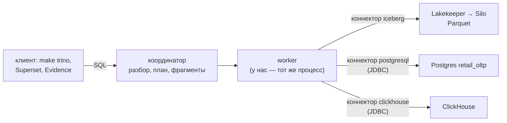
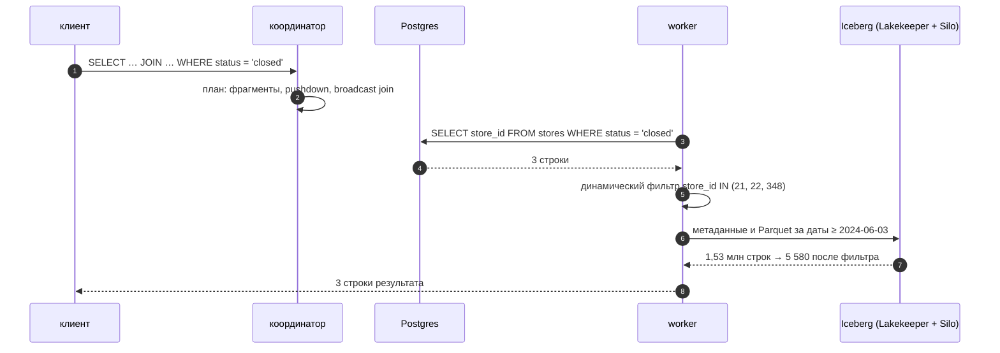

# 04 · Trino: один SQL к lakehouse, Postgres и ClickHouse

> [!info] Урок одной фразой
> Trino — переводчик на переговорах. Он сам ничего не хранит: принимает вопрос на SQL, раздаёт
> его частями «странам» (Iceberg, Postgres, ClickHouse) на их языке и собирает ответ. Хороший
> переводчик переводит фильтр заранее, чтобы каждая страна прислала три строки, а не миллион.
> Это называется pushdown.

> [!todo] Чек-лист: после урока ты сможешь
> - [ ] объяснить устройство Trino: координатор, worker, коннектор, каталог;
> - [ ] описать каталог в `etc/catalog/*.properties` и обратиться к таблице `каталог.схема.таблица`;
> - [ ] написать федеративный запрос: витрина Iceberg × справочник Postgres;
> - [ ] прочитать `EXPLAIN` и `EXPLAIN ANALYZE`: что ушло в источник, сколько строк пришло;
> - [ ] решить, оставить вопрос на Trino или перенести его в витрину.

**Нужно для:** лаба [10.2](../labs/10.2_trino_federation/README.md).
**Карта урока:** [trino-federation.canvas](../maps/trino-federation.canvas).

---

## Шаг 0. Азбука

| Понятие | В аналогии «переводчик на переговорах» | Подробнее |
|---|---|---|
| Координатор | Старший переводчик: разбирает вопрос и делит работу | [Trino](../../../glossary/trino.md) |
| Worker | Помощник: читает данные и считает свою часть | [Trino](../../../glossary/trino.md) |
| Коннектор | Знание одного языка: Iceberg, Postgres, ClickHouse | [Trino](../../../glossary/trino.md) |
| Каталог | Конкретная страна: коннектор + адрес + пароль | [Trino](../../../glossary/trino.md) |
| Федеративный запрос | Вопрос, ответ на который есть только у нескольких стран вместе | [федеративный запрос](../../../glossary/federated-query.md) |
| Pushdown | Перевести фильтр заранее, чтобы прислали меньше | [федеративный запрос](../../../glossary/federated-query.md) |

---

## Шаг 1. Как устроен Trino

**Проблема.** Данные сети лежат в трёх системах: витрины — в Iceberg, текущий справочник
магазинов — в Postgres `retail_oltp`, быстрые итоги — в ClickHouse. Чтобы их соединить, можно
каждый раз строить пайплайн. Или взять движок, который читает все три сам.

**Как устроено.** Trino — распределённый SQL-движок без своего хранилища (MPP, как Spark SQL,
но для интерактивных запросов):

1. **Координатор** принимает SQL, разбирает его, строит план и делит план на **фрагменты**.
2. **Worker-ы** выполняют фрагменты параллельно. Данные между ними идут по сети, в памяти, без
   записи на диск. Поэтому Trino быстрый на коротких запросах, но падает, если запросу не хватает
   памяти.
3. Источник данных подключает **коннектор**. Он знает, как перечислить таблицы, прочитать их и
   какую работу можно отдать источнику.
4. **Каталог** — экземпляр коннектора с настройками. Таблица адресуется тремя частями:
   `каталог.схема.таблица`.

У нас один контейнер `trino` — координатор и worker сразу (`node-scheduler.include-coordinator=true`).
Куча JVM — 80 % лимита контейнера 3 ГБ.



**У нас.** Каталоги — файлы `infra/docker/trino/catalog/*.properties`:

```properties
# iceberg.properties
connector.name=iceberg                                        # ① коннектор
iceberg.catalog.type=rest
iceberg.rest-catalog.uri=http://lakekeeper:8181/catalog
iceberg.rest-catalog.warehouse=${ENV:ICEBERG_WAREHOUSE}       # ② значение из окружения
iceberg.rest-catalog.vended-credentials-enabled=true          # ③ ключи S3 выдаёт каталог
s3.endpoint=http://silo:9000

# postgresql.properties
connector.name=postgresql
connection-url=jdbc:postgresql://postgres:5432/retail_oltp    # ④ одна база = один каталог
connection-password=${ENV:POSTGRES_PASSWORD}
```

| Метка | Что важно |
|---|---|
| ① | имя файла (`iceberg`) становится именем каталога; коннектор — его тип |
| ② | `${ENV:…}` подставляет переменную окружения контейнера: пароли не лежат в git |
| ③ | как у Spark и ClickHouse: Trino получает временные ключи S3 вместе с таблицей |
| ④ | каталог Postgres видит одну базу; схемы базы — схемы каталога |

**Что из этого следует.** Новый источник = новый файл каталога и перезапуск контейнера. Схема
`clickhouse.serving_demo` — это база ClickHouse `serving_demo`.

> [!example]- Попробуй сам: каталоги и таблицы
> ```bash
> make up PROFILES="serving"
> make trino
> ```
> ```sql
> SHOW CATALOGS;
> SHOW TABLES FROM iceberg.serving_demo;
> SELECT count(*), count_if(status = 'open') FROM postgresql.serving_demo.stores;
> SELECT count(*) FROM clickhouse.serving_demo.sales_daily;
> quit
> ```
> **Увидишь:** каталоги `clickhouse`, `iceberg`, `postgresql`, `system`; три таблицы в
> `iceberg.serving_demo`; `898 | 898`; `4850000`.
> **Почему:** каждый каталог — отдельный коннектор. Trino сам ходит в Lakekeeper, Postgres и
> ClickHouse по сети Docker. Если таблиц нет, построй учебные данные (урок 01, шаг 4).

---

## Шаг 2. Федеративный запрос

**Проблема.** Вопрос «сколько продали магазины, которые сейчас закрыты?» требует продажи из
витрины и **текущий** статус из учётной системы. Витрина не знает статус, а учётная система не
хранит продажи.

**Как устроено.** В Trino это обычный `JOIN` таблиц из разных каталогов:

```sql
SELECT p.status, count(DISTINCT f.store_id) AS stores, round(sum(f.sale_amount)) AS sales
FROM iceberg.serving_demo.fct_sales_daily AS f
JOIN postgresql.serving_demo.stores AS p ON p.store_id = f.store_id
WHERE f.dt >= DATE '2024-06-03'
GROUP BY p.status;
```

Ответ зависит от состояния Postgres **в момент запроса**. Пайплайн и пересборка витрины не нужны.

**Что из этого следует.** Федерация хороша для вопросов «здесь и сейчас» и для разовых
исследований. Но каждый запуск нагружает все источники. Если такой запрос попадёт на дашборд,
OLTP-база получит десятки запросов в минуту.

> [!example]- Попробуй сам: ответ меняется вместе с учётной системой
> ```bash
> make trino ARGS="--execute \"SELECT p.status, count(DISTINCT f.store_id) AS stores, round(sum(f.sale_amount)) AS sales FROM iceberg.serving_demo.fct_sales_daily f JOIN postgresql.serving_demo.stores p ON p.store_id = f.store_id WHERE f.dt >= DATE '2024-06-03' GROUP BY p.status\""
> docker compose --env-file .env -f infra/docker/compose.yaml exec postgres \
>   psql -U de -d retail_oltp -c "UPDATE serving_demo.stores SET status = 'closed' WHERE store_id IN (348, 21, 22)"
> ```
> Повтори первую команду. Затем верни статус: та же команда `psql` с
> `SET status = 'open' WHERE status = 'closed'`.
> **Увидишь:** сначала одна строка `"open","898","1668079.0"`. После `UPDATE` — две:
> `"open","895","1661067.0"` и `"closed","3","7013.0"`.
> **Почему:** Trino читает Postgres при каждом запуске, витрина Iceberg не менялась.

---

## Шаг 3. Pushdown: что Trino отдаёт источнику

**Проблема.** Наивный федеративный движок прочитал бы все строки всех таблиц и сделал бы всю
работу сам. Для таблицы на миллионы строк в OLTP-базе это и медленно, и опасно.

**Как устроено.** Оптимизатор Trino старается отдать работу источнику (**pushdown**):

| Что отдаётся | Как выглядит в плане | Кто умеет |
|---|---|---|
| фильтр (`WHERE`) | `constraint on [status]` у `TableScan` | все наши коннекторы |
| список колонок | `columns=[store_id]` | все |
| агрегат (`GROUP BY`) | `TableScan[… Query[SELECT … GROUP BY …]]` | JDBC-коннекторы: Postgres, ClickHouse |
| отсечение файлов по статистикам | `filterPredicate = (date '2024-06-03' <= dt)` | Iceberg |
| **динамический фильтр** | `dynamicFilters = {store_id = #df_…}` | Trino сам: ключи маленькой стороны join фильтруют большую |

Динамический фильтр работает так. Trino сначала читает маленькую сторону join (справочник),
собирает её ключи и рассылает их сканеру большой стороны. Сканер отбрасывает строки ещё до join.

`EXPLAIN` показывает план без запуска. `EXPLAIN ANALYZE` запускает запрос и пишет у каждого
узла, сколько строк пришло (`Input`) и сколько ушло дальше (`Output`).

На запросе «продажи закрытых магазинов» (`… AND p.status = 'closed'`) после закрытия трёх
магазинов:

| Узел | Что видно в `EXPLAIN ANALYZE` |
|---|---|
| `TableScan postgresql … constraint on [status]` | фильтр ушёл в Postgres: `Input: 3 rows` |
| `InnerJoin … distribution = REPLICATED` | справочник разослан всем worker-ам (broadcast, как в Spark) |
| `ScanFilterProject iceberg … dynamicFilters` | `Input: 1532240 rows`, `Filtered: 99.64%` — дошло 5 580 строк |

А агрегат по ClickHouse Trino отдаёт целиком:

```text
TableScan[table = clickhouse:Query[SELECT "city_id", sum("sale_amount") AS "_pfgnrtd_0"
          FROM "serving_demo"."sales_daily" GROUP BY "city_id"] …]
```

**Что из этого следует.** Читай план федеративного запроса до того, как запустишь его на проде.
Если у `TableScan` по OLTP-таблице нет `constraint` — Trino вытащит таблицу целиком.

> [!example]- Попробуй сам: план с pushdown
> ```bash
> make trino
> ```
> ```sql
> EXPLAIN SELECT city_id, sum(sale_amount) FROM clickhouse.serving_demo.sales_daily GROUP BY city_id;
> EXPLAIN SELECT f.store_id, sum(f.sale_amount)
> FROM iceberg.serving_demo.fct_sales_daily f
> JOIN postgresql.serving_demo.stores p ON p.store_id = f.store_id
> WHERE p.status = 'closed' GROUP BY f.store_id;
> quit
> ```
> **Увидишь:** в первом плане — `TableScan[table = clickhouse:Query[SELECT "city_id", sum(…)
> … GROUP BY "city_id"]`. Во втором — `constraint on [status]` у Postgres и `dynamicFilters` у
> Iceberg.
> **Почему:** коннектор ClickHouse умеет переписать агрегат в SQL ClickHouse. Фильтр по статусу
> Postgres выполнит сам, а ключи закрытых магазинов Trino передаст сканеру Iceberg.

> [!warning] Ловушка
> Проверяй `EXPLAIN` перед запуском федеративного запроса к OLTP-базе. Функция или приведение типа
> в `WHERE` (например, `lower(status) = 'closed'`) может отключить pushdown. Тогда Trino прочитает
> всю таблицу и нагрузит учётную систему.

---

## Шаг 4. Когда Trino, а когда копия

**Проблема.** Федерация удобна, но не бесплатна. Нужно правило, по которому вопрос остаётся на
Trino или превращается в витрину.

**Как устроено.** Один и тот же вопрос — доля часов без товара в городе 0 за май, 10 запусков
от клиента в workspace:

| Путь | Медиана | Максимум |
|---|---|---|
| Trino → Iceberg (join факта и справочника) | 113 мс | 125 мс |
| Trino → ClickHouse (каталог `clickhouse`) | 65 мс | 106 мс |
| ClickHouse напрямую, время сервера (урок 01) | 4 мс | 4 мс |

| Оставить на Trino | Перенести в витрину / ClickHouse |
|---|---|
| разовый или исследовательский вопрос | вопрос задают каждый день, он на дашборде |
| нужна свежесть источника «сейчас» | хватает свежести пайплайна |
| источники маленькие или pushdown отсекает почти всё | большие объёмы, тяжёлые join |
| источник выдержит нагрузку | источник — OLTP-база, ей нельзя мешать |

**Что из этого следует.** Trino — инструмент аналитика и прототипа витрины. Если федеративный
запрос стал регулярным, его результат становится моделью dbt и попадает в витрину.

---

## Сборка целиком

Федеративный запрос «продажи закрытых магазинов»:



| Шаг | Если сломается | Симптом |
|---|---|---|
| 3 | pushdown отключён выражением | Postgres отдаёт всю таблицу, растёт `Input` |
| 6 | нет vended credentials | `Access Denied` при чтении S3 |
| 7 | не хватает памяти на join | `Query exceeded per-node memory limit` |

## Шпаргалка

| Хочу | Как |
|---|---|
| Консоль | `make trino`; выйти — `quit` |
| Один запрос | `make trino ARGS="--execute \"SELECT …\""` |
| UI | http://localhost:8082 — запросы, стадии, строки и байты |
| Каталоги | `SHOW CATALOGS`; файлы — `infra/docker/trino/catalog/` |
| Таблица | `каталог.схема.таблица` |
| План | `EXPLAIN …`; с цифрами — `EXPLAIN ANALYZE …` |
| Распределённый план | `EXPLAIN (TYPE DISTRIBUTED) …` |
| Из Python | `trino.dbapi.connect(host="trino", port=8080, user="…")` |

## Типичные ошибки

| Симптом | Причина | Как проверить | Как чинить |
|---|---|---|---|
| `Catalog '…' not found` | файла каталога нет или контейнер не перезапущен | `SHOW CATALOGS` | файл в `trino/catalog/`, перезапуск `trino` |
| `Schema '…' does not exist` | нет таблиц в источнике | запрос к источнику напрямую | построить данные |
| Федеративный запрос медленный, Postgres под нагрузкой | нет pushdown фильтра | `EXPLAIN`: вместо `TableScan … constraint on [status]` — `ScanFilterProject … filterPredicate = (lower(status) …)` | фильтр без функций, по колонке как есть |
| `Query exceeded per-node memory limit` | join или `GROUP BY` не помещается в память | UI → запрос → Stages | меньше строк до join; маленькая таблица справа |
| Разные числа у Trino и ClickHouse | типы: Trino делит `integer` нацело | `typeof(…)` | `16.0 * count(*)` или `CAST … AS double` |

## Проверь себя

Карточки — в [flashcards.md](../flashcards.md).

> [!question] 1. Где Trino хранит данные таблиц каталога `iceberg`?
> > [!success]- Ответ
> > Нигде. Данные — в Parquet на Silo, метаданные — в Lakekeeper. Trino читает их при каждом
> > запросе через коннектор.

> [!question] 2. Как по плану понять, что фильтр ушёл в Postgres?
> > [!success]- Ответ
> > У узла `TableScan` с таблицей `postgresql:…` есть `constraint on [колонка]`. В
> > `EXPLAIN ANALYZE` его `Input` равен числу отфильтрованных строк, а не размеру таблицы.

> [!question] 3. Что такое динамический фильтр и почему Iceberg прочитал 1,53 млн строк, хотя нужно 5 580?
> > [!success]- Ответ
> > Trino собрал ключи маленькой стороны join (3 магазина) и передал их сканеру Iceberg.
> > Сканер отбросил 99,64 % строк до join. Но файлы витрины отсортированы по дате, а не по
> > магазину, поэтому статистики файлов не помогли — строки пришлось прочитать.

> [!question] 4. Аналитик каждый час запускает федеративный запрос к `retail_oltp` для дашборда. Что предложишь?
> > [!success]- Ответ
> > Перенести данные `retail_oltp` в lakehouse (ingestion или CDC, модули 04 и 08) и построить
> > витрину. Регулярная нагрузка на учётную систему — риск для её пользователей.
