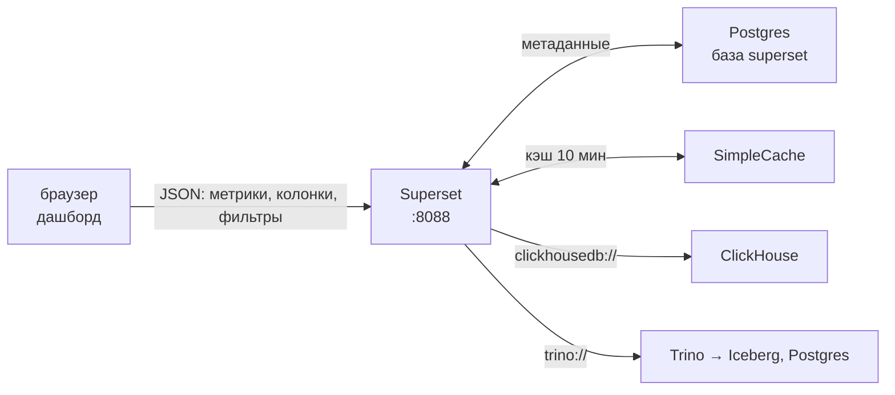
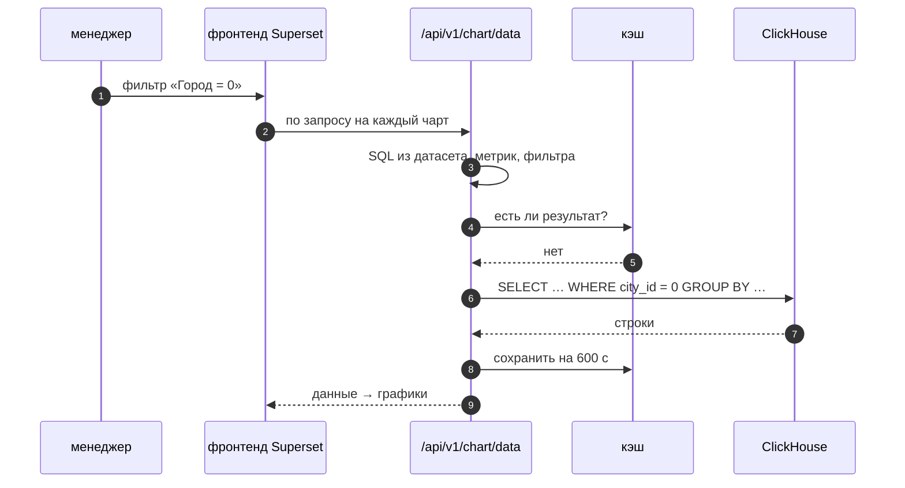

# 05 · Superset: от подключения до дашборда, и как не обмануть графиком

> [!info] Урок одной фразой
> Superset — витрина магазина для данных. Подключение — дверь на склад, датасет — полка с
> подписанными товарами и ценником (метрики), чарт — один товар на витрине, дашборд — вся витрина.
> Хорошая витрина отвечает на вопрос покупателя за пять секунд. Плохая — красивая, но покупатель
> уходит без ответа или с неверным.

> [!todo] Чек-лист: после урока ты сможешь
> - [ ] подключить ClickHouse и Trino к Superset строкой SQLAlchemy;
> - [ ] создать датасет, добавить метрики и вычисляемые колонки, выбрать временную колонку;
> - [ ] собрать чарт: метрика, измерение, временное зерно, фильтр — и прочитать его SQL;
> - [ ] собрать дашборд с фильтрами и объяснить, как работают кэш и перекрёстные фильтры;
> - [ ] выбрать тип графика под вопрос и найти пять типичных обманов на графике.

**Нужно для:** лаба [10.3](../labs/10.3_superset_dashboard/README.md).
**Карта урока:** [superset-dashboards.canvas](../maps/superset-dashboards.canvas).

---

## Шаг 0. Азбука

| Понятие | В аналогии «витрина магазина» | Подробнее |
|---|---|---|
| Подключение (database) | Дверь на склад: адрес и ключ | [Superset](../../../glossary/superset.md) |
| Датасет | Полка: таблица или SQL + подписи колонок + ценники-метрики | [Superset](../../../glossary/superset.md) |
| Метрика датасета | Ценник: формула агрегата, общая для всех чартов полки | [метрика](../../../glossary/metric.md) |
| Чарт | Один товар на витрине: график по вопросу | [Superset](../../../glossary/superset.md) |
| Дашборд | Вся витрина: чарты + фильтры | [Superset](../../../glossary/superset.md) |
| Временное зерно (time grain) | Как группировать даты: день, неделя, месяц | [grain](../../../glossary/grain.md) |

---

## Шаг 1. Как Superset получает данные

**Проблема.** BI-инструмент не хранит данные. Ему нужно знать, куда отправлять SQL, и превращать
клики пользователя в запросы.

**Как устроено.** Superset — веб-приложение на Python (Flask) с фронтендом на React. Его
**метаданные** — пользователи, подключения, датасеты, чарты, дашборды — лежат в Postgres (у нас
база `superset`). Данные он берёт из подключённых баз через драйверы SQLAlchemy:

1. Пользователь меняет фильтр на дашборде.
2. Фронтенд отправляет описание запроса (датасет, метрики, колонки, фильтры) в API `/chart/data`.
3. Superset собирает SQL на диалекте нужной базы и проверяет кэш.
4. Если результата в кэше нет — отправляет SQL в базу, кладёт ответ в кэш на 10 минут.
5. Фронтенд рисует график.



Подключения в нашем стеке (вводятся в **Settings → Database Connections → + Database →
Other → SQLAlchemy URI**):

| База | SQLAlchemy URI |
|---|---|
| ClickHouse | `clickhousedb://de:<CLICKHOUSE_PASSWORD>@clickhouse:8123/serving_demo` |
| Trino | `trino://superset@trino:8080/iceberg` |

Адреса — имена сервисов в сети Docker: Superset ходит изнутри сети, а не через `localhost`.
Пароль Superset шифрует ключом `SUPERSET_SECRET_KEY` из `.env`.

**Что из этого следует.** Скорость дашборда — это скорость базы плюс кэш. Superset не ускорит
медленный запрос, поэтому витрины для дашборда лежат в ClickHouse (уроки 02–03).

> [!example]- Попробуй сам: вход и подключение ClickHouse
> ```bash
> make up PROFILES="serving"
> grep -E "^(SUPERSET_ADMIN_PASSWORD|CLICKHOUSE_PASSWORD)=" .env
> ```
> Открой http://localhost:8088, войди как `admin` с паролем `SUPERSET_ADMIN_PASSWORD`.
> Settings → Database Connections → + Database → внизу списка «Other» → вставь URI ClickHouse с
> паролем → **Test Connection** → Connect.
> **Увидишь:** сообщение «Connection looks good!», в списке баз — новое подключение.
> **Почему:** драйвер clickhouse-connect (установлен в образ `debd/superset:6.1.0`) открыл
> HTTP-соединение с `clickhouse:8123`. Если пароль неверен — ошибка аутентификации ClickHouse.

---

## Шаг 2. Датасет: где живут метрики Superset

**Проблема.** Если каждый чарт сам пишет формулу «доли часов без товара», формулы разойдутся
(урок 06). Нужен общий слой определений хотя бы внутри Superset.

**Как устроено.** Датасет — описание источника для чартов:

| Вид | Что это | Когда |
|---|---|---|
| физический | таблица или представление базы | витрина уже имеет нужный grain |
| виртуальный | SQL-запрос из SQL Lab, сохранённый как датасет | нужен join или фильтр, а витрины нет |

У датасета настраивают (**Datasets → карандаш Edit**):

- **Metrics** — именованные формулы агрегатов: `SUM(oos_hours) / (16 * COUNT(*))` с форматом
  `.2%`. Все чарты датасета используют одну формулу.
- **Calculated columns** — выражения на уровне строки: `if(activity_flag = 1, 'промо', 'без промо')`.
- **Columns**: какая колонка временная (`Is temporal`), какие доступны для фильтра и группировки,
  понятные подписи (`Verbose name`).
- **Cache timeout** — время жизни кэша для этого датасета.

**Что из этого следует.** Метрика датасета — «лёгкий семантический слой»: формула одна, но
видна только в Superset. Её текст должен повторять определение из dbt (урок 06).

> [!warning] Ловушка
> Не используй агрегат `AVG` над готовой долей в витрине по городам. Среднее долей не равно
> доле сети: 20,19 % вместо 19,75 %. Заводи метрику из сумм: `SUM(числитель) / SUM(знаменатель)`.

---

## Шаг 3. Чарт: какой SQL получится

**Проблема.** Пользователь кликает, а запрос пишет Superset. Надо понимать, во что превращаются
настройки чарта, — иначе не найти, почему число неверное или запрос медленный.

**Как устроено.** Основные поля чарта и их место в SQL:

| Поле чарта | Что в SQL |
|---|---|
| Metrics | выражения в `SELECT` с агрегатом |
| Dimensions / X-axis | колонки в `SELECT` и `GROUP BY` |
| Time grain | функция округления даты: в ClickHouse `toStartOfMonth(toDateTime(dt))` |
| Filters | `WHERE` (по колонкам) или `HAVING` (по метрикам) |
| Sort by, Row limit | `ORDER BY`, `LIMIT` |

Запрос чарта «доля без товара по городам» на нашем датасете ClickHouse:

```sql
SELECT `city_id` AS `city_id`,
       SUM(oos_hours) / (16 * COUNT(*)) AS `oos_share`,
       SUM(sale_amount) AS `sales`
FROM `serving_demo`.`sales_daily`
GROUP BY `city_id` ORDER BY `sales` DESC LIMIT 3
```

Ответ: город 0 — 19,17 %, город 12 — 20,35 %, город 16 — 19,57 %; по сети — 19,75 %. Те же
числа дал `mf query` в уроке 06.

**Что из этого следует.** Любой чарт можно проверить: меню чарта **… → View query** показывает
SQL, **View as table** — данные. Тот же SQL можно запустить в `make ch` и сравнить.

> [!example]- Попробуй сам: датасет, метрика и чарт
> Сначала построй дневную витрину в ClickHouse:
> ```bash
> make ch ARGS="--queries-file modules/10_serving_bi/demo/clickhouse/02_sales_daily.sql"
> ```
> В Superset: Datasets → + Dataset → база ClickHouse, схема `serving_demo`, таблица
> `sales_daily` → Create dataset and create chart. Закрой мастер чарта, открой датасет на
> редактирование → Metrics → + Add item: имя `oos_share`, SQL `SUM(oos_hours) / (16 * COUNT(*))`,
> D3 format `.2%` → Save. Затем Charts → + Chart → датасет `sales_daily` → **Bar Chart**:
> X-axis `city_id`, Metrics `oos_share` → Update chart → … → View query.
> **Увидишь:** 18 столбиков; SQL с `GROUP BY city_id`; у города 0 — 19,17 %.
> **Почему:** чарт — это запрос `GROUP BY` по измерению; формула пришла из метрики датасета.
> Вывод первой команды — `4850000  0.1975`: строк в витрине и доля сети.

---

## Шаг 4. Дашборд: фильтры, кросс-фильтры, кэш

**Проблема.** Один чарт отвечает на один вопрос. Менеджеру сети нужно несколько ответов сразу и
возможность сузить их до города или периода.

**Как устроено.**

- **Дашборд** — сетка чартов (Dashboards → + Dashboard, чарты перетаскивают из правой панели).
- **Native filters** — панель фильтров слева: «Город», «Период». Фильтр применяется ко всем
  чартам, у которых есть эта колонка, или к выбранным (Scoping).
- **Cross-filtering** — клик по столбику города фильтрует остальные чарты.
- **Кэш**: одинаковый запрос в течение `CACHE_DEFAULT_TIMEOUT` (у нас 600 с) берётся из памяти.
  Кнопка **Force refresh** в меню дашборда идёт в базу мимо кэша.

**Что из этого следует.** Число запросов к базе = число чартов × число смен фильтров. Дашборд из
10 чартов на витрине с плохим `ORDER BY` нагрузит базу в 10 раз сильнее, чем один отчёт.

---

## Шаг 5. Какой график выбрать и как не обмануть

**Проблема.** График можно построить правильно по данным и при этом ввести в заблуждение.
Ошибку визуализации не поймает ни один тест.

**Как устроено.** Тип графика выбирают по **вопросу**, а не по красоте:

| Вопрос | График | Пример у нас |
|---|---|---|
| Как менялось во времени? | линия (Line Chart) | доля часов без товара по дням |
| Как сравнить категории? | столбики (Bar Chart), отсортированные | доля по 18 городам |
| Из чего состоит целое? | столбик с накоплением (2–5 частей) | продажи: промо и без промо |
| Как связаны две меры? | точечный (Scatter) | скидка и продажи по товарам |
| Одно ключевое число? | Big Number с трендом | доля сети за вчера |
| Точные значения для поиска? | таблица | топ-20 магазинов по часам без товара |

Пять типичных обманов:

1. **Ось столбиков не с нуля.** Разница 19 % и 20 % выглядит двукратной. Столбики — только от нуля.
   Линии можно масштабировать: на них важна форма.
2. **Средние долей.** См. шаг 2: агрегат должен считать долю из сумм.
3. **Круговая диаграмма с 18 секторами.** Глаз плохо сравнивает углы. Больше пяти частей —
   столбики.
4. **Неполный последний период.** В июле 2024 у нас 2 дня из 31: продажи «упали в 15 раз». Режь
   неполный период фильтром или подписывай его.
5. **Цвет без смысла.** Каждый город своим цветом — шум. Цветом выделяют то, на что надо смотреть.

**Что из этого следует.** Дашборд начинается со списка вопросов (модуль 01, лаба 01.2), а не с
набора графиков. Каждый чарт подписан вопросом, на который он отвечает.

> [!warning] Ловушка
> Проверяй последний период на графике динамики. Помесячные продажи у нас — март 168 тыс., апрель
> 1,35 млн, июль 108 тыс. Март и июль неполные: 4 и 2 дня. Без подписи читатель увидит падение
> продаж в июле.

---

## Сборка целиком

Менеджер открывает дашборд и выбирает город:



| Шаг | Если сломается | Симптом |
|---|---|---|
| 3 | метрика датасета с ошибкой | все чарты датасета неверны одинаково |
| 6 | `city_id` не в начале `ORDER BY` | дашборд медленный, `read_rows` — вся таблица |
| 7 | кэш держит старое | после перезалива витрины числа не меняются до Force refresh |

## Шпаргалка

| Хочу | Как |
|---|---|
| Открыть | http://localhost:8088, `admin` / `SUPERSET_ADMIN_PASSWORD` |
| Подключить ClickHouse | `clickhousedb://de:<пароль>@clickhouse:8123/serving_demo` |
| Подключить Trino | `trino://superset@trino:8080/iceberg` |
| Метрика | Datasets → Edit → Metrics: `SUM(a) / SUM(b)`, формат `.2%` |
| SQL чарта | меню чарта → View query |
| Произвольный SQL | SQL → SQL Lab; сохранить как датасет — Save → Save dataset |
| Фильтр на дашборд | Edit dashboard → Filters → + Add filter, Scoping |
| Мимо кэша | меню дашборда → Force refresh |

## Типичные ошибки

| Симптом | Причина | Как проверить | Как чинить |
|---|---|---|---|
| `Could not load database driver` | драйвера нет в образе | `docker compose … exec superset pip list` | пакет в `infra/docker/superset/Dockerfile`, пересборка |
| Подключение к `localhost:8123` не работает | `localhost` — сам контейнер Superset | — | имя сервиса: `clickhouse:8123` |
| Чарт не видит колонку даты | колонка не отмечена временной | Edit dataset → Columns | `Is temporal` |
| Число не совпадает с SQL аналитика | разные формулы метрики | View query | одна метрика в датасете, сверка с dbt |
| После перезалива старые числа | кэш | время последнего запроса | Force refresh или меньше `cache_timeout` |
| Подключения пропали после смены `.env` | изменён `SUPERSET_SECRET_KEY` | — | вернуть ключ; ключ не меняют без миграции |

## Проверь себя

Карточки — в [flashcards.md](../flashcards.md).

> [!question] 1. Где Superset хранит данные чартов?
> > [!success]- Ответ
> > Нигде постоянно. В Postgres — только метаданные (подключения, датасеты, чарты). Данные он
> > каждый раз запрашивает из базы и держит ответ в кэше до 600 с.

> [!question] 2. Чарт показывает 20,19 % для сети, а `mf query` — 19,75 %. Что проверить?
> > [!success]- Ответ
> > View query: скорее всего, метрика — `AVG` по готовым долям или чарт строится по витрине городов.
> > Метрика должна делить суммы.

> [!question] 3. Почему в URI Superset указан `clickhouse:8123`, а в браузере ты открываешь `localhost:8123`?
> > [!success]- Ответ
> > Superset работает в контейнере и ходит по сети Docker, где ClickHouse — сервис `clickhouse`.
> > `localhost:8123` — опубликованный порт на хосте для тебя.

> [!question] 4. Менеджер просит круговую диаграмму продаж по 18 городам. Что предложишь?
> > [!success]- Ответ
> > Отсортированные горизонтальные столбики: углы 18 секторов не сравнить. Если важна доля
> > города 0 — столбик с накоплением «город 0 / остальные».
