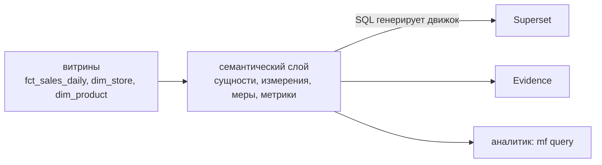
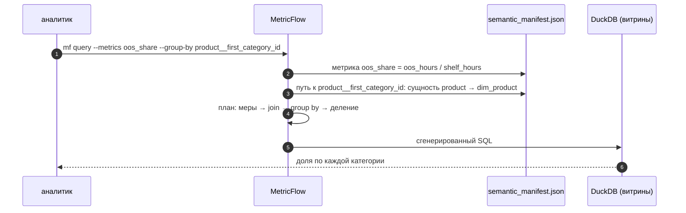

# 06 · Семантический слой: метрика описана один раз

> [!info] Урок одной фразой
> «Доля часов без товара» в Superset — 19,75 %, в отчёте аналитика — 20,19 %. Оба считали
> правильно, но по разным формулам. Семантический слой — единая техкарта ресторана: блюдо готовят
> по одному рецепту, кто бы ни стоял у плиты. Метрику описывают один раз в YAML, а SQL для неё
> генерирует движок.

> [!todo] Чек-лист: после урока ты сможешь
> - [ ] объяснить, какую проблему решает семантический слой и где он стоит в стеке;
> - [ ] описать семантическую модель: сущности, измерения, меры;
> - [ ] описать метрики типов simple, ratio и метрику с фильтром;
> - [ ] получить метрику в разрезе через `mf query` и прочитать сгенерированный SQL;
> - [ ] назвать, где ещё живут метрики (датасет Superset, Cube, LookML) и чем платишь за слой.

**Нужно для:** лаба [10.4](../labs/10.4_semantic_layer/README.md).
**Карта урока:** [semantic-layer.canvas](../maps/semantic-layer.canvas).

---

## Шаг 0. Азбука

| Понятие | В аналогии «техкарта ресторана» | Подробнее |
|---|---|---|
| Метрика | Блюдо из меню: название и рецепт | [метрика](../../../glossary/metric.md) |
| Семантический слой | Книга техкарт, общая для всех поваров | [семантический слой](../../../glossary/semantic-layer.md) |
| Семантическая модель | Описание одной заготовки: из чего и как режут | [семантический слой](../../../glossary/semantic-layer.md) |
| Сущность (entity) | Связь заготовок: «соус к этому блюду» — ключ join | [семантический слой](../../../glossary/semantic-layer.md) |
| Измерение (dimension) | Как подают: по городу, по дню, в промо или нет | [измерение](../../../glossary/dimension.md) |
| Мера (measure) | Ингредиент: колонка и способ агрегации | [метрика](../../../glossary/metric.md) |
| MetricFlow (`mf`) | Шеф, который по техкарте пишет SQL | [семантический слой](../../../glossary/semantic-layer.md) |

---

## Шаг 1. Откуда берутся разные числа для одной метрики

**Проблема.** Метрику «доля часов без товара» (out-of-stock, OOS) считают в трёх местах: чарт
Superset, отчёт Evidence, SQL аналитика. Каждый автор пишет формулу сам. На наших данных:

| Формула | Значение | Где так считают |
|---|---|---|
| `sum(oos_hours) / sum(16)` по сети | **19,75 %** | доля из сумм — правильно для сети |
| среднее долей по 18 городам | **20,19 %** | «средняя доля» в сводной таблице |
| доля по одному городу 0 | 19,17 % | отфильтровали и забыли |

Числа расходятся, и бизнес перестаёт верить дашбордам. Это не ошибка SQL, а ошибка **определения**:
формула живёт в головах и в копиях запросов.

**Как устроено.** Семантический слой выносит определения в одно место между витринами и
потребителями:



Потребитель просит «`oos_share` по городам за май» — не пишет SQL. Движок знает, как соединить
таблицы и как посчитать дробь.

**Что из этого следует.** Слой не ускоряет запросы и не хранит данные. Он гарантирует, что
одинаковый вопрос даёт одинаковый ответ. Цена — ещё один слой, который надо поддерживать.

---

## Шаг 2. Семантическая модель: сущности, измерения, меры

**Проблема.** Чтобы генерировать SQL, движку надо знать три вещи: какие таблицы как соединяются,
по каким колонкам можно резать и что можно агрегировать.

**Как устроено.** В dbt это описывают блоком `semantic_models` в YAML рядом с моделями. Наш
учебный проект — `demo/dbt_semantic/models/marts/_semantic.yml`:

```yaml
semantic_models:
  - name: sales
    model: ref('fct_sales_daily')
    primary_entity: sale_line          # ① строка факта
    defaults:
      agg_time_dimension: dt
    entities:
      - name: store                    # ② ключ к справочнику магазинов
        type: foreign
        expr: store_id
      - name: product
        type: foreign
        expr: product_id
    dimensions:
      - name: dt                       # ③ измерение времени
        type: time
        type_params: {time_granularity: day}
      - name: is_promo                 # ④ вычисляемое измерение
        type: categorical
        expr: activity_flag = 1
    measures:
      - name: oos_hours                # ⑤ мера: колонка + агрегация
        agg: sum
      - name: shelf_hours
        agg: sum
        expr: "16"

  - name: stores
    model: ref('dim_store')
    entities:
      - name: store                    # ⑥ то же имя, тип primary — так строится join
        type: primary
        expr: store_id
    dimensions:
      - name: city_id
        type: categorical
```

| Метка | Что важно |
|---|---|
| ① | у факта нет своего ключа-колонки, но первичная сущность обязательна: без неё dbt пишет `Semantic Manifest validation failed` |
| ② ⑥ | сущность `store` есть в двух моделях: foreign в факте, primary в справочнике. По совпадению имён MetricFlow сам строит `LEFT JOIN` |
| ③ | `agg_time_dimension` — по какой дате резать метрики; в запросе она называется `metric_time` |
| ④ | измерение может быть выражением; его полное имя — `sale_line__is_promo` (сущность + имя) |
| ⑤ | мера — «ингредиент», ещё не метрика: колонка `oos_hours` и агрегация `sum` |

MetricFlow также требует **календарь** (time spine) — модель с одной строкой на каждый день. По
нему он строит ряды по неделям и месяцам. У нас это `metricflow_time_spine.sql`.

**Что из этого следует.** Связи между таблицами описаны один раз, через сущности. Потребителю не
нужно знать, что город лежит в `dim_store`: он просит `store__city_id`.

---

## Шаг 3. Метрики: simple, ratio, фильтр

**Проблема.** Мера — ещё не метрика для бизнеса. Метрике нужны имя, подпись, описание и правильная
формула, особенно для долей.

**Как устроено.** Блок `metrics` строит метрики из мер и других метрик:

```yaml
metrics:
  - name: oos_hours                    # ① simple: одна мера
    type: simple
    type_params: {measure: oos_hours}
  - name: shelf_hours
    type: simple
    type_params: {measure: shelf_hours}

  - name: oos_share                    # ② ratio: дробь из двух метрик
    label: Доля часов без товара
    type: ratio
    type_params:
      numerator: oos_hours
      denominator: shelf_hours

  - name: promo_sales_share            # ③ числитель с фильтром
    type: ratio
    type_params:
      numerator:
        name: sales
        filter: "{{ Dimension('sale_line__is_promo') }} = true"
        alias: promo_sales             # ④
      denominator: sales
```

| Метка | Что важно |
|---|---|
| ① | в dbt 1.12 числитель и знаменатель ratio — **метрики**; ссылка на меру даёт ошибку `The metric oos_hours does not exist` |
| ② | ratio считается как `sum(числитель) / sum(знаменатель)` **после** группировки — поэтому доля по сети 19,75 %, а не среднее долей |
| ③ | фильтр сужает только числитель |
| ④ | без `alias` MetricFlow 0.15 назвал обе части `sales` и взял одно значение для обеих: доля вышла `1`. С `alias` — 37,90 % |

Другие типы: `derived` (выражение из метрик: `sales - sales_last_year`), `cumulative`
(нарастающий итог), `conversion` (воронка).

> [!example]- Попробуй сам: метрики по городам и сгенерированный SQL
> ```bash
> make shell
> cd modules/10_serving_bi/demo/dbt_semantic
> dbt build -q
> mf query --metrics sales,oos_share,promo_sales_share --group-by store__city_id --order -sales --limit 3
> mf query --metrics oos_share,promo_sales_share
> mf query --metrics oos_share --group-by product__first_category_id --explain
> exit
> ```
> **Увидишь:** город 0 первым: продажи `2.5945e+06`, `oos_share` `0.191735`, промо `0.415996`.
> По сети — `0.197494` и `0.379001`. Третья команда печатает SQL: подзапрос с `16 AS
> __shelf_hours`, `LEFT OUTER JOIN … dim_product`, деление `oos_hours / NULLIF(shelf_hours, 0)`.
> **Почему:** MetricFlow нашёл путь от меры к измерению через сущность `product` и сам добавил
> join. Деление — после суммирования, как требует ratio.
> `dbt build` копирует витрины из Iceberg в файл `data/demo_serving.duckdb` (нужны таблицы
> `serving_demo`, см. урок 03).

> [!warning] Ловушка
> Сверяй каждую новую метрику с ручным SQL до публикации. Генератор SQL тоже ошибается: пример —
> `promo_sales_share = 1` без `alias`. Одна проверка на старте дешевле, чем недоверие к дашбордам.

---

## Шаг 4. Где ещё живут метрики и чем платишь за слой

**Проблема.** MetricFlow — не единственный вариант. Метрики можно хранить в BI или в отдельном
сервисе.

**Как устроено.**

| Где | Как | Кто читает | Минус |
|---|---|---|---|
| Датасет Superset | метрика `SUM(oos_hours) / SUM(16)` в датасете | только Superset | Evidence и аналитик её не видят |
| dbt + MetricFlow | YAML в проекте dbt, `mf query`, API dbt Cloud | любой через сгенерированный SQL | open source — только CLI; API для BI — платный dbt Cloud |
| Cube | отдельный сервис, модели в YAML/JS, SQL- и REST-API, кэш | BI по протоколу Postgres | ещё один сервис в проде |
| LookML (Looker) | модель внутри BI | только Looker | привязка к продукту |
| Витрина с готовой метрикой | колонка `oos_share` в таблице | все | работает только для одного разреза: долю по городу нельзя сложить в долю по сети |

**Что из этого следует.** На нашем стеке нет бесплатного API между MetricFlow и Superset. Поэтому
практичный путь такой:

1. Определение метрики — в dbt (`_semantic.yml`): там же описания, тесты и lineage.
2. В Superset метрика датасета повторяет формулу дословно (урок 05).
3. Контрольный запрос `mf query` и чарт Superset дают одно число — это проверка в лабе 10.4.

> [!warning] Ловушка
> Не храни долю как колонку витрины, если по ней строят разрезы. Сумма или среднее готовых долей
> по городам не даст долю сети: 20,19 % вместо 19,75 %. Храни числитель и знаменатель.

---

## Сборка целиком

Вопрос «доля часов без товара по категориям» от запроса до числа:



| Шаг | Если сломается | Симптом |
|---|---|---|
| 2 | не запущен `dbt parse` / `build` | `Unable to load the semantic manifest` |
| 3 | разные имена сущности в моделях | `does not match any of the available group-by-items` + подсказки |
| 4 | ratio с одинаковыми именами частей | доля ровно `1` |

## Шпаргалка

| Хочу | Как |
|---|---|
| Проверить модель | `dbt parse`, затем `mf validate-configs --skip-dw` |
| Список метрик и измерений | `mf list metrics`, `mf list dimensions --metrics oos_share` |
| Метрика по дням | `mf query --metrics sales --group-by metric_time__day` |
| По месяцам, по порядку | `--group-by metric_time__month --order metric_time__month` |
| Разрез через справочник | `--group-by store__city_id` |
| Фильтр в запросе | `--where "{{ Dimension('store__city_id') }} = 0"` |
| Посмотреть SQL | `--explain` |
| Доля | `type: ratio`, числитель и знаменатель — метрики |

## Типичные ошибки

| Симптом | Причина | Как проверить | Как чинить |
|---|---|---|---|
| `Semantic Manifest validation failed` | нет первичной сущности у модели с измерениями | `dbt --debug parse` — строка WARNING | `primary_entity:` |
| `The metric … does not exist` | в ratio указана мера | имя в `metrics:` | simple-метрика над мерой |
| `does not match any of the available group-by-items` | неверное имя измерения | подсказки в ошибке | имя вида `сущность__измерение` |
| Доля ровно 1 | одинаковые имена частей ratio | `--explain` | `alias:` у числителя |
| Месяцы вразнобой | порядок не задан | — | `--order metric_time__month` |

## Проверь себя

Карточки — в [flashcards.md](../flashcards.md).

> [!question] 1. Почему ratio-метрика `oos_share` по сети даёт 19,75 %, а среднее долей городов — 20,19 %?
> > [!success]- Ответ
> > Ratio делит суммы после группировки: каждый магазино-день весит одинаково. Среднее долей даёт
> > маленькому городу тот же вес, что и городу 0 с половиной строк.

> [!question] 2. Как MetricFlow узнаёт, что для разреза по городу нужен join с `dim_store`?
> > [!success]- Ответ
> > По сущности `store`: в факте она foreign, в `dim_store` — primary. Измерение `city_id`
> > принадлежит модели `stores`, путь к нему идёт через эту сущность.

> [!question] 3. Метрику описали в dbt. Как сделать, чтобы Superset показывал то же число?
> > [!success]- Ответ
> > В open source прямого API нет. Метрику датасета Superset пишут той же формулой из сумм и
> > сверяют с `mf query` на одном разрезе. В dbt Cloud или Cube BI читает метрику через API.

> [!question] 4. Чем плох вариант «положить колонку `oos_share` в витрину по городам»?
> > [!success]- Ответ
> > Долю нельзя агрегировать дальше: для сети или региона придётся усреднять доли — получится
> > 20,19 % вместо 19,75 %. Нужны числитель и знаменатель.
