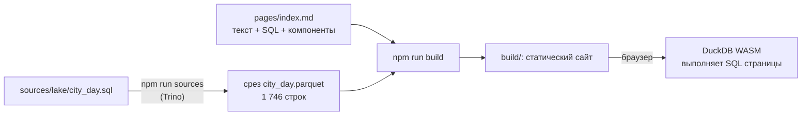

# 07 · Отчёты как код: Evidence

> [!info] Урок одной фразой
> Дашборд — пульт с кнопками: сам выбирай, что смотреть. Отчёт — статья с выводом: автор уже
> выбрал, что важно, и доказал это графиками. Evidence пишет такую статью в markdown прямо в git:
> текст, SQL и графики в одном файле. Ревьюер видит diff и вывода, и запроса, как в коде.

> [!todo] Чек-лист: после урока ты сможешь
> - [ ] объяснить, когда отчёт-страница лучше дашборда и наоборот;
> - [ ] описать устройство Evidence: источники, кэш срезов, запросы страницы, компоненты, сборка;
> - [ ] написать страницу: SQL-блок, `<Value>`, `<BarChart>`, `<LineChart>`, фильтр `<Dropdown>`;
> - [ ] собрать статический сайт и объяснить, какие данные в нём лежат;
> - [ ] найти и обойти типичные проблемы: типы дат из Trino, «тихие» ошибки источников.

**Нужно для:** лаба [10.5](../labs/10.5_evidence_report/README.md).
**Карта урока:** [reports-as-code.canvas](../maps/reports-as-code.canvas).

---

## Шаг 0. Азбука

| Понятие | В аналогии «статья с выводом» | Подробнее |
|---|---|---|
| Отчёт как код | Статья в git: правки видны построчно | [отчёт как код](../../../glossary/reports-as-code.md) |
| Источник (source) | Архив, из которого автор берёт цифры | [отчёт как код](../../../glossary/reports-as-code.md) |
| Срез источника | Выписка из архива: только то, что нужно статье | [отчёт как код](../../../glossary/reports-as-code.md) |
| Запрос страницы | Расчёт на полях статьи | [отчёт как код](../../../glossary/reports-as-code.md) |
| Компонент | Готовая иллюстрация: график, таблица, число в тексте | [отчёт как код](../../../glossary/reports-as-code.md) |
| Статическая сборка | Напечатанный выпуск: читать можно без автора и без архива | [docs as code](../../../glossary/docs-as-code.md) |

---

## Шаг 1. Дашборд или отчёт

**Проблема.** Бизнес-вопрос «почему в городе 3 полки пустеют чаще» не решается дашбордом. Нужен
вывод, его доказательства и оговорки: какие данные, что неполно, как считали. В Superset такой
текст некуда положить, а в презентации цифры устаревают и не проверяются.

**Как устроено.**

| | Дашборд (Superset) | Отчёт-страница (Evidence) |
|---|---|---|
| Для чего | мониторинг: «как дела сейчас?» | ответ: «почему так и что делать?» |
| Кто выбирает срез | читатель, фильтрами | автор, текстом; фильтров немного |
| Где хранится | метаданные BI-сервера | markdown и SQL в git |
| Ревью изменений | экспорт JSON, читать трудно | diff текста и SQL в pull request |
| Свежесть | запрос при каждом открытии | на момент сборки сайта |
| Нужен сервер | да, BI и база | нет: статический сайт |

**Что из этого следует.** Отчёт-страница не заменяет дашборд, а закрывает другую потребность.
Её делают для вопроса, на который отвечают один раз в неделю или месяц, и для документации
метрик.

---

## Шаг 2. Как устроен Evidence

**Проблема.** Отчёт должен открываться быстро и без доступа к базе, но фильтры на странице должны
работать. Как это совместить?

**Как устроено.** Evidence разделяет работу на два этапа:

1. **Источники (`npm run sources`).** Для каждого файла `sources/<источник>/<срез>.sql` Evidence
   выполняет запрос в базе через коннектор и сохраняет результат в Parquet. У нас коннектор —
   Trino, источник называется `lake`.
2. **Страница.** Файл `pages/index.md` — markdown с SQL-блоками. Эти запросы выполняет **DuckDB
   в браузере** (WASM) над сохранёнными срезами. Поэтому фильтр работает мгновенно и без базы.
3. **Компоненты** — теги вроде `<BarChart data={by_city} …/>` рисуют результат запроса.
4. **Сборка (`npm run build`).** Evidence собирает статический сайт в `build/`: HTML, JS,
   DuckDB WASM и Parquet со срезами.



**Что из этого следует.**

- Свежесть отчёта = время последнего `npm run sources`. Обновление отчёта — шаг пайплайна.
- **Всё, что выгрузил срез, лежит в сайте** и доступно любому читателю, даже если страница это
  не показывает. Срез агрегируют в источнике до нужного grain, без лишних колонок.
- Тяжёлую работу делает база (Trino), лёгкую — браузер. Срез `city_day` — 18 городов × 97 дней
  = 1 746 строк вместо 4,85 млн.

> [!warning] Ловушка
> Не выгружай в срез сырую витрину «на всякий случай». Она попадёт в сайт целиком: и размер, и
> доступ. Сначала агрегируй в SQL источника до grain страницы.

---

## Шаг 3. Страница: SQL, числа в тексте, графики, фильтр

**Проблема.** Числа, вписанные в текст руками, устаревают при следующей сборке. Текст должен
брать числа из запросов.

**Как устроено.** Фрагменты учебной страницы `demo/evidence_report/pages/index.md`:

````markdown
```sql totals
select sum(oos_hours) / sum(shelf_hours) as oos_share       -- ① SQL-блок с именем
from lake.city_day                                           -- ② срез: источник.срез
where ${inputs.city.value} = -1 or city_id = ${inputs.city.value}   -- ③ значение фильтра
```

Полка пустует <Value data={totals} column=oos_share fmt=pct1/> рабочих часов.   ④

<Dropdown name=city data={cities} value=city_id title="Город">                    ⑤
    <DropdownOption value=-1 valueLabel="Вся сеть"/>
</Dropdown>

<BarChart data={by_city} x=city y=oos_share yFmt=pct1 swapXY=true/>               ⑥
````

| Метка | Что важно |
|---|---|
| ① | имя блока (`totals`) — имя результата для компонентов |
| ② | таблица среза: `lake.city_day` — из `sources/lake/city_day.sql` |
| ③ | `${inputs.city.value}` подставляет выбор фильтра; запрос пересчитывается в браузере |
| ④ | `<Value>` вставляет число в текст; `fmt=pct1` — процент с одним знаком |
| ⑤ | `<Dropdown>` создаёт фильтр `city`; дополнительная опция −1 — «вся сеть» |
| ⑥ | `swapXY=true` — горизонтальные столбики: подписи городов читаются лучше |

Другие частые компоненты: `<LineChart>` — динамика, `<DataTable>` с `<Column>` — таблица,
`<BigValue>` — крупное число.

> [!example]- Попробуй сам: учебный отчёт
> ```bash
> make up PROFILES="serving evidence"
> make logs S=evidence
> ```
> Дождись строк `city_day ✔ Finished, wrote 1746 rows.` и `Local: http://localhost:3071/`, выйди
> из логов (Ctrl+C) и открой http://localhost:3071.
> **Увидишь:** заголовок «Где и когда полки пустеют», фразу «Полка пустует 19.7% рабочих часов.
> Продажи в промо — 37.9% всех продаж.», столбики по 18 городам, линию по дням, таблицу категорий.
> Выбери город в фильтре — числа в тексте и линия пересчитаются.
>
> **Почему:** при старте контейнер выполнил `npm ci`, `npm run sources` (запросы в Trino) и
> `npm run dev`. Пересчёт по фильтру делает DuckDB в браузере.
> Те же 19,75 % и 37,90 % дали `mf query` (урок 06) и Superset (урок 05).

---

## Шаг 4. Сборка и что в ней лежит

**Проблема.** Отчёт надо отдать людям без доступа к стеку: файлом, на внутренний сайт, в GitHub
Pages.

**Как устроено.** `make report` останавливает сервер разработки, выгружает срезы и собирает сайт
в `build/`. На стеке сборка учебного отчёта заняла 46 с:

| Что в `build/` | Размер |
|---|---|
| весь сайт | 87 МБ |
| два варианта DuckDB WASM (браузер скачивает один) | 34 и 39 МБ |
| данные: `data/lake/city_day/…/city_day.parquet` | 35 КБ |
| данные: `category_city.parquet` | 6 КБ |

Сайт — статические файлы. Их отдаёт любой веб-сервер: `npm run preview` локально, nginx, GitHub
Pages (модуль 12).

**Что из этого следует.** Размер сайта почти не зависит от отчёта — это движок. А данные внутри
сайта — ровно срезы источников. Проверяй их перед публикацией.

> [!example]- Попробуй сам: статическая сборка
> ```bash
> make report
> find modules/10_serving_bi/demo/evidence_report/build -name "*.parquet" -printf "%s %p\n"
> make up PROFILES="serving evidence"
> ```
> **Увидишь:** `Build complete --> ./build`, затем два файла Parquet: около 35 000 и 6 000 байт.
> **Почему:** сборка упаковала срезы, выгруженные `npm run sources`. Последняя команда снова
> запускает сервер разработки, который `make report` остановил: сборка и сервер используют одну
> рабочую папку `.evidence`.

---

## Шаг 5. Ловушки Evidence на нашем стеке

**Проблема.** Evidence молод, и его коннекторы не всё переносят гладко. Ошибки источника
выглядят как успех.

**Как устроено.** Найдено при подготовке урока:

| Что случилось | Как выглядит | Что делать |
|---|---|---|
| Дата из Trino | `city_day ✖ Cannot convert 2024-05-01 to a BigInt`; с `timestamp` — то же | передать дату строкой `cast(dt as varchar)`, на странице — `dt::date` |
| Ошибка источника | после `✖` всё равно `[INFO]: ✅ Done!`, страница без графика | читать строки `✔ Finished, wrote N rows` у каждого среза |
| Целые числа | ID города приходят как `3.0` | `cast(city_id as integer)` в запросе страницы |
| Шаблон проекта | `degit evidence-dev/template` даёт проект Evidence Studio (облако, вход в аккаунт) | открытый фреймворк: `@evidence-dev/evidence` 40.1.8 в `package.json` |
| Установка | `ERESOLVE … peer typescript@"5.4.2"` | закрепить `typescript` 5.4.2 в `devDependencies` |
| Сервер не отвечает по имени сервиса | `403` для `http://evidence:3071` | открывать `localhost:3071`: Vite пропускает только известные имена хоста |

> [!warning] Ловушка
> Проверяй вывод `npm run sources` построчно, а не по последней строке. Упавший срез не
> останавливает сборку: сайт соберётся, но график останется пустым.

---

## Сборка целиком

Еженедельное обновление отчёта в пайплайне:

```mermaid
sequenceDiagram
    autonumber
    participant D as Dagster
    participant EV as evidence (контейнер)
    participant TR as Trino
    participant G as GitHub Pages / сервер
    participant R as читатель
    D->>EV: npm run sources
    EV->>TR: SQL срезов
    TR-->>EV: строки → Parquet
    D->>D: проверка: у каждого среза «✔ Finished»
    D->>EV: npm run build → build/
    D->>G: публикация build/
    R->>G: открыл страницу
    G-->>R: HTML, DuckDB WASM, срезы; SQL страницы — в браузере
```

| Шаг | Если сломается | Симптом |
|---|---|---|
| 3 | тип даты из Trino | срез `✖`, пустой график |
| 4 | проверку пропустили | опубликован отчёт с пустыми графиками |
| 6 | в срезе лишние данные | они доступны любому читателю сайта |

## Шпаргалка

| Хочу | Как |
|---|---|
| Сервер разработки | `make up PROFILES="serving evidence"` → http://localhost:3071 |
| Свой проект | `EVIDENCE_DIR=capstone/serving/report make up PROFILES="serving evidence"` |
| Сборка | `make report` (с `EVIDENCE_DIR=…` — свой проект) |
| Новый срез | файл `sources/<источник>/<срез>.sql`, затем `npm run sources` |
| Подключение | `sources/<источник>/connection.yaml`: `type: trino`, `host`, `catalog`, `schema` |
| Число в тексте | `<Value data={q} column=c fmt=pct1/>` |
| Фильтр | `<Dropdown name=x data={q} value=c/>` → `${inputs.x.value}` в SQL |
| Графики | `<BarChart>`, `<LineChart>`, `<DataTable>`, `<BigValue>` |

## Типичные ошибки

| Симптом | Причина | Как проверить | Как чинить |
|---|---|---|---|
| `Unable to load source manifest` | срезы не выгружены | `.evidence/template/static/data` | `npm run sources` |
| График пустой, ошибок на странице нет | срез упал при выгрузке | вывод `sources`: строка `✖` | исправить SQL среза |
| `Cannot convert … to a BigInt` | DATE/TIMESTAMP из Trino | — | дату строкой, `::date` на странице |
| Числа на странице устарели | сайт собран до пересчёта витрин | время сборки | `make report` после dbt в пайплайне |
| Сборка падает с `Could not resolve entry module` | сборка запущена рядом с работающим `dev` | `docker ps` | `make report` (сам останавливает `dev`) |

## Проверь себя

Карточки — в [flashcards.md](../flashcards.md).

> [!question] 1. Где выполняется SQL из блока на странице Evidence, а где — SQL из `sources/`?
> > [!success]- Ответ
> > `sources/` — в базе (у нас Trino) при `npm run sources`, результат сохраняется в Parquet.
> > SQL страницы — в браузере читателя, DuckDB WASM над этими Parquet.

> [!question] 2. Почему сборка весит 87 МБ, а данные в ней — 41 КБ?
> > [!success]- Ответ
> > Большую часть занимает движок DuckDB WASM (два варианта по 34 и 39 МБ). Данные — только
> > агрегированные срезы.

> [!question] 3. Отчёт показывает долю 19,7 %, а дашборд — 21 %. Где искать причину?
> > [!success]- Ответ
> > Сначала свежесть: когда выгружены срезы и когда обновлена копия в ClickHouse. Затем формулы:
> > SQL страницы и метрика датасета Superset против определения в dbt (урок 06).

> [!question] 4. Руководитель просит «добавить на отчёт фильтр по каждому магазину». Что ответишь?
> > [!success]- Ответ
> > Срез придётся детализировать до магазина: 898 × 97 строк — ещё приемлемо, но данные каждого
> > магазина окажутся в сайте. Если нужен поиск по любому магазину — это задача дашборда.
