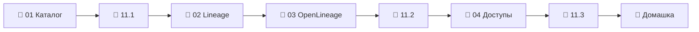

# Модуль 11 · Governance: каталог, lineage, доступы

**Длительность:** ~1 нед. · **Статус и DoD:** см. [ROADMAP](../../ROADMAP.md)

## Бизнес-вопрос

> Кто владеет данными, откуда они пришли и кому их можно видеть?

## Цели

- развернуть каталог данных и наполнять его сбором метаданных по YAML в git
- давать таблицам владельцев, описания, термины и метки чувствительности
- получать сквозной lineage: статический из dbt, рантайм из Spark через OpenLineage, дашборды
- использовать lineage для анализа влияния и поиска причины
- ограничивать доступ ролями, масками колонок и фильтрами строк в Trino и Postgres

## Темы

- каталог данных: сервисы, FQN, владельцы, глоссарий, теги, сбор метаданных как код
- теория lineage: таблицы и колонки, статический и рантайм, анализ влияния и поиск причины
- стандарт OpenLineage: событие, задача, датасет, фасеты, транспорты; агент Spark, клиент Python
- RBAC, маскирование, row-level security, классификация данных
- этика данных и ответственность инженера (Клеппман, гл. 12)

## Инструменты

OpenMetadata 2.0.3 + Elasticsearch 9.3 (слой `governance.yaml`, профиль `governance`),
агент `openlineage-spark` 1.53.0 и `openlineage-python`, dbt-trino 1.10, правила доступа Trino

## Маршрут прохождения

Сначала урок, потом задачи лабы по нему. Статусы: ✅ сделано · 🟨 сейчас · ⬜ впереди.

| # | Шаг | Что | Статус |
|---|---|---|---|
| 1 | 📖 [01 · Каталог данных](theory/01_data_catalog.md) · [карта](maps/data-catalog.canvas) | урок | ⬜ |
| 2 | 🧪 [Лаба 11.1 — каталог capstone](labs/11.1_catalog/README.md) | сбор, владельцы, глоссарий | ⬜ |
| 3 | 📖 [02 · Lineage](theory/02_lineage_theory.md) · [карта](maps/lineage-theory.canvas) | урок | ⬜ |
| 4 | 📖 [03 · OpenLineage](theory/03_openlineage.md) · [карта](maps/openlineage.canvas) | урок | ⬜ |
| 5 | 🧪 [Лаба 11.2 — сквозной lineage](labs/11.2_lineage/README.md) | Spark → dbt → дашборд | ⬜ |
| 6 | 📖 [04 · Доступы и этика](theory/04_access_control.md) · [карта](maps/access-control.canvas) | урок | ⬜ |
| 7 | 🧪 [Лаба 11.3 — доступы](labs/11.3_access_control/README.md) | роли, маски, RLS | ⬜ |
| 8 | 🏁 [Домашка-чекпоинт](homework.md) | 7 вопросов и одно предсказание | ⬜ |

> [!note] Учебный проект модуля (2026-10-03)
> - Слой: `make up PROFILES="governance serving"`, затем `make om-token` (токен бота в `.env` и
>   сервис пайплайнов `openlineage`) и в `make shell` — `python modules/11_governance/demo/om_demo_setup.py`
>   (команды-владельцы и пайплайн Spark). UI — http://localhost:8585, `admin@open-metadata.org` / `admin`.
> - Данные: `make spark-lineage` — задача [`demo/spark_store_sales.py`](demo/spark_store_sales.py)
>   с агентом OpenLineage (файлы → `raw_sales` → `store_sales_daily`); [`demo/dbt_governance/`](demo/dbt_governance/)
>   — модели на Trino в Iceberg (+ справочник Postgres); [`demo/superset_dashboard.py`](demo/superset_dashboard.py)
>   — дашборд «Наличие по городам». Нужны таблицы модуля 10 (`build_serving_demo.py`).
> - Сбор метаданных — [`demo/openmetadata/*.yaml`](demo/openmetadata/), запуск `make om-ingest CFG=…`
>   в порядке: `trino.yaml`, `trino_postgresql.yaml`, `postgres.yaml`, `dbt.yaml`, `superset.yaml`.
> - Python-событие OpenLineage — [`demo/emit_lineage.py`](demo/emit_lineage.py).
> - Правила доступа Trino — `infra/docker/trino/rules.json` (пользователи `partner`, `city_manager_0`).
> - Это не capstone и не ответы к лабам.

## Чек-лист самоконтроля

Отмечай пункт, только когда можешь сделать это **без подсказки**. Подробные чек-листы — в начале
каждого урока.

**Каталог** ([01](theory/01_data_catalog.md))
- [ ] Собираю метаданные источника по YAML и объясняю порядок сбора
- [ ] Даю таблице владельца, описание, тег и термин так, чтобы они не терялись при пересборе

**Lineage** ([02](theory/02_lineage_theory.md), [03](theory/03_openlineage.md))
- [ ] Делаю анализ влияния и поиск причины по графу таблиц и колонок
- [ ] Подключаю агент OpenLineage и читаю событие: задача, датасеты, фасеты
- [ ] Нахожу по логу каталога, почему ребро не появилось

**Доступы** ([04](theory/04_access_control.md))
- [ ] Пишу правила Trino с маской и фильтром и проверяю их от имени ролей
- [ ] Настраиваю роли, права на колонки и RLS в Postgres и предсказываю результат

**Закрытие модуля**
- [ ] Лабы 11.1–11.3 выполнены по Definition of Done
- [ ] [Домашка](homework.md) сдана, ошибки разобраны
- [ ] Тезисы по Клеппману (гл. 12, *Doing the Right Thing*) — в [`notes.md`](notes.md)

## Материалы модуля

| Что | Где |
|---|---|
| 🧠 Карточки для повторения | [flashcards.md](flashcards.md) |
| 🗺️ Карты | [maps/](maps/) |
| 📚 Термины | [glossary/](../../glossary/README.md) — раздел «Governance» |
| 🧪 Учебный проект | [demo/](demo/) |
| 📓 Заметки | [notes.md](notes.md) |

## Мини-проект (вклад в capstone)

Каталог capstone с владельцами, глоссарием метрик и сквозным lineage от источника через Spark и
dbt до дашборда (лабы 11.1–11.2); матрица доступа и правила Trino и Postgres (лаба 11.3).

## Ресурсы

- [OpenMetadata docs](https://docs.open-metadata.org/) · [коннекторы](https://docs.open-metadata.org/v2.0.x/connectors)
- [OpenLineage: спецификация](https://openlineage.io/docs/spec/object-model) · [Spark](https://openlineage.io/docs/integrations/spark/) · [транспорты](https://openlineage.io/docs/integrations/spark/configuration/transport/)
- [Trino: правила доступа в файле](https://trino.io/docs/current/security/file-system-access-control.html)
- [Postgres: row-level security](https://www.postgresql.org/docs/current/ddl-rowsecurity.html)

## Книга и видео

Полная таблица с пояснениями, зачем читать и что пропустить — в [карте чтения](../../reading_map.md#11--governance).

- 📖 Клеппман, гл. 12 — последний раздел, этика данных (урок 04)

## Домашка-чекпоинт

После всех лаб — [`homework.md`](homework.md).

## Заметки

Конспект, тезисы по книге и выводы — в [`notes.md`](notes.md).
