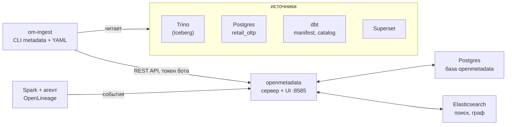
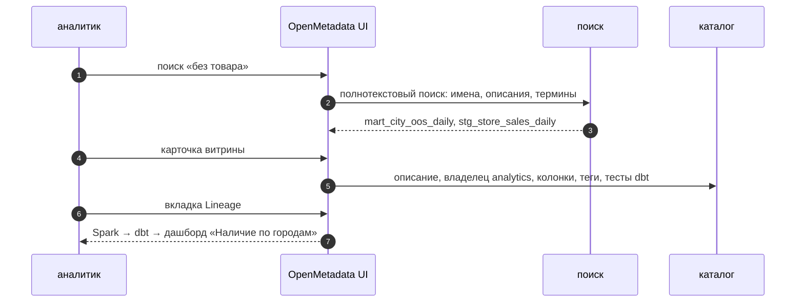

# 01 · Каталог данных: OpenMetadata

> [!info] Урок одной фразой
> Данных в сети уже много: Iceberg, учётная система, модели dbt, витрины ClickHouse, дашборды.
> Новый аналитик не знает, где что лежит, что значит `oos_hours` и кого спросить. Каталог — это
> библиотечный каталог: карточка на каждую таблицу с описанием, владельцем, терминами, метками и
> связями с другими «книгами». Карточки заполняет робот (сбор метаданных), а смысл добавляют люди.

> [!todo] Чек-лист: после урока ты сможешь
> - [ ] объяснить, какие задачи решает каталог данных и из каких частей состоит OpenMetadata;
> - [ ] прочитать полное имя объекта (FQN) и найти таблицу по сервису, базе, схеме;
> - [ ] собрать метаданные из Trino, Postgres и dbt командой `make om-ingest` по YAML в git;
> - [ ] назначить владельца, описание, тег классификации и термин глоссария;
> - [ ] объяснить, почему описания лучше держать в YAML dbt, а не править в UI.

**Нужно для:** лаба [11.1](../labs/11.1_catalog/README.md).
**Карта урока:** [data-catalog.canvas](../maps/data-catalog.canvas).

---

## Шаг 0. Азбука

| Понятие | В аналогии «библиотечный каталог» | Подробнее |
|---|---|---|
| Каталог данных | Картотека всех книг | [каталог данных](../../../glossary/data-catalog.md) |
| Сервис | Библиотека-филиал (Trino, Postgres, Superset) | [OpenMetadata](../../../glossary/openmetadata.md) |
| FQN | Шифр книги: филиал.зал.полка.книга | [каталог данных](../../../glossary/data-catalog.md) |
| Сбор метаданных (ingestion) | Робот, который обходит полки и пишет карточки | [OpenMetadata](../../../glossary/openmetadata.md) |
| Владелец | Библиотекарь, отвечающий за полку | [каталог данных](../../../glossary/data-catalog.md) |
| Глоссарий | Словарь терминов: что значит «доля без товара» | [каталог данных](../../../glossary/data-catalog.md) |
| Тег, классификация | Цветная наклейка «только в читальном зале» | [классификация данных](../../../glossary/data-classification.md) |

---

## Шаг 1. Какие вопросы закрывает каталог

**Проблема.** В модулях 04–10 появились десятки таблиц в пяти системах. Документация есть
кусками: `dbt docs` описывает модели, Superset — свои датасеты, Postgres — ничего. Аналитик
задаёт в чате одни и те же вопросы, а ответы теряются.

**Как устроено.** Каталог собирает метаданные всех систем в одну модель и отвечает на вопросы:

| Вопрос | Что в каталоге |
|---|---|
| Где данные о наличии на полке? | поиск по именам, описаниям, терминам |
| Что значит колонка? | описание колонки, термин глоссария |
| Кто отвечает? | владелец: человек или команда |
| Можно ли верить? | уровень (tier), результаты тестов dbt, свежесть |
| Откуда пришло и кто использует? | lineage (уроки 02–03) |
| Можно ли мне это видеть? | теги классификации, политики (урок 04) |

**Что из этого следует.** Каталог полезен, только если он полный и свежий. Поэтому технические
метаданные (таблицы, колонки, типы, lineage) собирают автоматически и регулярно, а люди
добавляют то, что машина не знает: смысл и ответственность.

---

## Шаг 2. Как устроен OpenMetadata у нас

**Проблема.** Каталог — тоже система: ему нужно хранить карточки, искать по ним и получать
метаданные из источников.

**Как устроено.** Слой `governance.yaml`:



| Сервис | Что делает | Память на стеке |
|---|---|---|
| `openmetadata` | сервер API и UI; хранит сущности в базе `openmetadata` нашего Postgres | ~1 ГБ |
| `elasticsearch` | индекс для поиска и обхода lineage | ~1,8 ГБ |
| `om-ingest` | разовый контейнер с CLI `metadata`: сбор по YAML | на время запуска |
| `om-migrate`, `om-db-init` | однократно: база и миграции | — |

В официальной поставке сбор запускает встроенный Airflow по расписанию из UI. Мы его не
ставим: конфиги сбора лежат в git (`demo/openmetadata/*.yaml`), запуск — командой. Так сбор
воспроизводим, его видно в ревью, а в модуле 06 его можно поставить ассетом Dagster.

**Сущности и полные имена.** Каталог хранит дерево: **сервис → база → схема → таблица →
колонка**. Полное имя (FQN) соединяет уровни точками:

| Источник | Сервис | FQN таблицы |
|---|---|---|
| Trino, каталог `iceberg` | `trino_lake` | `trino_lake.iceberg.governance_demo.mart_city_oos_daily` |
| Trino, каталог `postgresql` | `trino_lake` | `trino_lake.postgresql.serving_demo.stores` |
| Postgres `retail_oltp` напрямую | `retail_oltp` | `retail_oltp.retail_oltp.serving_demo.stores` |

Последние две строки — **одна и та же таблица**, видная через два сервиса. Каталог считает их
разными узлами: lineage dbt идёт к первому, описания из Postgres — ко второму.

Сервисы бывают разных типов: баз данных, пайплайнов (`openlineage`, Dagster), дашбордов
(Superset), хранилищ объектов.

**Что из этого следует.** FQN — адрес, по которому склеиваются lineage, описания dbt и связи
дашбордов. Имя сервиса выбирают один раз и не меняют.

> [!example]- Попробуй сам: поднять каталог
> ```bash
> make up PROFILES="governance serving"
> make om-token
> make shell
> python modules/11_governance/demo/om_demo_setup.py
> exit
> ```
> Открой http://localhost:8585, войди: `admin@open-metadata.org` / `admin`.
> **Увидишь:** `OM_INGESTION_TOKEN записан в .env (760 символов)` и `сервис пайплайнов openlineage
> есть`; затем `команда analytics: 201` (повторно — `200`) и строку про пайплайн; в UI —
> каталог без таблиц.
> **Почему:** сервер при первом запуске создаёт ботов и их JWT-токены. Скрипт
> `scripts/om_token.py` входит под администратором, читает токен бота `ingestion-bot` и пишет его
> в `.env`: им пользуются сбор метаданных и агент Spark. `om_demo_setup.py` заводит команды-владельцы
> (шаг 4) и пайплайн Spark (урок 03).

> [!warning] Ловушка
> Не поднимай governance вместе со spark и streaming. Elasticsearch, сервер и Trino вместе
> занимают около 4,5 ГБ, а сбор метаданных — ещё гигабайт на время работы.

---

## Шаг 3. Сбор метаданных как код

**Проблема.** Вручную описывать сотни таблиц никто не будет. Нужно, чтобы робот приходил в
источник, читал схему и обновлял карточки — и делал это одинаково при каждом запуске.

**Как устроено.** Конфиг сбора — YAML из трёх частей:

```yaml
source:
  type: trino                          # ① коннектор
  serviceName: trino_lake              # ② имя сервиса в каталоге
  serviceConnection:
    config: {type: Trino, hostPort: trino:8080, username: openmetadata, catalog: iceberg}
  sourceConfig:
    config:
      type: DatabaseMetadata           # ③ вид сбора
      schemaFilterPattern:
        includes: ["governance_demo", "serving_demo"]   # ④ только нужные схемы
sink:
  type: metadata-rest                  # ⑤ куда писать — в API каталога
workflowConfig:
  openMetadataServerConfig:
    hostPort: http://openmetadata:8585/api
    authProvider: openmetadata
    securityConfig:
      jwtToken: ${OM_INGESTION_TOKEN}  # ⑥ токен из окружения
```

| Метка | Что важно |
|---|---|
| ① | тип коннектора: `trino`, `postgres`, `dbt`, `superset`… |
| ② | сервис создаётся при первом сборе; повторный сбор обновляет его, а не создаёт новый |
| ③ | виды сбора: `DatabaseMetadata` (схемы), `DatabaseLineage`, `DatabaseUsage`, `Profiler`, `DBT` |
| ④ | без фильтра соберёт всё, что видит пользователь Trino |
| ⑤ | сбор пишет через REST API — так же, как UI |
| ⑥ | CLI подставляет переменные окружения, поэтому токен и пароли не лежат в git |

Порядок важен: сначала сервис базы (Trino), потом dbt — сбор dbt не создаёт таблицы, а
привязывает модели к уже собранным таблицам того же сервиса.

**Что из этого следует.** Сбор метаданных — пайплайн. Его запускают по расписанию или после
`dbt build`, и он может упасть, как любой другой.

> [!example]- Попробуй сам: собрать Trino и dbt
> ```bash
> make om-ingest CFG=modules/11_governance/demo/openmetadata/trino.yaml
> make om-ingest CFG=modules/11_governance/demo/openmetadata/trino_postgresql.yaml
> make shell
> cd modules/11_governance/demo/dbt_governance && dbt docs generate -q && dbt build -q
> exit
> make om-ingest CFG=modules/11_governance/demo/openmetadata/dbt.yaml
> ```
> **Увидишь:** в конце каждого сбора — сводку `Workflow … Summary`: у первого `Processed records:
> 12`, `Filtered: 2`, `Errors: 0`, время около секунды (плюс ~30 с на старт контейнера). В UI:
> Explore → Tables → `mart_city_oos_daily` с описанием из YAML dbt, владельцем `analytics` и
> вкладкой Lineage.
> **Почему:** первый сбор создал сервис `trino_lake` и таблицы схем `governance_demo` и
> `serving_demo` каталога `iceberg`; `Filtered` — схемы, отброшенные фильтром. Второй добавил в
> тот же сервис каталог `postgresql`: модель `stg_stores` читает справочник через него. Сбор dbt
> прочитал `manifest.json` и `catalog.json` и дописал к таблицам описания, владельцев, тесты и
> lineage моделей.

---

## Шаг 4. Владельцы, глоссарий, теги

**Проблема.** Робот знает типы колонок, но не знает, что `oos_hours` — «часы без товара на полке
с 6 до 22» и что за витрину отвечает команда аналитики.

**Как устроено.** Три вида «человеческих» метаданных:

| Что | Где задать | Пример |
|---|---|---|
| Владелец (owner) | `meta.owner` в YAML dbt или вкладка таблицы | `analytics` для витрины |
| Описание | `description` в YAML dbt | описание `mart_city_oos_daily` |
| Тег классификации | теги dbt (`tags`) или классификации каталога: `PII.Sensitive`, `Tier.Tier1` | `sales` — коммерческая тайна |
| Термин глоссария | Govern → Glossary: термин с определением, привязка к колонкам | «Доля часов без товара» |

Описания и владельцы из YAML dbt приходят при каждом сборе. Значит, источник правды — код, а
каталог — витрина метаданных. Правки в UI при следующем сборе могут быть перезаписаны
(`dbtUpdateDescriptions: true`).

**Что из этого следует.** Правило команды: технический смысл — в YAML dbt рядом с кодом;
бизнес-термины и политики — в глоссарии каталога, у них свой владелец.

> [!warning] Ловушка
> Заведи команды до сбора dbt. Если команды `analytics` в каталоге нет, сбор не назначит
> владельца и только предупредит: `Unable to ingest owner from DBT since no user or team was
> found with name analytics`. Ошибки при этом нет — легко не заметить.

> [!warning] Ловушка
> Не пиши описание витрины в UI каталога, если оно есть в YAML dbt. При
> `dbtUpdateDescriptions: true` следующий сбор заменит текст из UI текстом из YAML.

---

## Сборка целиком

Новый аналитик ищет данные о наличии на полке:



| Шаг | Если сломается | Симптом |
|---|---|---|
| 2 | описаний нет в YAML | поиск по смыслу ничего не находит |
| 4 | у таблицы нет владельца | непонятно, кого спросить |
| 6 | dbt собран до таблиц Trino | модели не привязались, lineage пустой |

## Шпаргалка

| Хочу | Как |
|---|---|
| Поднять каталог | `make up PROFILES="governance"` (+ `serving` для Trino и Superset) |
| Токен бота | `make om-token` |
| UI | http://localhost:8585, `admin@open-metadata.org` / `admin` |
| Собрать источник | `make om-ingest CFG=modules/…/x.yaml` |
| Ограничить схемы | `schemaFilterPattern: {includes: [...]}` |
| dbt в каталог | `dbt docs generate`, затем `dbt build`, затем сбор `type: dbt` |
| Владелец из dbt | `meta: {owner: <команда>}` в YAML; команда должна уже быть в каталоге |

## Типичные ошибки

| Симптом | Причина | Как проверить | Как чинить |
|---|---|---|---|
| `401 Unauthorized` при сборе | нет или устарел токен | `grep OM_INGESTION_TOKEN .env` | `make om-token` |
| Модели dbt не привязались к таблицам | сбор dbt раньше сбора Trino или другое имя сервиса | `serviceName` в обоих YAML | сначала Trino, одинаковый `serviceName` |
| Тесты dbt не видны | `run_results.json` от `docs generate` | время файла | `dbt build` после `docs generate` |
| В каталоге лишние схемы | нет фильтра | — | `schemaFilterPattern` |
| У моделей нет владельцев | команды нет в каталоге | `Unable to ingest owner` в логе сбора | завести команду (`om_demo_setup.py`), пересобрать dbt |
| Модель без предка-источника | источник читается через другой каталог Trino | `Warnings` в сборе dbt | собрать и этот каталог (`trino_postgresql.yaml`) |
| Сервер не стартует | Elasticsearch не готов | `make logs S=elasticsearch` | подождать healthcheck, хватает ли памяти |

## Проверь себя

Карточки — в [flashcards.md](../flashcards.md).

> [!question] 1. Почему сбор dbt запускают после сбора Trino?
> > [!success]- Ответ
> > Сбор dbt не создаёт таблицы: он находит их по FQN в сервисе `trino_lake` и дописывает
> > описания, теги и lineage моделей. Нет таблиц — не к чему привязать.

> [!question] 2. Зачем держать конфиги сбора в git, а не настраивать в UI?
> > [!success]- Ответ
> > Сбор воспроизводим и виден в ревью, секреты подставляются из окружения, а запуск можно
> > включить в оркестратор после `dbt build`.

> [!question] 3. Аналитик исправил описание витрины в UI. Через день оно вернулось к старому. Почему?
> > [!success]- Ответ
> > Описание приходит из YAML dbt при каждом сборе (`dbtUpdateDescriptions: true`) и
> > перезаписывает правку. Исправлять нужно в YAML.
