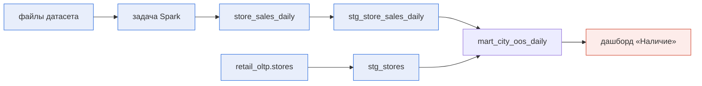
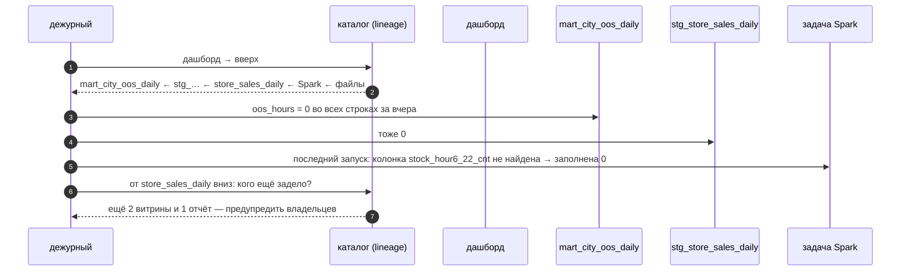

# 02 · Lineage: откуда данные пришли и кого заденет изменение

> [!info] Урок одной фразой
> Lineage — родословная данных. По ней идут в две стороны. Вверх — к предкам, когда в витрине
> ошибка и надо найти, где она родилась (поиск причины). Вниз — к потомкам, когда собираешься
> менять колонку и надо знать, чей дашборд сломается (анализ влияния). Родословную можно
> записать по документам (из кода) или по свидетельству очевидцев (из запусков). Подробная
> родословная говорит не только «кто родители», но и «от кого какие черты» — это lineage
> колонок.

> [!todo] Чек-лист: после урока ты сможешь
> - [ ] объяснить, зачем lineage, на двух задачах: анализ влияния и поиск причины;
> - [ ] отличить lineage таблиц от lineage колонок и сказать, что даёт каждый;
> - [ ] отличить статический lineage (из кода) от рантайм-lineage (из запусков) и назвать их слепые зоны;
> - [ ] получить анализ влияния и поиск причины в dbt (`dbt ls -s +модель`, `-s модель+`);
> - [ ] объяснить, почему сквозной граф нашего стека нельзя собрать одним инструментом.

**Нужно для:** лаба [11.2](../labs/11.2_lineage/README.md), задачи 1 и 3.
**Карта урока:** [lineage-theory.canvas](../maps/lineage-theory.canvas).

---

## Шаг 0. Азбука

| Понятие | В аналогии «родословная» | Подробнее |
|---|---|---|
| Lineage | Родословная таблицы | [lineage](../../../glossary/lineage.md) |
| Вверх (upstream) | Предки | [lineage](../../../glossary/lineage.md) |
| Вниз (downstream) | Потомки | [lineage](../../../glossary/lineage.md) |
| Анализ влияния | Кого затронет «наследственная болезнь», если она появится у предка | [lineage](../../../glossary/lineage.md) |
| Поиск причины | От чьей ветки пришла болезнь | [lineage](../../../glossary/lineage.md) |
| Lineage колонок | От кого какая черта | [lineage](../../../glossary/lineage.md) |
| Статический / рантайм | По документам / по свидетельству очевидцев | [lineage](../../../glossary/lineage.md) |

---

## Шаг 1. Две задачи, ради которых нужен lineage

**Проблема.** В сети 40 таблиц и 10 дашбордов. Инженер хочет переименовать колонку
`stock_hour6_22_cnt` в bronze. Через неделю директор видит на дашборде «0 % часов без товара».
Без карты связей никто не знает ни того, что сломается, ни того, где искать причину.

**Как устроено.** Граф lineage — узлы (таблицы, задачи, дашборды) и рёбра «из чего сделано».
По нему решают две задачи:

| Задача | Направление | Вопрос | Когда |
|---|---|---|---|
| Анализ влияния (impact analysis) | вниз, к потомкам | «Что сломается, если я изменю X?» | до изменения: ревью, планирование миграции |
| Поиск причины (root cause) | вверх, к предкам | «Откуда пришла ошибка в Y?» | после инцидента (модуль 09, урок 05) |



Ошибку в `mart_city_oos_daily` ищут вверх (синие узлы). Изменение в `stg_store_sales_daily`
проверяют вниз: витрина и дашборд (красный).

**Что из этого следует.** Lineage — не картинка для отчёта, а инструмент двух рабочих процессов:
ревью изменений и разбора инцидентов. Поэтому он должен быть полным и свежим. Устаревший граф
хуже, чем никакой: он даёт ложную уверенность.

---

## Шаг 2. Таблицы или колонки

**Проблема.** Граф таблиц говорит, что витрина зависит от `store_sales_daily`. Но если меняют
одну колонку из десяти, большая часть потомков не пострадает. Граф таблиц перестраховывается.

**Как устроено.**

| Уровень | Ребро | Пример | Даёт | Цена |
|---|---|---|---|---|
| Таблицы | таблица → таблица | `stg_store_sales_daily` → `mart_city_oos_daily` | быстрый обзор, поиск причины до таблицы | грубый анализ влияния |
| Колонки | колонка → колонка (+ преобразование) | `products` → `shelf_hours` (`16 * products`) → `shelf_hours` (`sum`) | точный анализ влияния; путь чувствительных данных | нужно разбирать SQL или план запроса |

Lineage колонок получают двумя способами:

1. **Разбор SQL.** Парсер читает `SELECT` модели и понимает, из каких колонок источника
   собрано выражение. Так работает OpenMetadata для моделей dbt и запросов.
2. **План выполнения.** Движок знает, какие колонки он читал для каждого выходного поля. Так
   агент OpenLineage в Spark заполняет поле `columnLineage` (урок 03).

**Что из этого следует.** Lineage колонок важен для governance: он показывает, куда утекла
чувствительная колонка (`sales` с меткой `commercial`) — во все витрины и дашборды ниже.
`SELECT *` и динамический SQL (Jinja, строки в Python) разбор SQL понимает плохо.

---

## Шаг 3. Из кода или из запусков

**Проблема.** Откуда взять рёбра графа? Можно прочитать код проекта. А можно записывать, что
действительно читала и писала каждая задача при запуске.

**Как устроено.**

| | Статический (из кода) | Рантайм (из запусков) |
|---|---|---|
| Источник | `ref()`/`source()` dbt, SQL моделей, граф ассетов Dagster | события запусков: OpenLineage из Spark, Airflow, dbt |
| Когда известен | до запуска | после запуска |
| Видит | то, что описано в проекте | то, что реально прочитано и записано, в т.ч. в Python и Spark |
| Не видит | задачи вне проекта (Spark, скрипты), динамический SQL | задачи, которые не запускались; код без агента |
| Плюс | анализ влияния до мержа | правда о проде; время и статус каждого запуска |

У нас статический lineage уже есть в двух местах:

- **dbt** (модуль 05): `dbt ls -s +модель` — вверх, `dbt ls -s модель+` — вниз, `dbt docs` —
  граф моделей и источников;
- **Dagster** (модуль 06): граф ассетов от загрузки до витрин.

Но задача Spark (модуль 07) пишет таблицу, а dbt знает её только как `source` — без информации,
откуда она взялась. Граф dbt начинается с этой таблицы, а Dagster не знает колонок.

**Что из этого следует.** Сквозной граф «файл → Spark → dbt → дашборд» собирают в одном
**каталоге** (урок 01) из трёх источников. Это статический lineage dbt, рантайм-lineage Spark
через OpenLineage (урок 03) и связи дашбордов из Superset. Каталог склеивает их по полным именам
таблиц.

> [!example]- Попробуй сам: анализ влияния и поиск причины в dbt
> ```bash
> make shell
> cd modules/05_transformation_dbt/demo
> dbt ls -s +mart_city_rainy_days --resource-type model source -q
> dbt ls -s source:raw.train+ --resource-type model exposure -q
> exit
> ```
> **Увидишь:** первая команда — предки витрины: `int_city_weather_daily`, `stg_weather` и
> источники `source:weather_demo.raw.eval`, `source:weather_demo.raw.train`. Вторая — потомки
> источника: `stg_weather`, `int_city_weather_daily`, обе витрины и
> `exposure:weather_demo.weather_report`.
> **Почему:** `+` перед моделью — все предки, после — все потомки. Exposure — описанный в YAML
> потребитель (отчёт); без него анализ влияния заканчивался бы на витрине.

> [!warning] Ловушка
> Не считай граф dbt полным графом данных. Он начинается с `source`: всё, что было до него
> (Spark, dlt, ручные скрипты), в нём отсутствует. Ищи причину инцидента дальше вверх — в каталоге.

---

## Шаг 4. Как склеивается сквозной граф

**Проблема.** dbt называет таблицу `iceberg.governance_demo.store_sales_daily`, Spark —
`lh.governance_demo.store_sales_daily`, а в S3 это папка `s3://warehouse/…`. Если каталог не
поймёт, что это одна таблица, граф распадётся на куски.

**Как устроено.** У каждого узла в каталоге есть **полное имя** (FQN, fully qualified name):
`сервис.база.схема.таблица`. Каждый поставщик lineage сообщает рёбра в своих именах, а каталог
сопоставляет их со своими узлами:

| Поставщик | Как называет таблицу | Как каталог находит узел |
|---|---|---|
| dbt (manifest) | `database.schema.name` = `iceberg.governance_demo.stg_stores` | сервис указан в конфиге сбора dbt |
| OpenLineage из Spark | `namespace` + `name` датасета (урок 03) | по схеме и имени таблицы среди сервисов каталога |
| Superset | датасет: база Superset + схема + таблица | имя сервиса базы указано в конфиге сбора Superset |

На стеке так и вышло со справочником магазинов. dbt читает его через Trino, и в каталоге он стал
узлом `trino_lake.postgresql.serving_demo.stores`. Сбор самого Postgres создал второй узел той же
таблицы: `retail_oltp.retail_oltp.serving_demo.stores`. Lineage идёт от первого, а описания из
базы — у второго.

**Что из этого следует.** Сквозной lineage держится на соглашениях об именах. Одинаковые имена
схем и таблиц во всех инструментах — не эстетика, а условие работы графа.

---

## Сборка целиком

Разбор инцидента «на дашборде 0 % часов без товара»:



| Шаг | Если lineage неполный | Симптом |
|---|---|---|
| 2 | нет рёбер Spark | граф обрывается на `store_sales_daily`, причину ищут вручную |
| 6 | нет связи с дашбордами | владельцы других отчётов узнают об ошибке от бизнеса |

## Шпаргалка

| Хочу | Как |
|---|---|
| Предки модели в dbt | `dbt ls -s +модель --resource-type model source` |
| Потомки модели в dbt | `dbt ls -s модель+ --resource-type model exposure` |
| Потребитель в графе dbt | `exposures:` в YAML (`type: dashboard`, `depends_on: ref(…)`) |
| Граф ассетов | Dagster UI → Lineage (модуль 06) |
| Lineage Spark | агент OpenLineage (урок 03) |
| Сквозной граф и колонки | OpenMetadata → таблица → вкладка Lineage (урок 01, лаба 11.2) |

## Типичные ошибки

| Симптом | Причина | Как проверить | Как чинить |
|---|---|---|---|
| Граф обрывается на таблице из Spark | нет рантайм-lineage | у таблицы в каталоге нет предков | агент OpenLineage |
| Один и тот же объект — два узла | разные имена в инструментах | FQN узлов в каталоге | единые имена схем и таблиц |
| Lineage колонок пустой | `SELECT *`, динамический SQL | SQL модели | явный список колонок |
| Анализ влияния «всё зависит от всего» | только lineage таблиц | — | lineage колонок для важных таблиц |

## Проверь себя

Карточки — в [flashcards.md](../flashcards.md).

> [!question] 1. Ты меняешь тип колонки `sales` в staging. Какая задача lineage нужна и в какую сторону идти?
> > [!success]- Ответ
> > Анализ влияния, вниз: все модели, витрины, дашборды и отчёты, где используется `sales`.
> > Лучше по lineage колонок — он не покажет потомков, которые `sales` не читают.

> [!question] 2. Почему dbt не покажет, что `store_sales_daily` построила задача Spark?
> > [!success]- Ответ
> > dbt знает только свой проект: таблица для него — `source`. Связь со Spark появляется только
> > из рантайм-lineage (OpenLineage) в каталоге.

> [!question] 3. Чем рантайм-lineage лучше статического и чем хуже?
> > [!success]- Ответ
> > Лучше: видит реальные чтения и записи, в том числе в Python и Spark, плюс время и статус
> > запуска. Хуже: появляется только после запуска, поэтому для анализа влияния до мержа нужен
> > статический.
