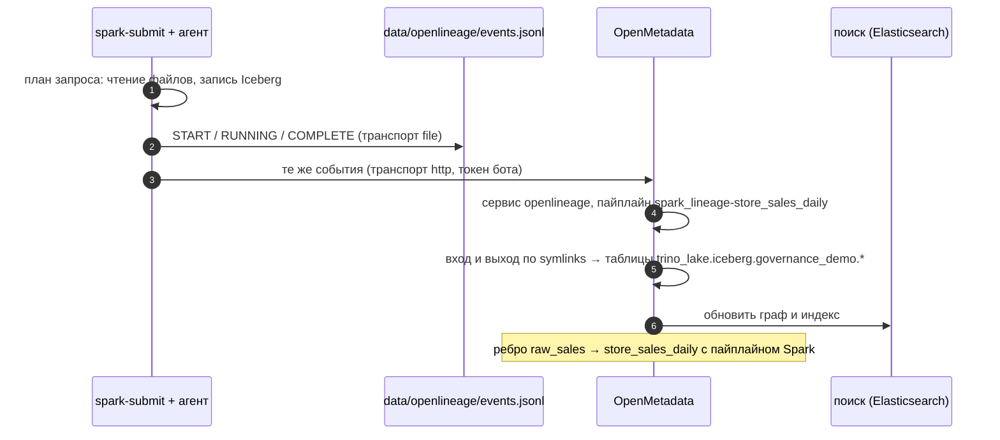

# 03 · OpenLineage: lineage из запусков в одном формате

> [!info] Урок одной фразой
> Каждый инструмент знает свой кусок графа, но говорит на своём языке. OpenLineage — общий бланк
> протокола очевидца. Задача при запуске пишет в нём, кто она, что прочитала, что записала и
> какие колонки из каких получились. Бланк уходит туда, где собирают граф. Spark заполняет его
> сам через агент, свой Python-скрипт — через клиент, а каталог склеивает бланки в сквозной граф.

> [!todo] Чек-лист: после урока ты сможешь
> - [ ] описать модель OpenLineage: событие, запуск, задача, датасет, фасет;
> - [ ] прочитать событие агента Spark: входы, выходы, `symlinks`, `columnLineage`, статистику;
> - [ ] подключить агент к Spark и выбрать транспорт: console, file, http, composite;
> - [ ] отправить своё событие из Python;
> - [ ] объяснить, как OpenMetadata превращает событие в рёбра графа и почему важны имена.

**Нужно для:** лаба [11.2](../labs/11.2_lineage/README.md), задача 2.
**Карта урока:** [openlineage.canvas](../maps/openlineage.canvas).

---

## Шаг 0. Азбука

| Понятие | В аналогии «протокол очевидца» | Подробнее |
|---|---|---|
| RunEvent | Один заполненный бланк | [OpenLineage](../../../glossary/openlineage.md) |
| Run (`runId`) | Номер происшествия: все бланки одного запуска | [OpenLineage](../../../glossary/openlineage.md) |
| Job (`namespace` + `name`) | Кто действовал | [OpenLineage](../../../glossary/openlineage.md) |
| Dataset (`namespace` + `name`) | Что взяли и что получили | [OpenLineage](../../../glossary/openlineage.md) |
| Facet | Приложение к бланку: схема, колонки, статистика | [OpenLineage](../../../glossary/openlineage.md) |
| Транспорт | Как бланк доставить: распечатать, в файл, по HTTP | [OpenLineage](../../../glossary/openlineage.md) |

---

## Шаг 1. Модель события

**Проблема.** Spark, dbt, Airflow, Flink и свои скрипты пишут и читают таблицы. Если каждый
сообщает lineage в своём формате, каталогу нужен отдельный разборщик на каждый инструмент.

**Как устроено.** OpenLineage задаёт одну JSON-схему события `RunEvent`:

```json
{
  "eventType": "COMPLETE",                                   ①
  "eventTime": "2026-10-03T18:20:04Z",
  "run":  {"runId": "…uuid…", "facets": {"parent": …}},      ②
  "job":  {"namespace": "spark_lineage",                     ③
           "name": "store_sales_daily.overwrite_by_expression.lh_governance_demo_store_sales_daily"},
  "inputs":  [{"namespace": "file", "name": "/workspace/data/raw/freshretailnet_50k/data"}],
  "outputs": [{"namespace": "s3://warehouse", "name": "lakehouse/01a1…",   ④
               "facets": {"symlinks": …, "schema": …, "columnLineage": …},
               "outputFacets": {"outputStatistics": {"rowCount": 87106}}}],
  "producer": "https://github.com/OpenLineage/OpenLineage/tree/1.53.0/integration/spark"
}
```

| Метка | Что важно |
|---|---|
| ① | `START` → `RUNNING` → `COMPLETE` или `FAIL`: по ним видно время и исход запуска |
| ② | `runId` одинаков у всех событий запуска; фасет `parent` связывает действие Spark с приложением |
| ③ | задача = пространство имён + имя; в OpenMetadata из них получается имя пайплайна `spark_lineage-store_sales_daily` (шаг 4) |
| ④ | датасет тоже = пространство имён + имя; для Iceberg агент берёт **место в S3**, а имя таблицы кладёт в фасет `symlinks` |

**Фасеты** — расширения события. Стандартные фасеты датасета: `schema` (колонки и типы),
`symlinks` (другие имена того же датасета, например имя в каталоге), `columnLineage`,
`dataSource`, статистика ввода и вывода. Свои фасеты можно добавлять — неизвестные приёмник
пропускает.

**Что из этого следует.** Lineage — побочный продукт запуска: событие описывает факт, а не
намерение. Если задача упала, придёт `FAIL` с теми же входами.

---

## Шаг 2. Агент Spark: что он видит сам

**Проблема.** Переписывать задачи Spark ради lineage никто не будет. Нужно получать события без
изменения кода.

**Как устроено.** Агент `openlineage-spark` — **listener** Spark: класс, который Spark вызывает на
каждое событие выполнения. Агент берёт логический план запроса, находит в нём чтения и записи и
выводит, какая колонка из каких получена. Подключение — только настройками `spark-submit`:

```bash
--conf spark.extraListeners=io.openlineage.spark.agent.OpenLineageSparkListener   # ① агент
--conf spark.openlineage.namespace=spark_lineage                                   # ② задачи
--conf spark.openlineage.transport.type=composite                                  # ③ два пути
--conf spark.openlineage.transport.transports.om.type=http
--conf spark.openlineage.transport.transports.om.url=http://openmetadata:8585/api/v1/openlineage/
--conf spark.openlineage.transport.transports.om.endpoint=lineage
--conf spark.openlineage.transport.transports.om.auth.type=api_key                 # ④ токен бота
--conf spark.openlineage.transport.transports.file.type=file
--conf spark.openlineage.transport.transports.file.location=/workspace/data/openlineage/events.jsonl
```

| Метка | Что важно |
|---|---|
| ① | jar агента лежит в образе `debd/spark:4.1.3`; без этой настройки он ничего не делает — кластер модуля 07 его не включает |
| ② | имя пространства задач; вместе с именем приложения Spark оно даёт имя пайплайна в каталоге |
| ③ | `composite` отправляет каждое событие всем транспортам: в каталог и в файл для чтения глазами |
| ④ | OpenMetadata принимает события только от авторизованного клиента — JWT бота |

У нас это собрано в `infra/docker/spark/submit_with_lineage.sh`; запуск — `make spark-lineage`.

Что агент нашёл в задаче `spark_store_sales.py` (файлы → `raw_sales` → `store_sales_daily`):

| Что | Значение |
|---|---|
| событий за запуск | 16: приложение и два действия с записью — каждое `START` → `RUNNING` → `COMPLETE` |
| вход первого действия | `file` : `/workspace/data/raw/freshretailnet_50k/data` |
| вход второго действия | `s3://warehouse` : `lakehouse/…`; `symlinks`: `governance_demo.raw_sales` |
| выход | `s3://warehouse` : `lakehouse/01a1…`; `symlinks`: `governance_demo.store_sales_daily` (`TABLE`) |
| `columnLineage` | `store_id`, `city_id` ← `IDENTITY`; `dt` ← `TRANSFORMATION` (`to_date`); `sales`, `oos_hours` ← `AGGREGATION` |
| `outputStatistics` | `rowCount` 87 106, 2 файла |

**Что из этого следует.** Агент получает и lineage таблиц, и lineage колонок, и статистику — без
строчки кода в задаче. Но имя выхода он даёт как место в S3: без фасета `symlinks` каталог не
понял бы, что это таблица `store_sales_daily`.

> [!example]- Попробуй сам: события агента в файл
> ```bash
> make up PROFILES="governance serving"
> rm -f data/openlineage/events.jsonl
> make spark-lineage
> python3 -c "
> import json
> for l in open('data/openlineage/events.jsonl'):
>     e = json.loads(l)
>     print(e['eventType'], e['job']['name'][:60], [d['name'] for d in e.get('outputs', [])])"
> ```
> **Увидишь:** 16 строк от `START store_sales_daily` до `COMPLETE store_sales_daily`; у действий
> `overwrite_by_expression…` выход `lakehouse/…`.
> **Почему:** агент шлёт событие на старт и конец приложения и каждого действия с записью.
> Транспорт `file` дописывает в конец файла — поэтому файл сначала удаляем. Последнюю команду
> можно выполнить и в `make shell`: файл лежит в `data/` репозитория.

> [!warning] Ловушка
> Не ищи таблицу Iceberg в событии по полю `name` выхода. Там место в хранилище, а не имя.
> Имя таблицы — в `facets.symlinks.identifiers`; по нему каталог связывает событие с узлом.

---

## Шаг 3. Своё событие из Python

**Проблема.** Не у всего есть агент: выгрузка отчёта, скрипт сверки, ручная правка данных. Если
они читают и пишут таблицы, без них граф неполный.

**Как устроено.** Клиент `openlineage-python` (группа `governance` в workspace) собирает событие
из классов `RunEvent`, `Run`, `Job`, `InputDataset`, `OutputDataset` и отправляет его тем же
транспортом. Пример — `demo/emit_lineage.py`: задача `publish_city_report` читает витрину и пишет
HTML-отчёт.

```python
ol = OpenLineageClient(transport=ConsoleTransport(ConsoleConfig()))   # ① или HttpTransport
run = Run(runId=str(uuid.uuid4()))                                    # ② один runId на запуск
job = Job(namespace="python_scripts", name="publish_city_report")
for state in (RunState.START, RunState.COMPLETE):                     # ③ начало и конец
    ol.emit(RunEvent(eventType=state, eventTime=…, run=run, job=job,
                     producer=PRODUCER, inputs=inputs, outputs=outputs))
```

| Метка | Что важно |
|---|---|
| ① | консольный транспорт печатает через `logging` — без `logging.basicConfig(level=INFO)` вывода нет |
| ② | новый `runId` на каждый запуск, один на все его события |
| ③ | в реальном скрипте `COMPLETE` отправляют после успешной работы, `FAIL` — в `except` |

OpenMetadata строже спецификации: время `2026-10-03T18:29:55+00:00` он отклоняет с HTTP 400
`Invalid request format`, а `2026-10-03T18:29:55Z` принимает. Поэтому в примере время приводится
к суффиксу `Z`.

> [!example]- Попробуй сам: событие из Python
> ```bash
> make shell
> python modules/11_governance/demo/emit_lineage.py
> exit
> ```
> **Увидишь:** строку `OpenLineageClient will use console transport` и два JSON-события:
> `"eventType": "START"` и `"eventType": "COMPLETE"` с входом
> `iceberg.governance_demo.mart_city_oos_daily` и фасетами `schema`, `symlinks`.
> **Почему:** клиент сериализовал объекты в JSON по схеме OpenLineage и отдал консольному
> транспорту. С аргументом `om` те же события уйдут в OpenMetadata.

---

## Шаг 4. Как событие становится ребром в каталоге

**Проблема.** Каталог получает поток событий. Ему надо понять, к каким узлам графа они относятся,
иначе получится набор висящих рёбер.

**Как устроено.** OpenMetadata принимает события на `POST /api/v1/openlineage/lineage`:

1. Проверяет токен бота.
2. Ищет **сервис пайплайнов** с именем `openlineage` и в нём **пайплайн** с именем
   `<namespace задачи>-<имя приложения>`: у нас `spark_lineage-store_sales_daily`.
3. Для каждого входа и выхода ищет **таблицу** среди собранных сервисов баз: по фасету
   `symlinks` (`governance_demo.raw_sales`) или по имени вида `schema.table`.
4. Создаёт ребро «вход → выход» с пайплайном на ребре.

Что получилось на стеке (лог сервера и граф каталога):

| Что | Результат | Почему |
|---|---|---|
| ребро `raw_sales → store_sales_daily` | есть, источник `OpenLineage`, пайплайн `openlineage.spark_lineage-store_sales_daily` | оба датасета найдены по `symlinks` среди таблиц `trino_lake` |
| ребро «файлы → `raw_sales`» | нет: `No parsable table identifier for dataset /workspace/data/raw/… (namespace file)` | каталог сопоставляет только таблицы, не файлы |
| lineage колонок на ребре Spark | пусто | в `columnLineage` входы названы местом в S3 (`lakehouse/01a1…`), без `symlinks` |
| сервис `openlineage` | сам не создаётся: `Pipeline service 'openlineage' not found` | создаёт `make om-token` |
| пайплайн | OpenMetadata 2.0.3 падает при создании: `null value in column "updatedat"` | создаём заранее: `om_demo_setup.py` |

Поэтому учебная задача Spark сделана в два шага: файлы → `raw_sales`, затем `raw_sales` →
`store_sales_daily`. Второе ребро каталог строит; первое — нет, и это видно в логе.

**Что из этого следует.** OpenLineage отвечает за формат, а каталог — за сопоставление имён.
Сначала собирают метаданные таблиц (урок 01), потом принимают события. Разрывы ищут в логе
сервера: строки `OpenLineageMapper` и `OpenLineageEntityResolver`.

> [!example]- Попробуй сам: ребро Spark в каталоге
> ```bash
> make spark-lineage
> make logs S=openmetadata 2>&1 | grep -m3 "OpenLineageEntityResolver"
> ```
> Остановить логи — Ctrl+C. Затем в UI: Explore → Tables → `store_sales_daily` → Lineage.
> **Увидишь:** `lh.governance_demo.raw_sales 4850000 строк; lh.governance_demo.store_sales_daily
> 87106 строк`; в логе — `No parsable table identifier for dataset /workspace/data/raw/…`; в
> графе — предок `raw_sales` и пайплайн `spark_lineage-store_sales_daily` на ребре.
> **Почему:** выход и вход второго шага — таблицы, найденные по `symlinks`; вход первого шага —
> файлы, их каталог пропускает.
> Нужны собранные таблицы (урок 01) и `om_demo_setup.py`.

---

## Сборка целиком



| Шаг | Если сломается | Симптом |
|---|---|---|
| 3 | нет или устарел токен | в логе Spark — ошибка HTTP 401, задача при этом проходит |
| 5 | таблица не собрана в каталог | пайплайн есть, рёбер нет |
| 1 | агент не включён | файл событий пустой |

## Шпаргалка

| Хочу | Как |
|---|---|
| Включить агент Spark | `spark.extraListeners=io.openlineage.spark.agent.OpenLineageSparkListener` |
| Имя пространства задач | `spark.openlineage.namespace=…` |
| В файл | `spark.openlineage.transport.type=file`, `…location=/путь` |
| В два места | `type=composite`, `…transports.<имя>.type=…` |
| В OpenMetadata | http, `url=http://openmetadata:8585/api/v1/openlineage/`, `endpoint=lineage`, `auth.type=api_key` |
| Запустить у нас | `make spark-lineage` (свой скрипт — `JOB=…`) |
| Своё событие | `openlineage-python`: `OpenLineageClient(…).emit(RunEvent(…))` |
| Имя таблицы Iceberg в событии | `outputs[].facets.symlinks.identifiers[].name` |

## Типичные ошибки

| Симптом | Причина | Как проверить | Как чинить |
|---|---|---|---|
| Файл событий пуст | listener не подключён | лог: `Registered listener io.openlineage…` | `spark.extraListeners` |
| `Output RDDs are empty: skipping` в логе | действие без записи (например, `count`) | — | это нормально: событие шлют только действия с выходом |
| Пайплайн есть, рёбер нет | таблицы нет в каталоге или имя не совпало | поиск таблицы в каталоге | собрать метаданные сервиса; единые имена |
| Ребро есть, пайплайна нет | OpenMetadata 2.0.3 не создал пайплайн (`updatedat`) | лог `Failed to create pipeline` | создать пайплайн заранее через API |
| Нет ребра от файлов | каталог сопоставляет только таблицы | `No parsable table identifier` | сначала записать файлы в таблицу |
| Консольный транспорт молчит | `logging` не настроен | — | `logging.basicConfig(level=logging.INFO)` |
| 401 от OpenMetadata | токен пуст или устарел | `grep OM_INGESTION_TOKEN .env` | `make om-token` |
| 400 `Invalid request format` на своё событие | время `…+00:00` вместо `…Z` | поле `eventTime` | `isoformat().replace("+00:00", "Z")` |

## Проверь себя

Карточки — в [flashcards.md](../flashcards.md).

> [!question] 1. Почему выход задачи Spark в событии назван `lakehouse/01a1…`, а не `store_sales_daily`?
> > [!success]- Ответ
> > Агент описывает датасет местом хранения (S3). Имя таблицы в каталоге Iceberg — в фасете
> > `symlinks`. Каталог сопоставляет событие с таблицей по нему.

> [!question] 2. Чем `columnLineage` агента отличается от lineage колонок, который каталог получает из dbt?
> > [!success]- Ответ
> > Агент выводит его из плана выполнения Spark, то есть из того, что реально выполнялось.
> > Для dbt каталог разбирает текст SQL модели.

> [!question] 3. Скрипт на Python перезаписывает таблицу. Как сделать, чтобы это было видно в графе?
> > [!success]- Ответ
> > Отправлять события OpenLineage клиентом `openlineage-python`: `START` перед работой,
> > `COMPLETE` или `FAIL` после, с входами и выходами и фасетом `symlinks`.

> [!question] 4. Что будет с задачей Spark, если OpenMetadata недоступен?
> > [!success]- Ответ
> > Задача отработает: агент только пишет ошибку отправки в лог (у нас ещё и
> > `continueOnFailure=true` в составном транспорте). Lineage этого запуска в каталоге не будет.
