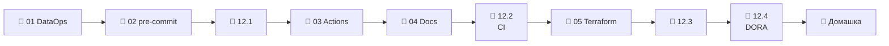

# Модуль 12 · DataOps и CI/CD

**Длительность:** ~1 нед. · **Статус и DoD:** см. [ROADMAP](../../ROADMAP.md)

## Бизнес-вопрос

> Как менять pipeline часто и без страха что-то сломать?

## Цели

- вынести курс в отдельный репозиторий и ставить проверки перед каждым коммитом
- проверять каждый pull request в CI: lint, тесты, сборка dbt только изменённых моделей
- публиковать документацию dbt как артефакт сборки
- описывать ресурсы стека кодом в Terraform и хранить состояние удалённо
- мерить поставку изменений метриками DORA вместе с SLO данных

## Темы

- DataOps: практики, окружения dev / CI / prod, метрики DORA, связь с SLO
- pre-commit: git-хуки, внешние и локальные хуки, одна версия линтеров везде
- GitHub Actions: workflow, jobs, steps, права и секреты; slim CI (`state:modified+`, `--defer`)
- документация как артефакт: `dbt docs generate` в CI → GitHub Pages
- Terraform: провайдеры, ресурсы, state в удалённом backend, plan/apply, импорт; облачный вариант стека

## Инструменты

pre-commit 4.6 (в образе workspace), GitHub Actions + actionlint 1.7, `make ci` (чистый контейнер
uv), Terraform 1.16 в контейнере (провайдеры MinIO и PostgreSQL)

> [!note] Решение 2026-10-03: CI — под отдельный репозиторий курса
> Workflow лежит в `.github/workflows/ci.yml` корня курса и заработает после выноса курса в свой
> репозиторий (лаба 12.1). До этого CI проверяется локально: `make ci` и actionlint. Подробности —
> [`memory/decisions/ci-separate-repo.md`](../../memory/decisions/ci-separate-repo.md).

## Маршрут прохождения

Сначала урок, потом задачи лабы по нему. Статусы: ✅ сделано · 🟨 сейчас · ⬜ впереди.

| # | Шаг | Что | Статус |
|---|---|---|---|
| 1 | 📖 [01 · DataOps](theory/01_dataops.md) · [карта](maps/dataops.canvas) | урок | ⬜ |
| 2 | 📖 [02 · pre-commit](theory/02_precommit.md) · [карта](maps/precommit.canvas) | урок | ⬜ |
| 3 | 🧪 [Лаба 12.1 — свой репозиторий и хуки](labs/12.1_precommit/README.md) | вынос курса, pre-commit | ⬜ |
| 4 | 📖 [03 · GitHub Actions и slim CI](theory/03_github_actions.md) · [карта](maps/github-actions.canvas) | урок | ⬜ |
| 5 | 📖 [04 · Документация как артефакт](theory/04_docs_artifact.md) · [карта](maps/docs-artifact.canvas) | урок | ⬜ |
| 6 | 🧪 [Лаба 12.2 — CI и Pages](labs/12.2_ci_docs/README.md) | мини-проект | ⬜ |
| 7 | 📖 [05 · Terraform](theory/05_terraform.md) · [карта](maps/terraform.canvas) | урок | ⬜ |
| 8 | 🧪 [Лаба 12.3 — Terraform](labs/12.3_terraform/README.md) | ресурсы стека кодом | ⬜ |
| 9 | 🧪 [Лаба 12.4 — метрики DataOps](labs/12.4_dataops_metrics/README.md) | DORA + SLO | ⬜ |
| 10 | 🏁 [Домашка-чекпоинт](homework.md) | 7 вопросов и одно предсказание | ⬜ |

> [!note] Учебный проект модуля (2026-10-03)
> - `.pre-commit-config.yaml`, `scripts/git-hooks/pre-commit`; команды `make precommit`, `make hooks`.
> - `.github/workflows/ci.yml` + шаги `scripts/ci/{lint,test,dbt}.sh`; локальный прогон — `make ci`
>   (`CI_STEPS="lint"` — один шаг). dbt-шаг собирает учебный проект модуля 05 на датасете с
>   Hugging Face, без стека.
> - [`demo/terraform_local/`](demo/terraform_local/) — бакет `exports` в Silo и роль с базой
>   `reporting` в Postgres; state — в бакете `tfstate`; `make tf ARGS="…"`.
> - Это не capstone и не ответы к лабам.

## Чек-лист самоконтроля

Отмечай пункт, только когда можешь сделать это **без подсказки**. Подробные чек-листы — в начале
каждого урока.

**Процесс** ([01](theory/01_dataops.md), [02](theory/02_precommit.md))
- [ ] Считаю метрики DORA по истории и связываю их с SLO данных
- [ ] Добавляю хук pre-commit и разбираю его отказ

**CI/CD** ([03](theory/03_github_actions.md), [04](theory/04_docs_artifact.md))
- [ ] Пишу workflow и проверяю его до GitHub: `make ci`, actionlint
- [ ] Объясняю slim CI и где берётся состояние прода
- [ ] Публикую документацию dbt из CI

**Инфраструктура** ([05](theory/05_terraform.md))
- [ ] Читаю план Terraform и предсказываю результат `apply`
- [ ] Держу state удалённо и беру под управление ресурс, созданный руками

**Закрытие модуля**
- [ ] Лабы 12.1–12.4 выполнены по Definition of Done
- [ ] [Домашка](homework.md) сдана, ошибки разобраны
- [ ] Тезисы по Клеппману (гл. 1, удобство сопровождения) — в [`notes.md`](notes.md)

## Материалы модуля

| Что | Где |
|---|---|
| 🧠 Карточки для повторения | [flashcards.md](flashcards.md) |
| 🗺️ Карты | [maps/](maps/) |
| 📚 Термины | [glossary/](../../glossary/README.md) — раздел «DataOps и CI/CD» |
| 🧪 Учебный проект | [demo/](demo/), `scripts/ci/`, `.github/workflows/` |
| 📓 Заметки | [notes.md](notes.md) |

## Мини-проект (вклад в capstone)

Каждый pull request в репозиторий курса проходит lint, тесты и сборку dbt автоматически, а
документация dbt публикуется на GitHub Pages (лаба 12.2). Ресурсы стека — в Terraform (12.3),
метрики поставки — `ops/dora.md` (12.4).

## Ресурсы

- [pre-commit](https://pre-commit.com/) · [pre-commit-hooks](https://github.com/pre-commit/pre-commit-hooks)
- [GitHub Actions: синтаксис workflow](https://docs.github.com/en/actions/reference/workflows-and-actions/workflow-syntax) · [actionlint](https://github.com/rhysd/actionlint)
- [dbt: state и defer (slim CI)](https://docs.getdbt.com/reference/node-selection/defer)
- [GitHub Pages: публикация через Actions](https://docs.github.com/en/pages/getting-started-with-github-pages/using-custom-workflows-with-github-pages)
- [Terraform: S3 backend](https://developer.hashicorp.com/terraform/language/backend/s3)
- [Surfalytics: Git and CI/CD](https://github.com/surfalytics/data-projects/tree/main/dataops-projects/01_git_and_ci_cd) · [Terraform 101](https://github.com/surfalytics/data-projects/tree/main/dataops-projects/02_terraform_101)
- [DORA: четыре метрики](https://dora.dev/guides/dora-metrics-four-keys/)

## Книга и видео

Полная таблица с пояснениями, зачем читать и что пропустить — в [карте чтения](../../reading_map.md#12--dataops-и-cicd).

- 📖 Клеппман, гл. 1 — удобство сопровождения (урок 01)
- 🎬 [Zoomcamp `01-docker-terraform`](https://github.com/DataTalksClub/data-engineering-zoomcamp/tree/main/01-docker-terraform) — часть Terraform (урок 05)

## Домашка-чекпоинт

После всех лаб — [`homework.md`](homework.md).

## Заметки

Конспект, тезисы по книге и выводы — в [`notes.md`](notes.md).
