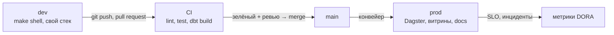
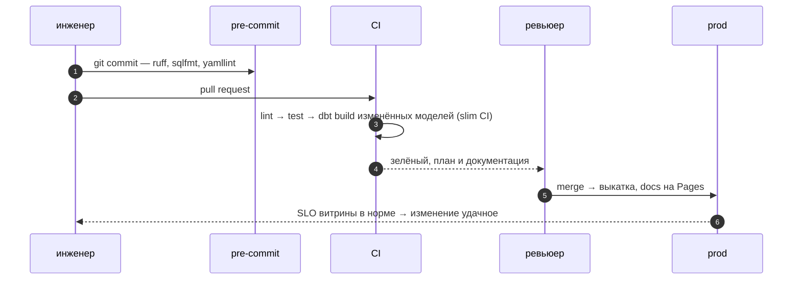

# 01 · DataOps: менять пайплайн часто и без страха

> [!info] Урок одной фразой
> Пайплайн — живой организм: каждую неделю новые модели, источники, правила. Если каждое
> изменение — ручная выкатка «в пятницу вечером», команда начинает бояться перемен и копит их
> большими пачками, а большие пачки ломаются чаще. DataOps — конвейер для изменений: маленькие
> правки, автоматические проверки на каждой, отдельные окружения и числа, которые показывают,
> стало ли лучше.

> [!todo] Чек-лист: после урока ты сможешь
> - [ ] объяснить, какую проблему решает DataOps и из каких практик он состоит;
> - [ ] назвать четыре метрики DORA и посчитать их для своего пайплайна;
> - [ ] объяснить, зачем окружения dev, CI и prod и как они устроены у нас;
> - [ ] связать метрики поставки изменений с SLO данных (модуль 09);
> - [ ] прочитать размер изменений по истории git и назвать риск больших пачек.

**Нужно для:** лаба [12.4](../labs/12.4_dataops_metrics/README.md).
**Карта урока:** [dataops.canvas](../maps/dataops.canvas).

---

## Шаг 0. Азбука

| Понятие | В аналогии «конвейер изменений» | Подробнее |
|---|---|---|
| DataOps | Конвейер, по которому правки едут в прод с проверками | [DataOps](../../../glossary/dataops.md) |
| CI | Контроль качества на каждой детали | [CI/CD](../../../glossary/ci-cd.md) |
| CD | Автоматическая отгрузка проверенной детали | [CI/CD](../../../glossary/ci-cd.md) |
| Окружение (dev, prod) | Опытный цех и основной цех | [DataOps](../../../glossary/dataops.md) |
| Метрики DORA | Спидометр и счётчик брака конвейера | [DataOps](../../../glossary/dataops.md) |
| SLO | Обещание клиенту: «свежие данные к 6:00» | [SLA, SLO, SLI](../../../glossary/slo-sli-sla.md) |

---

## Шаг 1. Почему изменения в данных страшны

**Проблема.** Изменение пайплайна ломает не только код, но и данные: витрина с неверной
формулой уже прочитана дашбордом и попала в отчёт директору. Откатить код можно за минуту, а
данные придётся пересчитывать. Поэтому команды выкатывают изменения редко и большими пачками.
Но большая пачка — это десятки изменений сразу: если что-то сломалось, непонятно что.

**Как устроено.** DataOps переносит в данные практики DevOps:

| Практика | Что даёт | Где в курсе |
|---|---|---|
| Всё в git: код, конфиги, инфраструктура | любое состояние воспроизводится | весь курс; Terraform — урок 05 |
| Маленькие изменения через pull request | ревью по силам, легко откатить | лабы модуля |
| Автоматические проверки на каждом изменении | ошибки ловятся до прода | pre-commit (урок 02), CI (урок 03) |
| Тесты данных | ошибки в данных, а не только в коде | модули 05, 09 |
| Отдельные окружения | эксперимент не трогает прод | шаг 3 |
| Наблюдаемость и SLO | знаем, что прод здоров | модуль 09 |
| Документация как артефакт сборки | описание не отстаёт от кода | урок 04 |

**Что из этого следует.** Цель DataOps — не «больше автоматизации», а **частые маленькие
безопасные изменения**. Автоматизация — средство, чтобы маленькие изменения стоили дёшево.

---

## Шаг 2. Метрики DORA

**Проблема.** «Мы стали работать лучше» — мнение. Нужны числа, которые показывают скорость и
надёжность поставки изменений.

**Как устроено.** Исследование DORA (DevOps Research and Assessment) выделило четыре метрики.
Первые две — про скорость, вторые две — про надёжность:

| Метрика | Вопрос | Как посчитать у нас |
|---|---|---|
| Частота выкатки (deployment frequency) | как часто изменения попадают в прод | мержи в `main` в неделю |
| Время до прода (lead time for changes) | сколько идёт изменение от коммита до прода | время от первого коммита ветки до мержа и выкатки |
| Доля неудачных изменений (change failure rate) | какая доля выкаток что-то сломала | выкатки, после которых был инцидент или откат / все выкатки |
| Время восстановления (time to restore) | как быстро чиним | от начала инцидента до восстановления — MTTR (модуль 09) |

Скорость и надёжность не враги: команды с частыми маленькими выкатками и ломают реже, и чинят
быстрее. Маленькое изменение легко проверить, понять и откатить.

**Что из этого следует.** Метрики считают по истории git, CI и журналу инцидентов
(`ops/incidents.md`). Важен тренд, а не абсолютное значение: сравнивай себя с собой месяц назад.

> [!example]- Попробуй сам: размер изменений в истории курса
> ```bash
> git log --shortstat --format='%ad|%s' --date=short -- . | \
>   awk '/\|/{d=$0} /files? changed/{print $1, $4+$6, d}' | head -8
> ```
> Команда выполняется на хосте в папке курса: git — инструмент хоста, как docker и make.
> **Увидишь:** по строке на коммит — файлов, строк, дата и сообщение. В истории курса есть
> коммиты на 184 файла и 18 390 строк (2026-10-02) и на 144 файла и 13 891 строку (2026-10-01).
> **Почему:** материалы модулей добавлялись крупными пачками. Для учебных текстов это терпимо,
> а для кода пайплайна такая пачка почти не поддаётся ревью: дели её на изменения по одной теме.

---

## Шаг 3. Окружения: dev, CI, prod

**Проблема.** Если проверять изменение прямо в проде, ошибка сразу видна бизнесу. Если только на
ноутбуке — «у меня работает», а в проде нет.

**Как устроено.** Изменение проходит три окружения:

| Окружение | Где у нас | Данные | Кто запускает |
|---|---|---|---|
| dev | твой стек в Docker, `make shell` | учебные или копия | ты |
| CI | раннер GitHub или `make ci` в чистом контейнере | датасет с Hugging Face, без нашего стека | автоматически на pull request |
| prod | основной стек: lakehouse, Dagster по расписанию | настоящие | только конвейер после мержа |

Что меняется между окружениями — **не код, а настройки**: цели dbt (`--target`), имена схем,
адреса, секреты. Секреты лежат в `.env` локально и в Secrets репозитория на GitHub — никогда в git.



**Что из этого следует.** CI — это окружение без нашего стека: всё, что в нём нужно (данные,
зависимости), он получает сам. Поэтому CI проверяет и воспроизводимость: если сборка работает
только на твоём ноутбуке, CI это покажет.

---

## Шаг 4. Связь с SLO данных

**Проблема.** DORA меряет поставку **кода**. Но потребитель видит **данные**: свежесть, полноту,
правильность. Можно часто выкатывать и при этом каждый день опаздывать с витриной.

**Как устроено.** В модуле 09 ты сформулировал SLO данных (`ops/slo.md`): например, «витрина
готова к 6:00 в 95 % дней». Связь двух миров:

| Событие | DORA | SLO данных |
|---|---|---|
| Выкатка сломала модель, витрина не собралась | +1 к неудачным изменениям | день вне SLO, расход бюджета ошибок |
| Источник прислал файл поздно | не влияет | день вне SLO |
| Инцидент закрыт за 2 часа | время восстановления | MTTR (модуль 09) |

**Что из этого следует.** Если бюджет ошибок SLO исчерпан, команда замедляет выкатки и чинит
надёжность. Если бюджет есть — можно выкатывать чаще. Две системы метрик управляют одним
решением: «можно ли сейчас рисковать».

---

## Сборка целиком

Путь одного изменения — новая колонка в витрине:



| Шаг | Если пропустить | Цена |
|---|---|---|
| 1 | нет pre-commit | ошибки стиля и секреты доходят до CI или до git |
| 3 | нет CI | ошибка находится в проде |
| 5 | нет мониторинга SLO | о поломке скажет бизнес |

## Шпаргалка

| Хочу | Как |
|---|---|
| Частота выкатки | мержи в `main` за неделю: `git log --merges --since=…` |
| Время до прода | время pull request: от первого коммита до мержа |
| Доля неудачных | инциденты после выкатки / выкатки (`ops/incidents.md`) |
| Время восстановления | MTTR из постмортемов |
| Размер изменений | `git log --shortstat` |
| Проверить, что сборка не зависит от моего стека | `make ci` |

## Типичные ошибки

| Симптом | Причина | Как проверить | Как чинить |
|---|---|---|---|
| Выкатки редкие и страшные | большие пачки изменений | `git log --shortstat` | маленькие pull request по одной теме |
| «У меня работает» | сборка зависит от локального состояния | `make ci` | всё нужное CI получает сам |
| Метрики DORA растут, жалобы тоже | меряем код, а не данные | SLO в `ops/slo.md` | смотреть DORA вместе с SLO |
| Секрет оказался в git | `.env` или токен в коде | pre-commit `detect-private-key`, запрет `.env` | секреты — только в окружении |

## Проверь себя

Карточки — в [flashcards.md](../flashcards.md).

> [!question] 1. Почему частые маленькие выкатки надёжнее редких больших?
> > [!success]- Ответ
> > Маленькое изменение легко отревьюить, проверить и откатить; если оно сломало прод, причина
> > очевидна. В большой пачке ошибку ищут среди десятков изменений.

> [!question] 2. Чем окружение CI отличается от dev?
> > [!success]- Ответ
> > В CI нет твоего стека и локального состояния: зависимости и данные он получает сам. Поэтому
> > CI проверяет и воспроизводимость сборки.

> [!question] 3. Витрина опоздала из-за источника. Это неудачное изменение по DORA?
> > [!success]- Ответ
> > Нет: выкатки не было. Это нарушение SLO данных. DORA и SLO меряют разное и дополняют друг
> > друга.
