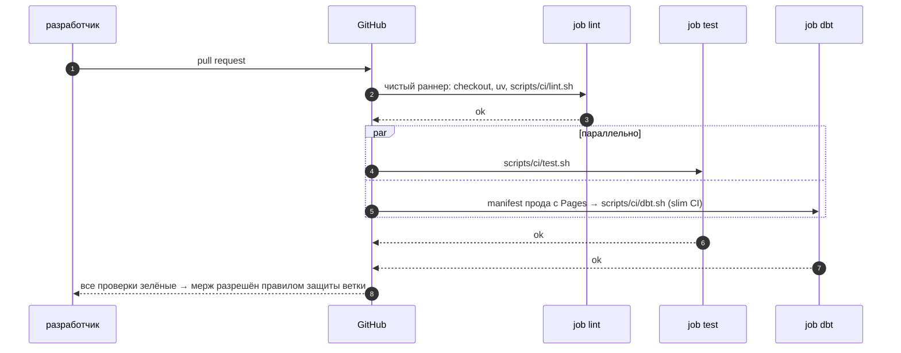

# 03 · GitHub Actions: CI на каждый pull request и slim CI для dbt

> [!info] Урок одной фразой
> pre-commit проверяет у тебя на машине, но его можно обойти, а тесты и сборку dbt он не
> запускает. CI — независимый контролёр: на каждый pull request он берёт чистую машину, ставит
> зависимости с нуля, гоняет линтеры, тесты и dbt. Чтобы не пересобирать весь проект ради одной
> модели, slim CI строит только изменённое, а остальное «одалживает» у прода.

> [!todo] Чек-лист: после урока ты сможешь
> - [ ] прочитать и написать workflow: события, jobs, steps, `needs`, `if`, права;
> - [ ] объяснить, почему шаги CI вынесены в скрипты и как проверить CI до GitHub (`make ci`, actionlint);
> - [ ] объяснить slim CI dbt: `state:modified+`, `--state`, `--defer`;
> - [ ] хранить секреты и выдавать права по принципу наименьших привилегий;
> - [ ] отличить «CI зелёный» от «изменение проверено».

**Нужно для:** лаба [12.2](../labs/12.2_ci_docs/README.md), задачи 1–2.
**Карта урока:** [github-actions.canvas](../maps/github-actions.canvas).

---

## Шаг 0. Азбука

| Понятие | В аналогии «независимый контролёр» | Подробнее |
|---|---|---|
| Workflow | Регламент проверки: когда и что проверять | [CI/CD](../../../glossary/ci-cd.md) |
| Событие (trigger) | Повод для проверки: пришёл pull request | [CI/CD](../../../glossary/ci-cd.md) |
| Job | Отдельный стол проверки, на своей чистой машине | [CI/CD](../../../glossary/ci-cd.md) |
| Step | Одна операция за столом | [CI/CD](../../../glossary/ci-cd.md) |
| Action | Готовый инструмент: «достать код», «поставить uv» | [CI/CD](../../../glossary/ci-cd.md) |
| Slim CI | Проверять только изменённые детали и всё, что от них зависит | [CI/CD](../../../glossary/ci-cd.md) |

---

## Шаг 1. Как устроен workflow

**Проблема.** Проверки должны запускаться сами на каждом pull request, на чистой машине, и
блокировать мерж, если что-то сломано.

**Как устроено.** Workflow — YAML-файл в `.github/workflows/`. GitHub читает его при событии и
запускает jobs на **раннерах** — временных виртуальных машинах. Наш `.github/workflows/ci.yml`:

```yaml
on:                                    # ① когда запускать
  pull_request:
  push:
    branches: [main]
concurrency:                           # ② новый push отменяет старый запуск той же ветки
  group: ci-${{ github.ref }}
  cancel-in-progress: true
permissions:
  contents: read                       # ③ по умолчанию — только чтение
jobs:
  lint:
    runs-on: ubuntu-24.04
    steps:
      - uses: actions/checkout@v7      # ④ готовый action: код репозитория
      - uses: astral-sh/setup-uv@v10.2.0  # uv нужной версии, кэш пакетов
        with: {version: "0.9.30", enable-cache: true}
      - run: scripts/ci/lint.sh        # ⑤ сам шаг — скрипт из репозитория
  test:
    needs: lint                        # ⑥ порядок: test и dbt — после lint
  dbt:
    needs: lint
```

| Метка | Что важно |
|---|---|
| ① | `pull_request` — проверка предложенного изменения; `push` в `main` — сборка прода и публикация |
| ② | экономит минуты: проверять устаревший коммит незачем |
| ③ | токен workflow по умолчанию может только читать; права на публикацию выдаются одной job (урок 04) |
| ④ | `uses` — чужой action с версией; версию закрепляют, иначе обновление action сломает CI без твоих правок. Короткий тег (`@v7`) есть не у всех: первый запуск курса на GitHub упал на `setup-uv@v10` — такого тега нет |
| ⑤ | шаг — скрипт в репозитории, а не длинная команда в YAML (шаг 2) |
| ⑥ | jobs без `needs` идут параллельно на разных машинах; `test` и `dbt` у нас параллельны |

**Что из этого следует.** Каждая job — отдельная чистая машина: зависимости ставятся заново, файлы
между jobs не передаются (для этого есть артефакты и кэш). Поэтому CI проверяет и
воспроизводимость сборки.

---

## Шаг 2. Шаги — скрипты, и CI проверяется до GitHub

**Проблема.** Если вся логика CI написана прямо в YAML, проверить её можно только пушем на GitHub:
ошибка → правка → пуш → ждать пять минут. А пока курс не вынесен в свой репозиторий, GitHub
workflow вообще не увидит.

**Как устроено.** Две практики:

1. **Логика — в скриптах** `scripts/ci/lint.sh`, `test.sh`, `dbt.sh`. Workflow только вызывает их.
   Тот же скрипт запускается локально.
2. **`make ci`** запускает скрипты в **чистом контейнере uv** — без нашего стека, как раннер
   GitHub. **actionlint** проверяет синтаксис workflow и встроенные shell-команды (через
   shellcheck).

Замеры на стеке (2026-10-03):

| Прогон | Время | Что видно |
|---|---|---|
| `make ci`, первый раз | 7 мин 16 с | почти всё — загрузка зависимостей; сама сборка dbt — 1,2 с, 16 узлов |
| `make ci CI_STEPS="lint"` с кэшем | ~3 с | первый же прогон поймал длинную строку и три неотформатированных файла |
| `make ci CI_STEPS="test"` | 1,4 с | `6 skipped`: тестам Spark нужен кластер |
| actionlint | доли секунды | код выхода 0 |

**Что из этого следует.** Кэш зависимостей решает: без него каждый запуск CI — минуты загрузки.
В workflow кэш даёт `setup-uv` (`enable-cache: true`), датасет кэшируется `actions/cache`.

> [!example]- Попробуй сам: CI без GitHub
> ```bash
> make ci CI_STEPS="lint"
> docker run --rm -v "$PWD":/repo -w /repo rhysd/actionlint:1.7.12 -no-color .github/workflows/ci.yml; echo $?
> ```
> **Увидишь:** `== lint`, затем `All checks passed!`, `… files already formatted`, `… files passed
> formatting check`; actionlint ничего не печатает, код `0`.
> **Почему:** `make ci` запускает те же скрипты, что workflow, в контейнере
> `ghcr.io/astral-sh/uv:python3.12-bookworm-slim` — без нашего стека. Пустой вывод actionlint —
> ошибок нет.

> [!warning] Ловушка
> Не считай зелёный CI доказательством, что всё проверено. На стеке шаг test проходит с
> результатом `6 skipped`: тесты Spark пропускаются без кластера. Смотри, сколько тестов
> **выполнено**, а не только цвет.

---

## Шаг 3. Slim CI: собирать только изменённое

**Проблема.** Проект capstone — десятки моделей. Пересобирать всё на каждый pull request долго, а
для больших таблиц ещё и дорого. Правка одной витрины не требует пересчёта staging.

**Как устроено.** dbt умеет сравнивать проект с **состоянием** — `manifest.json` другой сборки:

1. `--state <папка>` — где лежит `manifest.json` прода.
2. `--select state:modified+` — модели, у которых изменился код или конфиг по сравнению с
   состоянием, и все их потомки (`+`).
3. `--defer` — если выбранной модели нужен `ref()` на модель, которую не строим, dbt подставляет
   таблицу **прода** из состояния. Без `--defer` такая ссылка указала бы на пустую схему CI.

`scripts/ci/dbt.sh` делает так: есть `ci_state/manifest.json` — slim CI; нет — полная сборка. На
GitHub состояние прода берётся с сайта документации (урок 04).

**Что из этого следует.** Slim CI ускоряет проверку пропорционально доле изменённого. Но он
проверяет только то, что изменилось: сломанную зависимость, которую `state:modified` не считает
изменением (например, данные источника), он не заметит. Полная сборка остаётся на `main`.

> [!example]- Попробуй сам: одна правка — шесть узлов
> ```bash
> make ci CI_STEPS="dbt"
> mkdir -p data/ci_state && cp modules/05_transformation_dbt/demo/target/manifest.json data/ci_state/
> echo "-- slim CI check" >> modules/05_transformation_dbt/demo/models/marts/mart_city_rainy_days.sql
> make ci CI_STEPS="dbt"
> git checkout -- modules/05_transformation_dbt/demo/models/marts/mart_city_rainy_days.sql
> rm -r data/ci_state
> ```
> Если курс ещё внутри общего репозитория, `git checkout` выполняй в нём же — путь тот же.
> **Увидишь:** первый прогон — `полная сборка: нет …/manifest.json` и `Done. PASS=15 … TOTAL=16`;
> второй — `slim CI: state:modified+ против /workspace/data/ci_state` и `Done. PASS=5 … NO-OP=1
> … TOTAL=6`: витрина, её юнит-тест, три теста данных и exposure.
> **Почему:** изменился только SQL `mart_city_rainy_days`; `+` добавил её потомков (тесты,
> exposure). Staging и факт не пересобирались. С кэшем зависимостей шаг занял ~22 с.

---

## Шаг 4. Секреты и права

**Проблема.** CI иногда нужны пароли: к облаку, к хранилищу, к каталогу. Положить их в YAML —
значит опубликовать.

**Как устроено.**

- **Secrets** репозитория (Settings → Secrets and variables → Actions) — зашифрованные значения.
  В workflow: `${{ secrets.ИМЯ }}`; в логах GitHub их маскирует.
- Pull request из форка секретов не получает: чужой код не должен их читать.
- **`permissions`** задают права токена `GITHUB_TOKEN`: по умолчанию у нас `contents: read`, права
  на Pages — только у job публикации.
- Наш CI секретов не требует: датасет публичный, dbt работает на DuckDB внутри раннера.

**Что из этого следует.** Лучший секрет в CI — которого нет. Если CI можно построить без доступа
к проду, так и делают: меньше риск утечки и меньше зависимость от внешних систем.

---

## Сборка целиком



| Шаг | Если сломается | Симптом |
|---|---|---|
| 2 | версия uv или пакетов не закреплена | CI ломается сам, без твоих правок |
| 5 | нет состояния прода | полная сборка — медленнее, но верно |
| 7 | нет правила защиты ветки | красный CI не мешает мержу |

## Шпаргалка

| Хочу | Как |
|---|---|
| Запуск на pull request и в `main` | `on: {pull_request: , push: {branches: [main]}}` |
| Порядок jobs | `needs: lint` |
| Условие | `if: github.ref == 'refs/heads/main'` |
| Кэш пакетов | `astral-sh/setup-uv@v10.2.0` с `enable-cache: true` |
| Кэш файлов | `actions/cache` с `path` и `key` |
| Секрет | `${{ secrets.ИМЯ }}` |
| CI локально | `make ci`, один шаг — `CI_STEPS="dbt"` |
| Проверить YAML | actionlint в контейнере |
| Slim CI | `dbt build --select state:modified+ --defer --state ci_state` |

## Типичные ошибки

| Симптом | Причина | Как проверить | Как чинить |
|---|---|---|---|
| CI зелёный, но ничего не проверено | тесты пропущены | `skipped` в выводе | считать выполненные тесты; дать CI нужное окружение |
| Работает локально, падает в CI | зависимость от локального стека или файлов | `make ci` | всё нужное CI получает сам |
| CI сломался без изменений в репозитории | версия action или пакета не закреплена | лог запуска | закрепить `@vN`, `uv.lock`, `--frozen` |
| Job падает на `Set up job`: `Unable to resolve action …, unable to find version` | такого тега у action нет (у `setup-uv` нет `v10`, только `v10.2.0`) | страница Releases action | указать существующий тег; actionlint этого не ловит |
| Slim CI собрал всё | нет `manifest.json` прода | лог шага | опубликовать docs из `main` |
| `ref` указывает на пустую таблицу | slim CI без `--defer` | лог dbt | добавить `--defer` |

## Проверь себя

Карточки — в [flashcards.md](../flashcards.md).

> [!question] 1. Зачем шаги CI вынесены в скрипты, а не написаны в YAML?
> > [!success]- Ответ
> > Скрипт запускается и в CI, и локально (`make ci`): CI проверяется без пушей на GitHub, а
> > логика одна в двух местах.

> [!question] 2. Что делает `--defer` в slim CI?
> > [!success]- Ответ
> > Для `ref()` на модели, которые в этом запуске не строятся, dbt подставляет таблицы прода из
> > `--state`. Иначе изменённая модель читала бы пустую схему CI.

> [!question] 3. Шаг test зелёный: `6 skipped`. Что не так?
> > [!success]- Ответ
> > Ни один тест не выполнен: им нужен кластер Spark. CI нужно окружение для этих тестов или
> > тесты, которые работают без кластера (локальная сессия Spark).
