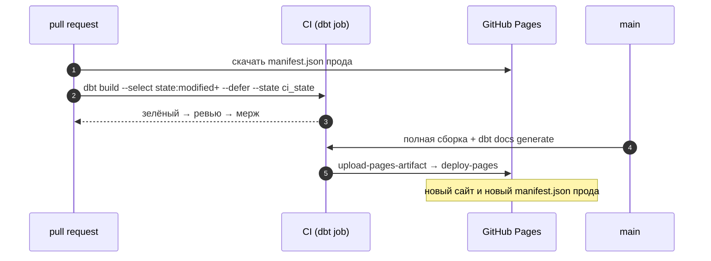

# 04 · Документация как артефакт сборки: dbt docs на GitHub Pages

> [!info] Урок одной фразой
> Документацию, которую пишут отдельно от кода, никто не обновляет. dbt собирает сайт
> документации из того же YAML, что описывает модели. Осталось сделать сборку сайта шагом CI.
> Каждый мерж в `main` публикует свежий сайт. Файл с графом проекта с этого сайта становится
> «паспортом прода» для следующей проверки.

> [!todo] Чек-лист: после урока ты сможешь
> - [ ] объяснить, из чего dbt собирает сайт документации и что лежит в `target/`;
> - [ ] объяснить, зачем документацию собирать в CI, а не на ноутбуке;
> - [ ] описать публикацию на GitHub Pages: артефакт, права, окружение;
> - [ ] объяснить, как опубликованный `manifest.json` используется в slim CI.

**Нужно для:** лаба [12.2](../labs/12.2_ci_docs/README.md), задача 3.
**Карта урока:** [docs-artifact.canvas](../maps/docs-artifact.canvas).

---

## Шаг 0. Азбука

| Понятие | В аналогии «паспорт изделия» | Подробнее |
|---|---|---|
| Документация как код | Паспорт печатают из чертежей, а не пишут от руки | [документация как код](../../../glossary/docs-as-code.md) |
| Артефакт сборки | Готовый отпечатанный паспорт | [CI/CD](../../../glossary/ci-cd.md) |
| `manifest.json` | Полный чертёж проекта: модели, связи, описания | [CI/CD](../../../glossary/ci-cd.md) |
| GitHub Pages | Витрина, где паспорт выставлен для всех | [CI/CD](../../../glossary/ci-cd.md) |

---

## Шаг 1. Что собирает dbt docs

**Проблема.** В модуле 05 ты открывал документацию командой `dbt docs serve` на своём ноутбуке.
Коллега её не видит, а через месяц она отстаёт от кода.

**Как устроено.** `dbt docs generate` пишет в `target/` три файла:

| Файл | Откуда | Что в нём |
|---|---|---|
| `manifest.json` | разбор проекта: SQL, YAML, `ref`, `source` | все узлы, их связи, описания, тесты, exposures |
| `catalog.json` | запрос к базе | реальные колонки и типы таблиц |
| `index.html` | шаблон dbt | сайт, который читает два файла выше |

Сайт — статический: HTML и два JSON. Его можно положить на любой веб-сервер.

**Что из этого следует.** Для `catalog.json` dbt ходит в базу. Поэтому в CI документацию собирают
после `dbt build`: таблицы уже есть, их колонки попадут в каталог.

---

## Шаг 2. Публикация на GitHub Pages

**Проблема.** Сайт надо выложить туда, где его видят все, и обновлять при каждом изменении — без
ручных шагов.

**Как устроено.** GitHub Pages принимает сайт как **артефакт** workflow. В нашем
`.github/workflows/ci.yml`:

```yaml
  dbt:
    steps:
      - run: scripts/ci/dbt.sh                      # ① build + docs generate
      - name: Сайт документации
        if: github.ref == 'refs/heads/main'         # ② только из main
        uses: actions/upload-pages-artifact@v5
        with:
          path: modules/05_transformation_dbt/demo/target

  docs:
    if: github.ref == 'refs/heads/main'
    needs: [test, dbt]                              # ③ только если всё зелёное
    permissions:
      pages: write                                  # ④ минимум прав для публикации
      id-token: write
    environment:
      name: github-pages
    steps:
      - uses: actions/deploy-pages@v5
```

| Метка | Что важно |
|---|---|
| ① | скрипт шага собирает модели и документацию тем же способом, что `make ci` локально |
| ② | с pull request сайт не публикуется: документация прода должна соответствовать `main` |
| ③ | красный тест — нет публикации: на сайте не окажется описание сломанной версии |
| ④ | права выдаются только этой job; остальные работают с `contents: read` |

В настройках репозитория источник Pages — **GitHub Actions** (Settings → Pages → Source).

**Что из этого следует.** Документация обновляется сама при каждом мерже и всегда соответствует
коду прода. Ссылку на сайт кладут в README репозитория и в каталог (модуль 11).

---

## Шаг 3. Опубликованный manifest как состояние прода

**Проблема.** Slim CI (урок 03) собирает только изменённые модели. Чтобы понять «изменённые
относительно чего», нужен `manifest.json` прода. Где его взять в CI на pull request?

**Как устроено.** Он уже опубликован: сайт документации содержит `manifest.json` последней сборки
`main`. Шаг workflow на pull request скачивает его:

```bash
curl -fsSL "https://<владелец>.github.io/<репозиторий>/manifest.json" -o ci_state/manifest.json \
  || rm -f ci_state/manifest.json
```

Если файла нет (первый запуск, сайт ещё не опубликован), `scripts/ci/dbt.sh` делает полную сборку.

**Что из этого следует.** Один артефакт служит двум целям: людям — сайт, CI — состояние прода.
Это частый приём: артефакт сборки — источник истины о том, что сейчас в проде.

> [!warning] Ловушка
> Не публикуй сайт документации из ветки pull request. Тогда `manifest.json` на Pages перестанет
> описывать прод, и slim CI будет сравнивать изменения не с тем.

---

## Сборка целиком



| Шаг | Если сломается | Симптом |
|---|---|---|
| 1 | сайт ещё не опубликован | slim CI делает полную сборку (так и задумано) |
| 5 | у job нет `pages: write` | ошибка прав при деплое |
| 5 | Pages не включены | деплой падает: источник Pages не задан |

## Шпаргалка

| Хочу | Как |
|---|---|
| Собрать сайт | `dbt docs generate` после `dbt build` |
| Посмотреть локально | `dbt docs serve --host 0.0.0.0 --port 8580` в `make shell` |
| Опубликовать | `upload-pages-artifact` с папкой `target` → `deploy-pages` |
| Включить Pages | Settings → Pages → Source: GitHub Actions |
| Состояние прода для slim CI | `manifest.json` с адреса Pages |

## Типичные ошибки

| Симптом | Причина | Как проверить | Как чинить |
|---|---|---|---|
| На сайте нет колонок | `docs generate` до `build` или без базы | размер `catalog.json` | сначала `build` |
| Деплой: нет прав | job без `pages: write`, `id-token: write` | `permissions` job | выдать права только job публикации |
| Сайт не обновляется | публикация не из `main` или упала | вкладка Actions | условие `github.ref == 'refs/heads/main'` |
| Slim CI всегда собирает всё | нет `manifest.json` на Pages | `curl` адреса | опубликовать сайт хотя бы раз |

## Проверь себя

Карточки — в [flashcards.md](../flashcards.md).

> [!question] 1. Почему документацию собирают в CI, а не публикуют с ноутбука?
> > [!success]- Ответ
> > Сборка в CI повторяема и привязана к `main`: сайт всегда соответствует коду прода. С
> > ноутбука публикуют что угодно, в том числе незамерженные правки.

> [!question] 2. Зачем job публикации отдельные права, а не всему workflow?
> > [!success]- Ответ
> > Принцип наименьших привилегий: lint и тесты не должны уметь менять сайт. Права нужны только
> > одной job.

> [!question] 3. Как сайт документации помогает slim CI?
> > [!success]- Ответ
> > На нём лежит `manifest.json` последней сборки `main` — состояние прода. CI на pull request
> > скачивает его и строит только изменённые модели и их потомков.
