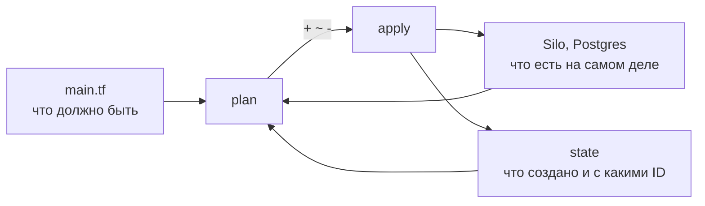
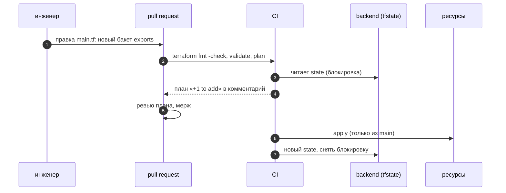

# 05 · Terraform: инфраструктура как код

> [!info] Урок одной фразой
> Compose описывает, какие контейнеры запустить. Но бакеты, базы, роли и права внутри них мы
> до сих пор создавали руками или скриптами. Terraform — смета и прораб. В файле записано, каким
> должно быть хозяйство. `plan` показывает разницу между сметой и тем, что есть, а `apply`
> доводит хозяйство до сметы. Журнал прораба (state) хранится в общем шкафу, чтобы два прораба не
> строили одно и то же одновременно.

> [!todo] Чек-лист: после урока ты сможешь
> - [ ] объяснить декларативный подход IaC и цикл `init` → `plan` → `apply` → `destroy`;
> - [ ] описать провайдер, ресурс, переменную, вывод на HCL;
> - [ ] объяснить, что хранит state и почему его держат в удалённом backend с блокировкой;
> - [ ] прочитать `plan` и предсказать, что изменит `apply`;
> - [ ] показать, как наш стек выглядел бы в облаке, и чем облачный вариант отличается.

**Нужно для:** лаба [12.3](../labs/12.3_terraform/README.md).
**Карта урока:** [terraform.canvas](../maps/terraform.canvas).

---

## Шаг 0. Азбука

| Понятие | В аналогии «смета и прораб» | Подробнее |
|---|---|---|
| IaC | Хозяйство описано сметой, а не памятью строителей | [Terraform](../../../glossary/terraform.md) |
| Провайдер | Бригада, которая умеет работать с конкретным материалом (S3, Postgres, облако) | [Terraform](../../../glossary/terraform.md) |
| Ресурс | Пункт сметы: бакет, роль, база | [Terraform](../../../glossary/terraform.md) |
| `plan` | Сравнение сметы с тем, что построено | [Terraform](../../../glossary/terraform.md) |
| State | Журнал прораба: что он построил и с какими ID | [Terraform](../../../glossary/terraform.md) |
| Backend, блокировка | Общий шкаф для журнала и табличка «занято» | [Terraform](../../../glossary/terraform.md) |

---

## Шаг 1. Зачем описывать инфраструктуру кодом

**Проблема.** В курсе бакеты создаёт `silo-init`, базы — `*-db-init`, роли Postgres — руками в
уроках модуля 11. Через полгода никто не помнит, какие роли и бакеты нужны и почему. Поднять
такую же среду для теста или в облаке — неделя археологии.

**Как устроено.** Инфраструктура как код (IaC) бывает двух видов:

| | Императивно (скрипт) | Декларативно (Terraform) |
|---|---|---|
| Что пишешь | шаги: «создай бакет, потом роль» | итог: «должен быть бакет и роль» |
| Повторный запуск | может упасть («уже существует») или задвоить | ничего не меняет, если всё совпадает |
| Изменение | новый скрипт «поправь» | правишь описание, `plan` показывает разницу |
| Удаление | отдельный скрипт | убрал ресурс из файла — `apply` его удалит |

**Что из этого следует.** Декларативное описание — одновременно документация и способ
воспроизвести среду. Его ревьюят в pull request, как код пайплайна.

---

## Шаг 2. Провайдеры и ресурсы

**Проблема.** Terraform сам не умеет создавать бакет или роль. Ему нужен посредник, который знает
API конкретной системы.

**Как устроено.** **Провайдер** — плагин Terraform для одной системы. Провайдеров тысячи: AWS,
Yandex Cloud, Kubernetes, Postgres, GitHub. Наш учебный проект
`demo/terraform_local/main.tf` управляет **нашим же стеком**:

```hcl
terraform {
  required_providers {
    minio      = { source = "aminueza/minio", version = "~> 3.0" }        # ① Silo = API MinIO
    postgresql = { source = "cyrilgdn/postgresql", version = "~> 1.25" }
  }
}

variable "pg_password" {                                                  # ② переменная
  type      = string
  sensitive = true                                                        #   не печатается в plan
}

provider "postgresql" {
  host     = "postgres"
  username = var.pg_user
  password = var.pg_password                                              # ③ значение — TF_VAR_pg_password
  sslmode  = "disable"
}

resource "minio_s3_bucket" "exports" {                                    # ④ тип ресурса + имя в коде
  bucket = "exports"
}

resource "postgresql_database" "reporting" {
  name  = "reporting"
  owner = postgresql_role.reporting.name                                  # ⑤ ссылка → зависимость
}
```

| Метка | Что важно |
|---|---|
| ① | `source` — адрес в реестре, `version` — ограничение; точная версия фиксируется в `.terraform.lock.hcl` |
| ② | переменные задают снаружи; `sensitive` прячет значение в выводе |
| ③ | `TF_VAR_<имя>` в окружении — значение переменной; `make tf` берёт пароли из `.env` |
| ④ | `minio_s3_bucket.exports` — адрес ресурса в коде; по нему Terraform сопоставляет код и state |
| ⑤ | ссылка на атрибут другого ресурса задаёт порядок: сначала роль, потом база |

**Что из этого следует.** Терраформ строит граф ресурсов по ссылкам и создаёт независимые ресурсы
параллельно. Зависимость, которую не видно в ссылках, задают `depends_on`.

---

## Шаг 3. Цикл plan → apply и state

**Проблема.** Как Terraform узнаёт, что бакет уже есть и его не надо создавать снова? И какой
именно бакет из десятка в Silo — «его»?

**Как устроено.**

1. `init` скачивает провайдеры и подключает backend состояния.
2. `plan` читает код, читает **state** (что Terraform создал раньше, с ID) и опрашивает реальные
   ресурсы. Результат — разница: `+` создать, `~` изменить, `-` удалить, `-/+` пересоздать.
3. `apply` выполняет план и записывает новый state.
4. `destroy` удаляет всё, что есть в state.



**State** — JSON со всеми ресурсами, их ID и атрибутами, включая секреты. Хранить его рядом с
кодом в git нельзя: там пароли, и два человека перезапишут друг другу состояние. Поэтому state
держат в **удалённом backend** с **блокировкой**: у нас — бакет `tfstate` в Silo (создаёт
`silo-init`), `use_lockfile = true` кладёт рядом файл-замок на время `apply`.

**Что из этого следует.** State — источник правды Terraform о «своих» ресурсах. Ресурс, созданный
руками, Terraform не знает: он попытается создать его ещё раз и упадёт. Такой ресурс нужно
импортировать (`terraform import`).

> [!example]- Попробуй сам: полный цикл на нашем стеке
> ```bash
> make tf ARGS="init -no-color"
> make tf ARGS="plan -no-color"
> make tf ARGS="apply -auto-approve -no-color"
> make tf ARGS="plan -no-color"
> make tf ARGS="destroy -auto-approve -no-color"
> ```
> **Увидишь:** `Successfully configured the backend "s3"!` и план `Plan: 4 to add, 0 to change,
> 0 to destroy.` Затем — `Apply complete! Resources: 4 added`. Повторный план — `No changes. Your
> infrastructure matches the configuration.` В конце — `Destroy complete! Resources: 4 destroyed.`
> **Почему:** после `apply` state в Silo совпадает с кодом и с реальностью — менять нечего.
> State лежит в `s3://tfstate/local-stack/terraform.tfstate` (~4 КБ): удали локальную папку
> `data/.terraform` и снова сделай `init` — план всё равно покажет `No changes`.

> [!warning] Ловушка
> Не клади `terraform.tfstate` в git. В нём пароли и ID всех ресурсов, а два локальных файла у
> двух людей рано или поздно разойдутся. Держи state в удалённом backend с блокировкой.

---

## Шаг 4. Как наш стек выглядел бы в облаке

**Проблема.** Курс работает локально, но вакансии ждут облако. Нужно понимать соответствие
наших сервисов облачным и что меняется в IaC.

**Как устроено.**

| У нас (compose) | Облако (AWS / Yandex Cloud) | Ресурс Terraform |
|---|---|---|
| Silo, бакеты | S3 / Object Storage | `aws_s3_bucket` / `yandex_storage_bucket` |
| Postgres | RDS / Managed PostgreSQL | `aws_db_instance` / `yandex_mdb_postgresql_cluster` |
| Lakekeeper | Glue Catalog, S3 Tables / свой Lakekeeper в Kubernetes | `aws_glue_catalog_database` |
| Spark | EMR, Dataproc / Yandex Data Processing | `aws_emr_cluster` |
| Trino | Athena (Trino внутри) / Managed Trino | `aws_athena_workgroup` |
| ClickHouse | ClickHouse Cloud / Managed ClickHouse | провайдер `clickhouse` / `yandex_mdb_clickhouse_cluster` |
| роли и права | IAM-роли, политики | `aws_iam_role`, `aws_iam_policy` |

Что добавляется в облаке: сети (VPC, подсети, группы безопасности), IAM вместо паролей, стоимость
каждого ресурса, окружения dev/prod как отдельные workspace или папки с общими модулями.

**Что из этого следует.** Подход тот же: провайдер, ресурсы, переменные, удалённый state. Разница
— в числе ресурсов и в том, что ошибка в `apply` стоит денег. Поэтому в облаке `plan` проверяют
в CI до мержа, а `apply` запускает только конвейер (урок 03).

---

## Сборка целиком

Изменение инфраструктуры через pull request:



| Шаг | Если сломается | Симптом |
|---|---|---|
| 3 | state недоступен | `Error: Failed to get existing workspaces` |
| 3 | другой apply в работе | `Error acquiring the state lock` |
| 6 | ресурс создан руками до apply | `already exists`; нужен `terraform import` |

## Шпаргалка

| Хочу | Как |
|---|---|
| Запустить у нас | `make tf ARGS="…"` (другая папка — `TF_DIR=…`) |
| Скачать провайдеры, подключить backend | `init` |
| Посмотреть изменения | `plan`; сохранить — `plan -out=tfplan` |
| Применить | `apply` (`-auto-approve` — без вопроса) |
| Удалить всё своё | `destroy` |
| Формат и проверка | `fmt -check`, `validate` |
| Что в state | `state list`, `state show <адрес>` |
| Взять под управление готовый ресурс | `import <адрес> <ID>` |

## Типичные ошибки

| Симптом | Причина | Как проверить | Как чинить |
|---|---|---|---|
| `already exists` при apply | ресурс создан руками | `state list` | `terraform import` или удалить ресурс |
| План хочет пересоздать базу | изменён атрибут, который нельзя поменять на месте | `-/+` в плане | понять последствия; при необходимости — миграция данных |
| `Error acquiring the state lock` | параллельный apply или упавший запуск | файл `.tflock` в бакете | дождаться; `force-unlock` — только если уверен |
| Пароль виден в выводе | переменная не `sensitive` | вывод `plan` | `sensitive = true` |
| `NoSuchBucket` на init | нет бакета для state | `mc ls` | бакет `tfstate` (создаёт `silo-init`) |

## Проверь себя

Карточки — в [flashcards.md](../flashcards.md).

> [!question] 1. Повторный `plan` сразу после `apply` показал изменения. О чём это говорит?
> > [!success]- Ответ
> > Кто-то или что-то меняет ресурс вне Terraform (дрейф), или провайдер нормализует атрибут
> > иначе, чем записано в коде. Нужно найти причину, иначе каждый `apply` будет что-то «чинить».

> [!question] 2. Почему state не хранят в git, если код хранят?
> > [!success]- Ответ
> > В state секреты и ID ресурсов; два человека будут перезаписывать друг другу файл. Удалённый
> > backend даёт одну копию и блокировку.

> [!question] 3. Роль `reporting` создали руками, а потом описали в Terraform. Что будет при `apply`?
> > [!success]- Ответ
> > Terraform её не знает (в state нет) и попробует создать — ошибка «уже существует». Нужно
> > `terraform import postgresql_role.reporting reporting`.
