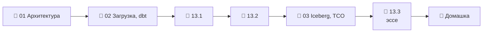

# Модуль 13 · (Опционально) Облачное хранилище: Snowflake

**Длительность:** ~1 нед. · **Статус и DoD:** см. [ROADMAP](../../ROADMAP.md)

## Бизнес-вопрос

> Чем облачный DWH отличается от своего lakehouse по цене, удобству и возможностям?

## Цели

- понимать устройство облачного DWH и соотносить его с нашим стеком
- загрузить датасет в Snowflake и перенести dbt-проект
- считать стоимость владения и принимать решение «облако или lakehouse» как ADR

## Темы

- архитектура Snowflake: хранение, виртуальные склады, облачные сервисы; микропартиции; кредиты
- загрузка: stage, `INFER_SCHEMA`, `COPY INTO`; dbt-snowflake, различия диалектов
- Snowflake + Iceberg: таблицы под управлением Snowflake и во внешнем каталоге
- стоимость владения (TCO), привязка к поставщику, ADR с условиями пересмотра

## Инструменты

Snowflake trial — **единственный модуль вне локального Docker**. В образе workspace —
`dbt-snowflake` 1.12 (группа `cloud`).

> [!warning] Что проверено на стеке, а что нет
> Проверено в контейнере: установка адаптера, `dbt parse` и `dbt ls` учебного проекта без аккаунта.
> SQL Snowflake (`demo/snowflake/*.sql`) и команды уроков, которые требуют аккаунта, сверены с
> документацией Snowflake, но **не запускались** на стеке курса. Начинай с ресурсного монитора и
> склада `XSMALL` с автоостановкой (лаба 13.1, задача 1).

## Маршрут прохождения

Сначала урок, потом задачи лабы по нему. Статусы: ✅ сделано · 🟨 сейчас · ⬜ впереди.

| # | Шаг | Что | Статус |
|---|---|---|---|
| 1 | 📖 [01 · Snowflake изнутри](theory/01_snowflake_architecture.md) · [карта](maps/snowflake-architecture.canvas) | урок | ⬜ |
| 2 | 📖 [02 · Загрузка и dbt](theory/02_load_and_dbt.md) · [карта](maps/load-and-dbt.canvas) | урок | ⬜ |
| 3 | 🧪 [Лаба 13.1 — загрузка](labs/13.1_load/README.md) | склад, stage, COPY INTO | ⬜ |
| 4 | 🧪 [Лаба 13.2 — dbt на Snowflake](labs/13.2_dbt_snowflake/README.md) | перенос проекта | ⬜ |
| 5 | 📖 [03 · Iceberg и TCO](theory/03_iceberg_and_tco.md) · [карта](maps/iceberg-and-tco.canvas) | урок | ⬜ |
| 6 | 🧪 [Лаба 13.3 — сравнение](labs/13.3_comparison/README.md) | TCO, ADR, эссе | ⬜ |
| 7 | 🏁 [Домашка-чекпоинт](homework.md) | 7 вопросов и одно предсказание | ⬜ |

> [!note] Учебный проект модуля (2026-10-03)
> - [`demo/snowflake/01_setup_and_load.sql`](demo/snowflake/01_setup_and_load.sql) — склад, база,
>   stage, таблица по схеме Parquet, `COPY INTO` (проверено по документации).
> - [`demo/dbt_snowflake/`](demo/dbt_snowflake/) — staging и витрина «город × день» под Snowflake;
>   реквизиты — `SNOWFLAKE_*` в `.env`; `dbt parse` работает без аккаунта.

## Чек-лист самоконтроля

Отмечай пункт, только когда можешь сделать это **без подсказки**.

- [ ] Объясняю слои Snowflake и их аналоги в нашем стеке
- [ ] Считаю стоимость склада и настраиваю автоостановку и ресурсный монитор
- [ ] Загружаю файлы через stage и `COPY INTO` и объясняю, почему повтор не задваивает данные
- [ ] Переношу dbt-проект и нахожу места, зависящие от диалекта
- [ ] Считаю TCO и пишу ADR «облако или lakehouse» с условиями пересмотра
- [ ] Лабы 13.1–13.3 выполнены, [домашка](homework.md) сдана

## Материалы модуля

| Что | Где |
|---|---|
| 🧠 Карточки для повторения | [flashcards.md](flashcards.md) |
| 🗺️ Карты | [maps/](maps/) |
| 📚 Термины | [glossary/](../../glossary/README.md) — раздел «Облачное хранилище» |
| 🧪 Учебный проект | [demo/](demo/) |
| 📓 Заметки | [notes.md](notes.md) |

## Мини-проект (вклад в capstone)

ADR «Где работает capstone в продакшене» в `capstone/architecture.md` и эссе «когда выбирать
облачный DWH, а когда lakehouse» в `blog/` (лаба 13.3).

## Ресурсы

- [Snowflake: архитектура](https://docs.snowflake.com/en/user-guide/intro-key-concepts) · [склады](https://docs.snowflake.com/en/user-guide/warehouses-overview) · [стоимость](https://docs.snowflake.com/en/user-guide/cost-understanding-overall)
- [Snowflake: загрузка Parquet и `INFER_SCHEMA`](https://docs.snowflake.com/en/sql-reference/functions/infer_schema) · [`COPY INTO`](https://docs.snowflake.com/en/sql-reference/sql/copy-into-table)
- [Snowflake: таблицы Iceberg](https://docs.snowflake.com/en/user-guide/tables-iceberg)
- [dbt: профиль Snowflake](https://docs.getdbt.com/docs/core/connect-data-platform/snowflake-setup)
- [Data-Learn: модуль 6 — аналитические хранилища](https://github.com/Data-Learn/data-engineering/blob/master/DE-101%20Modules/Module06/readme.md)
- [Surfalytics: Snowflake and Iceberg lakehouse](https://github.com/surfalytics/data-projects/tree/main/de-projects/16_snowflake_and_iceberg_lakehouse)

## Книга и видео

Полная таблица — в [карте чтения](../../reading_map.md#13--опц-облачное-хранилище).

- 🎬 [Zoomcamp `03-data-warehouse`](https://github.com/DataTalksClub/data-engineering-zoomcamp/tree/main/03-data-warehouse) — BigQuery для сравнения моделей оплаты

## Домашка-чекпоинт

После всех лаб — [`homework.md`](homework.md).

## Заметки

Конспект и выводы — в [`notes.md`](notes.md).
