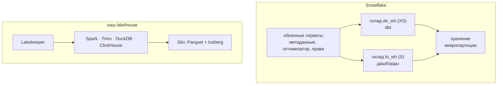

# 01 · Snowflake: облачное хранилище изнутри

> [!info] Урок одной фразой
> Наш lakehouse — свой дом: сами строим склад (Silo), каталог (Lakekeeper), нанимаем рабочих
> (Spark, Trino, DuckDB) и чиним всё сами. Snowflake — аренда в бизнес-центре: склад, охрана и
> уборка включены в счёт, ты только включаешь нужное число рабочих на нужное время и платишь
> поминутно. Удобно — пока не забыл выключить свет.

> [!todo] Чек-лист: после урока ты сможешь
> - [ ] объяснить три слоя Snowflake: хранение, вычисления (виртуальные склады), сервисы;
> - [ ] сопоставить слои Snowflake с сервисами нашего стека;
> - [ ] объяснить микропартиции и отсечение — и связать их с Parquet, Iceberg и MergeTree;
> - [ ] посчитать стоимость запроса и склада в кредитах и объяснить автоостановку;
> - [ ] назвать возможности, которых у нас нет «из коробки»: time travel, zero-copy clone, обмен данными.

> [!warning] Ловушка
> Проверь, что склад вычислений создан с `AUTO_SUSPEND` и самым маленьким размером, прежде чем
> что-то запускать. Команды этого модуля проверены по документации Snowflake, а не на стеке курса:
> для них нужен аккаунт (trial). Склад без автоостановки тратит кредиты, пока ты спишь.

**Нужно для:** лабы [13.1](../labs/13.1_load/README.md), [13.3](../labs/13.3_comparison/README.md).
**Карта урока:** [snowflake-architecture.canvas](../maps/snowflake-architecture.canvas).

---

## Шаг 0. Азбука

| Понятие | В аналогии «аренда в бизнес-центре» | Подробнее |
|---|---|---|
| Облачное хранилище (cloud DWH) | Арендованный офис со всеми службами | [Snowflake](../../../glossary/snowflake.md) |
| Виртуальный склад (warehouse) | Бригада рабочих, которую включаешь на время | [Snowflake](../../../glossary/snowflake.md) |
| Кредит | Единица оплаты бригады за время работы | [Snowflake](../../../glossary/snowflake.md) |
| Микропартиция | Коробка на складе со списком «что внутри» | [Snowflake](../../../glossary/snowflake.md) |
| Time travel, clone | Архив копий и мгновенная копия без перевозки | [Snowflake](../../../glossary/snowflake.md) |

---

## Шаг 1. Три слоя и что им соответствует у нас

**Проблема.** В модуле 01 мы выбрали lakehouse: хранение и вычисления раздельно, движков много.
Облачный DWH тоже разделяет хранение и вычисления. Чем он тогда отличается?

**Как устроено.** Snowflake — три слоя:

| Слой Snowflake | Что делает | У нас |
|---|---|---|
| Хранение | таблицы в собственном формате в облачном объектном хранилище | Parquet + Iceberg в Silo |
| Вычисления — виртуальные склады | кластеры, которые выполняют запросы; включаются и выключаются, размер XS…6XL | Spark, Trino, DuckDB, ClickHouse |
| Облачные сервисы | метаданные, оптимизатор, права, транзакции, кэш результатов | Lakekeeper, Postgres, правила Trino, OpenMetadata |

Главное отличие от lakehouse — **один владелец всех слоёв**. Нельзя прочитать таблицу Snowflake
напрямую Spark-ом, минуя Snowflake (кроме таблиц Iceberg, урок 03). Зато не нужно ничего
администрировать: обновления, бэкапы, масштабирование делает поставщик.



**Что из этого следует.** Несколько складов читают одни данные и не мешают друг другу: dbt на
своём складе, дашборды — на своём. У нас то же самое делают разные движки над Iceberg — но
движки ставим и сопровождаем мы.

---

## Шаг 2. Микропартиции и отсечение

**Проблема.** Snowflake не даёт задать индексы или `ORDER BY` таблицы, как ClickHouse. Как он
тогда читает мало данных?

**Как устроено.** При загрузке Snowflake режет таблицу на **микропартиции** — неизменяемые
колоночные блоки по 50–500 МБ несжатых данных. Для каждой он хранит в метаданных min/max и число
различных значений каждой колонки. Запрос с фильтром сначала смотрит метаданные и пропускает
микропартиции, где значения точно нет (**pruning**).

| Механизм | Snowflake | Наш аналог |
|---|---|---|
| блок данных | микропартиция | группа строк Parquet (модуль 03), гранула MergeTree (модуль 10) |
| статистика блока | min/max в метаданных сервиса | статистики Parquet и манифестов Iceberg; засечки MergeTree |
| порядок строк | порядок загрузки; `CLUSTER BY` — фоновая пересортировка (платная) | sort order Iceberg; `ORDER BY` MergeTree |
| как увидеть | Query Profile: Partitions scanned / total | `EXPLAIN ANALYZE`, `Processed … rows` |

**Что из этого следует.** Правило то же, что в модулях 03 и 10: отсечение работает, если данные
лежат в порядке главного фильтра. Загружай файлы по датам — и фильтр по дате отсечёт почти всё.

---

## Шаг 3. Деньги: кредиты и склады

**Проблема.** В локальном стеке запрос «бесплатный», он стоит только времени. В облаке каждая
секунда работы склада — деньги. Нужна модель стоимости, чтобы не получить счёт-сюрприз.

**Как устроено.**

| Что | Как считается |
|---|---|
| Вычисления | склад включён → тратит кредиты в час: XS — 1, S — 2, M — 4 (каждый размер вдвое больше); посекундно, минимум 60 с после включения |
| Хранение | за ТБ в месяц сжатых данных, включая копии time travel |
| Облачные сервисы | бесплатно до 10 % от вычислений за день |
| Перенос данных | за выгрузку в другой регион или облако |

`AUTO_SUSPEND = 60` выключает склад после минуты простоя, `AUTO_RESUME = TRUE` включает на первом
запросе. Кэш результатов (24 часа) отвечает на повторный одинаковый запрос без склада.

Пример: dbt-проект собирается на XS за 3 минуты раз в сутки → 3 мин + 1 мин до автоостановки ≈
4 мин/сут ≈ 2 кредита в месяц. Дашборд на складе S, который включают 50 раз в день по 2 минуты →
100 мин/сут × 2 кредита/ч ≈ 100 кредитов в месяц. Цена кредита зависит от редакции и облака.

**Что из этого следует.** Стоимость в облаке определяют не объём данных, а **время работы
складов** и их размер. Отсюда практики: маленькие склады, автоостановка, отдельный склад под
каждую нагрузку, кэш, мониторинг расходов.

---

## Шаг 4. Чего у нас нет «из коробки»

**Проблема.** Если Snowflake — просто «чужой lakehouse», зачем за него платить? Есть возможности,
которые у нас требуют работы.

**Как устроено.**

| Возможность | Snowflake | У нас |
|---|---|---|
| Time travel | `SELECT … AT(OFFSET => -3600)` — таблица час назад; 1 день в редакции Standard, до 90 — в Enterprise | снапшоты Iceberg (модуль 03) — есть, но хранение и очистку настраиваем сами |
| Zero-copy clone | `CREATE DATABASE dev CLONE prod` — копия без копирования данных | ветки Iceberg/Lakekeeper — частично; обычно копируем данные |
| Обмен данными | доступ к таблицам другой компании без выгрузки | нет |
| Масштабирование | размер склада меняется командой за секунды | добавить workers Spark, ресурсы контейнеров |
| Администрирование | обновления, бэкапы, отказоустойчивость — у поставщика | всё сами |

**Что из этого следует.** Облачный DWH покупают ради времени команды: меньше людей на
сопровождение, быстрее старт. Lakehouse выбирают ради открытого формата, независимости от
поставщика и цены на больших объёмах. Это компромисс, а не «лучше/хуже» (урок 03, лаба 13.3).

---

## Сборка целиком

Запрос дашборда «доля часов без товара в городе 0 за май» в Snowflake:

```mermaid
sequenceDiagram
    autonumber
    participant BI as дашборд
    participant SVC as облачные сервисы
    participant WH as склад bi_wh (S)
    participant ST as хранение
    BI->>SVC: SELECT … WHERE city_id = 0 AND dt BETWEEN май
    SVC->>SVC: кэш результатов? нет. Права? ок
    SVC->>SVC: метаданные: отсечь микропартиции по min/max dt и city_id
    SVC->>WH: план + список микропартиций (склад включается: AUTO_RESUME)
    WH->>ST: чтение нужных колонок нужных микропартиций
    WH-->>BI: результат; через 60 с простоя склад выключится
```

| Шаг | Если плохо | Симптом |
|---|---|---|
| 3 | данные не в порядке фильтра | Partitions scanned ≈ total, запрос дорогой |
| 4 | склад без автоостановки | кредиты тратятся ночью |
| 4 | слишком большой склад | быстро, но в 4–8 раз дороже без нужды |

## Шпаргалка

| Хочу | Как (Snowflake) |
|---|---|
| Склад с автоостановкой | `CREATE WAREHOUSE … WAREHOUSE_SIZE='XSMALL' AUTO_SUSPEND=60 AUTO_RESUME=TRUE` |
| Поменять размер | `ALTER WAREHOUSE de_wh SET WAREHOUSE_SIZE='SMALL'` |
| Сколько потрачено | `SNOWFLAKE.ACCOUNT_USAGE.WAREHOUSE_METERING_HISTORY` |
| Отсечение запроса | Query Profile → Partitions scanned / Partitions total |
| Таблица в прошлом | `SELECT … FROM t AT(OFFSET => -3600)` |
| Копия базы без копирования | `CREATE DATABASE dev CLONE prod` |

## Типичные ошибки

| Симптом | Причина | Как проверить | Как чинить |
|---|---|---|---|
| Кредиты кончились за выходные | склад без автоостановки или «пингующий» дашборд | история списаний | `AUTO_SUSPEND`, отдельный склад для BI |
| Запрос читает все микропартиции | фильтр не по порядку загрузки | Query Profile | загружать по датам; `CLUSTER BY` для крупных таблиц |
| Быстрый запрос стоит дорого | склад завышенного размера | время × размер | начинать с XS, увеличивать по замеру |
| Счёт за хранение выше ожидания | долгий time travel и fail-safe | `TABLE_STORAGE_METRICS` | короче `DATA_RETENTION_TIME_IN_DAYS` |

## Проверь себя

Карточки — в [flashcards.md](../flashcards.md).

> [!question] 1. Чем виртуальный склад Snowflake похож на наши движки и чем отличается?
> > [!success]- Ответ
> > Похож: вычисления отдельно от хранения, несколько складов читают одни данные. Отличается: склад
> > читает только формат Snowflake (кроме Iceberg), включается командой и оплачивается посекундно.

> [!question] 2. Почему стоимость Snowflake зависит больше от времени работы складов, чем от объёма данных?
> > [!success]- Ответ
> > Хранение дешёвое и платится за ТБ в месяц; вычисления — кредиты за каждую секунду работы
> > склада. Склад, который не выключается, стоит дороже любого хранения.

> [!question] 3. Какой наш механизм ближе всего к микропартициям?
> > [!success]- Ответ
> > Файлы и группы строк Parquet со статистиками min/max в Iceberg: отсечение по метаданным до
> > чтения данных. В ClickHouse похожую роль играют гранулы и засечки.
