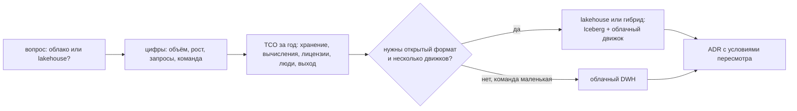

# 03 · Snowflake и Iceberg, стоимость владения: облако или свой lakehouse

> [!info] Урок одной фразой
> Между «всё своё» и «всё в облаке» есть середина. Данные лежат в открытом формате Iceberg, а
> считает их тот движок, который удобнее, — в том числе Snowflake. Выбор между вариантами — не
> спор вкусов, а расчёт: сколько стоят железо, лицензии и **люди**, и насколько больно будет
> уйти от поставщика.

> [!todo] Чек-лист: после урока ты сможешь
> - [ ] объяснить варианты Iceberg в Snowflake: таблица под управлением Snowflake и таблица во внешнем каталоге;
> - [ ] посчитать стоимость владения (TCO) двух вариантов: прямые расходы и время команды;
> - [ ] назвать, что такое привязка к поставщику и как открытый формат её уменьшает;
> - [ ] сформулировать решение «облако или lakehouse» в виде ADR с альтернативами.

> [!warning] Ловушка
> Не сравнивай варианты только по счёту за облако. Самая большая статья lakehouse — время
> инженеров на сопровождение, а облака — склады, которые никто не выключил. Команды Snowflake в
> уроке проверены по документации, не на стеке.

**Нужно для:** лаба [13.3](../labs/13.3_comparison/README.md).
**Карта урока:** [iceberg-and-tco.canvas](../maps/iceberg-and-tco.canvas).

---

## Шаг 0. Азбука

| Понятие | Аналогия | Подробнее |
|---|---|---|
| Привязка к поставщику (vendor lock-in) | Мебель, прикрученная к арендованным стенам | [Snowflake](../../../glossary/snowflake.md) |
| Стоимость владения (TCO) | Цена квартиры + коммуналка + ремонт + твоё время | [Snowflake](../../../glossary/snowflake.md) |
| Iceberg в Snowflake | Свои коробки на арендованном складе: можно увезти | [Iceberg](../../../glossary/iceberg.md) |
| ADR | Протокол решения: что выбрали и почему | [ADR](../../../glossary/adr.md) |

---

## Шаг 1. Iceberg в Snowflake

**Проблема.** Обычные таблицы Snowflake читает только Snowflake. Если завтра понадобится Spark или
сменится поставщик, данные придётся выгружать. Открытый формат решает это — но как совместить его
с облачным DWH?

**Как устроено.** Snowflake умеет работать с таблицами Iceberg двумя способами:

| Вариант | Кто ведёт каталог | Кто пишет | Кто читает |
|---|---|---|---|
| Iceberg-таблица под управлением Snowflake | Snowflake (может отдавать каталог по REST — Open Catalog / Polaris) | Snowflake | Snowflake и внешние движки через каталог |
| Iceberg-таблица во внешнем каталоге | внешний REST-каталог (как наш Lakekeeper) или Glue | внешние движки (Spark, dlt) | Snowflake и все остальные |

В обоих случаях данные лежат Parquet-файлами в **вашем** бакете (`EXTERNAL VOLUME`), а не во
внутреннем хранилище Snowflake. Склады Snowflake читают их так же, как Spark и Trino у нас.

**Что из этого следует.** Архитектура «lakehouse + облачный движок» возможна: Lakekeeper и Silo
остаются, Snowflake становится ещё одним движком рядом с Trino и Spark. Цена — внешний доступ к
вашему хранилищу и расходы на перенос данных между облаками.

---

## Шаг 2. Стоимость владения

**Проблема.** «Snowflake дорогой» и «свой стек бесплатный» — оба утверждения неверны. Нужна
таблица, где посчитаны все статьи.

**Как устроено.** TCO — все расходы за период (обычно год):

| Статья | Свой lakehouse (как наш стек в облаке) | Snowflake |
|---|---|---|
| Хранение | объектное хранилище: за ТБ в месяц | за ТБ в месяц + time travel и fail-safe |
| Вычисления | виртуальные машины Spark/Trino/ClickHouse — работают постоянно или по расписанию | кредиты складов посекундно |
| Лицензии | нет (open source) или поддержка вендора | включены в кредиты |
| Сопровождение | обновления, мониторинг, отказоустойчивость, безопасность — люди | у поставщика |
| Время до результата | недели на сборку стека | дни |
| Выход | бесплатно: формат открытый | выгрузка данных, переписывание SQL под другой диалект |

Пример расчёта по нашему датасету (числа — порядок, не прайс). Данных ~0,15 ГБ сжатых, поэтому
хранение копеечное в обоих вариантах. dbt раз в сутки на XS — единицы кредитов в месяц; дашборд на S —
десятки. Свой стек в облаке — 2–3 постоянные виртуальные машины. Главная статья lakehouse —
**часы инженера** на обновления и инциденты, она легко превышает все остальные.

**Что из этого следует.** На маленьких объёмах и в маленькой команде облачный DWH почти всегда
дешевле в TCO: людей нет, а данных мало. На больших объёмах, при нескольких движках и требовании
независимости от поставщика выигрывает lakehouse. Ответ зависит от ваших чисел — поэтому их
считают, а не угадывают.

---

## Шаг 3. Решение как ADR

**Проблема.** Через полгода спросят: «Почему мы не на Snowflake?» Если ответа нет в документах, спор
начнётся заново (модуль 01, урок 06).

**Как устроено.** Решение записывают ADR — тем же шаблоном, что в модуле 01:

| Раздел | Что писать для «облако или lakehouse» |
|---|---|
| Контекст | объём данных, рост, команда, требования (движки, свежесть, безопасность) |
| Варианты | lakehouse; облачный DWH; гибрид: Iceberg + облачный движок |
| Плюсы и минусы | TCO из шага 2, время до результата, привязка, навыки команды |
| Решение | выбор и **условия пересмотра**: «вернёмся к вопросу, если данных станет больше 10 ТБ» |

**Что из этого следует.** Хорошее решение содержит условия, при которых оно перестаёт быть верным.
Тогда пересмотр — запланированный шаг, а не кризис.

---

## Сборка целиком

## Шпаргалка

| Хочу | Как |
|---|---|
| Таблица Iceberg в Snowflake | `CREATE ICEBERG TABLE … EXTERNAL_VOLUME = … CATALOG = 'SNOWFLAKE'` |
| Таблица из внешнего каталога | `CATALOG INTEGRATION` (REST) + `CREATE ICEBERG TABLE … CATALOG = '<интеграция>'` |
| Сравнить стоимость | таблица TCO: хранение, вычисления, лицензии, люди, выход |
| Записать решение | ADR: контекст, варианты, решение, условия пересмотра |

## Типичные ошибки

| Симптом | Причина | Как проверить | Как чинить |
|---|---|---|---|
| «Свой стек дешевле», а команда тонет в инцидентах | время людей не посчитано | часы на сопровождение за месяц | добавить строку «люди» в TCO |
| Счёт облака вырос в разы | склады без контроля | история списаний | автоостановка, бюджеты и оповещения |
| Уход от поставщика — месяцы работы | данные и SQL только в его формате | где лежат данные | Iceberg, переносимый dbt-проект |
| Решение пересматривают каждый квартал | нет ADR с условиями | `capstone/architecture.md` | ADR с условиями пересмотра |

## Проверь себя

Карточки — в [flashcards.md](../flashcards.md).

> [!question] 1. Чем Iceberg-таблица во внешнем каталоге отличается от обычной таблицы Snowflake для ухода от поставщика?
> > [!success]- Ответ
> > Данные лежат Parquet-файлами в вашем бакете, каталог — ваш. Уход — это отключить Snowflake:
> > Spark и Trino продолжат читать те же таблицы. Обычную таблицу пришлось бы выгружать.

> [!question] 2. Почему на нашем объёме облачный DWH, скорее всего, дешевле по TCO?
> > [!success]- Ответ
> > Данных ~0,15 ГБ, вычислений — минуты в день. Счёт за кредиты мал, а свой стек требует часов
> > инженера на сопровождение — это самая дорогая статья.

> [!question] 3. Что делает ADR «живым», а не архивным документом?
> > [!success]- Ответ
> > Условия пересмотра: числа или события, при которых решение надо принять заново.
