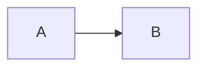

# NN · <Тема: что узнаешь, человеческими словами>

> [!info] Урок одной фразой
> Суть темы в 2–3 предложениях, через аналогию урока.

> [!todo] После урока ты сможешь
> - навык, проверяемый действием (предсказать, настроить, починить…)

Файл: `modules/NN_<модуль>/theory/MM_<тема>.md`.

**Нужно для:** лаба [NN.M](../labs/NN.M_<название>/README.md), задачи … **Карта урока:** [<тема>.canvas](../maps/<тема>.canvas)

---

## Шаг 0. Азбука

Сквозная аналогия — таблица «в технологии → в аналогии → ссылка на термин в glossary/».
Базовые понятия, без которых урок не читается, — здесь или отдельными заметками в [`glossary/`](../../../glossary/README.md) (общий на весь курс).
Ссылка из урока: `[термин](../../../glossary/<term>.md)`.

---

## Шаг 1. <Вопрос, на который отвечает шаг?>

**Проблема.** Зачем это вообще существует: что сломается или станет неудобно без этого.

**Как устроено.** Механизм по шагам связным текстом, с причинными связями
(«потому что», «поэтому», «иначе»). Не тезисы.



**Что из этого следует.** Практические следствия, которые пригодятся в задачах.

**У нас.** Фрагмент конфига / кода из стека с разметкой ①②③ и таблицей пояснений.

> [!example]- Попробуй сам: <что увидим>
> ```bash
> команда, проверенная на живом стеке
> ```
> **Увидишь:** … **Почему:** …

> [!warning] Ловушка
> Типичная ошибка и её механизм.

---

## Сборка целиком

Сквозной пример: один запрос / одна операция от начала до конца (sequenceDiagram с `autonumber`),
и какой симптом дал бы сбой на каждом шаге.

## Шпаргалка

| Хочу | Как |
|---|---|

## Типичные ошибки

| Симптом | Причина | Как проверить | Как чинить |
|---|---|---|---|

## Проверь себя

Карточки — в [flashcards.md](../flashcards.md).

> [!question] 1. Вопрос на применение, а не на пересказ?
> > [!success]- Ответ
> > Ответ с объяснением «почему».
